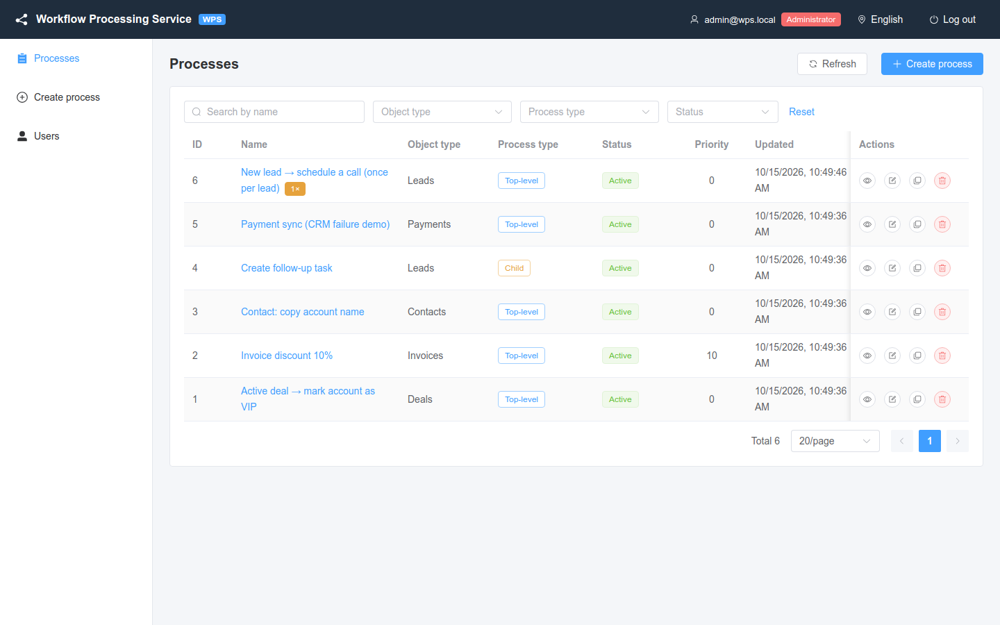

# WPS Documentation / Документация WPS

Workflow Processing Service (WPS) is a business-process automation service for a CRM: it listens to CRM "record saved"
events, checks process conditions and runs a chain of actions (load related records, change fields, save to the CRM,
start child processes) with a full audit of every step.

WPS — сервис автоматизации бизнес-процессов для CRM: он получает события сохранения записей CRM, проверяет условия
процессов и выполняет цепочку действий (загрузка связанных записей, изменение полей, сохранение в CRM, запуск ведомых
процессов) с полным аудитом каждого шага.

| | |
|---|---|
| 🇬🇧 **[English documentation](en/README.md)** | [Quick start](en/02-getting-started/quick-start.md) · [User guide](en/03-user-guide/processes.md) · [Architecture](en/05-architecture/overview.md) · [Developer guide](en/07-developer-guide/dev-environment.md) |
| 🇷🇺 **[Документация на русском](ru/README.md)** | [Быстрый старт](ru/02-getting-started/quick-start.md) · [Руководство пользователя](ru/03-user-guide/processes.md) · [Архитектура](ru/05-architecture/overview.md) · [Руководство разработчика](ru/07-developer-guide/dev-environment.md) |

