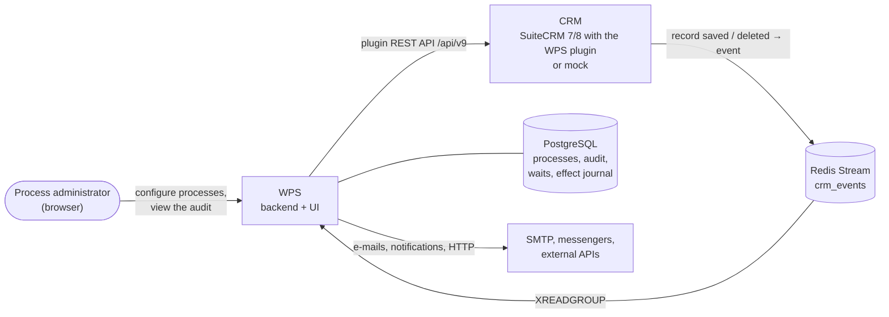

# Overview

What Workflow Processing Service (WPS) is, what problems it solves and where to start reading.

<!-- lang-switch -->
🇬🇧 English | [🇷🇺 Русский](../../ru/01-overview/index.md)
<!-- /lang-switch -->

## What is WPS

**Workflow Processing Service (WPS)** is an open-source business-process automation service on top of a CRM
(SuiteCRM 7, SuiteCRM 8 or the bundled mock CRM). Feature-wise it targets SuiteCRM AOW Workflow and Bitrix24 business
processes, but it runs separately from the CRM: it does not load the CRM web server, survives CRM restarts and keeps a
detailed audit of every step.

When the CRM saves or deletes a record, for example a deal or a lead, the WPS plugin in the CRM publishes an **event**
to the Redis Stream `crm_events` (contract 2.0: the event type `create` / `update` / `delete`, old values of the changed
fields, the list of changed fields, the user). WPS reads the event and:

1. Picks the active **top-level processes** configured for this object type (CRM module) and this event type
   (`trigger_on`), ordered by `priority`.
2. Checks the **conditions** of each process: comparisons with type casting, emptiness, lists, ranges, relative dates,
   field changes, expressions on the right-hand side, AND / OR groups.
3. Runs the **preload**: loads related objects from the CRM into variables (`v1`, `account`, …) — lazily, only when
   the conditions on `object.*` already hold.
4. Runs the **actions** of the process — from simple ones (change a field, save to the CRM) to blocks with branches,
   loops, pauses, e-mails, HTTP requests and notifications.
5. Writes every **execution** and every **step** to the audit: request, result, errors, retries, context. The audit is
   available in the web UI and through the API.

Processes are configured without programming: simple ones in the visual editor, complex ones as a JSON definition
through the API. Adding or changing a process needs no deployment.

## What problems it solves

| Problem | How WPS solves it |
|---|---|
| Business rules are hard-coded in CRM logic hooks and every change needs a developer | Rules are data: a process is stored as a JSON `definition`, edited in the UI or through the API and versioned (`version` + 1 on every save) |
| "When X is saved, update the related Y" needs custom code | Preload fetches the related record, `modify` changes it, `save_object` / `save_to_crm` writes it back |
| All tasks of a deal must be processed, not just one | `find_records` finds a list of records, `foreach` iterates over it, `update_records` changes all records in one step, `aggregate` computes a sum or a count |
| A person or an external system must be notified | `send_email` (SMTP), `notify` (CRM bell, Telegram, Slack, Teams), `http_request` (any REST API or webhook) |
| "3 days after…", "30 days before…" | The `delay` pause: the execution "sleeps" in PostgreSQL and wakes up on time without holding a worker |
| Nobody knows why a field changed | Every execution keeps the source event, the condition trace, the request and result of every step and the final context |
| The CRM or an external service is temporarily down | Recoverable errors (timeouts, HTTP 5xx, 429) are retried by the `retry` profile; `on_error` decides whether to stop, continue or jump to another step |
| A letter or a request must not be sent twice | The side-effect journal: a step repeated after a crash does not send the letter or the request again |
| A record must not be processed twice | Event idempotency and the **run once per record** flag (`run_once`) |
| Passwords and tokens of external systems must not live in processes | Secrets: the value is encrypted in WPS, a process refers to it as `secret://name` |
| A long chain of dependent processes | `start_process` launches child processes; they receive the event and all variables |

## Key features

### Triggering and conditions

- **Event type** (`trigger_on`): a process reacts to record creation, update and/or deletion.
- **Comparison operators** (25): equality, ordering (`greater_than` …), ranges (`between`, `not_between`), lists
  (`in`, `not_in`), substrings (`contains`, `starts_with`, `ends_with`), multienums (`contains_any`, `contains_all`,
  `contains_none`), emptiness and presence of data (`is_empty`, `is_null` …), field changes (`changed`, `changed_to`,
  `changed_from`, `not_changed`).
- **Type casting** (`cast`: `string`, `int`, `decimal`, `bool`, `date`, `datetime`, `list`) with options (case,
  spaces, date format, list separator) and the strict `on_cast_error` mode.
- **Right-hand side**: a value, another field or an **expression** (`v1.credit_limit * 0.8`, `config.min_amount`);
  **relative dates** (`today+30d`, `now-24h`, `start_of_quarter`).
- **AND / OR groups** of any depth; **values before the change** (`object_before`).

### Actions

| Group | Actions |
|---|---|
| CRM data | `preload` (load a record), `modify` (change a field), `save_object` (save), `find_records` (find a list of records), `update_records` (change all records of a list), `link_records` / `unlink_records` |
| Variables | `set_variable` (write a process variable, accumulators) |
| Logic | `condition` (if / else, several branches), `foreach` (loop over a list), `stop_process` (finish early), `delay` (pause until a time or a date) |
| People and external systems | `send_email`, `notify`, `http_request`, `assign` (assign an owner: round robin, least busy, manager…) |
| Processes | `start_process` (start a child process) |

**Change types** of a field: a value, another variable, a **calculation** by an expression, a **template** with
substitutions, a **date shift**, increment / decrement, clear, append to and remove from a list, a **map** (lookup
table), an **aggregate** over CRM records (`count`, `sum`, `avg`, `min`, `max`).

### Expressions and templates

- Exact decimal arithmetic, comparisons, logic, conditional functions (`if`, `ifs`, `switch`, `coalesce`).
- Functions for strings (`replace`, `split`, `pad_left`, `translit`, `slug`, regular expressions `regex_match` /
  `regex_extract` / `regex_replace`), numbers (`round`, `percent`, `to_number`, `number_format`), dates (`add_days`,
  `date_diff`, `format_date`, time zones), **lists** (`to_list`, `unique`, `sort`, `pluck`, `where`, `sum`), type checks
  (`is_number`, `is_date`, `to_bool`) and **JSON** (`json_get` with JSONPath, `json_decode`, `json_encode`).
- **System variables** `sys.*` (execution id, process and version, trigger, event type, changed fields, user, current
  time, last error) and **process constants** `config.*`.

### Execution, reliability, audit

- Step errors: `on_error` (`stop`, `continue`, `goto`) and the `retry` profile on every step.
- Waiting executions (`waiting`) are stored in PostgreSQL and survive restarts; deleting a process with waiting
  executions cancels them (`cancelled`).
- The side-effect journal and the `delivery` policy (`at_most_once` / `at_least_once`) for e-mails, requests and
  notifications.
- At-least-once stream processing, idempotency, recovery of interrupted executions, the dead-letter stream
  `crm_events:dlq`.
- **Audit**: the execution log of a process, the execution page with steps, `request_data` / `result_data`, the
  condition trace and the live context.
- **Manual run** with a test object, optionally without the condition check (`force`).

### Administration

- Roles `admin`, `editor`, `viewer` (JWT); user management in the UI.
- Secrets of external systems (`/api/secrets`), mail check (`/api/mail/test`) and notification channel check
  (`/api/notify/test`).
- Observability: `/api/health` and Prometheus metrics at `/metrics`.
- Bilingual UI: Russian and English, switched without reloading the page.
- Extensibility: new actions, blocks, operators, change types, expression functions and notification channels are added
  as PHP classes and registered in one place.

## What is configured in the editor and what through the API

The visual process editor covers the "table" part of the definition. Everything else is set by the JSON definition
through the API (`POST` / `PUT /api/processes`) — the UI shows those parts and tries not to touch them on save, but they
cannot be edited in the form.

| Part of a process | In the editor | API only |
|---|---|---|
| Name, object type, process type, priority, run once | ✓ | |
| Event type `trigger_on` | | ✓ (not shown on the card) |
| Constants `definition.constants` | | ✓ (not shown on the card) |
| Conditions: AND rows with one value — **Equals**, **Not equals**, **Contains**, **Does not contain**, `starts_with`, `ends_with`, `changed_to`, `changed_from` — and without a value — `is_empty`, `is_not_empty`, `is_null`, `is_not_null`, `changed`, `not_changed` | ✓ | |
| Conditions with `cast` (`greater_than`, `less_than` …), lists, ranges, with an expression, OR groups | | ✓ |
| Preload (block 2) | ✓ | `strategy`, preload inside actions |
| **Change** rows (`modify`) with one value: **Set to value**, **Set from variable**, **Calculate**, `template`, `increment` / `decrement`, `clear` | ✓ | `date_shift`, lists (`append` / `remove` with options), `map`, `aggregate`; the `id`, `on_error`, `retry` fields |
| **Save to CRM** (`save_object`), **Start next process** (`start_process`) | ✓ | `mode: full`, `on_error`, `retry` |
| `send_email`, `http_request`, `notify`, `assign`, `set_variable`, `find_records`, `update_records`, `link_records`, `unlink_records`, `foreach`, `condition`, `stop_process`, `delay` | shown as a grey read-only row | ✓ |

In the English UI only the basic operators and change types are translated; the others come from the server with
Russian labels (for example `starts_with` is shown as **Начинается с**, `template` as **Шаблон**).

> **Note**
> A process built through the API can be opened in the editor and saved: the form edits the definition on top of the
> original JSON. The `config.*` constants, extra row fields (`cast`, `on_cast_error`, `id`, `on_error`, `retry`, `mode`,
> `strategy` …) and the action order are kept. Rows the form cannot show — conditions with lists, ranges, expressions
> or nested groups, the **Date shift**, list, **Map** and **Aggregate** change types, starting several processes in one
> step, and all actions from the last row of the table — are shown read-only and saved unchanged. Details —
> [FAQ](../08-faq.md#can-i-open-a-process-created-through-the-api-in-the-editor).

## How it fits together

The CRM publishes events. WPS reads them and reads and writes CRM records through the plugin REST API (search with
filters, relationships, counts). PostgreSQL stores processes, the audit, waiting executions and the side-effect journal.
A second Redis instance (not shown) holds caches, the state of running executions, locks and assignment queues. The
full picture is in the [Architecture overview](../05-architecture/overview.md).

## Technology stack

| Part | Technologies |
|---|---|
| Backend (`back/`) | PHP 8.3, Swoole 6 (coroutines), the SwooleApp framework (`sidalex/swoole-app`), symfony/mailer |
| Frontend (`front/`) | Vue 3, TypeScript, Vite 5, Element Plus, Pinia, Vue Router, Axios, vue-i18n |
| Storage | PostgreSQL 15, Redis 7 (two instances: event bus and data) |
| CRM | SuiteCRM 7 / 8 with the WPS plugin (`.tehnical/`) or the mock (`mock/`) |
| Mail for development | Mailpit (catches letters sent by processes, `http://localhost:8025`) |
| Delivery | Docker Compose |

## Where to go next

| Task | Section |
|---|---|
| Run WPS locally in 10 minutes | [Quick start](../02-getting-started/quick-start.md) |
| Build your first process | [Your first process](../02-getting-started/first-process.md) |
| Learn the UI and all settings | [User guide](../03-user-guide/login-and-ui.md) |
| Take a ready-made scenario | [Recipes](../03-user-guide/recipes.md) |
| Find out why a process did not work | [Executions and audit](../03-user-guide/executions-and-audit.md), [FAQ](../08-faq.md) |
| Deploy and configure | [Deployment](../04-operations/deployment.md), [Configuration](../04-operations/configuration.md) |
| Understand the internals | [Architecture overview](../05-architecture/overview.md) |
| Work through the API | [API reference](../06-api-reference/index.md) |
| Add a new action or operator | [Developer guide](../07-developer-guide/dev-environment.md) |
| Look up a term | [Glossary](glossary.md) |

<!-- footer-nav -->
---

[Contents](../README.md) | [Glossary](glossary.md) Next →
<!-- /footer-nav -->
