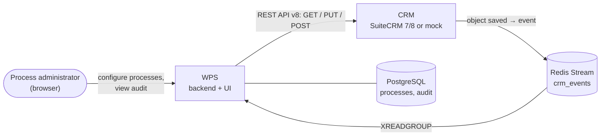

# Overview

What Workflow Processing Service (WPS) is, what problems it solves and where to start reading.

<!-- lang-switch -->
🇬🇧 English | [🇷🇺 Русский](../../ru/01-overview/index.md)
<!-- /lang-switch -->

## What is WPS

**Workflow Processing Service (WPS)** is an open-source service that automates business processes on top of a CRM
(SuiteCRM 7, SuiteCRM 8 or the bundled mock CRM).

Every time the CRM saves an object, for example a deal or a lead, it publishes an event into the Redis Stream
`crm_events`. WPS reads the event and does the following:

1. Picks the active **top-level processes** configured for that object type (CRM module), ordered by `priority`.
2. Checks each process's **conditions**. All rows are combined with AND.
3. Runs **preload**: loads related objects from the CRM into variables (`v1`, `v2`, …).
4. Runs the process **actions** strictly in order: change fields, save objects to the CRM, start **child processes**
   asynchronously.
5. Writes every **execution** and every **step** to the audit, which you can browse in the web UI.

Processes are configured in a web interface without writing code. No deployment is needed to add or change a process.

## What problems it solves

| Problem | How WPS handles it |
|---|---|
| Business rules are hard-coded in CRM logic hooks and need a developer for every change | Rules are data: a process is a JSON `definition` edited in the UI and versioned (`version` + 1 on every save) |
| "When X is saved, update the related Y" requires custom code | Preload loads the related record, `modify` changes it, `save_object` / `save_to_crm` writes it back |
| Nobody knows why a field changed | Every execution stores the source event, the condition trace, each step's request/result and the final context |
| The CRM is temporarily unavailable | Recoverable errors (timeouts, HTTP 5xx) are retried with exponential backoff; interrupted executions are resumed |
| The same record must not be processed twice | Event idempotency plus the optional **run once per record** flag (`run_once`) |
| A long chain of dependent processes | `start_process` launches child processes that receive the event and all variables |

## Key features

- **Visual process editor**: trigger conditions, preload, modifications, saving to the CRM, starting the next process.
  A variables sidebar shows which variables exist at every step.
- **Conditions**: operators `equals`, `not_equals`, `contains`, `not_contains`. You can compare with a static value or with
  another field. Conditions can use preloaded variables (lazy preload).
- **Change types**: `set_value`, `set_from_variable`, `calculate`. `calculate` takes expressions with `+ - * / %` and the
  functions `concat`, `upper`, `lower`, `trim`, `len`, `substr`, `round`, `abs`, `min`, `max`.
- **Child processes** started asynchronously, with cycle detection when a process is saved.
- **Manual run** with a test object, with an option to skip the conditions (`force`).
- **Audit**: execution log per process, step-by-step details, live context while an execution is running.
- **Reliability**: at-least-once stream processing, retries, recovery of interrupted executions, dead-letter stream
  `crm_events:dlq`.
- **Roles**: `admin`, `editor`, `viewer` (JWT authentication).
- **Observability**: `/api/health` and Prometheus metrics at `/metrics`.
- **Extensibility**: new action types, comparison operators, change types, load strategies and expression functions are
  added as PHP classes registered in one place.
- **Bilingual UI**: English and Russian, switchable without reloading the page.

## How it fits together

The CRM publishes events. WPS consumes them and calls the CRM REST API back to read and write records. PostgreSQL stores
the process configuration and the audit. A second Redis instance (not shown) holds caches and the state of running
executions. The full picture is in [Architecture overview](../05-architecture/overview.md).

## Technology stack

| Part | Technologies |
|---|---|
| Backend (`back/`) | PHP 8.3, Swoole 6 (coroutines), SwooleApp framework (`sidalex/swoole-app`) |
| Frontend (`front/`) | Vue 3, TypeScript, Vite 5, Element Plus, Pinia, Vue Router, Axios, vue-i18n |
| Storage | PostgreSQL 15, Redis 7 (two instances: event bus and data) |
| CRM | SuiteCRM 7 / 8 with the WPS plugin (`.tehnical/`), or the mock (`mock/`) |
| Delivery | Docker Compose |

## Where to go next

| You want to… | Read |
|---|---|
| Start WPS locally in 10 minutes | [Quick start](../02-getting-started/quick-start.md) |
| Build your first process | [Your first process](../02-getting-started/first-process.md) |
| Learn the UI and every setting | [User guide](../03-user-guide/login-and-ui.md) |
| Copy a ready-made scenario | [Recipes](../03-user-guide/recipes.md) |
| Deploy and configure | [Deployment](../04-operations/deployment.md), [Configuration](../04-operations/configuration.md) |
| Understand the internals | [Architecture overview](../05-architecture/overview.md) |
| Call the API | [API reference](../06-api-reference/index.md) |
| Add a new action or operator | [Developer guide](../07-developer-guide/dev-environment.md) |
| Look up a term | [Glossary](glossary.md) |

<!-- footer-nav -->
---

[Contents](../README.md) | [Glossary](glossary.md) Next →
<!-- /footer-nav -->
