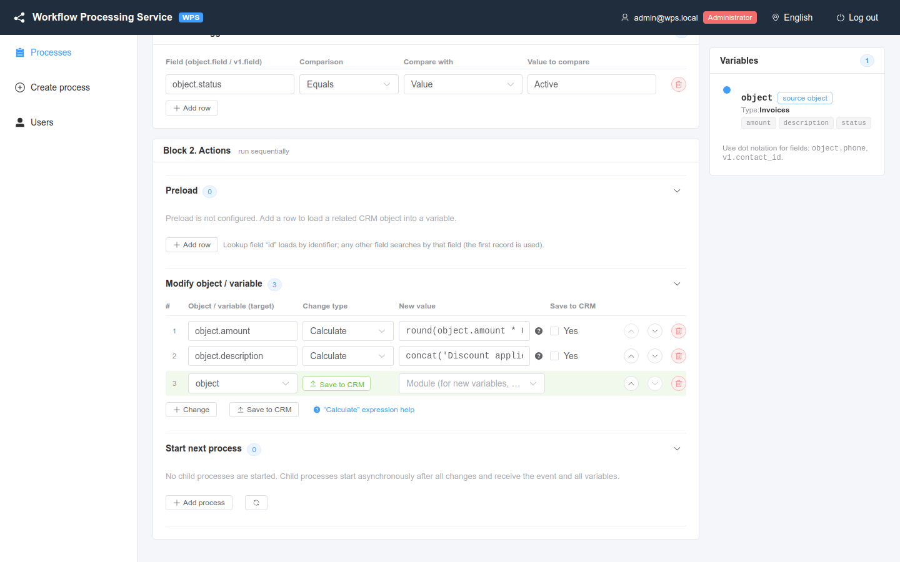

# Change types and expressions

How a **Modify object / variable** row computes the new value: a fixed value, a copy of another field, or a calculated expression.

<!-- lang-switch -->
🇬🇧 English | [🇷🇺 Русский](../../ru/03-user-guide/change-types-and-expressions.md)
<!-- /lang-switch -->



*Process **Invoice discount 10%**: two rows with the **Calculate** change type.*

The **Change type** column of a modify row has three options:

| UI (EN) | UI (RU) | Code | **New value** contains |
|---|---|---|---|
| **Set to value** | Равен значению | `set_value` | the value itself |
| **Set from variable** | Равен переменной | `set_from_variable` | a path to another field |
| **Calculate** | Расчёт | `calculate` | an expression |

## Set to value

Writes the text from **New value** into the target field as is.

- Allowed values: any text or number; an empty value writes an empty string.
- Example: target `v1.rating`, value `VIP`.
- Server error: `Value must be a string or a number` (possible only via the API, e.g. an array as value).

## Set from variable

Copies the value of another field — of the event object or of any variable.

- **New value** is a path: `object.phone`, `v1.name`, `v2.sale`.
- If the source field does not exist (or the variable is empty), the target gets an empty value (`null`).
- Example: target `object.description`, value `v1.name` — the contact gets the name of its account (recipe **Contact: copy account name**).
- Errors: `Action 1: specify a value`; server: `Field path is required`, `Variable "v3" is not defined at this point`, `"v1" must point to a field, e.g. v1.name`.

## Calculate

Computes the value from an expression. Click **“Calculate” expression help** (or the `?` icon in the row) for a short reminder in the editor.

```text
round(object.amount * 0.9, 2)
concat('Discount applied, new amount: ', object.amount)
upper(trim(object.name))
```

### Syntax

| Element | Syntax | Examples |
|---|---|---|
| Number | digits with an optional decimal point | `10`, `0.9`, `.5` |
| String | in single or double quotes; `\` escapes the next character | `'abc'`, `"Call back: "`, `'it\'s'` |
| Field path | `object.<field>` or `<variable>.<field>`; nested fields with more dots | `object.amount`, `v1.price`, `v1.address.city` |
| Arithmetic | `+` `-` `*` `/` `%` | `object.amount * 0.9 + 10` |
| Unary minus | `-` before a value | `-object.amount` |
| Parentheses | `(` … `)` | `(object.price - object.discount) * object.qty` |
| Function call | `name(arg, …)`, names are case-insensitive | `round(object.amount, 2)` |

Precedence: `*` `/` `%` before `+` `-`; operators of the same level are evaluated left to right. A word without a dot that is not followed by `(` is an error — write `object.amount`, not `amount`.

### Values and types

- **A missing field gives an empty string** (it never stops the calculation).
- `+` **adds** when both operands are numbers (numbers or text that looks like a number, e.g. `"10"`), and **concatenates** otherwise: `'10' + 5` → `15`, `object.name + 5` → `Deal5`.
- `-` `*` `/` `%` require numbers. An empty value counts as `0`. Text that is not a number fails the step: `Operator "*" requires numbers, got "abc"`.
- Division or modulo by zero fails the step: `Division by zero in expression`, `Modulo by zero in expression`.
- The result is cleaned up: floating-point noise is rounded to 10 decimals (`0.1 + 0.2` → `0.3`), and a whole number is stored as an integer (`9.0` → `9`).
- To join numbers as text, use `concat`: `concat(object.code, object.number)`.

### Functions

| Function | Result | Example | Result of the example |
|---|---|---|---|
| `concat(a, b, …)` | all arguments joined as text | `concat('Call back: ', object.name)` | `Call back: Ivan Petrov` |
| `upper(s)` | upper case | `upper('hello')` | `HELLO` |
| `lower(s)` | lower case | `lower('ABC')` | `abc` |
| `trim(s)` | text without leading/trailing spaces | `trim('  x  ')` | `x` |
| `len(s)` | length in characters | `len('Привет')` | `6` |
| `substr(s, start[, length])` | part of the text; `start` counts from 0, negative counts from the end | `substr('hello world', 0, 5)` | `hello` |
| `round(x[, precision])` | rounded number, `precision` decimals (default 0) | `round(10.456, 2)` | `10.46` |
| `abs(x)` | absolute value | `abs(-5)` | `5` |
| `min(a, b, …)` | smallest number | `min(object.amount, 1000)` | e.g. `500` |
| `max(a, b, …)` | largest number | `max(object.amount, 0)` | e.g. `500` |

Text functions work with any language (Cyrillic included). `round`, `abs`, `min`, `max` need numbers (`Operator "round()" requires numbers, got "…"`). Calling a function with too few arguments fails the step: `Wrong number of arguments for function substr()`.

New functions can be added by a developer: [Expression functions](../07-developer-guide/extending/expression-functions.md).

### Examples

All of these were checked on a running WPS with the event object `{ "id": "1", "name": "Deal", "amount": "500" }`:

| Expression | Result |
|---|---|
| `object.amount * 0.9` | `450` |
| `round(object.amount * 0.9, 2)` | `450` |
| `'10' + 5` | `15` |
| `object.name + 5` | `Deal5` |
| `object.missing * 2 + 1` | `1` |
| `10 / 4` | `2.5` |
| `0.1 + 0.2` | `0.3` |
| `7 % 3` | `1` |
| `substr(upper('hello world'), 0, 5)` | `HELLO` |
| `concat('Discount applied, new amount: ', object.amount)` | `Discount applied, new amount: 500` |

### Errors

Checked when the process is saved (the step never runs with a broken expression):

| Message | Cause |
|---|---|
| `Action 1: specify a value` / `Expression is required` | Empty expression |
| `Unknown function "foo"` | Function does not exist |
| `Unknown identifier "amount" (use object.<field> or <variable>.<field>) at position 0 in "amount * 2"` | A field without `object.` / variable prefix |
| `Unexpected ")" at position 8 in "round(1))"`, `Expected ")" at position …` | Unbalanced parentheses or a stray operator |
| `Unterminated string starting at position …` | A missing closing quote |
| `Unexpected character "#" at position …` | A character that is not part of the syntax |
| `Variable "v3" is not defined at this point` | The expression uses a variable that is not declared before this row |

Checked during the execution (the step fails, the execution ends as **Failed**): operations on non-numeric text, division by zero, too few function arguments, a result that is not a finite number (`Expression result is not a finite number`).

## See also

- [Actions](actions.md) — targets, **Save to CRM**, new variables.
- [Recipes](recipes.md) — complete processes with calculations.

<!-- footer-nav -->
---

← Previous: [Actions](actions.md) | [Contents](../README.md) | [Child processes](subprocesses.md) Next →
<!-- /footer-nav -->
