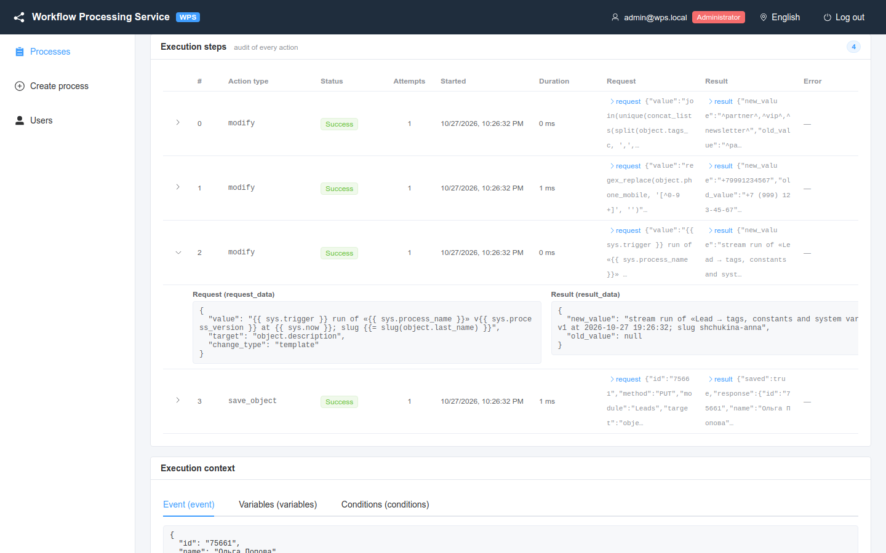

# Change types and expressions

How a **Modify object / variable** row computes the new value: a fixed value, a copy of another field, a calculated expression, text from a template, a shifted date, a counter, a clear, an append, a lookup table or an aggregate over CRM records.

<!-- lang-switch -->
🇬🇧 English | [🇷🇺 Русский](../../ru/03-user-guide/change-types-and-expressions.md)
<!-- /lang-switch -->


*Process **Invoice discount 10%**: two rows with the **Calculate** change type.*

Change types (the **Change type** column of a row; `aggregate` and types with extra fields — `separator`, `map`, `list`
and so on — are set through the API: the editor keeps only `target`, `change_type`, `value` and `save_to_crm` of a row):

| UI (EN) | UI (RU) | Code | **New value** contains |
|---|---|---|---|
| **Set to value** | Равен значению | `set_value` | the value itself |
| **Set from variable** | Равен переменной | `set_from_variable` | a path to another field |
| **Calculate** | Расчёт | `calculate` | an expression |
| **Template** | Шаблон | `template` | text with `{{ … }}` substitutions, see [Template](#template) |
| **Date shift** | Сдвиг даты | `date_shift` | base, shift and time in separate fields, see [Date shift](#date-shift) |
| **Increment by** / **Decrement by** | Увеличить на / Уменьшить на | `increment` / `decrement` | the step (1 by default), see [Increment / decrement by](#increment--decrement-by) |
| **Clear** | Очистить | `clear` | not needed, see [Clear](#clear) |
| **Append** / **Prepend** / **Remove from list** | Дописать в конец / в начало / Удалить из списка | `append` / `prepend` / `remove` | a text template or list elements, see [Append](#append-prepend-remove-from-a-list) |
| **Map** | По таблице соответствия | `map` | the source field and the table, see [Map](#map) |
| **Aggregate over records** | Агрегат по записям | `aggregate` | function, field and record source, see [Aggregate over records](#aggregate-over-records) |

The same change types work in the [Set a process variable](actions.md#set-a-process-variable) action (`set_variable`) —
for intermediate values that are not saved to the CRM — and in the rules of
[Update list records](actions.md#update-list-records) (`update_records`). An unknown code is rejected on save:
`Change type must be one of: set_value, set_from_variable, calculate, template, date_shift, increment, decrement, clear, append, prepend, remove, map, aggregate`
(the list is returned by [`GET /api/dictionaries/change-types`](../06-api-reference/endpoints.md)).

Where the expression language is used:

| Place | How it is written | Result |
|---|---|---|
| **Calculate** (`calculate`) in `modify`, `set_variable`, `update_records` | the whole `value` (or `expression`) is an expression | a value of any type: number, text, boolean, list |
| Right side of a condition (`value_type: expression`) | `value` (or a pair for `between`) | cast with the row's `cast` before comparison |
| Template tag `{{= … }}` | an expression inside the tag | converted to text |
| Template filters `{{ x \| f:a }}` | a function call `f(x, a)` | converted to text |

## Set to value

Writes the text from **New value** into the target field as is.

- Allowed values: any text or number (via the API also `true` / `false` and `null`); an empty value writes an empty string.
- Example: target `v1.rating`, value `VIP`.
- Server error: `Value must be a string or a number` (possible only via the API, e.g. an array as value).

## Set from variable

Copies the value of another field — of the event object or of any variable.

- **New value** is a path: `object.phone`, `v1.name`, `v2.sale`.
- If the source field does not exist (or the variable is empty), the target gets an empty value (`null`).
- Example: target `object.description`, value `v1.name` — the contact gets the name of its account (recipe **Contact: copy account name**).
- Errors: `Action 1: specify a value`; server: `Field path is required`, `Variable "v3" is not defined at this point`, `"v1" must point to a field, e.g. v1.name`.

## Calculate

Computes the value from an expression. Click **“Calculate” expression help** (or the `?` icon in the row) for a short reminder in the editor.

The same expression language works in **conditions**: `"value_type": "expression"` computes the right side of a
condition (e.g. `v1.credit_limit * 0.8`), see [Trigger conditions → Comparing with an expression](triggers-and-conditions.md#comparing-with-an-expression).

```text
round(object.amount * 0.9, 2)
concat('Discount applied, new amount: ', object.amount)
upper(trim(object.name))
```

Via the API the expression is passed in `value`; the key `expression` is a synonym (it wins when both are given).
An empty expression is a save error `Expression is required`.

### Syntax

| Element | Syntax | Examples |
|---|---|---|
| Number | digits with an optional decimal point | `10`, `0.9`, `.5` |
| String | in single or double quotes; `\` escapes only a quote and itself, any other sequence (`\d`, `\p{Lu}`) is kept as written | `'abc'`, `"Call back: "`, `'it\'s'`, `'^\d{10}$'`, `'\\'` (a single `\`) |
| Field path | `object.<field>` or `<variable>.<field>`; nested fields with more dots | `object.amount`, `v1.price`, `v1.address.city` |
| Literals | `true`, `false`, `null` | `object.is_active == true` |
| List | `[a, b, …]` | `[object.a, object.b] == [1, 2]` |
| Arithmetic | `+` `-` `*` `/` `%` | `object.amount * 0.9 + 10` |
| Unary minus | `-` before a value | `-object.amount` |
| Comparison | `==` `!=` `<` `<=` `>` `>=` | `object.amount > 100000` |
| Logic | `and` `or` `not` | `object.probability >= 50 and not object.closed` |
| Parentheses | `(` … `)` | `(object.price - object.discount) * object.qty` |
| Function call | `name(arg, …)`, names are case-insensitive | `round(object.amount, 2)` |

**Synonyms:** `=` is the same as `==`; `<>` is the same as `!=`; `&&`, `||`, `!` are the same as `and`, `or`, `not`.

**Literals in more detail.**

- A number is digits and a point only: `1e3`, `1 000`, `1,5` are not literals (`1,5` is two arguments separated by a
  comma). A negative number is a unary minus: `-5`. A literal longer than 100 digits is a save error `Number is too large at position …`.
- Strings have no escape sequences such as `\n` or `\t`: `'a\nb'` is four characters `a`, `\`, `n`, `b`.
  `\'` (or `\"` inside double quotes) is a quote, `\\` is one backslash; any other `\` is kept as is, so regular
  expressions are written without doubling: `'^\d{10}$'` gives the pattern `^\d{10}$`.
- Spaces and line breaks between the elements of an expression do not matter.
- A path starts with a letter or `_` and consists of letters, digits, `_` and dots; a field with a hyphen or a space in its
  name cannot be written as a path.

**Operator precedence** (top to bottom — from weakest to strongest; operators of the same level are evaluated left to right):

| Level | Operators | Reads as |
|---|---|---|
| 1 | `or`, `\|\|` | `a or b and c` = `a or (b and c)` |
| 2 | `and`, `&&` | `a and b or c` = `(a and b) or c` |
| 3 | `not`, `!` | `not a == b` = `not (a == b)` |
| 4 | `==` `!=` `<` `<=` `>` `>=` (and synonyms) | cannot be chained: `1 < 2 < 3` is a save error |
| 5 | `+` `-` | `a + b > c` = `(a + b) > c` |
| 6 | `*` `/` `%` | `a + b * c` = `a + (b * c)` |
| 7 | unary `-` `+` | `-a * b` = `(-a) * b` |

The order is the same as in SQL and Python. When in doubt, add parentheses: `(a or b) and c`.

**Keywords** `and`, `or`, `not`, `true`, `false`, `null` are case-insensitive (`AND`, `True`, `NULL`). A word with a dot
is always a path: `object.or`, `object.and`, `v1.null` are fields, not operators. A word without a dot that is not
followed by `(` is an error — write `object.amount`, not `amount`.

### System variables and constants

Besides `object`, `object_before` and process variables, two virtual variables are available wherever a path is allowed —
in conditions, **Calculate** expressions, templates, filters and `set_variable`:

- **`sys` — system variables of the execution.** The values are not stored in the context; they are computed on read, so
  `sys.now` is the current moment, not the start time. `sys` is read-only.
- **`config` — process constants.** Declared in `definition.constants` (see [Process constants](processes.md#process-constants));
  read-only, and their names are checked when the process is saved.

| Field | Type | Value | Example |
|---|---|---|---|
| `sys.execution_id` | string | Execution UUID | `f270393e-8d59-4142-8a46-9084b6d0149f` |
| `sys.parent_execution_id` | string | UUID of the parent execution; `''` at the top level | `''` |
| `sys.process_id` | integer | Process ID | `508` |
| `sys.process_name` | string | Process name | `VIP accounts` |
| `sys.process_version` | integer | Definition version the execution runs with | `3` |
| `sys.event_id` | string | CRM event ID (`manual-<uuid>` for a manual run) | `1792043807117-0` |
| `sys.trigger` | string | Start source: `stream`, `manual`, `child` | `stream` |
| `sys.depth` | integer | Nesting depth: `0` — top level | `1` |
| `sys.module` | string | Module of the event object | `Accounts` |
| `sys.record_id` | string | `id` of the CRM record from the event | `9185c76a-…` |
| `sys.event_type` | string | `create`, `update` or `delete` | `update` |
| `sys.changed_fields` | list | List of changed fields; `[]` when the event did not provide it | `["phone_office"]` |
| `sys.user_id` | string | ID of the CRM user who saved the record; otherwise `''` | `1` |
| `sys.now` | datetime | Current moment, UTC `Y-m-d H:i:s`; computed on every read | `2026-10-26 20:03:37` |
| `sys.started_at` | datetime | Execution start, UTC `Y-m-d H:i:s` | `2026-10-26 20:03:37` |
| `sys.errors_count` | integer | How many step errors were handled by `on_error` / a loop | `0` |
| `sys.last_error` | object | The last handled error — an object with the fields `step_id`, `step_path`, `action_type`, `code`, `message`, `http_status`, `attempts`, `at` (and `iteration` inside a loop); absent until an error is handled. Read a field: `sys.last_error.code`, `sys.last_error.message`; see [Step errors](actions.md#the-sys-variable-the-last-error) | `sys.last_error.code` → `HTTP_503` |

The list with types is returned by [`GET /api/dictionaries/system-variables`](../06-api-reference/endpoints.md);
a finished execution keeps a snapshot of the values in `context.system` (see [Executions and audit](executions-and-audit.md)).



*A step with the template `{{ sys.trigger }} run of «{{ sys.process_name }}» v{{ sys.process_version }} at {{ sys.now }}`: "Result (result_data)" shows the substituted values. The `context.system` snapshot is returned by the API (`GET /api/executions/{id}`); the UI context tabs do not show it.*

Examples:

```text
object.processed_at   = sys.now
object.correlation_id = sys.execution_id
object.segment        = if(object.annual_revenue >= config.vip_threshold, 'VIP', 'Regular')
object.stages         = join(config.open_stages, ', ')
```

Details:

- **Before the execution exists** (`sys.execution_id`, `sys.started_at`) the values are empty: conditions are checked
  before the execution row is created. In the snapshot of a finished execution both fields are filled.
- **Manual run**: `sys.trigger = manual`; `sys.user_id` comes from `object.user_id` when it is passed.
- **Stream event**: `sys.user_id` comes from `wps_user_id` (the user who saved the record), `sys.changed_fields` from the
  contract 2.0 event; an old plugin does not send the list — it will be `[]`.
- **A child process** gets its own `sys.execution_id`, `sys.depth` (`+1`), `sys.trigger = child`, `sys.process_*`, the
  parent's `sys.parent_execution_id` and **its own** constants.
- **`sys.now` is not frozen**: two reads in a row may return different times. For a single timestamp, save it to a
  variable (`set_variable`) and use that.
- `sys` and `config` without a field are not available in expressions — name a field (`sys.trigger`, `config.threshold`).
  Nested fields are read with a dot: `sys.last_error.code`; an item of a list constant — with list functions
  (`first(config.open_stages)`, `in(object.sales_stage, config.open_stages)`).
- **In conditions** `sys.*` and `config.*` are known at once and never trigger the [lazy preload](triggers-and-conditions.md#conditions-on-preloaded-variables-lazy-preload):
  the row `sys.trigger` **equals** `manual` or a right-hand expression `config.vip_threshold` is checked in the first pass.
- **Value types are kept**: `config.vip_threshold` from `100000` is a number, `config.open_stages` is a list, `sys.depth` is
  an integer. In a template a list is substituted as JSON — use the `join` filter.
- **Save errors**: `Unknown system variable "sys.x"; available: …`, `Constant "x" is not defined in
  definition.constants`, `Variable "sys" is read-only`, `Name "config" is reserved`.

### Values and types

- **A missing field gives an empty string** (it never stops the calculation).
- `+` **adds** when both operands are numbers in strict format (a number or text such as `"10"`, `"-0.5"`, `" 3 "`), and **concatenates** otherwise: `'10' + 5` → `15`, `object.name + 5` → `Deal5`. Text like `'1 234,56'` (space, comma) or `'1e3'` is not a number — without `to_number()` it is concatenated. `'' + 5` → the text `'5'` (concatenation: an empty string is not a number).
- `-` `*` `/` `%` require numbers. An empty value counts as `0`. Text that is not a number fails the step: `Operator "*" requires numbers, got "abc"`.
- Division or modulo by zero fails the step: `Division by zero in expression`, `Modulo by zero in expression`. The remainder has the sign of the dividend: `-7 % 3` → `-1`.
- **Arithmetic is exact decimal** (bcmath), not floating point: `0.1 + 0.2` → `0.3`, `19.99 * 3` → `59.97`, `0.1 + 0.2 == 0.3` → `true`. Intermediate results keep 10 decimals; division is rounded to 10 decimals, half away from zero (`1 / 3` → `0.3333333333`, `2 / 3` → `0.6666666667`).
- Result type: an integer below 10¹⁵ is an integer (`9.0` → `9`, `object.amount * 0.9` with `500` → `450`); a fraction exact in 15 significant digits is a float (`10 / 4` → `2.5`); **otherwise it is text holding the number**, so large sums are not distorted: `'12345678901234567.89' + 0.01` → `'12345678901234567.9'`, `9007199254740993 + 0` → `'9007199254740993'`. Such a value is written to the CRM and compared by conditions as a number; in the audit its `new_value` is a string.
- A number with more than 100 integer digits is an error `Number is too large` (in a literal — when the process is saved).
- To join numbers as text, use `concat`: `concat(object.code, object.number)`.
- Comparisons and logical operators return `true` or `false`. Written to a field, such a value is stored as a boolean.

### Comparison rules

The rules are applied in order — the first matching one wins:

| # | Situation | How it is compared | Examples |
|---|---|---|---|
| 1 | Empty values | `null` and `''` are equal (a missing field is `''` too) | `object.missing == ''` → `true`, `null == ''` → `true` |
| 2 | `<` `<=` `>` `>=` with at least one empty operand | always `false` | `object.missing > 5` → `false`, `object.missing < 5` → `false` |
| 3 | One operand is `true` / `false` | the other is converted to a boolean by the [truthiness](#truthiness-of-conditions) table (`1`, `yes`, `да` → `true`; `0`, `no`, `нет` → `false`) | `'yes' == true` → `true`, `'abc' == true` → `false` |
| 4 | Both operands are strictly formatted numbers | exact decimal comparison (no float noise) | `'100' == 100.00` → `true`, `'9' < '10'` → `true` |
| 5 | Both are lists | `==` / `!=` element by element; `<` and the others are an error | `[1, 2] == ['1', '2']` → `true` |
| 6 | Anything else | as strings, byte by byte; **case matters** | `'abc' == 'ABC'` → `false`, `'b' > 'a'` → `true` |

- **A strictly formatted number** is digits with an optional sign and a decimal point: `10`, `-3.5`, `.5`, `' 42 '`
  (surrounding spaces are fine). Text like `'1 000'`, `'1 234,56'`, `'10 USD'` is **not** a number and is compared as a
  string: `'1 234,56' > 5` is a string comparison. Convert such values to numbers first (type casts in conditions or a calculation).
- A string and a number, when the string is not a number: string comparison (`'abc' > 5` → `true`, because `'a'` sorts after `'5'`).
- **Dates are not detected automatically.** Compare them in the canonical `YYYY-MM-DD` (or `YYYY-MM-DD HH:MM:SS`) format —
  then the string order matches the chronological one: `object.close_date < '2026-12-31'`. Dates like `31.12.2026` cannot
  be compared this way.
- Case is ignored only in keywords and function names, never in values. For a case-insensitive comparison:
  `lower(object.status) == 'active'`.
- A boolean compared with a value that cannot be converted: `==` gives `false`, `!=` gives `true`, and `<` `>` … fail with `Cannot compare boolean with "abc"`.

### Truthiness of conditions

`and`, `or`, `not`, the condition of `if()` and the conditions of `ifs()` accept only values that clearly mean “yes” or “no”:

| Treated as true | Treated as false |
|---|---|
| `true`, `1`, `t`, `yes`, `y`, `on`, `да` | `false`, `0`, `f`, `no`, `n`, `off`, `нет`, `''`, a blank string, `null` (and a missing field) |

Text is compared case-insensitively and with surrounding spaces ignored (`' YES '`, `'Да'` are true). Of numbers only `1`
and `0` are allowed: `if(2, …)` is an error. Any other value fails the step with `Condition must be boolean, got "abc"` — a typo in a condition never silently turns
into “false”. Usually a condition is a comparison: not `if(object.status, …)` but `if(object.status == 'Active', …)`.

`and` and `or` evaluate the right side only when it is needed (`false and …` → `false` without evaluating the right side)
and always return `true` or `false`. `not object.missing` → `true`.

### Conditional functions

The arguments of these functions are evaluated **lazily**: a branch that is not chosen is not evaluated, so
`if(true, 1, 1 / 0)` → `1` without a division-by-zero error.

| Function | Returns | Example |
|---|---|---|
| `if(cond, then[, else])` | `then` when `cond` is true, otherwise `else` (an empty string without `else`) | `if(object.amount > 100000, 'VIP', 'Regular')` |
| `coalesce(a, b, …)` | the first non-empty value (not `null` and not `''`); an empty string when all are empty | `coalesce(object.phone_mobile, object.phone_work, v1.phone_office)` |
| `ifempty(a, default)` | `a` when it is not empty, otherwise `default` | `ifempty(object.title, 'Untitled')` |
| `ifs(cond1, value1, cond2, value2, …[, default])` | the value of the first pair with a true condition; an odd last argument is the default; an empty string when nothing matches and there is no default | `ifs(object.amount > 1000000, 'A', object.amount > 100000, 'B', 'C')` |
| `switch(x, key1, value1, key2, value2, …[, default])` | the value for the first key equal to `x` (by the `==` rules); an extra last argument is the default | `switch(object.rating, 'Hot', 'High', 'Warm', 'Medium', 'Low')` |

Examples:

```text
concat('Category ', ifs(object.amount > 1000000, 'A', object.amount > 100000, 'B', 'C'))
if(object.probability >= 50 and object.sales_stage != 'Closed Lost', 'In progress', 'Low priority')
concat('Call: ', coalesce(object.phone_mobile, object.phone_work, object.phone_other, 'no phone'))
switch(lower(object.lead_source), 'web site', 'Website', 'cold call', 'Cold call', 'Other')
if(object.amount > 0, round(object.discount / object.amount * 100, 1), 0)
```

`coalesce` and `ifempty` treat only `null` and `''` as empty: `0`, `false` and `' '` (a space) are values.

### Functions

The expression language has 121 functions. A function name is case-insensitive (`ROUND(…)` = `round(…)`). The number
of arguments is checked **when the process is saved**: `substr(object.name)` is rejected with
`Function "substr" expects 2..3 arguments, got 1`. Literal arguments that can be checked in advance (rounding
precision, regex flags and pattern, JSONPath, the `date_diff` unit, a time zone, the `sort` order, the `pad_*` /
`repeat` length) are checked at save time as well; computed ones are checked at run time. Arguments of ordinary
functions are evaluated up front, arguments of [conditional functions](#conditional-functions) lazily.

Every function is described once, in the section of its category:

| Category | Functions | Section |
|---|---|---|
| Conditional (5) | `if`, `coalesce`, `ifempty`, `ifs`, `switch` | [Conditional functions](#conditional-functions) |
| Strings (32) | `concat`, `upper`, `lower`, `trim`, `len`, `substr`, `left`, `right`, `capitalize`, `title_case`, `truncate`, `pad_left`, `pad_right`, `repeat`, `contains`, `starts_with`, `ends_with`, `index_of`, `before`, `after`, `replace`, `replace_ci`, `split`, `join`, `strip_tags`, `nl2br`, `urlencode`, `json`, `translit`, `slug`, `default`, `number` | [Strings](#strings) |
| Regular expressions (3) | `regex_match`, `regex_extract`, `regex_replace` | [Regular expressions](#regular-expressions) |
| Numbers (14) | `round`, `floor`, `ceil`, `trunc`, `abs`, `sign`, `min`, `max`, `pow`, `sqrt`, `percent`, `to_number`, `to_int`, `number_format` | [Numbers](#numbers) |
| Lists (18) | `list`, `to_list`, `count`, `in`, `first`, `last`, `nth`, `slice`, `unique`, `sort`, `reverse`, `concat_lists`, `without`, `sum`, `avg`, `pluck`, `where`, `index_of_item` | [Lists](#lists) |
| Checks and conversions (13) | `is_empty`, `is_not_empty`, `is_number`, `is_numeric_text`, `is_int`, `is_date`, `is_bool`, `is_list`, `is_object`, `to_string`, `to_bool`, `to_date`, `to_datetime` (plus `to_number`, `to_int`, `to_list` from their own sections) | [Type checks and conversions](#type-checks-and-conversions) |
| JSON (4) | `json_encode`, `json_decode`, `json_get`, `json_get_all` | [JSON](#json) |
| Dates and time (32) | `now`, `today`, `date`, `datetime`, `add_minutes`, `add_hours`, `add_days`, `add_weeks`, `add_months`, `add_years`, `date_diff`, `year`, `month`, `day`, `hour`, `minute`, `weekday`, `week`, `quarter`, `start_of_*` / `end_of_*` (day, week, month, quarter, year), `is_weekend`, `format_date`, `format_date_locale` | [Dates and time](#dates-and-time) |

The full list with signatures, descriptions and examples is returned by
[`GET /api/dictionaries/functions`](../06-api-reference/endpoints.md#get-apidictionariesfunctions) (fields `name`,
`category`, `signature`, `min_args`, `max_args`, `returns`, `description`, `example`). New functions can be added by a
developer: [Expression functions](../07-developer-guide/extending/expression-functions.md).

#### Strings

String functions work with Unicode characters (a Cyrillic letter is one character, not two bytes). An argument of any
type is first turned into text: `null` and a missing field → `''`, `true` / `false` → `true` / `false`, a list or a
record → JSON. Substring matching is **case-sensitive**, except `replace_ci`. The examples were checked on a running WPS.

| Function | Result | Example | Result of the example |
|---|---|---|---|
| `concat(a, b, …)` | all arguments joined as text (at least one argument) | `concat('Call back: ', object.name)` with `name = Deal`; `concat(1, true, null, [1,2])` | `Call back: Deal`; `1true[1,2]` |
| `upper(s)`, `lower(s)` | upper / lower case | `upper('привет')`, `lower('ABC')` | `ПРИВЕТ`, `abc` |
| `trim(s)` | text without leading/trailing spaces and line breaks | `trim('  x  ')` | `x` |
| `len(s)` | length in characters; an empty value — `0` | `len('Привет')`, `len(object.missing)` | `6`, `0` |
| `substr(s, start[, length])` | part of the text; `start` from 0, negative counts from the end; `length` — how many characters (negative — how many to drop from the end). Arguments are converted to integers without a check (`'x'` → `0`) | `substr('hello world', 0, 5)`, `substr('hello world', -5)` | `hello`, `world` |
| `left(s, n)`, `right(s, n)` | the first / last `n` characters; `n` larger than the length — the whole text | `left('+79991234567', 2)`, `right('+79991234567', 10)` | `+7`, `9991234567` |
| `capitalize(s)` | the first letter upper-cased, the rest unchanged | `capitalize('иван')`, `capitalize('иВАН')` | `Иван`, `ИВАН` |
| `title_case(s)` | each word capitalised, the other letters lower-cased | `title_case('иван петров')`, `title_case('IVAN PETROV')` | `Иван Петров`, `Ivan Petrov` |
| `truncate(s, length[, suffix])` | text no longer than `length` characters **including** `suffix` (default `…`); short text is unchanged | `truncate('Big deal', 5)`, `truncate('Big deal', 5, '...')`, `truncate('Big deal', 20)` | `Big …`, `Bi...`, `Big deal` |
| `pad_left(s, length[, char])`, `pad_right(…)` | pads to `length` characters on the left / right; `char` is exactly one character (a space by default); longer text is not cut | `pad_left('42', 5, '0')`, `pad_right('42', 5, '.')`, `pad_left('12345', 3, '0')` | `00042`, `42...`, `12345` |
| `repeat(s, count)` | the string repeated `count` times (`0…1000`, result ≤ 1 MB) | `repeat('-', 3)`, `repeat('ab', 0)` | `---`, `''` |
| `contains(s, part)` | whether the substring is present | `contains('ivan@gmail.com', '@')`, `contains('ABC', 'b')` | `true`, `false` |
| `starts_with(s, part)`, `ends_with(s, part)` | whether the string starts / ends with the substring | `starts_with('A-1', 'A-')`, `ends_with('ivan@gmail.com', '@gmail.com')` | `true`, `true` |
| `index_of(s, part)` | position of the first occurrence (in characters, from 0) or `-1` | `index_of('a@b.c', '@')`, `index_of('Привет', 'в')`, `index_of('abc', 'z')` | `1`, `3`, `-1` |
| `before(s, sep)` | the part before the first occurrence; no occurrence — the whole string | `before('a@b.c', '@')`, `before('abc', '@')` | `a`, `abc` |
| `after(s, sep)` | the part after the first occurrence; no occurrence — `''` | `after('a@b.c', '@')`, `after('abc', '@')` | `b.c`, `''` |
| `replace(s, search, replacement)` | replaces all occurrences; an empty `search` changes nothing | `replace('999-123-45-67', '-', '')`, `replace('abc', '', 'x')` | `9991234567`, `abc` |
| `replace_ci(s, search, replacement)` | the same, case-insensitive (Unicode); the rest of the text keeps its case | `replace_ci('Активен', 'активен', 'Active')`, `replace_ci('AaAa', 'a', '-')` | `Active`, `----` |
| `split(s, separator[, wrapper])` | a list: splits the string, trims items, drops empty ones; `wrapper` strips the frame (multienum) | `split('^vip^,^partner^', ',', '^')`, `split(' a , ,b ', ',')`, `split('', ',')` | `["vip","partner"]`, `["a","b"]`, `[]` |
| `join(list[, separator[, wrapper]])` | list items joined with `separator` (default `, `); accepts an array, a JSON array in a string and a multienum `^a^,^b^`; any other string is one item; `wrapper` wraps each item | `join(['vip', 'partner'], ',', '^')`, `join('^vip^,^partner^', '; ')`, `join('["a","b"]', '\|')`, `join(object.missing)` | `^vip^,^partner^`, `vip; partner`, `a\|b`, `''` |
| `strip_tags(s)` | removes HTML tags; HTML entities (`&amp;`) stay | `strip_tags('<p>Привет</p>')`, `strip_tags('<b>a</b> &amp; <br/>b')` | `Привет`, `a &amp; b` |
| `nl2br(s)` | inserts `<br>` before every line break (the break itself stays) — for HTML e-mails | `nl2br(object.description)` with `"line1\nline2"` | `line1<br>` + a line break + `line2` |
| `urlencode(s)` | encoding for a URL per RFC 3986 (space → `%20`, Cyrillic → UTF-8) | `urlencode('a b&c')`, `urlencode('Привет')` | `a%20b%26c`, `%D0%9F%D1%80%D0%B8%D0%B2%D0%B5%D1%82` |
| `json(v)` | the value as JSON (like `json_encode`, but without an error on invalid data); handy as a template filter | `json([1, 'a'])`, `json('a/b')` | `[1,"a"]`, `"a/b"` |
| `translit(s)` | Cyrillic → Latin (GOST 7.79-2000, system B); other characters are unchanged | `translit('Щука')`, `translit('Йошкар-Ола, Юрий, Цой, Ёлка')` | `Shchuka`, `Yoshkar-Ola, Yuriy, Tsoy, Yolka` |
| `slug(s)` | transliteration, lower case, everything except `a-z` and `0-9` → `-` (runs collapse), no `-` at the ends | `slug('Заказ №42')`, `slug('  Привет, Мир! 2026 ')` | `zakaz-42`, `privet-mir-2026` |
| `default(a, fallback)` | `a` if it is neither `null` nor `''`, otherwise `fallback` (like `ifempty`, but both arguments are evaluated; handy as the filter `{{ x \| default:'—' }}`) | `default(object.missing, '—')`, `default(' ', '—')`, `default(0, '—')` | `—`, `' '`, `0` |
| `number(x[, decimals[, dec_sep[, thousands_sep]]])` | alias of [`number_format`](#numbers) | `number(1234.5, 2, ',', ' ')` | `1 234,50` |

**Details and errors of string functions** (run-time errors fail the step):

- `translit` renders an upper-case multi-letter character as `Shch`, `Zh`, `Kh`…, so an all-caps word comes out mixed:
  `translit('ЩУКА')` → `ShchUKA`. If you need upper case, use `upper(translit(…))`.
- `truncate`: the length is a non-negative integer, otherwise `Function "truncate": length must be a non-negative integer, got "x"`.
  When `suffix` is longer than `length`, only `suffix` remains: `truncate('Big deal', 2, '...')` → `...`.
- `left` / `right`: `Function "left": count must be a non-negative integer, got "-1"` (a fraction gives the same error).
- `pad_left` / `pad_right` and `repeat`: length 0…1000 — `Function "pad_left": length must be an integer between 0 and 1000, got "1001"`,
  `Function "repeat": count must be an integer between 0 and 1000, got "1001"` (for a literal — at save time);
  a `char` that is not one character — `pad_left(): pad character must be exactly one character`.
- `split`: an empty separator — `split(): separator must not be empty`; more than 10,000 items —
  `List is too large (max 10000 items)`.
- Strings have no escape sequences: `'a\nb'` is four characters `a`, `\`, `n`, `b`, not a line break (see
  [Syntax](#syntax)). A line break comes only from data (a CRM field, a template).

### Regular expressions

`regex_match`, `regex_extract` and `regex_replace` take a pattern **without delimiters**: the engine wraps it in
`~…~u` (Unicode is always on) and escapes `~` inside. So a pattern is written as an ordinary string, without doubling
backslashes: `'^\d{10}$'` (see [Syntax](#syntax)).

| Function | Result | Example |
|---|---|---|
| `regex_match(s, pattern[, flags])` | `true` when there is at least one match | `regex_match(object.inn, '^\d{10}(\d{2})?$')` |
| `regex_extract(s, pattern[, group[, flags]])` | the first match or the given group (`0` — the whole match); no match — `''` | `regex_extract(object.subject, '#(\d+)', 1)` |
| `regex_replace(s, pattern, replacement[, flags])` | replaces all matches; the replacement may refer to groups as `$1`, `$2` … | `regex_replace(object.phone, '[^0-9+]', '')` |

Flags are an optional argument: `i` (case-insensitive, Unicode), `m` (`^` and `$` on every line), `s` (the dot matches a
newline too). Flags can be combined: `'im'`. Other flags (`u`, `e` …) are not needed and are rejected.

```text
regex_replace(object.phone, '[^0-9+]', '')                          '+7 (999) 123-45-67' → '+79991234567'
regex_match(object.inn, '^\d{10}(\d{2})?$')                        a 10- or 12-digit tax ID
regex_extract(object.subject, '#(\d+)', 1)                          'Order #42' → '42'
regex_replace(object.date, '^(\d{4})-(\d{2})-(\d{2})$', '$3.$2.$1')  '2026-10-26' → '26.10.2026'
```

**Limits.** They protect the worker from catastrophic patterns: the pattern is at most 500 characters, the subject at
most 100 000 characters, backtracking 100 000, recursion 10 000. When exceeded, the step fails with
`Regular expression failed: backtrack limit exceeded` instead of hanging. A literal pattern and literal flags are
validated **when the process is saved**:

| Expression | Error on save |
|---|---|
| `regex_match(object.x, '(')` | `Invalid regular expression in regex_match(): missing closing parenthesis` |
| `regex_match(object.x, 'a', 'x')` | `Function "regex_match": flags may contain only i, m, s, got "x"` |
| a pattern longer than 500 characters | `Regular expression in regex_match() is too long (max 500 characters)` |
| `regex_extract(object.x, 'a', -1)` | `Function "regex_extract": group must be a non-negative integer, got "-1"` |

When the pattern, the flags or the group number are **computed** (taken from a field or built with `concat`), the same
checks run when the step executes, and an error fails the step. Run-time errors:

| Situation | Message |
|---|---|
| A computed pattern does not compile | `Invalid regular expression in regex_match(): missing closing parenthesis` |
| The subject is longer than 100,000 characters | `Regular expression input in regex_match() is too long (max 100000 characters)` |
| The backtracking limit is exceeded (`regex_match('aaaa…ab', '(a+)+$')`) | `Regular expression failed: backtrack limit exceeded` |
| The recursion limit is exceeded | `Regular expression failed: recursion limit exceeded` |
| A negative or fractional group | `Function "regex_extract": group must be a non-negative integer, got "…"` |

Edge behaviour (checked on a running WPS):

| Expression | Result | Why |
|---|---|---|
| `regex_match('ABC', 'abc', 'i')` | `true` | the `i` flag |
| `regex_match('a~b', 'a~b')` | `true` | `~` is escaped by the engine |
| `regex_extract('order #42', '#(\d+)')` | `#42` | no group — the whole match |
| `regex_extract('order #42', '#(\d+)', 5)` | `''` | there is no group with this number |
| `regex_replace('Привет Мир', '\p{Lu}', '_')` | `_ривет _ир` | Unicode classes always work |
| `regex_match('ab', 'a.b', 's')` | `false` | `s` only affects line breaks; there is no character between `a` and `b` |

A multienum (`^vip^,^partner^`) needs no regular expression — use `split`/`join` with the `wrapper` argument (see
[Lists](#lists)): `join(split(object.tags_c, ',', '^'), '; ')` → `vip; partner`.

### Numbers

All numeric functions compute exactly (decimal, see [Values and types](#values-and-types)) and return results by the
same type rules. An empty argument (`''`, a missing field) counts as `0`; a non-numeric one is a run-time error
`Function "floor" requires a number, got "abc"`.

| Function | Result | Example | Example result |
|---|---|---|---|
| `round(x[, digits])` | rounded to `digits` decimals, **half away from zero** (2.5 → 3, −2.5 → −3); `digits` may be negative — to tens, hundreds … | `round(1.005, 2)`, `round(1250, -2)` | `1.01`, `1300` |
| `floor(x[, digits])` | rounded down (toward −∞) | `floor(-1.5)`, `floor(10.459, 2)` | `-2`, `10.45` |
| `ceil(x[, digits])` | rounded up (toward +∞) | `ceil(1.01)` | `2` |
| `trunc(x[, digits])` | fractional part dropped (toward zero) | `trunc(-1.7)` | `-1` |
| `abs(x)` | absolute value | `abs(-0.5)` | `0.5` |
| `sign(x)` | sign: `-1`, `0` or `1` | `sign(-3)` | `-1` |
| `min(a, b, …)`, `max(a, b, …)` | smallest / largest; with one list argument — over its items (an empty list → `''`) | `min([5, 2, 9])` | `2` |
| `pow(x, n)` | `x` to the power `n`; an integer power up to 100 in absolute value is exact, otherwise floating point | `pow(1.1, 2)`, `pow(9, 0.5)` | `1.21`, `3` |
| `sqrt(x)` | square root, 10 decimals; of a negative number — error `sqrt() of a negative number` | `sqrt(2)` | `1.4142135624` |
| `percent(x, p)` | `p` percent of `x` (`x * p / 100`) | `percent(200, 15)` | `30` |
| `to_number(s)` | number from text: spaces (non-breaking too) are removed, `,` is the decimal separator when there is no `.`; empty stays empty (handy with `coalesce`); `'1,234.56'` (both separators) and `'abc'` are an error `Cannot convert "abc" to a number` | `to_number('1 234,56')` | `1234.56` |
| `to_int(s)` | integer from text; a fractional part is an error `Cannot convert "1.5" to an integer`; empty stays empty | `to_int(' 42 ')` | `42` |
| `number_format(x[, decimals[, dec_sep[, thousands_sep]]])` | text with separators; defaults `decimals = 0`, `dec_sep = '.'`, `thousands_sep = ' '` (a plain space); rounding half away from zero | `number_format(1234567.891, 2, ',', ' ')` | `1 234 567,89` |

Scenarios:

```
round(object.amount * 1.2, 2)                      amount with VAT: 19.99 → 23.99, no 23.987999…
floor(object.amount / object.qty * 100) / 100      unit price: 100 / 3 → 33.33
to_number(v1.price_text)                           '1 234,56' → 1234.56
number_format(object.amount, 2, ',', ' ')          1234567.891 → '1 234 567,89'
```

Changes compared with earlier versions: `round(1.005, 2)` is now `1.01` (float noise used to give `1`); numeric
function errors read `Function "round" requires a number, got "…"` (previously
`Operator "round()" requires numbers, got "…"`). A precision (`digits`, `decimals`) given as a literal must be an
integer, otherwise the process is not saved: `Function "round": precision must be an integer`,
`Function "number_format": decimals must be an integer`. A computed fractional precision is a run-time error.

**Number edge cases and errors** (checked on a running WPS):

| Expression | Result |
|---|---|
| `round(object.missing)`, `sign(object.missing)` | `0`, `0` — an empty value counts as zero |
| `round('abc')` | error `Function "round" requires a number, got "abc"` |
| `round(1.5, 0.5)` | save error `Function "round": precision must be an integer` |
| `ceil(-1.5)`, `trunc(10.459, 2)` | `-1`, `10.45` |
| `max(['1 000', 2])` | error `Function "max" requires a number, got "1 000"` — numbers with spaces go through `to_number` first |
| `min([])` | `''` |
| `pow(2, 10)`, `pow(2, -1)` | `1024`, `0.5` |
| `pow(-8, 0.5)` | error `Expression result is not a finite number` |
| `sqrt(16)`, `sqrt(-1)` | `4`, error `sqrt() of a negative number` |
| `percent(object.amount, 12.5)` with `amount = 500` | `62.5` |
| `to_number('-0,5')`, `to_number(' 42 ')`, `to_number('')` | `-0.5`, `42`, `''` |
| `to_number('1,234.56')` | error `Cannot convert "1,234.56" to a number` — both separators are ambiguous |
| `to_number('1e3')`, `to_number(true)` | error `Cannot convert "1e3" to a number`, `Cannot convert "true" to a number` |
| `to_int('100.00')`, `to_int('1 200')`, `to_int('1.5')` | `100`, `1200`, error `Cannot convert "1.5" to an integer` |
| `number_format(1234567.891)` | `1 234 568` (0 decimals and a space between thousands by default) |
| `number_format(-1234.5, 1)` | `-1 234.5` |
| `number_format(1234.5, -1)` | run-time error `Function "number_format": decimals must not be negative` |

### Lists

A list is an ordinary expression value: `[a, b, …]` (empty `[]`, items may be nested) or the function `list(a, …)`.
Lists come from three sources:

- **a multienum CRM field** — the string `^vip^,^partner^` is parsed by `to_list(s, ',', '^')`; the CRM format is never
  recognised automatically;
- **the result of `find_records`** — the variable `deals.items` (a list of records) and `deals.count`;
- **a JSON array in a string** — for example a list field value or an HTTP response.

Conversion to a list: an array stays as is, `''` and a missing value give `[]`, a JSON array is decoded, any other
string is one element. That is why `in('a', 'abc')` is `false` (an element check, not a substring one). Iterating over
a list is the job of the [`foreach` loop](actions.md#loop-for-each-item), not of the expression language.

| Function | Result | Example | Example result |
|---|---|---|---|
| `list(a, …)` | a list of the arguments | `list('vip', 'partner')` | `["vip","partner"]` |
| `to_list(s[, separator[, wrapper]])` | conversion to a list; with `separator` it splits the string, `wrapper` strips the frame of every item (multienum `^a^,^b^`) | `to_list('^a^,^b^', ',', '^')` | `["a","b"]` |
| `count(list)` | number of items; empty → `0`, a scalar → `1` | `count(object.missing)` | `0` |
| `in(x, list)` | whether `x` is in the list (compared by `==`, `'1' == 1`) | `in('vip', ['vip', 'x'])` | `true` |
| `first(list)`, `last(list)` | first / last item; an empty list → `''` | `first(tasks.items)` | the first record |
| `nth(list, i)` | the item with index `i` (0-based); negative — from the end; out of range → `''` | `nth(['a', 'b'], -1)` | `b` |
| `slice(list, start[, length])` | a sublist (like `array_slice`: a negative `start` counts from the end) | `slice([1, 2, 3, 4], 1, 2)` | `[2,3]` |
| `unique(list)` | without duplicates (compared by `==`), first-occurrence order | `unique([1, '1', 2])` | `[1,2]` |
| `sort(list[, 'asc'\|'desc'])` | numbers — decimal, strings — byte-wise; in a mixed list numbers come before strings | `sort([10, 2, 1])` | `[1,2,10]` |
| `reverse(list)` | reverse order | `reverse([1, 2, 3])` | `[3,2,1]` |
| `concat_lists(a, b, …)` | concatenation of lists (not the string `concat`) | `concat_lists([1], [2, 3])` | `[1,2,3]` |
| `without(list, x)` | the list without all items equal to `x` | `without(['spam', 'vip'], 'spam')` | `["vip"]` |
| `sum(list)`, `avg(list)` | sum / average; empty items are skipped, `avg([])` — `''`; a non-numeric item is an error | `sum(['0.1', '0.2'])` | `0.3` |
| `min(list)`, `max(list)` | minimum / maximum over the items (the same functions as in [Numbers](#numbers)) | `max([5, 2, 9])` | `9` |
| `pluck(list, field)` | field values from a list of records; a missing field — `''`, nested — `'address.city'`; scalars are skipped | `pluck(tasks.items, 'name')` | `["Call back","Send offer"]` |
| `where(list, field, value)` | records whose field equals `value` (rules of `==`) — filtering without lambdas | `count(where(tasks.items, 'status', 'Not Started'))` | `2` |
| `index_of_item(list, x)` | index of the first item equal to `x`, or `-1` | `index_of_item(['a', 'b'], 'b')` | `1` |

Typical scenarios:

```text
in('vip', to_list(object.tags_c, ',', '^'))                                  is the VIP tag present
count(deals.items)                                                           how many deals find_records found
sum(pluck(deals.items, 'amount'))                                            total over the found deals
join(sort(unique(to_list(object.tags_c, ',', '^'))), ', ')                   tags without duplicates, sorted
where(tasks.items, 'status', 'Not Started')                                  open tasks for update_records/foreach
```

**Edge cases.**

| Expression | Result | Why |
|---|---|---|
| `in('a', 'abc')` | `false` | a string is a one-item list, not a substring |
| `in('1', [1, 2])` | `true` | `==` compares a number and a string |
| `sum(['1 234,56'])` | error `sum(): element 1 is not a number: "1 234,56"` | strict number check; parse text numbers with `to_number` |
| `pluck('abc', 'x')` | `[]` | a scalar is not a record |
| `first([])`, `avg([])` | `''` | an empty list |
| `[1] + 1` | `'[1]1'` | `+` concatenates anything that is not a number; use `concat_lists` for lists |
| `[1, 2] == [2, 1]` | `false` | lists are compared element by element, order matters |
| `sort([1], 'up')` | save error `Function "sort": order must be "asc" or "desc"` | the order is only `asc` or `desc` |
| `sort([3, 1], concat('u', 'p'))` | `[1,3]` | a computed order other than `desc` sorts ascending without an error |
| `sort(['b', 10, 'a', 2])`, `sort(['b', 'B', 'a'])` | `[2,10,"a","b"]`, `["B","a","b"]` | numbers before strings; strings byte-wise — capitals first |
| `unique(['a', 'A'])` | `["a","A"]` | `==` is case-sensitive |
| `count('abc')`, `count('[1,2]')` | `1`, `2` | a string is one item, a JSON array in a string is decoded |
| `to_list('a, b ,,c', ',')`, `to_list(5)` | `["a","b","c"]`, `[5]` | items are trimmed, empty ones dropped; a scalar is one item |
| `to_list('a', '', '^')` | error `to_list(): separator is required when wrapper is given` | a wrapper without a separator makes no sense |
| `nth(['a', 'b'], 5)`, `nth(['a', 'b'], 1.5)` | `''`, error `nth(): index must be an integer, got "1.5"` | out of range — empty; the index is an integer |
| `slice([1, 2, 3, 4], -2)`, `slice([1, 2, 3, 4], 1, -1)` | `[3,4]`, `[2,3]` | a negative length drops items from the end |
| `sum([1, '', null, 2])`, `sum([])` | `3`, `0` | empty items are skipped; the sum of an empty list is `0` |
| `avg([1, 2, 2])` | `1.6666666667` | 10 decimals |
| `without([1, '1', 2], 1)` | `[2]` | all items equal by `==` are removed |
| `concat_lists([1], 'a', '')` | `[1,"a"]` | a string is one item, `''` is an empty list |
| `pluck(list, 'address.city')` for three records where only the first has the field | `["Msk","",""]` | a nested field; records without it give `''` |

**Limits and errors.** A list function accepts at most 10 000 items — otherwise a run-time error
`List is too large (max 10000 items)`. Numeric arguments (`nth`, `slice`) must be integers: `nth(): index must be an
integer, got "x"`. A list written into a CRM field is stored as a JSON array; to get a multienum, build the string with
`join`/`concat` instead of writing the list directly. List variables produced by `find_records` are read-only.

### Type checks and conversions

Checks (`is_*`) always return `true`/`false` and never fail a step. Emptiness is the same as the "Empty" condition
operator (see [Operators](triggers-and-conditions.md#operators)): `null`, an empty string or a string of spaces, an
empty list; `0` and `'0'` are **not** empty.

| Function | True when | Example | Result |
|---|---|---|---|
| `is_empty(x)` | `null`, `''`, a blank string or `[]` | `is_empty(object.phone_mobile)` | `true` |
| `is_not_empty(x)` | the value is not empty | `is_not_empty(object.name)` | `true` |
| `is_number(x)` | a strict number: `int`, `float` or text like `'12.5'`, `' 12 '`; `'1 234,56'` and `'1e3'` are not | `is_number(object.discount_c)` | `false` |
| `is_numeric_text(x)` | the value converts to a number like `to_number` | `is_numeric_text('1 234,56')` | `true` |
| `is_int(x)` | the value converts to an integer by the `int` cast rules | `is_int(object.qty)` | `true` |
| `is_date(x)` | the value parses as a date or a datetime (`date`, `datetime`) | `is_date(object.date_closed)` | `true` |
| `is_bool(x)` | the value converts to `bool` without an error (`true`/`1`/`t`/`yes`/`y`/`on`/`да`, `false`/`0`/`f`/`no`/`n`/`off`/`нет`, case-insensitive) | `is_bool(object.do_not_call)` | `true` |
| `is_list(x)` | a list (indices `0…n`) | `is_list(object.tags)` | `true` |
| `is_object(x)` | a record — an associative array | `is_object(resp.body)` | `true` |

Conversions use the same `TypeCaster` as conditions, so the result matches `cast`:

| Function | Result | Example | Result of the example |
|---|---|---|---|
| `to_string(x)` | text: `true`/`false`, a list or a record becomes JSON | `to_string([1, 2])` | `[1,2]` |
| `to_bool(x)` | `bool`; empty → `false`, an invalid value — error `Cannot convert "abc" to boolean` | `to_bool(object.do_not_call)` | `true` |
| `to_date(x[, format])`, `to_datetime(x[, format[, tz]])` | synonyms of `date()` / `datetime()` — see [Dates and time](#dates-and-time) | `to_date('16.10.2026')` | `2026-10-16` |
| `to_number(x)`, `to_int(x)` | see [Numbers](#numbers) | `to_number('1 234,56')` | `1234.56` |
| `to_list(x[, sep[, wrapper]])` | see [Lists](#lists) | `to_list('^a^,^b^', ',', '^')` | `["a","b"]` |

Scenarios:

```text
if(is_empty(object.phone_mobile), object.phone_work, object.phone_mobile)   mobile or work phone
if(is_number(object.discount_c), object.amount * (1 - object.discount_c / 100), object.amount)
if(to_bool(object.do_not_call), 'Do not call', 'May call')
```

Edge cases of checks and conversions (checked on a running WPS):

| Expression | Result | Why |
|---|---|---|
| `is_empty(' ')`, `is_empty('0')`, `is_empty(false)` | `true`, `false`, `false` | spaces are empty; `'0'` and `false` are values |
| `is_number('')`, `is_number(true)`, `is_number('1e3')` | `false`, `false`, `false` | strict numeric format only |
| `is_int('100.00')`, `is_int(' 1 200 ')`, `is_int('1.5')` | `true`, `true`, `false` | a zero fraction and space separators are allowed |
| `is_date('2026-02-30')`, `is_date('2026-10-16T07:30:00Z')` | `false`, `true` | a non-existent date is not a date; ISO 8601 is understood |
| `is_bool('t')`, `is_bool(2)` | `true`, `false` | of numbers only `0` and `1` |
| `is_list('[1,2]')`, `is_list([])` | `false`, `true` | a string with JSON is text, not a list; parse it with `to_list` |
| `is_object([])`, `is_object(tasks.items)` | `false`, `false` | an empty array and a list of records are not a record |
| `to_string(null)`, `to_string(1.50)` | `''`, `1.5` | |
| `to_bool(' ')`, `to_bool('Y')`, `to_bool(0)` | `false`, `true`, `false` | |

`is_number` checks the **format** (like a comparison with `cast: decimal`), `is_numeric_text` checks
**convertibility** (like `to_number`). For `'1 234,56'` the first gives `false`, the second `true`. An empty string is
`false` for every check except `is_empty`.

### JSON

JSON functions work with an already decoded value (`resp.body` after an [HTTP request](actions.md#http-request)) and
with a JSON string (a CRM field, `body_text`). `json_get` and `json_get_all` accept both forms. The path is JSONPath in
Goessner syntax: `$.data.id`, `$.items[0]`, `$..id`, `$.items[*].id`, filters `$.items[?(@.qty > 3)]`.

| Function | Result | Example | Result of the example |
|---|---|---|---|
| `json_encode(x)` | the value as JSON; Cyrillic and `/` are not escaped, the string `'42'` stays a string | `json_encode(list(1, 'a'))` | `[1,"a"]` |
| `json_decode(s)` | a string → a value; an object becomes an associative array, an empty string → `''` | `json_decode('[1, 2]')` | `[1,2]` |
| `json_get(json, path[, default])` | the first match; nothing found — `default` (`''` by default) | `json_get(resp.body, '$.data.customer.id')` | `42` |
| `json_get_all(json, path)` | a list of all matches; nothing found — `[]` | `json_get_all(resp.body, '$.items[*].id')` | `[1,2]` |

```text
json_get(object.payload, '$.customer.id')                    an id from JSON in a text field
json_get(resp.body, '$.order.status', 'unknown')             a status from a webhook response
json_get_all(resp.body, '$.items[*].id')                     all ids from a response
join(json_get_all(object.payload, '$.tags[*]'), ', ')        tags from JSON
json_encode(list(object.id, object.name))                    ['id', 'name'] for an external system
```

**Limits and errors.** A JSON string is at most 1 MB, nesting depth 64. Invalid JSON gives the error
`json_decode(): Syntax error` in `json_decode` and `json_get(): invalid JSON` / `json_get_all(): invalid JSON` in `json_get`/`json_get_all`; a string longer than 1 MB —
`json_decode(): JSON is too long (max 1048576 bytes)` (the same for `json_get`); data that cannot be encoded (for
example invalid UTF-8) — `json_encode(): …`. A literal
JSONPath is validated **when the process is saved**:

| Expression | Error on save |
|---|---|
| `json_get(object.x, 'data.id')` | `json_get(): JSONPath must start with "$"` |
| `json_get(object.x, '$.items[?(@.id')` | `json_get(): Invalid JSONPath: …` |

Edge cases (checked on a running WPS; `resp.body` = `{"data":{"customer":{"id":42}},"items":[{"id":1,"qty":2},{"id":2,"qty":5}]}`):

| Expression | Result | Why |
|---|---|---|
| `json_encode('42')`, `json_encode(null)` | `"42"`, `null` | a string stays a quoted string |
| `json_decode('"x"')`, `json_decode('42')`, `json_decode('')` | `x`, `42`, `''` | scalar JSON is allowed; an empty string is empty |
| `json_get(resp.body, '$.items[0]')` | `{"id":1,"qty":2}` | a match may be a record |
| `json_get_all(resp.body, '$..id')` | `[42,1,2]` | recursive descent |
| `json_get_all(resp.body, '$.items[?(@.qty > 3)].id')` | `[2]` | a filter |
| `json_get('', '$.a')`, `json_get(object.missing, '$.a', 'd')` | `''`, `d` | no document — the default |
| `json_get('42', '$.a', 'd')` | `d` | scalar JSON is not a document |
| `json_get('{bad', '$.a')` | error `json_get(): invalid JSON` | invalid JSON is always an error, not the default |

When the response is already decoded by `http_request`, a plain path works without JSONPath: `resp.body.data.id`.

### Dates and time

**Value format.** Date functions return strings in a canonical format — they can be written to the CRM as is and
compare correctly as strings (`add_days(today(), 3) > '2026-10-18'`):

| Kind | Format | Time zone |
|---|---|---|
| date | `Y-m-d` (`2026-10-16`) | calendar day, no zone |
| datetime | `Y-m-d H:i:s` (`2026-10-16 07:30:00`) | always UTC |

**Input values.** A date argument is accepted as `Y-m-d`, `Y-m-d H:i:s`, `Y-m-d H:i`, ISO 8601
(`2026-10-16T07:30:00Z`, `2026-10-16T10:30:00+03:00`, with fractions of a second and without a zone), `d.m.Y`,
`d.m.Y H:i`, `d.m.Y H:i:s`.

- A datetime **without an offset is UTC** — that is how the CRM sends it. A value with an offset is converted to UTC.
- A date without a time where a moment is needed (`add_hours`, `date_diff` in hours) is **midnight in `WPS_TIMEZONE`**.
- An empty value (`''`, `null`, a missing field, `0000-00-00`, `0000-00-00 00:00:00`) gives `''` (except `now()` and
  `today()`). Emptiness flows on, just like a missing field.

**Time zone.** `WPS_TIMEZONE` ([Configuration](../04-operations/configuration.md), default `UTC`) is the business
time zone, "local". `today()`, calendar days, period boundaries, date parts and `format_date()` are computed in it.
Functions with a `tz` argument accept `'local'` (= `WPS_TIMEZONE`), `'UTC'` or an IANA name (`'Europe/Moscow'`).

**Functions.** Examples assume `WPS_TIMEZONE=Europe/Moscow` and the current moment 2026-10-16 07:30 UTC.

| Function | Result | Example | Result of the example |
|---|---|---|---|
| `now()` | current moment, UTC | `now()` | `2026-10-16 07:30:00` |
| `today([tz])` | today's date in `tz` (local by default) | `today()` | `2026-10-16` |
| `date(value[, format])` | calendar date; from a datetime — the day in local; `format` is a PHP format for non-standard input | `date('2026-10-15 22:30:00')`, `date('16/10/2026', 'd/m/Y')` | `2026-10-16`, `2026-10-16` |
| `datetime(value[, format[, tz]])` | datetime in UTC; `tz` is the zone an input without an offset is written in (UTC by default); a date without a time is midnight in `tz`, or in local without `tz` | `datetime('2026-10-17 10:00', 'Y-m-d H:i', 'local')`, `datetime('2026-10-17')`, `datetime('2026-10-16T10:30:00+03:00')` | `2026-10-17 07:00:00`, `2026-10-16 21:00:00`, `2026-10-16 07:30:00` |
| `add_minutes(d, n)`, `add_hours(d, n)` | absolute time; a date becomes a datetime (from local midnight) | `add_hours('2026-10-16', 2)` | `2026-10-15 23:00:00` |
| `add_days(d, n)`, `add_weeks(d, n)` | calendar days; a datetime keeps its local time | `add_days(today(), 3)` | `2026-10-19` |
| `add_months(d, n)`, `add_years(d, n)` | months, clipped to the end of the month | `add_months('2026-01-31', 1)`, `add_years('2024-02-29', 1)` | `2026-02-28`, `2025-02-28` |
| `date_diff(from, to, unit)` | `to − from` in whole units, truncated toward zero; `unit`: `minutes`, `hours`, `days`, `weeks`, `months`, `years` | `date_diff('2026-10-16', '2026-10-15', 'days')` | `-1` |
| `year(d[, tz])`, `month`, `day`, `hour`, `minute` | part of the date as a number in local or `tz` | `hour('2026-10-16 07:30:00')`, `hour('2026-10-16 07:30:00', 'UTC')`, `minute('2026-10-16 07:30:00', 'Asia/Kolkata')` | `10`, `7`, `0` |
| `weekday(d[, tz])` | ISO day of the week: 1 — Monday … 7 — Sunday | `weekday('2026-10-16')` | `5` |
| `week(d[, tz])`, `quarter(d[, tz])` | ISO week number, quarter 1–4 | `week('2026-10-16')`, `quarter('2026-10-16')` | `42`, `4` |
| `start_of_day(d)`, `end_of_day(d)` | start (`00:00:00`) / end (`23:59:59`) of the day | `end_of_day('2026-10-16 07:30:00')` | `2026-10-16 20:59:59` |
| `start_of_week(d)`, `end_of_week(d)` | Monday / Sunday | `start_of_week('2026-10-16')` | `2026-10-12` |
| `start_of_month(d)`, `end_of_month(d)` | first / last day of the month | `end_of_month('2026-02-10')` | `2026-02-28` |
| `start_of_quarter(d)`, `end_of_quarter(d)` | first / last day of the quarter | `end_of_quarter(today())` | `2026-12-31` |
| `start_of_year(d)`, `end_of_year(d)` | January 1 / December 31 | `start_of_year('2026-10-16')` | `2026-01-01` |
| `is_weekend(d[, tz])` | Saturday or Sunday (`true`/`false`) | `is_weekend('2026-10-16 22:00:00')` | `true` (already Saturday in Moscow) |
| `format_date(d, format[, tz])` | text with PHP `DateTimeInterface::format` tokens; a datetime is shown in local or `tz` | `format_date('2026-10-16 07:30:00', 'd.m.Y H:i')` | `16.10.2026 10:30` |
| `format_date_locale(d, pattern, locale[, tz])` | text by an ICU pattern with month and day names in `locale` | `format_date_locale('2026-10-16', 'd MMMM y', 'ru')` | `16 октября 2026` |

Period boundaries keep the kind of value: a date gives a date, a datetime gives the boundary in local converted to
UTC. `format_date_locale` exists only when the PHP `intl` extension is installed in the image (the WPS image has it);
without it the function is missing from the dictionary and a process using it is not saved.

**Daylight saving time.** `add_days`, `add_weeks`, `add_months` work with the local time of a datetime: with
`WPS_TIMEZONE=Europe/Berlin` `add_days('2026-03-28 06:00:00', 1)` = `2026-03-29 05:00:00` (07:00 Berlin time before and
after the clock change). `add_hours`, `add_minutes` add absolute time: 2026-03-29 in Berlin has 23 hours
(`date_diff(datetime('2026-03-29'), datetime('2026-03-30'), 'hours')` = `23`).

**`date_diff`.** `days` is the difference of calendar days (a datetime is converted to local first):
`date_diff('2026-10-15 20:00:00', '2026-10-16 10:00:00', 'days')` = `1` (23:00 and 13:00 Moscow time are different
days), in hours it is `14`. `weeks` are whole weeks of the days. `months` and `years` count full months:
`date_diff('2026-01-31', '2026-02-28', 'months')` = `0`, `date_diff('2026-01-15', '2026-03-15', 'months')` = `2`.

**Typical scenarios:**

```text
add_days(today(), 3)                                                         task due in 3 days
datetime(concat(add_days(today(), 1), ' 10:00'), 'Y-m-d H:i', 'local')       tomorrow at 10:00 local time
date_diff(object.date_modified, now(), 'days')                               days since the deal last changed
format_date(object.date_closed, 'd.m.Y')                                     date for a letter: 16.10.2026
end_of_quarter(today())                                                      end of the quarter
```

**Working days are not supported**: there are no `add_workdays`, `workdays_between`, `is_workday` functions, and no
holiday calendar (`is_weekend` only checks Saturday and Sunday). If you need them, a developer adds a function with
`registerFunction` — see [Expression functions](../07-developer-guide/extending/expression-functions.md#34-example-working-days).

**Date errors on save:** `Function "date_diff": unit must be one of minutes, hours, days, weeks, months, years, got
"decades"` (a literal unit), `Unknown timezone "Mars/Base"` (a literal zone), `Function "format_date": format must not
be empty`, `Unknown function "add_workdays"`. **At run time:** `Cannot parse date "abc" in add_days()`,
`Function "add_days": count must be an integer, got "x"` (a fraction is an error too — use `add_hours` for fractional
days), `Unknown timezone "…" in today()` for a computed zone, `Cannot parse date "2026-02-30" in date()` for a date
that does not exist.

### Limits

| Limit | Value | Message |
|---|---|---|
| Expression length | 4000 characters | `Expression is too long (max 4000 characters)` |
| Expression size | 500 nodes (numbers, paths, operators, calls) | `Expression is too complex (max 500 nodes)` |
| Nesting | 32 levels of parentheses and calls | `Expression is nested too deeply (max 32 levels)` |
| Result length | 1 MB | `Expression result is too long` |
| Right-hand expression of a condition (`value_type: expression`) | 1000 characters | `Expression is too long (max 1000 characters)` |
| Items in a list (any list function, `split`, `list`) | 10,000 | `List is too large (max 10000 items)` |
| `pad_left` / `pad_right` length, `repeat` count | 0…1000 | `Function "repeat": count must be an integer between 0 and 1000, got "…"` |
| Regular expression pattern | 500 characters | `Regular expression in regex_match() is too long (max 500 characters)` |
| Regular expression subject | 100,000 characters | `Regular expression input in regex_match() is too long (max 100000 characters)` |
| Regex backtracking / recursion | 100,000 / 10,000 | `Regular expression failed: backtrack limit exceeded` |
| JSON string / JSON depth | 1 MB / 64 levels | `json_decode(): JSON is too long (max 1048576 bytes)` |
| Digits in a number | 100 | `Number is too large` |
| Precision of division, `avg`, `sqrt` | 10 decimals | — (rounded half away from zero) |

Expression length, size and nesting are checked on save, the rest at run time (for literal arguments — on save as
well).

### Edge cases

| Expression | Result | Why |
|---|---|---|
| `true + 1` | `true1` | `+` concatenates anything that is not numbers (kept for compatibility) |
| `object.missing == ''` | `true` | a missing field is an empty string, `null` = `''` |
| `object.missing > 5` | `false` | an ordering comparison with an empty value is always false |
| `not object.missing` | `true` | an empty value is false |
| `'abc' > 5` | `true` | `'abc'` is not a number — string comparison |
| `'1 234,56' > 5` | `false` | the space and the comma are not a number format, the strings `'1…'` and `'5'` are compared |
| `if(false, 1)` | `''` | without `else` an empty string is returned |
| `object.or == 1` | compares the field `or` | a word with a dot is a path, not an operator |
| `if(object.status, 1, 0)` with `status = 'Active'` | error `Condition must be boolean, got "Active"` | a condition must be boolean |

### Examples

All of these were checked on a running WPS with the event object `{ "id": "1", "name": "Deal", "amount": "500" }`:

| Expression | Result |
|---|---|
| `object.amount * 0.9` | `450` |
| `round(object.amount * 0.9, 2)` | `450` |
| `'10' + 5` | `15` |
| `object.name + 5` | `Deal5` |
| `object.missing * 2 + 1` | `1` |
| `10 / 4` | `2.5` |
| `0.1 + 0.2` | `0.3` |
| `round(object.amount * 1.2 + 0.005, 2)` | `600.01` |
| `7 % 3` | `1` |
| `substr(upper('hello world'), 0, 5)` | `HELLO` |
| `concat('Discount applied, new amount: ', object.amount)` | `Discount applied, new amount: 500` |
| `if(object.amount > 100, 'VIP', 'Regular')` | `VIP` |
| `object.amount == '500.00'` | `true` |
| `coalesce(object.missing, object.name)` | `Deal` |

### Errors

Checked when the process is saved (the step never runs with a broken expression):

| Message | Cause |
|---|---|
| `Action 1: specify a value` / `Expression is required` | Empty expression |
| `Unknown function "foo"` | Function does not exist |
| `Function "if" expects 2..3 arguments, got 1`, `Function "upper" expects 1 argument, got 0`, `Function "switch" expects at least 3 arguments, got 2` | Wrong number of function arguments |
| `Comparison operators cannot be chained …` | A comparison chain `1 < 2 < 3` — write `1 < 2 and 2 < 3` |
| `Unknown identifier "amount" (use object.<field> or <variable>.<field>) at position 0 in "amount * 2"` | A field without `object.` / variable prefix |
| `Unexpected ")" at position 8 in "round(1))"`, `Expected ")" at position …` | Unbalanced parentheses or a stray operator |
| `Unterminated string starting at position …` | A missing closing quote |
| `Unexpected character "#" at position …` | A character that is not part of the syntax |
| `Expression is too long …`, `Expression is too complex …`, `Expression is nested too deeply …` | A [limit](#limits) is exceeded |
| `Variable "v3" is not defined at this point` | The expression uses a variable that is not declared before this row |
| `Unknown system variable "sys.x"; available: …` | An unknown `sys.*` field |
| `Constant "x" is not defined in definition.constants` | The constant in the `config.x` path is not declared |
| `Variable "sys" is read-only` / `Name "config" is reserved` | An attempt to write to a system variable or constants |
| `Function "round": precision must be an integer`, `Function "number_format": decimals must be an integer` | A fractional literal precision |
| `Number is too large at position …` | A numeric literal longer than 100 digits |

Checked during the execution (the step fails, the execution ends as **Failed**): operations on non-numeric text,
division by zero, a non-boolean condition (`Condition must be boolean, got "…"`), an ordering comparison of lists
(`Lists cannot be compared with "<"`) or of a boolean with a value that cannot be converted
(`Cannot compare boolean with "…"`), a result that is too long (`Expression result is too long`), a result that is not a
finite number (`Expression result is not a finite number`), a number longer than 100 digits (`Number is too large`), a
non-numeric argument of a numeric function (`Function "floor" requires a number, got "abc"`), unparseable text in
`to_number` / `to_int` (`Cannot convert "abc" to a number`).

Errors of specific functions (strings, regular expressions, lists, JSON, dates) are listed in their sections:
[Strings](#strings), [Regular expressions](#regular-expressions), [Numbers](#numbers), [Lists](#lists),
[Type checks and conversions](#type-checks-and-conversions), [JSON](#json), [Dates and time](#dates-and-time).
Literal arguments are checked on save as well: regex flags and pattern, JSONPath (`json_get(): JSONPath must start with "$"`),
the sort order (`Function "sort": order must be "asc" or "desc"`), the `pad_*` / `repeat` length, the `date_diff` unit
and the time zone (`Unknown timezone "Mars/Base"`).

## Template

Builds text from fixed parts and substitutions — instead of chains of `concat()`. The result is always a string.

```text
Call: {{ object.first_name }} {{ object.last_name }}
Deal {{ object.name }} for {{ object.amount | number:2:',':' ' }}, due {{ object.date_closed | format_date:'d.m.Y' }}
Owner: {{ owner.last_name | default:'not assigned' }}
Discount: {{= if(object.amount > 100000, '10%', '0%') }}
```

Through the API the template goes into `value` (`template` is a synonym):

```json
{ "type": "modify", "target": "call.name", "change_type": "template",
  "value": "Call: {{ object.first_name }} {{ object.last_name | upper | truncate:25 }}", "missing": "empty" }
```

### Template syntax

| Construct | What it does |
|---|---|
| `{{ path }}` | a field value: `object.name`, `v1.address.city`; spaces inside the braces do not matter |
| `{{ path \| f }}`, `{{ path \| f:a:b }}` | filters, left to right; `x \| f:a:b` is computed as the function `f(x, a, b)` |
| `{{ 'text' }}`, `{{ 5 }}` | a quoted string or a number instead of a path |
| `{{= expression }}` | any [Calculate](#calculate) expression: `{{= coalesce(object.phone_mobile, object.phone_work, 'none') }}`; no filters inside `{{= }}` — use functions |
| `{{! comment }}` | outputs nothing |
| `\{{` | a literal `{{` (no substitution) |
| `\\{{` | a literal `\` followed by a substitution |

- A filter argument is a path (`truncate:object.qty`), a string in `'…'` / `"…"` or a number. A colon or `|` inside
  quotes does not split arguments: `format_date:'H:i'`.
- `}}` inside a string of an expression does not close the tag: `{{= concat('}}', object.name) }}`.
- A lone `}}` in plain text is just text (JSON-like text `{"a":{"b":1}}` does not break the template).
- A field value is never rendered as a template again: a field containing `{{ object.name }}` is inserted as is.
- Inside `{{ }}` there is only a path, a string or a number with filters. Calculations (`object.a * 2`) go into `{{= }}`.

### Filters

A filter is any [expression function](#functions) whose first argument becomes the value: `upper`, `lower`, `trim`,
`substr`, `round`, `number`, `format_date`, `default`, `truncate`, `capitalize`, `join`, `json`, `urlencode`, `nl2br`
and the rest. The number of filter arguments is checked on save (`{{ x | truncate }}` →
`Template filter "truncate" expects 1..2 arguments, got 0`). The full list with examples is returned by
[`GET /api/dictionaries/template-filters`](../06-api-reference/endpoints.md#get-apidictionariestemplate-filters).

| Template | Result (`object.amount = 1234567.891`, `object.date_closed = 2026-10-31`) |
|---|---|
| `{{ object.amount \| number:2:',':' ' }}` | `1 234 567,89` |
| `{{ object.date_closed \| format_date:'d.m.Y' }}` | `31.10.2026` |
| `{{ '  abc ' \| trim \| upper }}` | `ABC` |
| `{{ object.name \| truncate:5 }}` with `name = Big deal` | `Big …` |
| `{{ object.industries \| join }}` with `^Banking^,^Retail^` | `Banking, Retail` |

### Missing values

A value is **missing** when the variable does not exist, is empty (`null`) or has no such field. A field that exists
but contains `''` or `null` is **not** missing: an empty string is inserted.

The row parameter `missing` decides what a missing value gives:

| `missing` | Result |
|---|---|
| `empty` (default) | an empty string; the path is listed in `result_data.missing` of the step (visible in the audit) |
| `error` | the step fails with `Template references missing value "v1.email"` |
| `keep` | the tag stays in the text as is (`{{ object.none }}`) — handy for debugging |

The `default` filter covers both empty and missing values: `{{ object.none | default:'—' }}` → `—`, and with
`missing: error` a substitution with `default` does not fail.

### Conversion to a string

`null` → empty string, `true` / `false` → `true` / `false`, a fraction without trailing zeros (`90.0` → `90`), a list or
an object → JSON (`["a","b"]`). A multienum (`^a^,^b^`) is inserted as is — the `join` filter turns it into text.

### Template limits and errors

| Limit / error | When | Message |
|---|---|---|
| Template length 64 KB | on save | `Template is too long (max 65536 characters)` |
| Result over 1 MB | at run time | `Template result is too long` |
| Unclosed tag | on save | `Unclosed "{{" at position 7` (position in characters) |
| Empty tag `{{ }}` | on save | `Empty template tag at position 2` |
| Empty expression `{{= }}` | on save | `Empty expression in template tag at position …` |
| Unknown filter | on save | `Unknown template filter "foo"` |
| Wrong number of filter arguments | on save | `Template filter "truncate" expects 1..2 arguments, got 0` |
| An expression instead of a path in `{{ }}` | on save | `Invalid value "object.a * 2" in template tag …` |
| Error in `{{= }}` | on save | the expression parse message, e.g. `Unexpected end of expression …` |
| The `raw` filter | on save | `Template filter "raw" is not allowed here` (forbidden in `modify`) |
| Undeclared variable | on save | `Variable "v9" is not defined at this point` |
| A whole variable `{{ object }}` | on save | `"object" must point to a field, e.g. object.name` |
| Wrong `missing` | on save | `Must be one of: empty, error, keep` (field `missing`) |
| The template is not a string | on save | `Template must be a string` |
| A filter function fails | at run time | as in Calculate: `Function "number_format" requires a number, got "Big deal"` |

Run-time substitution errors are counted by the
[`wps_template_render_errors_total`](../04-operations/monitoring.md) metric.

## Date shift

The `date_shift` type ("Сдвиг даты") computes a date from a base with a shift — without formulas. It is the
structured form of what **Calculate** does with `add_days()`, `add_months()` and so on (see
[Dates and time](#dates-and-time)): both use the same code, so the results match. `date_shift` is handier for simple
deadlines and the future UI, `calculate` — when logic is needed (`if`, `date_diff`, formatting).

```json
{ "type": "modify", "target": "task.date_due", "change_type": "date_shift",
  "base": "now", "shift": [ { "amount": 2, "unit": "day" } ], "set_time": "18:00" }
```

| Field | Values | Default |
|---|---|---|
| `base` | `now` — the current moment; `today` — today's date in `WPS_TIMEZONE`; a field path (`object.date_closed`, `v1.x`) | `now` |
| `base_cast` | how to parse the base field: `"date"` / `"datetime"` or an object `{"type": "date"\|"datetime", "format": "d.m.Y H:i", "timezone": "Europe/Moscow"}` (`format` — a PHP format string or a list of them, `timezone` — the zone of a time written without an offset) | the format is detected automatically (as in date functions), a datetime without an offset is UTC |
| `shift` | a list of `{"amount", "unit"}` applied in order; one object `{"amount": 3, "unit": "day"}`; a short string `"+2 day"`, `"-30 days"`, `"+1 week -2 day +30 minute"` | no shift |
| `unit` | `minute`, `hour`, `day`, `week`, `month`, `year` (plural is fine: `days`) | — |
| `amount` | an integer (may be negative) or a path to a field with an integer (`"object.days"`); `\|amount\| ≤ 100000` | — |
| `set_time` | `HH:MM` — the time of day after the shift, in `WPS_TIMEZONE` | unchanged |
| `result` | `date` → `Y-m-d` (the day in `WPS_TIMEZONE`), `datetime` → `Y-m-d H:i:s` in UTC | the kind of the resulting value (below) |
| `on_missing` | when the base field is missing, empty or `0000-00-00`: `null` — the result is `null` (the field is cleared), `error` — the step fails, `now` — use the current moment | `null` |

The units are listed by [`GET /api/dictionaries/date-units`](../06-api-reference/endpoints.md#get-apidictionariesdate-units).

**How it is computed.**

- Base `now` is a datetime; `today` is a date; a field is a date or a datetime according to its value (or `base_cast`).
- `minute`, `hour` — absolute time: across a DST change `+24 hour` gives a different local time. A date shifted by
  hours becomes a datetime (from midnight in `WPS_TIMEZONE`).
- `day`, `week`, `month`, `year` — calendar units in local time (`WPS_TIMEZONE`): 09:00 stays 09:00 after a DST change.
  Months clip to the end of the month: 31.01 + 1 month = 28.02 (29.02 in a leap year), 29.02 + 1 year = 28.02.
- `set_time` sets the local time and makes the result a datetime. If that time does not exist (it falls into the DST
  gap), the next existing time is used: 02:30 on the night of the change in Berlin → 03:30.
- `result` by default is the kind of the resulting value: `today` or a date field without `set_time` and without an hour
  shift → a date; `now`, a field with a time, a minute/hour shift or `set_time` → a datetime in UTC. An explicit
  `result: date` of a datetime takes the day in `WPS_TIMEZONE`, `result: datetime` of a date — midnight in `WPS_TIMEZONE`.

**Audit.** Besides `old_value` / `new_value`, the step's `result_data` has `base` (the base in canonical form),
`shifts` (the applied shifts with amounts taken from fields: `[{"amount": 5, "unit": "day"}]`) and `missing_base`
(`true` when the base field had no value).

**No working days.** Shifts use calendar units only; business calendars, holidays and working hours are not taken
into account. To add, say, `workday`, add a `DateUnit` case and a `DateMath` method (see
[Custom expression functions](../07-developer-guide/extending/expression-functions.md)).

### Scenarios

| Task | Settings | Result (`WPS_TIMEZONE = Europe/Moscow`, now 16.10.2026 10:30 MSK) |
|---|---|---|
| Task due in 2 days at 18:00 | `{"base": "now", "shift": "+2 day", "set_time": "18:00"}` | `2026-10-18 15:00:00` (UTC) |
| Call tomorrow at 10:00 | `{"base": "today", "shift": "+1 day", "set_time": "10:00"}` | `2026-10-17 07:00:00` |
| Reminder 30 days before the contract ends | `{"base": "object.contract_end", "shift": "-30 day"}` with `2026-12-01` | `2026-11-01` |
| Next contact in a month | `{"base": "object.date_closed", "shift": "+1 month"}` with `2026-01-31` | `2026-02-28` |
| Case response due in 8 hours | `{"base": "now", "shift": "+8 hour"}` | `2026-10-16 15:30:00` |

The same with **Calculate**: `datetime(concat(add_days(today(), 2), ' 18:00'), 'Y-m-d H:i', 'local')`,
`add_days(object.contract_end, -30)`, `add_months(object.date_closed, 1)`, `add_hours(now(), 8)`.

### Date shift errors

| Situation | When | Message |
|---|---|---|
| `base` is not `now` / `today` / a path | on save | `Base must be "now", "today" or a field path` or a path error (`"yesterday" must point to a field …`) |
| The base is an undeclared variable | on save | `Variable "v9" is not defined at this point` |
| Wrong `base_cast` | on save | `Base cast must be "date" or "datetime"`; options as in `cast` (`Unknown timezone "Mars/Base"` in `base_cast.timezone`) |
| `shift` is neither a list nor a string like `"+2 day"` | on save | `Shift must be a list of {amount, unit} or a string like "+2 day"` |
| Unknown unit (including `workday`) | on save | `Unit must be one of: minute, hour, day, week, month, year` |
| `amount` is a fraction or text | on save | `Amount must be an integer or a field path` |
| `\|amount\| > 100000` | on save | `Amount is out of range` |
| `set_time` is not `HH:MM` (`9:00`, `24:00`) | on save | `Time must be HH:MM` |
| Wrong `result` / `on_missing` | on save | `Result must be "date" or "datetime"` / `Must be one of: null, error, now` |
| The base field cannot be parsed | at run time | `date_shift: cannot parse "abc" as datetime` (or `as date` with `base_cast: date`) |
| `amount` from a field is not an integer | at run time | `date_shift: amount must be an integer, got "1.5"` |
| No base with `on_missing: error` | at run time | `date_shift: base "object.contract_end" has no value` |

## Increment / decrement by

The `increment` ("Increment by") and `decrement` ("Decrement by") types add a step to the current value of the `target`
field or subtract it — touch counters, balances, scores without an `x + 1` expression.

```json
{ "type": "modify", "target": "object.touches_c", "change_type": "increment" }
{ "type": "modify", "target": "object.balance_c", "change_type": "decrement", "value": "150,75", "cast": "decimal", "scale": 2 }
{ "type": "modify", "target": "object.score_c", "change_type": "increment", "value_type": "from_object_field", "value": "v1.bonus" }
```

| Field | Values | Default |
|---|---|---|
| `value` | the step — a number (`1`, `"1,5"`) or a path with `value_type: from_object_field` | `1` |
| `cast` | `int` or `decimal` — the kind of the result | an integer if the current value and the step are integers, otherwise a decimal |
| `scale` | decimal places, `0..10` | no rounding |
| `on_invalid` | the current value is not a number: `error` — the step fails, `reset` — count from 0 | `error` |

- A missing or empty current value counts as **0**: the first `increment` gives `1`.
- Fractions use decimal arithmetic without losing cents (`80 + 0.25 = 80.25`).
- The value is taken **from the execution context** (the event or a variable), not re-read from the CRM, and the `PUT`
  is not atomic: if two processes increment the same field at once, one increment can be lost. For exact counters
  compute the value with an aggregate over records.
- Errors: `Step must be a number`, `Cast must be "int" or "decimal"`, `Scale must be an integer from 0 to 10`,
  `Must be "error" or "reset"`; at run time — `increment: current value "abc" of object.x is not a number`.

## Clear

The `clear` type ("Clear") makes the field empty:

```json
{ "type": "modify", "target": "object.sic_code", "change_type": "clear" }
{ "type": "modify", "target": "object.reason_c", "change_type": "clear", "empty": "null" }
```

`empty` — `""` (default, an empty string — the SuiteCRM plugin reliably writes it to a field of any type) or `"null"`
(for CRMs where the difference matters; the SuiteCRM plugin clears the field too). Another value — `Must be "" or "null"`.

## Append, prepend, remove from a list

The `append` ("Append to the end"), `prepend` ("Prepend") and `remove` ("Remove from list") types append text to a field
or add and remove elements of a list (a multienum).

**Text** (`mode: "text"`, default) — the [template](#template) `value` (or a field value with
`value_type: from_object_field`) is added to the current value:

```json
{ "type": "modify", "target": "object.description", "change_type": "append",
  "value": "{{ now() | format_date:'d.m.Y' }}: ticker {{ object.ticker_symbol }}", "separator": "; ", "max_length": 2000 }
```

- `separator` goes only between the old and the new value: an empty field gets no separator.
- An empty new value leaves the field as it was.
- `max_length` caps the result length: `append` keeps the **end** (the newest entries), `prepend` the start.

**List** (`mode: "list"`) — the field is parsed as a list, the elements of `value` are added or removed:

```json
{ "type": "modify", "target": "object.template_ddown_c", "change_type": "append", "mode": "list",
  "value": "vip", "list": { "separator": ",", "wrapper": "^" } }
{ "type": "modify", "target": "object.template_ddown_c", "change_type": "remove", "mode": "list",
  "value": "^cold^,^test^", "list": { "separator": ",", "wrapper": "^" } }
```

- `list` is the storage format: `separator` (`,` by default, 1–5 characters) and `wrapper` (e.g. `^` for a SuiteCRM
  multienum `^a^,^b^`). `value` is parsed with the same format, so several elements can be added at once.
- `unique` (default `true`) — do not add elements that are already there.
- The result is written in the same format (`^vip^,^gold^`); if the field was an array (e.g. from an HTTP answer), it
  stays an array. All elements removed — an empty string `''`.
- `remove` works **only** with `mode: "list"`: `"remove" works only with mode "list"`.
- Errors: `Value is required`, `Mode must be "text" or "list"`, `Must be an object {"separator": ..., "wrapper": ...}`,
  `Separator must be 1-5 characters`, `Wrapper must be up to 5 characters`, `Must be a positive integer` (`max_length`).

## Map

The `map` type ("By a lookup table") translates the value of the `source` field by a table: industry → rating, amount →
category, country code → region.

**Exact match** (`mode: "exact"`, default):

```json
{ "type": "modify", "target": "object.rating", "change_type": "map", "source": "object.industry",
  "map": { "Banking": "Hot", "Technology": "Warm", "": "Not set" }, "default": "Cold",
  "cast": "string", "cast_options": { "case_sensitive": false } }
```

- The `map` keys are cast with the same `cast` / `cast_options` as the `source` value (case — `case_sensitive`, as in
  conditions). The `""` key matches an empty or missing value. Keys equal after the cast (`"100"` and `"100.0"` with
  `decimal`) are a save error.

**Ranges** (`mode: "ranges"`, `cast` is required: `int`, `decimal`, `date`, `datetime`):

```json
{ "type": "modify", "target": "object.priority_c", "change_type": "map", "source": "object.amount", "mode": "ranges",
  "cast": "decimal", "ranges": [ { "lt": 10000, "value": "Low" }, { "lt": 100000, "value": "Medium" }, { "lte": 1000000, "value": "High" } ],
  "default": "Strategic" }
```

- Ranges are checked in order, the first matching one wins: `lt` — strictly less than the bound, `lte` — less than or
  equal. The bounds must be ascending.

**Common.**

- `value_template: true` — the table values and `default` are [templates](#template): `"Customer {{ object.name }}"`.
- No match — `on_no_match`: `default` (the `default` value; the default when `default` is set), `keep` (the field is
  unchanged; the default without `default`), `null`, `error` (the step fails: `map: no match for "Other" in object.industry`).
- Save errors: `Mode must be "exact" or "ranges"`, `Map must be a non-empty object`, `Too many entries (max 500)`,
  `Key "x" cannot be cast to decimal`, `Keys "100" and "100.0" are equal after cast`,
  `Mode "ranges" requires cast: int, decimal, date or datetime`, `Ranges must be a non-empty list`,
  `Range must have exactly one of "lt", "lte"`, `Value is required`, `Bound is not a valid decimal`,
  `Ranges must be in ascending order`, `Must be one of: default, keep, null, error`, `Default value is required`.

**Example: an account card.** When the account ticker changes — a counter, a history, a clear and a rating by industry:

```json
{ "type": "modify", "target": "object.employees", "change_type": "increment" }
{ "type": "modify", "target": "object.description", "change_type": "append", "value": "ticker {{ object.ticker_symbol }}", "separator": "; " }
{ "type": "modify", "target": "object.sic_code", "change_type": "clear" }
{ "type": "modify", "target": "object.rating", "change_type": "map", "source": "object.industry",
  "map": { "Banking": "Hot", "Technology": "Warm" }, "default": "Cold", "cast": "string", "cast_options": { "case_sensitive": false } }
```

Result on SuiteCRM 8 (case `.tehnical/suiteCRM8/processes/cases/5.1.3-change-types.json`, texts in Russian): an account
with 4 employees, the description "создан", `sic_code` 6021 and the Banking industry after the ticker changed to WPS1 —
5, "создан; тикер WPS1", an empty `sic_code`, rating Hot; after the industry changed to Other and the ticker to WPS2 — 6,
"создан; тикер WPS1; тикер WPS2", rating Cold.

## Aggregate over records

The `aggregate` type ("Aggregate over records") computes **a count, sum, average, minimum or maximum over CRM records**
and writes the result into a field: "the number of open tasks of the account", "the sum of deals", "the date of the last
call". It is the counterpart of roll-up summary fields — without a separate search and a loop.

```json
{ "type": "modify", "target": "object.annual_revenue", "change_type": "aggregate",
  "function": "sum", "field": "amount",
  "source": { "relationship": { "module": "Accounts", "id": "object.id", "link": "opportunities" } } }
```

| Field | Values | Default |
|---|---|---|
| `function` | `count`, `count_distinct`, `sum`, `avg`, `min`, `max` (dictionary [`GET /api/dictionaries/aggregate-functions`](../06-api-reference/endpoints.md#get-apidictionariesaggregate-functions)) | — |
| `field` | Field of the records the function works on; not needed for `count` (records are counted) | — |
| `cast` | How values are cast: for `sum` / `avg` — `int` or `decimal`; for `min` / `max` required — `int`, `decimal`, `date`, `datetime` or `string`; for `count_distinct` — the same or no cast. Options — `cast_options`, as in conditions | `decimal` for `sum` / `avg` |
| `scale` | Decimal places of `sum` / `avg`, `0..10` | `2` for `avg`, no rounding for `sum` |
| `source` | **Exactly one** of two: `{"module": "Tasks", "filter": [...]}` — records of a module by a filter (format and operators as in [Find records](actions.md#find-records), the filter is required); `{"relationship": {"module": "Accounts", "id": "object.id", "link": "opportunities"}}` — records linked to the record `id` (a path to the id) through a link field | — |
| `limit` | Most records read, `1..AGGREGATE_MAX_RECORDS` | `1000` |
| `on_limit` | More records than `limit`: `error` — the step fails; `partial` — the result over the first `limit` records (`truncated: true` in the audit) | `error` |
| `empty_result` | Result when there are no records (or all have an empty field) | `0` for `count`, `count_distinct`, `sum`; `null` for `avg`, `min`, `max` |

The type works wherever change types work: in `modify`, in [`set_variable`](actions.md#set-a-process-variable) (several
aggregates in one variable) and in the rules of [`update_records`](actions.md#update-list-records).

**How it is computed.**

1. **Source `module` + `filter`.** The filter is translated into a CRM contract 2.0 query. If a filter value from the
   record is empty (e.g. `object.account_id` is not filled), **there is no request**: the result is `empty_result`,
   with `skipped_reason` in the audit. Otherwise `account_id = ''` would count all records without an account.
2. **`count` without `field` by a filter** — one request: the number comes from the CRM `meta.total` (the `count`
   feature), records are not read.
3. Other cases: WPS reads the records in pages of 100 (only `id` and `field`) and folds them itself. More records than
   `limit` — by `on_limit`.
4. **Source `relationship`** — the related records are read in full (no filter); an empty `id` — `empty_result`
   without a request. The CRM feature `relationships` is needed.
5. Empty values (`null`, `''`) are skipped. A value that cannot be cast by `cast` is a step error with the record id:
   `aggregate: value "abc" of Opportunities.amount (id …) is not a decimal`.
6. Sums and averages use decimal arithmetic without losing cents (`1000 + 2500.50 = 3500.5`); numbers are returned as
   numbers. `min` / `max` of dates are in the CRM storage format: date `Y-m-d`, datetime `Y-m-d H:i:s` in UTC.
7. **The result is not transactional**: records in the CRM may change while WPS reads the pages. For summaries this
   usually does not matter; for money where accuracy at a moment matters, reconcile the total separately.

**Audit.** The step `result_data`, besides `old_value` / `new_value`: `function`, `module` (and `link` for a
relationship), `records_scanned` (how many records were read), `pages`, `truncated`, `total` (when the number came
from `meta.total`), `skipped_reason` (no request was made). For `set_variable` the details are per field.

**Load on the CRM.** Every aggregate is a separate request (or several pages) on every execution of the process. Narrow
filters, `count` without `field` and a reasonable `limit` keep it down; the overall cap is `AGGREGATE_MAX_RECORDS` (see
[CRM integration](../04-operations/crm-integration.md)).

### Example: an account summary

```json
{ "type": "set_variable", "var": "stats", "fields": [
  { "name": "deals", "change_type": "aggregate", "function": "count",
    "source": { "relationship": { "module": "Accounts", "id": "object.id", "link": "opportunities" } } },
  { "name": "total", "change_type": "aggregate", "function": "sum", "field": "amount",
    "source": { "relationship": { "module": "Accounts", "id": "object.id", "link": "opportunities" } } },
  { "name": "avg", "change_type": "aggregate", "function": "avg", "field": "amount",
    "source": { "relationship": { "module": "Accounts", "id": "object.id", "link": "opportunities" } } },
  { "name": "open_tasks", "change_type": "aggregate", "function": "count",
    "source": { "module": "Tasks", "filter": [
      { "field": "parent_id", "operator": "equals", "value_type": "from_object_field", "value": "object.id" },
      { "field": "status", "operator": "not_in", "value": ["Completed", "Deferred"] } ] } },
  { "name": "last_call", "change_type": "aggregate", "function": "max", "field": "date_start", "cast": "datetime",
    "source": { "module": "Calls", "filter": [
      { "field": "parent_id", "operator": "equals", "value_type": "from_object_field", "value": "object.id" } ] },
    "empty_result": "none" } ] }
```

Result on SuiteCRM 8 (case `.tehnical/suiteCRM8/processes/cases/5.1.7-aggregate.json`): the account has 3 linked deals
for 1000, 2500.50 and 500 → `deals = 3`, `total = 4000.5`, `avg = 1333.5` (`records_scanned = 3`); 2 open tasks out of
3 → `open_tasks = 2` in one request (`total = 2`); calls on 03.10 and 05.11 → `last_call = 2026-11-05 14:30:00`. The
account description by a template is "Сделок: 3 на 4000.5 (средняя 1333.5); открытых задач: 2; последний звонок:
2026-11-05 14:30:00" (in Russian).

### Aggregate errors

| Situation | When | Message (field) |
|---|---|---|
| Unknown function | on save | `Function must be one of: count, count_distinct, sum, avg, min, max` (`…function`) |
| No `field` for a function other than `count`, invalid field name | on save | `Field is required for "sum"`, `Invalid field name` (`…field`) |
| Unsuitable `cast` | on save | `Function "sum" requires cast: int or decimal`, `Function "max" requires cast: int, decimal, date, datetime or string`, `Cast must be one of: …` (`…cast`) |
| Invalid `scale` | on save | `Scale must be an integer between 0 and 10` (`…scale`) |
| No source or both | on save | `Specify either "module" with "filter" or "relationship"` (`…source`) |
| Aggregate over a whole module | on save | `Filter is required (aggregating a whole module is not allowed)` (`…source.filter`) |
| Filter row errors | on save | the same as in Find records (`…source.filter[j]…`) |
| Invalid relationship | on save | `Invalid CRM module`, `Link name is required (e.g. contacts)`, an `id` path error (`…source.relationship.*`) |
| Invalid `limit` / `on_limit` | on save | `Limit must be between 1 and 5000`, `Must be "error" or "partial"` |
| More records than `limit` with `on_limit: error` | at run time | `aggregate: more than 1000 records of Opportunities; narrow the filter or set "on_limit": "partial"` |
| A value cannot be cast | at run time | `aggregate: value "abc" of Opportunities.amount (id …) is not a decimal` |

## See also

- [Actions](actions.md) — targets, **Save to CRM**, new variables.
- [Recipes](recipes.md) — complete processes with calculations.

<!-- footer-nav -->
---

← Previous: [Actions](actions.md) | [Contents](../README.md) | [Child processes](subprocesses.md) Next →
<!-- /footer-nav -->
