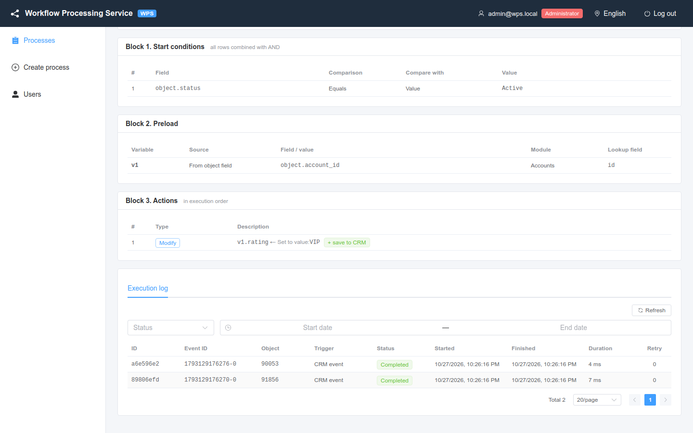
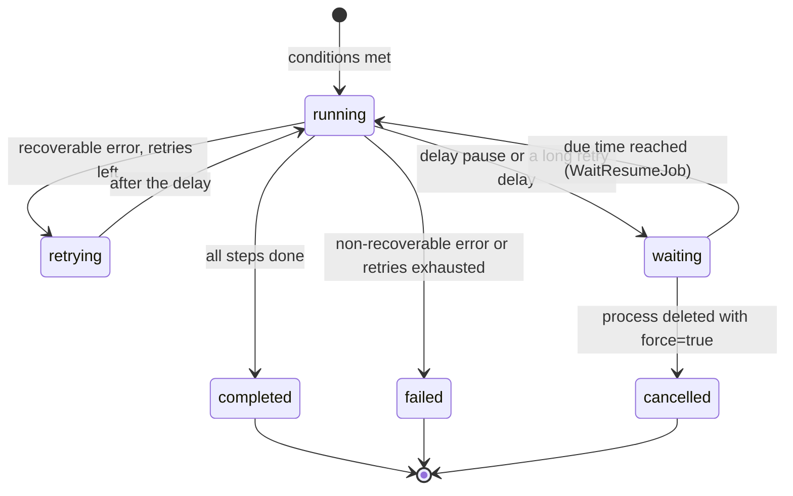

# Executions and audit

Where to see every run of a process, how to read an execution page and how to find the cause of an error.

<!-- lang-switch -->
🇬🇧 English | [🇷🇺 Русский](../../ru/03-user-guide/executions-and-audit.md)
<!-- /lang-switch -->

## What is recorded

Every time a process starts, WPS creates an **execution** (a run for one event) and writes every **step** (one preload
row or one action) to the audit:

- the execution: process and its version, trigger, event id, object, status, number of retries, error, timings, and the
  final context (event, variables, condition results);
- each step: action type, status, attempts, start time, duration, `request_data` (what the step did or sent) and
  `result_data` (what it got or changed), error message, and the place of the step in the program:
  - `step_index` — sequence number of the record in the execution audit;
  - `pc` — instruction number in the program (equals `step_index` for a linear process);
  - `step_path` — place of the step in the definition: `preload[0]`, `actions[2]`, `actions[1].branches[0].actions[0]`,
    `actions[1].else[0]`;
  - `iteration` — the iteration number of a [`foreach`](actions.md#loop-for-each-item) loop from zero, in nested loops
    the indexes from the outer to the inner one (`"2/0"`); empty outside loops;
  - `step_id` — the user `id` of the step, if set (see [Actions](actions.md#nested-blocks-and-step-fields));
  - `error_code` — error code of a failed step (`HTTP_503`, `TIMEOUT`, `CONFIG`, `UNKNOWN_OUTCOME` …);
  - `handled` — how the error was handled: `continue`, `goto` (by `on_error`), `item_continue` (a loop with
    `on_item_error: continue` went on to the next item) or empty (the error stopped the execution), see
    [Actions → Step errors](actions.md#step-errors-on_error-and-retries);
- the execution also has `handled_errors` — the number of step errors handled by `on_error` or `on_item_error: continue`.

> **Note**
> An event for which the process conditions were **not met** does not create an execution, so it does not appear in the
> log. The same applies to a start blocked by **Run once per record**. To see why a process did not start, use a
> [manual run](manual-run-and-reset.md): it shows the result of every condition.

## Execution log of a process

Open the process card and scroll down to the **Execution log** tab.



*Execution log of process #1: two completed runs started by CRM events.*

| Column | Meaning |
|---|---|
| **ID** | Short execution id; click the row to open the execution |
| **Event ID** | Redis Stream message id (`1792050605348-0`) or `manual-<uuid>` for a manual run |
| **Object** | Id of the CRM record from the event |
| **Trigger** | **CRM event** (`stream`), **Manual run** (`manual`), **Child** (`child`) |
| **Status** | **Running**, **Retrying**, **Waiting**, **Completed**, **Failed**, **Cancelled** |
| **Started** / **Finished** / **Duration** | Timings |
| **Retry** | How many times steps of this execution were retried |

Filters:

- **Status** — show only executions with the selected status;
- **Start date** — **End date** — period by the start time of the execution;
- **Refresh** — reload the list.

The list is sorted from newest to oldest and paginated. The same data is available through the API:

```bash
curl -s "http://localhost:9501/api/processes/1/executions?status=failed&date_from=2026-10-15T00:00:00Z&page=1&per_page=20" \
  -H "Authorization: Bearer $TOKEN"
```

## Execution statuses



| Status | UI | Meaning |
|---|---|---|
| `running` | **Running** | Steps are being executed |
| `retrying` | **Retrying** | A step failed with a temporary error (CRM timeout, CRM 5xx, network); WPS waits and repeats it |
| `waiting` | **Waiting** | The execution is paused until `waiting_until` (a `delay` pause or a long retry delay); no worker is held, the state is kept in PostgreSQL |
| `completed` | **Completed** | All steps finished; step errors handled by `on_error` (`continue` / `goto`) or by a loop with `on_item_error: continue` are counted in `handled_errors` |
| `failed` | **Failed** | A step failed (with `on_error: stop`, the default); the remaining steps were not executed |
| `cancelled` | **Cancelled** | A waiting execution was cancelled: the process was deleted with `?force=true` (`error_message` "Process deleted") |

Step statuses:

| Status | UI | Meaning |
|---|---|---|
| `success` | **Success** | The step finished |
| `failed` | **Failed** | The step failed; see the **Error** column |
| `skipped` | **Skipped** | The step was not executed: a previous step failed, there was nothing to save, or the variable to save is empty |
| `waiting` | **Waiting** | The step paused the execution (`result_data.wait = {due_at, reason}`); after waking the same record gets the final status |

### Waiting executions

An execution in the `waiting` status has the fields `waiting_until` (due time, UTC) and `wait_reason` (`delay` — a pause,
`retry` — a long retry delay). For such an execution `GET /api/executions/{id}` also returns the `wait` object (`due_at`,
`reason`, `attempts` — wake attempts, `info`) and takes the context from the saved wait snapshot:

```json
{ "id": "…", "status": "waiting", "waiting_until": "2026-10-19T09:00:00+00:00", "wait_reason": "delay",
  "current_step": 1,
  "wait": { "due_at": "2026-10-19T09:00:00+00:00", "reason": "delay", "attempts": 0,
            "info": { "pc": 1, "seq": 1, "mode": "after_wait", "parked_at": "2026-10-16T09:00:00+00:00" } },
  "actions": [ { "step_index": 0, "action_type": "modify", "status": "success" },
               { "step_index": 1, "action_type": "delay", "status": "waiting", "result_data": { "wait": { "due_at": "…", "reason": "delay" } } } ] }
```

After waking the pause step record gets the status `success` with `waited: true`, `waited_seconds` and `lateness_ms` (how
much later than due the execution continued), then the next steps follow. A retry step (`retry`) runs again after waking
and overwrites the same audit record.

All waiting executions (of every process):

```bash
curl -s "http://localhost:9501/api/executions?status=waiting&due_before=2026-10-20T00:00:00Z&page=1&per_page=50" \
  -H "Authorization: Bearer $TOKEN"
```

The **Status** filter of the process execution log accepts `waiting` and `cancelled` too. Deleting a process with waiting
executions is rejected (`409 PROCESS_HAS_WAITING_EXECUTIONS`); with `?force=true` (admin) they are cancelled.

## Execution page

Click a row in the log (or a link in **Child executions**) to open `/executions/<id>`.


*Completed execution of process #1: `preload` loaded the account, `modify` set the rating and saved it to the CRM.*

The page has four parts.

1. **Header** — short id, status, buttons **To process** and **Refresh**. While the execution is **Running** or
   **Retrying**, the page refreshes itself every 2 seconds and shows `live · updated <time>`.
2. **Properties** — **Execution ID**, **Process** (with its version at the time of the run), **Status**, **Trigger**,
   **Parent execution** (for a child), **Retry count**, **Event ID**, **Object**, **Duration**, **Started**,
   **Finished**. A red **Execution error** banner shows the error message of a failed execution.
3. **Execution steps** — one row per step: **#**, **Action type**, **Status**, **Attempts**, **Started**, **Duration**,
   **Request**, **Result**, **Error**. Expand a row to see the full **Request (request_data)** and
   **Result (result_data)** JSON.
4. **Execution context** — three tabs:
   - **Event (event)** — the object exactly as it came from the CRM;
   - **Variables (variables)** — `object` and all variables after the last step (for a running execution: the live
     context from Redis, marked **live context from Redis**);
   - **Conditions (conditions)** — every condition with the actual and expected values and the result.

For a parent process the **Child executions** table lists the children it started (see [Child processes](subprocesses.md)).

### What the steps record

| Action | `request_data` | `result_data` |
|---|---|---|
| `preload` | `var`, `module`, `strategy` (`by_id`/`by_field`), `by_field`, `source`, `value`, `lookup_value` | `found`, `object` (the loaded record or `null`) |
| `modify` | `target`, `change_type`, `value` (value or expression) | `old_value`, `new_value`; with `save_to_crm` also `save`; for `aggregate` — `function`, `module` / `link`, `records_scanned`, `pages`, `truncated`, `total`, `skipped_reason` (see [Aggregate over records](change-types-and-expressions.md#aggregate-over-records)) |
| `save_object` | `method` (`PUT`/`POST`), `module`, `id`, `attributes` sent | `saved`, `response`, `created_id` for a new record |
| `start_process` | `process_ids` | `children`: `started` / `skipped` for each child |
| `condition` (block) | `branches` (number of branches), `has_else` | `selected` — index of the chosen branch, `"else"` or `"none"` (no branch matched and there is no `else`); `branches` — for every checked branch `branch`, `name`, `result` and the condition trace `conditions` (see [below](#the-record-of-a-condition-block)) |
| `stop_process` (block) | `status`, `code`, `message` (the message template) | `stopped: true`, `status`, `code`, `message` after substitution; `message_error` when the template failed (see [below](#a-stopped-execution)) |
| `assign` | `target`, `field`, `strategy`, `only_active`, `queue_key`, `save` | `chosen_user_id`, `previous_user_id`, `unchanged`, `reason`, `pool_size`, `pool`, `pool_source`, `inactive`, `excluded`, `counts`, `manager_of`, `fallback`, `reused_decision`, `save` (see [Assign an owner](actions.md#assign-an-owner)) |
| `notify` | `title`, `message_preview`, `link`, `channels` (no secrets), `delivery` | `channels`: per channel `status` (`success` / `failed` / `skipped`), `deliveries` (`user`/`record`, `chat_id`/`message_id`, `status`, `replayed`), `error`, `error_code`; `warnings` (see [Notification](actions.md#notification)) |
| `update_records` | `list`, `module`, `count`, `set`, `only_changed`, `max` | `updated`, `unchanged`, `skipped_no_id`, `errors`, `items` (up to 200: `{id, status, fields, error}`); if records failed — the step is `failed` ("N of M records failed"), the same summary in `details` (see [Update list records](actions.md#update-list-records)) |
| `foreach` (block) | `source`, `as`, `max_items`, `on_overflow`, `on_item_error`, `has_where` | at the start — `count`, `truncated`, `source_missing`; when the loop ends the record is overwritten with the totals: `processed`, `skipped_by_where`, `failed_items`, `failed_indexes`, `unsaved_items`, `where_traces`, on failure `failed_at_index` (see [below](#the-record-of-a-foreach-loop)) |
| `delay` | `mode` and the due-time fields, `due_at` (UTC), `due_at_local` | in the coroutine — `waited: true`, `waited_seconds`, `inline: true`; after parking — `waited: true`, `lateness_ms`, `waited_seconds`; moment passed — `waited: false`, `past_due: true` (see [Delay](actions.md#delay)) |
| failed step | the step configuration | `error_class`, `recoverable`, `error_code`, `error` — the classified error (`code`, `message`, `transient`, `http_status`, `retry_after`), `details` (e.g. the CRM response); with `on_error: {goto}` — `goto` (target id) |
| external action (`send_email`, `http_request`, `notify`) | what was sent (secrets masked) | the response of the external system, `idempotency_key` — the external idempotency key; `replayed: true` when the step ran again after a crash and the response was taken from the side-effect journal without calling again |

Steps of branches that were not chosen are not written to the audit. When a step fails (and `on_error` is `stop`), the
following steps of its list (e.g. the branch) and the following steps of every enclosing list up to the top level get
`skipped`. With `on_error: continue` the failed step stays `failed` with `handled: "continue"` and the execution goes
on; with `goto` the steps between the error and the target do not run and are not written to the audit.

### The record of a condition block

A `condition` block writes one `condition` record per run; the steps of the chosen branch follow as ordinary records
(`step_path` like `actions[0].branches[1].actions[0]`), steps of the branches not chosen are not written.

```json
{ "step_index": 0, "pc": 0, "step_path": "actions[0]", "step_id": "deal_size", "action_type": "condition", "status": "success",
  "request_data": { "branches": 3, "has_else": false },
  "result_data": { "selected": 1,
    "branches": [
      { "branch": 0, "name": "Over 1M", "result": false,
        "conditions": [ { "field": "object.amount", "operator": "greater_than", "actual": "5000", "expected": "1000000", "result": false } ] },
      { "branch": 1, "name": "Over 100K or VIP", "result": true, "conditions": [ … ] } ] } }
```

- `selected` — the number of the chosen branch, `"else"` or `"none"` (no branch matched and there is no `else`).
- `branches` — only the **checked** branches in order: branches after the chosen one are not evaluated and are absent
  from the trace. `name` is the branch label if set; `conditions` is the same trace as for launch conditions (`actual`,
  `expected`, `*_cast`, `missing`, `cast_error`).
- An error in a branch condition (`on_cast_error: "error"`) gives a `condition` record with status `failed` and the
  trace of the failed row.

### The record of a foreach loop

A [`foreach`](actions.md#loop-for-each-item) loop writes **one** `foreach` record (its `step_index` comes before the body
steps) and ordinary records of the body steps with the iteration number. When the loop ends, the `foreach` record is
overwritten with the totals and `duration_ms` becomes the duration of the whole loop:

```json
[ { "step_index": 2, "pc": 2, "step_path": "actions[2]", "step_id": "each_deal", "action_type": "foreach", "status": "success",
    "request_data": { "source": "deals.items", "as": "deal", "max_items": 500, "on_overflow": "fail", "on_item_error": "stop", "has_where": true },
    "result_data": { "count": 3, "processed": 2, "skipped_by_where": 1, "failed_items": 0, "failed_indexes": [],
                     "unsaved_items": 0, "truncated": false, "source_missing": false,
                     "where_traces": [ { "index": 2, "conditions": [ … ] } ] } },
  { "step_index": 3, "step_path": "actions[2].actions[0]", "iteration": "0", "action_type": "modify", "status": "success" },
  { "step_index": 4, "step_path": "actions[2].actions[1]", "iteration": "0", "action_type": "save_object", "status": "success" },
  { "step_index": 6, "step_path": "actions[2].actions[0]", "iteration": "1", "action_type": "modify", "status": "success" } ]
```

- Items rejected by `where` leave no records: only the `skipped_by_where` counter and the trace of the first 20 in
  `where_traces`.
- `unsaved_items` — iterations after which the item variable still had unsaved changes (no `save_object`).
- `on_item_error: continue`: the failed step is `failed` with `handled: "item_continue"`, the rest of the iteration is
  not recorded, the loop totals have `failed_items` and `failed_indexes` (up to 50), the execution is `completed`.
- `on_item_error: stop`: the `foreach` record is `failed` with `failed_at_index`, the steps after the loop are `skipped`.
- A loop cut short by `stop_process` gets `stopped: true` in the totals; one left by a `goto` gets the `failed` status
  and `left_by: "goto"`.

### A stopped execution

The [`stop_process`](actions.md#stop-the-process) step writes one record `stop_process` with status `success`; the
remaining steps then get `skipped` with the reason `Not executed: the process was stopped by stop_process`:

```json
[ { "step_index": 0, "action_type": "condition", "status": "success", "result_data": { "selected": 0, "branches": [ … ] } },
  { "step_index": 1, "step_path": "actions[0].branches[0].actions[0]", "action_type": "stop_process", "status": "success",
    "request_data": { "status": "failed", "code": "NO_CONTACTS", "message": "Lead {{ object.last_name }} has no e-mail" },
    "result_data": { "stopped": true, "status": "failed", "code": "NO_CONTACTS", "message": "Lead Ivanov has no e-mail" } },
  { "step_index": 2, "step_path": "actions[1]", "action_type": "modify", "status": "skipped",
    "result_data": { "reason": "Not executed: the process was stopped by stop_process" } } ]
```

- `status: failed` — the execution status is `failed`, `error_message = "[NO_CONTACTS] Lead Ivanov has no e-mail"`;
  `status: completed` — the execution is `completed`, `error_message` is empty.
- The execution snapshot (`context`) has `stop: { status, code, message }`: it shows that the process ended early even
  when the status is `completed`.

## Diagnosing a failed execution


*Process #5 tries to load a record the mock CRM answers with HTTP 500: three retries, then the execution fails.*

1. Open the execution with status **Failed**. The **Execution error** banner shows the message, e.g.
   `CRM GET http://mock:9502/api/v8/Accounts/fail500-demo returned HTTP 500`.
2. In **Execution steps** find the row with status **Failed**. Steps after it are **Skipped** with the reason
   `Not executed: a previous step failed`.
3. Look at **Attempts**:
   - more than 1 (by default 4 = the first attempt + `ACTION_RETRY_MAX` 3 retries) — the error was temporary
     (`recoverable: true`): CRM unavailable, timeout or 5xx. Check the CRM and its URL/key
     ([CRM integration](../04-operations/crm-integration.md));
   - 1 — the error is permanent (`recoverable: false`): CRM 4xx, invalid module, wrong configuration. Fix the process.
4. Expand the row: `result_data.details.response` contains the CRM answer, `request_data` the exact configuration of the step.
5. Open **Execution context** → **Variables**: check which variables are `null` (a preload that found nothing) and what
   values the fields had.
6. Fix the process or the data and check it with a [manual run](manual-run-and-reset.md).

Typical errors:

| Error | Cause | What to do |
|---|---|---|
| `CRM GET … returned HTTP 500`, `connection failed`, `request timeout` | CRM unavailable or slow | Check the CRM, `CRM_API_BASE_URL`, `CRM_API_TIMEOUT` |
| `CRM … returned HTTP 401` | Wrong `CRM_API_STATIC_KEY` | Fix the key in the backend configuration |
| `Cannot save "v1": CRM module is unknown (set "module" in the save action)` | Saving a variable created by `modify` without a module | Fill **Module (for new variables, optional)** in the "Save to CRM" row |
| `Variable "v1" is empty (object was not loaded) — nothing to save` (step **Skipped**) | Preload found nothing | Add a condition on the variable (e.g. `v1.id` **Not equals** empty) |
| `Child process 42 not found`, `… is not a child process` | The child was deleted or changed its type | Fix the **Start next process** row |
| `Execution context expired or lost; it could not be resumed` | The worker crashed and the Redis state expired | Run the process again manually |
| `Outcome of the previous attempt is unknown …` (`error_code: UNKNOWN_OUTCOME`) | The worker crashed after an e-mail or a request was sent (`delivery: at_most_once`); the step was not repeated so as not to send twice | Check the external system; the call journal is `GET /api/executions/{id}/side-effects`; details — [Reliability](../04-operations/reliability.md#side-effects-and-repeats) |

> **Note**
> Saving a process increases its version. An execution keeps the version it ran with (**(version N)** next to the
> process name), so the audit stays consistent after the process is edited.

See also: [Reliability](../04-operations/reliability.md), [Monitoring](../04-operations/monitoring.md),
[Troubleshooting](../04-operations/troubleshooting.md), [API endpoints](../06-api-reference/endpoints.md).

<!-- footer-nav -->
---

← Previous: [Secrets](secrets.md) | [Contents](../README.md) | [Manual run and run-once reset](manual-run-and-reset.md) Next →
<!-- /footer-nav -->
