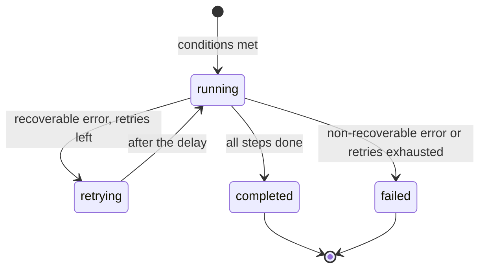

# Executions and audit

Where to see every run of a process, how to read an execution page and how to find the cause of an error.

<!-- lang-switch -->
🇬🇧 English | [🇷🇺 Русский](../../ru/03-user-guide/executions-and-audit.md)
<!-- /lang-switch -->

## What is recorded

Every time a process starts, WPS creates an **execution** (a run for one event) and writes every **step** (one preload
row or one action) to the audit:

- the execution: process and its version, trigger, event id, object, status, number of retries, error, timings, and the
  final context (event, variables, condition results);
- each step: action type, status, attempts, start time, duration, `request_data` (what the step did or sent) and
  `result_data` (what it got or changed), error message.

> **Note**
> An event for which the process conditions were **not met** does not create an execution, so it does not appear in the
> log. The same applies to a start blocked by **Run once per record**. To see why a process did not start, use a
> [manual run](manual-run-and-reset.md): it shows the result of every condition.

## Execution log of a process

Open the process card and scroll down to the **Execution log** tab.


*Execution log of process #1: two completed runs started by CRM events.*

| Column | Meaning |
|---|---|
| **ID** | Short execution id; click the row to open the execution |
| **Event ID** | Redis Stream message id (`1792050605348-0`) or `manual-<uuid>` for a manual run |
| **Object** | Id of the CRM record from the event |
| **Trigger** | **CRM event** (`stream`), **Manual run** (`manual`), **Child** (`child`) |
| **Status** | **Running**, **Retrying**, **Completed**, **Failed** |
| **Started** / **Finished** / **Duration** | Timings |
| **Retry** | How many times steps of this execution were retried |

Filters:

- **Status** — show only executions with the selected status;
- **Start date** — **End date** — period by the start time of the execution;
- **Refresh** — reload the list.

The list is sorted from newest to oldest and paginated. The same data is available through the API:

```bash
curl -s "http://localhost:9501/api/processes/1/executions?status=failed&date_from=2026-10-15T00:00:00Z&page=1&per_page=20" \
  -H "Authorization: Bearer $TOKEN"
```

## Execution statuses



| Status | UI | Meaning |
|---|---|---|
| `running` | **Running** | Steps are being executed |
| `retrying` | **Retrying** | A step failed with a temporary error (CRM timeout, CRM 5xx, network); WPS waits and repeats it |
| `completed` | **Completed** | All steps finished |
| `failed` | **Failed** | A step failed; the remaining steps were not executed |

Step statuses:

| Status | UI | Meaning |
|---|---|---|
| `success` | **Success** | The step finished |
| `failed` | **Failed** | The step failed; see the **Error** column |
| `skipped` | **Skipped** | The step was not executed: a previous step failed, there was nothing to save, or the variable to save is empty |

## Execution page

Click a row in the log (or a link in **Child executions**) to open `/executions/<id>`.


*Completed execution of process #1: `preload` loaded the account, `modify` set the rating and saved it to the CRM.*

The page has four parts.

1. **Header** — short id, status, buttons **To process** and **Refresh**. While the execution is **Running** or
   **Retrying**, the page refreshes itself every 2 seconds and shows `live · updated <time>`.
2. **Properties** — **Execution ID**, **Process** (with its version at the time of the run), **Status**, **Trigger**,
   **Parent execution** (for a child), **Retry count**, **Event ID**, **Object**, **Duration**, **Started**,
   **Finished**. A red **Execution error** banner shows the error message of a failed execution.
3. **Execution steps** — one row per step: **#**, **Action type**, **Status**, **Attempts**, **Started**, **Duration**,
   **Request**, **Result**, **Error**. Expand a row to see the full **Request (request_data)** and
   **Result (result_data)** JSON.
4. **Execution context** — three tabs:
   - **Event (event)** — the object exactly as it came from the CRM;
   - **Variables (variables)** — `object` and all variables after the last step (for a running execution: the live
     context from Redis, marked **live context from Redis**);
   - **Conditions (conditions)** — every condition with the actual and expected values and the result.

For a parent process the **Child executions** table lists the children it started (see [Child processes](subprocesses.md)).

### What the steps record

| Action | `request_data` | `result_data` |
|---|---|---|
| `preload` | `var`, `module`, `strategy` (`by_id`/`by_field`), `by_field`, `source`, `value`, `lookup_value` | `found`, `object` (the loaded record or `null`) |
| `modify` | `target`, `change_type`, `value` (value or expression) | `old_value`, `new_value`; with `save_to_crm` also `save` |
| `save_object` | `method` (`PUT`/`POST`), `module`, `id`, `attributes` sent | `saved`, `response`, `created_id` for a new record |
| `start_process` | `process_ids` | `children`: `started` / `skipped` for each child |
| failed step | the step configuration | `error_class`, `recoverable`, `details` (e.g. the CRM response) |

## Diagnosing a failed execution


*Process #5 tries to load a record the mock CRM answers with HTTP 500: three retries, then the execution fails.*

1. Open the execution with status **Failed**. The **Execution error** banner shows the message, e.g.
   `CRM GET http://mock:9502/api/v8/Accounts/fail500-demo returned HTTP 500`.
2. In **Execution steps** find the row with status **Failed**. Steps after it are **Skipped** with the reason
   `Not executed: a previous step failed`.
3. Look at **Attempts**:
   - more than 1 (by default 4 = the first attempt + `ACTION_RETRY_MAX` 3 retries) — the error was temporary
     (`recoverable: true`): CRM unavailable, timeout or 5xx. Check the CRM and its URL/key
     ([CRM integration](../04-operations/crm-integration.md));
   - 1 — the error is permanent (`recoverable: false`): CRM 4xx, invalid module, wrong configuration. Fix the process.
4. Expand the row: `result_data.details.response` contains the CRM answer, `request_data` the exact configuration of the step.
5. Open **Execution context** → **Variables**: check which variables are `null` (a preload that found nothing) and what
   values the fields had.
6. Fix the process or the data and check it with a [manual run](manual-run-and-reset.md).

Typical errors:

| Error | Cause | What to do |
|---|---|---|
| `CRM GET … returned HTTP 500`, `connection failed`, `request timeout` | CRM unavailable or slow | Check the CRM, `CRM_API_BASE_URL`, `CRM_API_TIMEOUT` |
| `CRM … returned HTTP 401` | Wrong `CRM_API_STATIC_KEY` | Fix the key in the backend configuration |
| `Cannot save "v1": CRM module is unknown (set "module" in the save action)` | Saving a variable created by `modify` without a module | Fill **Module (for new variables, optional)** in the "Save to CRM" row |
| `Variable "v1" is empty (object was not loaded) — nothing to save` (step **Skipped**) | Preload found nothing | Add a condition on the variable (e.g. `v1.id` **Not equals** empty) |
| `Child process 42 not found`, `… is not a child process` | The child was deleted or changed its type | Fix the **Start next process** row |
| `Execution context expired or lost; it could not be resumed` | The worker crashed and the Redis state expired | Run the process again manually |

> **Note**
> Saving a process increases its version. An execution keeps the version it ran with (**(version N)** next to the
> process name), so the audit stays consistent after the process is edited.

See also: [Reliability](../04-operations/reliability.md), [Monitoring](../04-operations/monitoring.md),
[Troubleshooting](../04-operations/troubleshooting.md), [API endpoints](../06-api-reference/endpoints.md).

<!-- footer-nav -->
---

← Previous: [Child processes](subprocesses.md) | [Contents](../README.md) | [Manual run and run-once reset](manual-run-and-reset.md) Next →
<!-- /footer-nav -->
