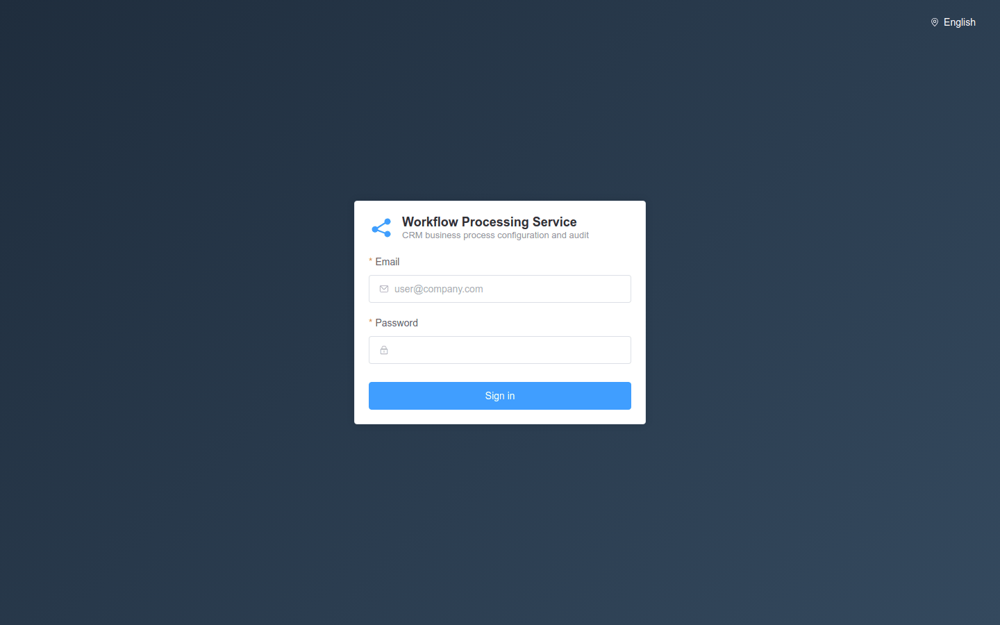
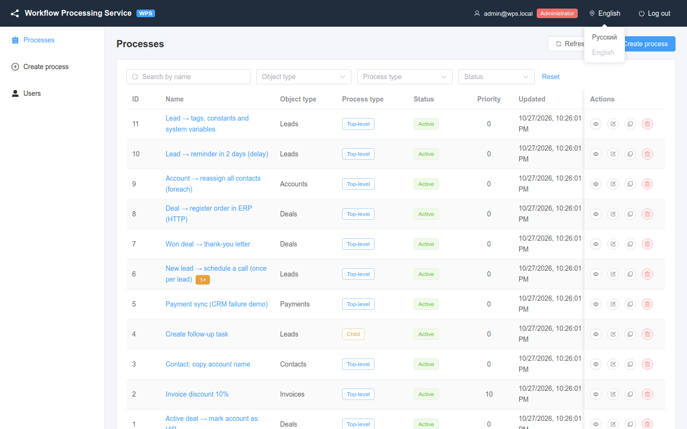
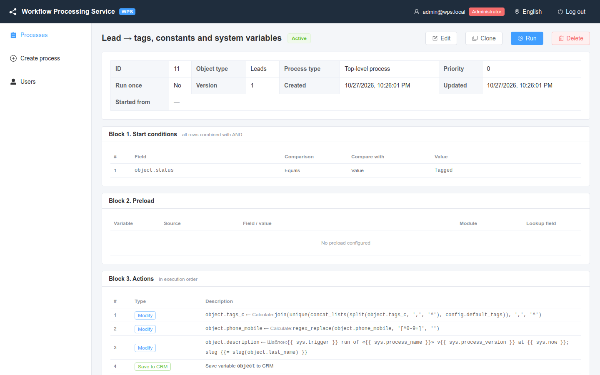

# Sign-in and the interface

How to sign in to the WPS web interface, find your way around it and switch the interface language.

<!-- lang-switch -->
🇬🇧 English | [🇷🇺 Русский](../../ru/03-user-guide/login-and-ui.md)
<!-- /lang-switch -->

## Sign in

1. Open the UI in a browser. With the default `docker compose` setup the address is `http://localhost:3000`; the port is set by `WPS_UI_PORT` in `./.env` (this repository's `.env` sets `3080`).
2. Enter **Email** and **Password**. Right after installation there is one administrator: `admin@wps.local` / `admin`.
3. Click **Sign in**.

*The sign-in page. The language switcher is in the top right corner.*

> **Warning**
> Change the password of `admin@wps.local` after the first sign-in (**Users** → edit the user). See [Users and roles](users-and-roles.md).

Messages you may see on the sign-in form:

| Message | Cause |
|---|---|
| Enter email / Invalid email | The email field is empty or is not a valid address |
| Enter password | The password field is empty |
| Invalid email or password | The server returned `401 INVALID_CREDENTIALS` |
| The server is unavailable. Check your connection. | The backend (`/api`) cannot be reached |

After a successful sign-in you land on the process list. If you opened a link to a specific page before signing in, you are taken to that page.

### Session

- The UI keeps an access token and a refresh token in the browser (`localStorage`, keys `wps_access_token` and `wps_refresh_token`).
- The access token lives 15 minutes by default (`JWT_ACCESS_TTL`), the refresh token 7 days (`JWT_REFRESH_TTL`). When the access token expires, the UI renews it silently.
- When the refresh token has expired too, you see **Session expired, please sign in again** and are sent to the sign-in page.
- **Log out** (top right) asks for confirmation (**Log out of the system?**) and deletes the tokens from the browser.

## Layout

*Main window: header, left menu and the work area (here — the process list).*

| Area | What is there |
|---|---|
| Header | **Workflow Processing Service** logo (link to the process list), your email, role badge (**Administrator**, **Editor**, **Viewer**), language switcher, **Log out** |
| Left menu | **Processes**, **Create process**, **Users** — depending on your role, see below |
| Work area | The current page: process list, process card, editor, execution page, users |

### What the menu shows for each role

| Menu item | `admin` | `editor` | `viewer` |
|---|---|---|---|
| **Processes** | ✓ | ✓ | ✓ |
| **Create process** | ✓ | ✓ | — |
| **Users** | ✓ | — | — |

The same rules protect the pages themselves: if a viewer opens `/processes/create` or an editor opens `/users` directly, the UI redirects to the process list. Buttons follow the role too: **Edit**, **Clone** and **Run** are visible to editors and administrators, **Delete** only to administrators. The full permission matrix is in [Users and roles](users-and-roles.md).

### Pages

| Address | Page | Who |
|---|---|---|
| `/login` | Sign in | everyone |
| `/processes` | Process list | all roles |
| `/processes/create` | New process | admin, editor |
| `/processes/{id}` | Process card, execution log, run-once records | all roles |
| `/processes/{id}/edit` | Edit process | admin, editor |
| `/executions/{id}` | Execution page (steps, context) | all roles |
| `/users` | Users | admin |

The browser tab title follows the page, for example `Processes — WPS`.

## Interface language

The interface is available in English and Russian. Process names, CRM module names and other data are shown as they are stored and are not translated.

*The language menu in the header: **Русский** / **English**.*

To switch the language:

1. Click the current language in the header (or in the top right corner of the sign-in page).
2. Choose **English** or **Русский**. The page switches immediately, without reloading; unsaved form data is kept.

How the language is chosen when the UI opens (first match wins):

1. The `lang` URL parameter: `?lang=en` or `?lang=ru`. Handy for links and bookmarks, e.g. `http://localhost:3000/processes?lang=en`.
2. The language you chose last time (stored in the browser, `localStorage['wps_locale']`).
3. The browser language.
4. Russian (default).

The chosen language is remembered in this browser and is also sent to the backend in the `Accept-Language` header.

> **Note**
> Module labels in selectors come from the CRM. The bundled mock returns Russian module names (for example `Сделки` for `Deals`) in both interface languages.

## What the UI has and what only the API has

| Task | UI | API |
|---|---|---|
| List, card, create, edit, clone, delete processes | ✓ | `/api/processes` |
| Execution log of a process, execution page, context | ✓ | `/api/processes/{id}/executions`, `/api/executions/{id}` |
| Executions of **all** processes, searching for waiting ones | — | `GET /api/executions?status=waiting` |
| Side-effect journal (what was sent) | — | `GET /api/executions/{id}/side-effects` |
| Manual run, run-once reset | ✓ | `/api/processes/{id}/run`, `/api/processes/{id}/runs` |
| Users | ✓ (admin) | `/api/users` |
| Secrets of external systems | — | `/api/secrets`, see [Secrets](secrets.md) |
| Mail and notification channel check | — | `POST /api/mail/test`, `POST /api/notify/test` |
| Service health and metrics | — | `/api/health`, `/metrics`, see [Monitoring](../04-operations/monitoring.md) |
| Dictionaries (operators, functions, `sys.*`, date units…) | partly — in drop-down lists | `/api/dictionaries/*` |

## The editor and actions set through the API

The process editor can build four kinds of rows: **conditions** (block 1), **preload**, **changes** with **Save to
CRM** and **Start next process** (block 2). Other actions — e-mails, HTTP requests, notifications, assignment, record
search, loops, branches, pauses, `set_variable`, `stop_process` — are set by the JSON definition through the API (see
the [Overview](../01-overview/index.md#what-is-configured-in-the-editor-and-what-through-the-api)).

How such actions look in the UI:

- **Process card**, **Block 3. Actions**: a row with the type tag (`send_email`, `foreach`, `http_request` …) and the
  JSON of the step in the **Description** column — not translated or formatted. Nested steps of blocks (`branches`, the
  loop body) are visible inside that JSON.
- **Editor**, **Modify object / variable** section: a grey row with the type tag and a JSON summary, an ⓘ icon —
  **This action can't be edited in the table editor and will be saved unchanged**. The row can be moved with the arrows
  or deleted, but not changed.
- Advanced conditions (groups, OR) are shown as a JSON block with a warning; **Replace with table conditions (AND)**
  turns them into plain rows (a simple AND group) or clears them.
- `trigger_on` and the `config.*` constants are not shown on the card — see them in the `GET /api/processes/{id}`
  response.

*The card of a process built through the API: calculations, a template with `sys.*` and a `config.*` constant.*

> **Note**
> A process built through the API can be saved from the editor: constants, row fields the form does not show (`cast`,
> `on_error`, `retry` …) and the action order are kept. What the form cannot show (conditions with lists and
> expressions, complex change types, non-editable actions) is shown read-only and saved unchanged. See the [FAQ](../08-faq.md#can-i-open-a-process-created-through-the-api-in-the-editor).

In the English UI the labels of operators and change types other than the basic ones (**Equals**, **Contains**,
**Set to value**, **Calculate** …) come from the server in Russian (for example **Больше**, **Шаблон**): the server
returns dictionaries in Russian, and the UI translates only the basic values.

## If you cannot sign in

| Symptom | What to do |
|---|---|
| **The server is unavailable. Check your connection.** | The backend does not answer: `curl http://localhost:9501/api/health`, `docker compose ps backend` |
| **Invalid email or password** | Check the keyboard layout and the e-mail; the default administrator password may have been changed — another administrator can change it on the **Users** page |
| The sign-in page appears again and again after signing in | The browser does not keep `localStorage` (a private mode that blocks storage) or different UI addresses are used (`localhost` and `127.0.0.1` have separate storage) |
| **Session expired, please sign in again** in the middle of work | The refresh token expired (`JWT_REFRESH_TTL`, 7 days) or `JWT_SECRET` changed on the server. Unsaved form changes are lost — save more often |
| **You do not have permission to perform this operation** | Your role does not allow this operation; if the role was raised recently, sign out and in again |
| A blank white page | Open the browser console (F12): usually an old frontend build is cached — reload with `Ctrl+F5` |

## Next steps

- [Processes](processes.md) — the list, the card and the editor.
- [Trigger conditions](triggers-and-conditions.md) — when a process starts.

<!-- footer-nav -->
---

← Previous: [Your first process](../02-getting-started/first-process.md) | [Contents](../README.md) | [Processes](processes.md) Next →
<!-- /footer-nav -->
