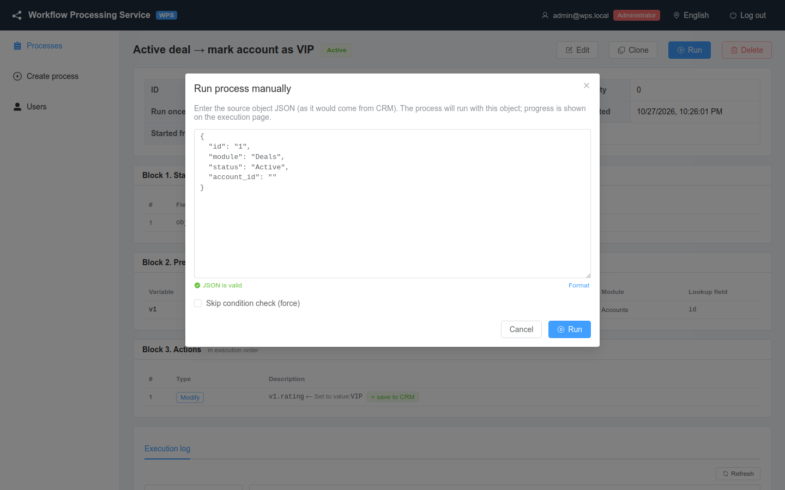
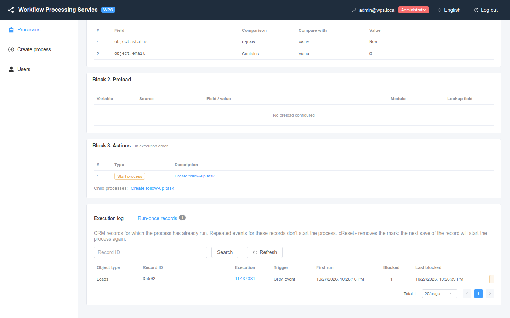

# Manual run and run-once reset

How to run a process with a test object without the CRM, and how to lift the "run once per record" restriction.

<!-- lang-switch -->
🇬🇧 English | [🇷🇺 Русский](../../ru/03-user-guide/manual-run-and-reset.md)
<!-- /lang-switch -->

## Manual run

A manual run starts the process with an object you type in, exactly as if the CRM had sent it. Use it to test a new
process, to repeat a failed run, or to find out why the process does not start for an event.

Available to the roles **Administrator** and **Editor** (see [Users and roles](users-and-roles.md)). A manual run works
for any process: inactive and child processes too.

### Run from the UI

1. Open the process card and click **Run**.
2. In the **Run process manually** dialog edit the JSON of the source object. The dialog fills in a template: `id`,
   `module` and the fields used in the conditions and in the preload (for `equals` conditions with their expected
   values).
3. The object **must** have an `id` — the id of a CRM record. If the process loads related records, put real ids
   there (for example `account_id` of an existing account).
4. Optionally enable **Skip condition check (force)**.
5. Click **Run**.



*Manual run of process #1: the template contains `id`, `module`, `status` from the condition and `account_id` from the preload.*

The editor checks the JSON as you type (**JSON is valid** / **Invalid JSON: …**); **Format** pretty-prints it. A JSON
object `{ … }` is expected: an array or a number gives **Expected a JSON object { … }**, and **Run** shows **Fix the
object JSON: …** and sends nothing. The dialog does not close on a click outside it — only with **Cancel** or the cross,
so that a typed object is not lost by accident.

How the object template is built:

| Source | What gets into the template |
|---|---|
| always | `id: "1"` and `module` = the object type of the process |
| condition rows `object.<field>` | the field; for **Equals** with a value — the expected value, for others — `""` |
| preload rows **From object field** | the source field (`account_id`) with the value `""` |
| advanced conditions (groups / OR), fields used in actions | **not** added — add them yourself |

Replace `"1"` with a real record `id` if the process saves `object` to the CRM: otherwise the save goes to a
non-existent record and the step fails with the CRM answer `404`.

### What happens next

| Result | Response | In the UI |
|---|---|---|
| Conditions met | `201`, `execution_id` | The **Process started** message; the dialog closes and the execution page opens at once. The steps run in the background, the page refreshes itself every 2 seconds while the execution runs |
| Conditions not met | `200`, `conditions_met: false` | **Start conditions not met — process was not started** and a table: **Field**, **Operator**, **Expected**, **Actual**, **Result** (`OK`, `FAIL` or **not checked**). The dialog stays open: fix the JSON and run again |
| Run once already used for this record | `200`, `run_once_blocked: true`, `previous_execution_id` | **The process has already run for this record — no new run was created** and a link to the earlier execution |
| Object without `id` | `422 VALIDATION_ERROR`, field `object.id` | Error message |

**Skip condition check (force)** skips the conditions only. It does **not** bypass **Run once per record**: the dialog
reminds you about it with **Run once is enabled for this process: «force» does not bypass it…**.

> **Note**
> A manual run uses the real CRM: `save_object` and **Save to CRM** really change records. Test on a test CRM or on the
> bundled mock (see [Quick start](../02-getting-started/quick-start.md)).

### Run through the API

```bash
TOKEN=$(curl -s -X POST http://localhost:9501/api/auth/login -H 'Content-Type: application/json' \
  -d '{"email":"admin@wps.local","password":"admin"}' | python3 -c 'import sys,json;print(json.load(sys.stdin)["data"]["access_token"])')

curl -s -X POST http://localhost:9501/api/processes/1/run \
  -H "Authorization: Bearer $TOKEN" -H 'Content-Type: application/json' \
  -d '{"object":{"id":"5001","module":"Deals","status":"Active","account_id":"706"},"force":false}'
```

Response when the conditions are met (`201`):

```json
{
  "success": true,
  "data": {
    "conditions_met": true,
    "execution_id": "b83cb6ce-6bfa-4e18-b189-ce99aedbf8e5",
    "conditions": [
      { "field": "object.status", "operator": "equals", "value_type": "static", "value": "Active",
        "actual": "Active", "expected": "Active", "result": true }
    ],
    "run_once_applied": false,
    "run_once_blocked": false,
    "previous_execution_id": null
  },
  "error": null
}
```

Response when the conditions are not met (`200`): `"conditions_met": false`, `"execution_id": null` and `result: false`
in the failed row of `conditions`. A row that was not evaluated has `result: null` (**not checked** in the UI).

The `object` key can be omitted: then the whole body is the object, and `force` is taken from the same body:

```bash
curl -s -X POST http://localhost:9501/api/processes/1/run \
  -H "Authorization: Bearer $TOKEN" -H 'Content-Type: application/json' \
  -d '{"id":"5002","module":"Deals","status":"Closed","account_id":"706","force":true}'
```

Follow the execution: `GET /api/executions/{execution_id}`.

#### A format 2.0 event: type, old values, changed fields

To test a process with conditions on `object_before`, pass the service fields of the event right in `object` — the way a CRM
plugin sends them (see [How WPS parses an event](../04-operations/crm-integration.md#how-wps-parses-an-event)):

```bash
curl -s -X POST http://localhost:9501/api/processes/1/run \
  -H "Authorization: Bearer $TOKEN" -H 'Content-Type: application/json' \
  -d '{"object":{"id":"27285","module":"Leads","status":"Assigned",
       "event_type":"update","before":{"status":"New"},"changed_fields":["status"]}}'
```

`event_type`, `before`, `changed_fields` do not stay in `object`: the old values are available as `object_before.status`, the event
type and the changed field list are in `context.event_info` of the execution. Without these fields a manual run is an old-format
event: `object_before` = `null`, conditions on it are false. A manual run does not check [`trigger_on`](triggers-and-conditions.md#event-type-and-the-run-on-field-trigger_on):
a `["delete"]` process can be tried manually with `"event_type":"delete"` (`save_object` for `object` is then skipped).

[Change operators](triggers-and-conditions.md#conditions-on-a-field-change) (`changed`, `changed_to`, `changed_from`,
`not_changed`) are checked the same way: with the fields from the example above, `object.status` **Changed from** `New` is met
and the trace has `conditions[k].changed = true`. Without `event_type` / `changed_fields` there is no change info: all four
operators are false and the trace has `"change_info": "missing"`.

### Testing processes with the newer features

| What you test | What to pass and what to expect |
|---|---|
| **Changed** / **Changed to** conditions | `event_type`, `changed_fields` and `before` — without them there is no change info and the rows are false. A `create` also needs `changed_fields` with the filled fields |
| `trigger_on` | A manual run does not check it: a process with `["delete"]` or `[]` runs manually all the same |
| `sys.*` | `sys.trigger = manual`, `sys.event_id = manual-<uuid>`, `sys.event_type` — from `event_type` (default `update`), `sys.user_id` — from `object.user_id` if passed, `sys.depth = 0` |
| `config.*` | Constants come from the saved process definition — save the process before running it |
| A `delay` pause | Really waits: the execution becomes **Waiting** and wakes up on time. To test, set a short time (`"duration": "1m"`) or drop the wait by deleting the process with `force=true` |
| `send_email` | The letter is really sent: on the stack — to Mailpit (`http://localhost:8025`), in production — to the real recipient |
| `http_request`, `notify` | The request and the message go to the external system; to test, use a test webhook or the mock (`http://mock:9502/mock/echo/…`, `/mock/slack/…`) |
| `find_records`, `foreach`, `update_records` | They work with CRM data, not with the passed object: you need a record with a real `id` and related records in the CRM |

> **Tip**
> To check the conditions without running the actions, make a copy of the process (**Clone**), remove the actions in the
> copy and run it: the response shows the condition trace, and the CRM is not changed.

## Run once per record

When **Run once per record** (`run_once`) is enabled in the process header, the process runs at most once for each CRM
record — for the pair "object type + `id` of the record". It works for every trigger: CRM event, child start and manual run.

- The mark is taken at the moment of the start, and only if the conditions are met. An event that does not meet the
  conditions does not use up the run.
- The mark stays after a failed execution: the record remains blocked until you reset it.
- A blocked start does not create an execution; it increases the **Blocked** counter of the mark.
- Without an `id` the restriction is not applied. In practice an `id` is always present: a stream event without `id`
  goes to the dead-letter queue, a manual run without `id` is rejected, a child process uses the record of the parent
  event. If the manual run response still says the check was not applied, the UI warns
  **Run once not applied: the object has no id**.

In the process list and in the card such processes have the badge **1×**.

### Run-once marks

The process card has the tab **Run-once records**. It appears when **Run once** is enabled or when marks exist (after
the flag was switched off the tab shows **Run once is disabled — marks are kept but not checked**).



*Process #6: the lead already had a run; a repeated manual run was blocked (**Blocked** = 1).*

| Column | Meaning |
|---|---|
| **Object type**, **Record ID** | The CRM record |
| **Execution** | The first execution that took the mark |
| **Trigger** | How the first run was started |
| **First run** | When the mark was taken |
| **Blocked** | How many starts were rejected since then |
| **Last blocked** | When the last one was rejected |

Use **Record ID** and **Search** to find one record.

### Reset a mark

1. On the **Run-once records** tab find the record.
2. Click **Reset** (shown to **Administrator** and **Editor**) and confirm **Remove the mark for record … ?**.
3. **Mark removed** — the next event (or manual run) for this record starts the process again.

Through the API (role **Administrator** or **Editor**):

```bash
# list the marks of process 6, optionally for one record
curl -s "http://localhost:9501/api/processes/6/runs?object_id=27285" -H "Authorization: Bearer $TOKEN"

# remove the mark of the Leads record 27285
curl -s -X DELETE http://localhost:9501/api/processes/6/runs/Leads/27285 -H "Authorization: Bearer $TOKEN"
# → {"success":true,"data":{"deleted":true},"error":null}
# no mark → 404 NOT_FOUND
```

Cloning a process copies the **Run once per record** flag but not the marks.

See also: [Executions and audit](executions-and-audit.md), [Reliability](../04-operations/reliability.md),
[API endpoints](../06-api-reference/endpoints.md).

<!-- footer-nav -->
---

← Previous: [Executions and audit](executions-and-audit.md) | [Contents](../README.md) | [Users and roles](users-and-roles.md) Next →
<!-- /footer-nav -->
