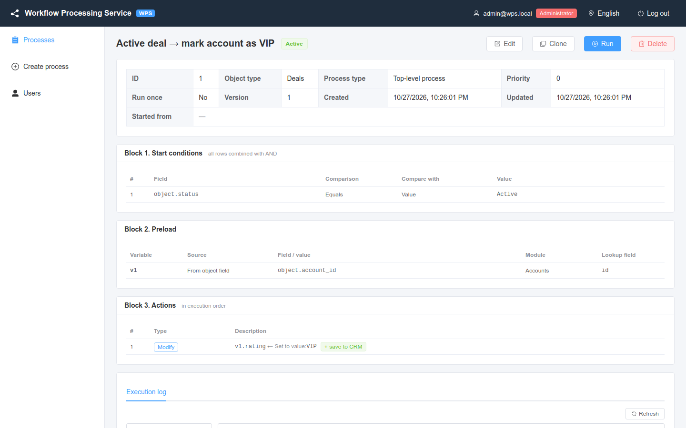
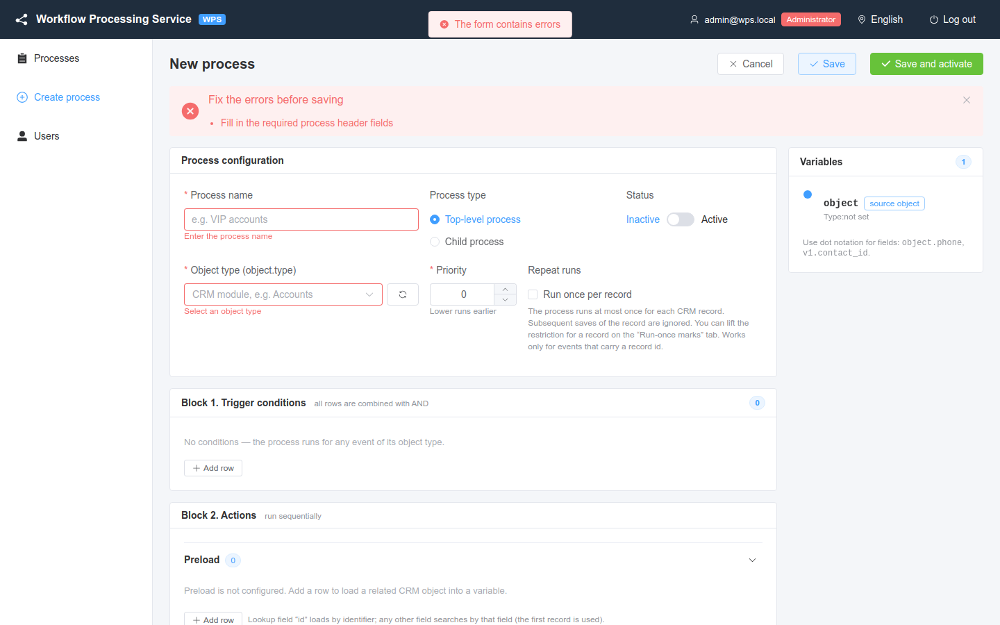

# Processes

How to find, create, edit, clone and delete processes, and what every field of the process configuration means.

<!-- lang-switch -->
🇬🇧 English | [🇷🇺 Русский](../../ru/03-user-guide/processes.md)
<!-- /lang-switch -->

A **process** is a rule of the form "when an object of type X is saved in the CRM and the conditions hold, do these actions". It consists of a configuration (name, type, object type, priority…), trigger conditions and a chain of actions. Conditions are described in [Trigger conditions](triggers-and-conditions.md), actions in [Actions](actions.md).

## Process list

Menu **Processes** (`/processes`).

*The process list with filters. The orange `1×` badge marks processes with "Run once per record".*

Columns: **ID**, **Name** (link to the process card), **Object type**, **Process type** (**Top-level** / **Child**), **Status** (**Active** / **Inactive**), **Priority**, **Updated**, **Actions**.

Filters above the table:

| Filter | What it does |
|---|---|
| **Search by name** | Substring search in the process name |
| **Object type** | CRM module; you can pick from the list or type any value |
| **Process type** | **Top-level** or **Child** |
| **Status** | **Active** or **Inactive** |
| **Reset** | Clears all filters |

The list is sorted by the update time, newest first. **Refresh** reloads it.

Row buttons (icons in **Actions**): **View**, **Edit** and **Clone** (admin, editor), **Delete** (admin only).

## Process card

Click a process name to open its card (`/processes/{id}`).

*The process card: properties, start conditions, preload and actions in execution order.*

The card shows:

- the properties: **Object type**, **Process type**, **Priority**, **Run once**, **Version**, **Created**, **Updated**, and for a child process **Started from** — links to the processes that start it;
- **Block 1. Start conditions**, **Block 2. Preload**, **Block 3. Actions** — read-only tables;
- for a top-level process with child processes — **Child processes:** with links;
- the **Execution log** tab (see [Executions and audit](executions-and-audit.md)) and, for processes with "run once", the **Run-once records** tab (see [Manual run and run-once reset](manual-run-and-reset.md)).

Header buttons: **Edit**, **Clone**, **Run** (admin, editor) and **Delete** (admin).

## Creating a process

1. Click **Create process** in the menu or above the list.
2. Fill in the **Process configuration** block (fields below).
3. Add trigger conditions in **Block 1. Trigger conditions** — or leave it empty to run on every event of the object type.
4. Configure **Block 2. Actions**: **Preload**, **Modify object / variable**, **Start next process**.
5. Click **Save** (the process is saved as it is, a new process is **Inactive** by default) or **Save and activate** (the process is saved with **Status** = **Active**).

After a successful save you see **Process created** and the process card opens.

*The editor: process configuration, conditions, actions and the **Variables** panel on the right.*

The **Variables** panel on the right lists every variable the process can use at this point: `object` (**source object**), variables **loaded from CRM** by preload and variables **created in process** by modify actions, with their type (module) and the fields referenced so far. Use it as a reference when typing paths like `object.phone` or `v1.contact_id`.

If you try to leave the editor with unsaved changes (the **unsaved** badge next to the title), WPS asks **You have unsaved changes. Leave the page?** — **Leave** / **Stay**.

## Configuration fields

| Field | Purpose | Values | Example | Errors |
|---|---|---|---|---|
| **Process name** | Name shown in lists and in the audit | required, up to 255 characters | `Active deal → mark account as VIP` | **Enter the process name**, **No more than 255 characters**; API: `Process name is required`, `Process name is too long (max 255)` |
| **Process type** | **Top-level process** — starts from CRM events. **Child process** — started only by another process via "Start next process" | `is_child`: `false` / `true` | Top-level | API: `Must be true or false`. A child process that is started by other processes cannot be turned back into a top-level one: `The process is started by other processes (…) and must stay a child process` |
| **Status** | **Active** / **Inactive**. Inactive processes do not react to events and are skipped when another process tries to start them | `is_active` | Active | API: `Must be true or false` |
| **Object type (object.type)** | CRM module whose events trigger the process. For a child process — the module of the record it works with | Latin letters, digits, `_`, starts with a letter. Pick from the list or type a value | `Deals` | **Select an object type**; API: `Object type (CRM module) is required` |
| **Priority** | Order among processes of the same object type: **Lower runs earlier** | integer, may be negative, default `0` | `10` | **Enter a priority**; API: `Priority must be an integer` |
| **Repeat runs** → **Run once per record** | The process runs at most once per CRM record; later saves of that record are ignored | `run_once`: `false` / `true` | off | API: `Must be true or false` |
| **Run on** (API only) | CRM event types that start a top-level process: record created, changed, deleted. Ignored for a child process; a manual run does not check it | `trigger_on`: an array of `create`, `update`, `delete`; default `["create", "update"]`; `[]` — manual runs only | `["delete"]` | API: `Must be an array of event types`, `Unknown event type "link" (allowed: create, update, delete)`, `The process runs only on delete: the deleted record cannot be saved` |

### Object type and the module list

The list of modules comes from the CRM (or from the mock) and is cached for 5 minutes (`DICT_CACHE_TTL`). If a module was just added in the CRM, click the refresh button next to the field (**Refresh module list from CRM**, editors and administrators). After the refresh you see **Module list refreshed**. You can also type a module name that is not in the list.

### Priority

When an event arrives, WPS takes all **active top-level** processes of its object type and runs them one after another in ascending priority (equal priority — by ID). Each process gets its own copy of the event; a failure in one process does not stop the others. See [Trigger conditions](triggers-and-conditions.md#when-a-process-starts).

### Run on (trigger_on)

The field is set through the API (the editor has no control for it yet). The default `["create", "update"]` matches the former
behaviour; a `PUT` without the field keeps the current value, so an editor that does not know the field does not reset it. Details —
in [Trigger conditions](triggers-and-conditions.md#event-type-and-the-run-on-field-trigger_on), including what happens on record
deletion. The process list is filtered with `GET /api/processes?trigger_on=delete`.

### Run once per record

When enabled, the first execution for a CRM record (module + record `id`) leaves a **mark**. Later events of the same record do not start the process again. The mark is taken only when the conditions are met, and stays even if the execution failed. It works only for events that carry a record `id`. Marks are listed and reset on the **Run-once records** tab — see [Manual run and run-once reset](manual-run-and-reset.md).

## Editing and versions

1. Open the process card and click **Edit** (or the edit icon in the list).
2. Change what you need and click **Save** or **Save and activate**.

Every save increases the version: the editor title shows `#1 · version 3`, and the success message is **Process saved (version N)**. Each execution records the version it ran with (**(version N)** on the execution page), so the audit stays readable after changes. The list of active processes is cached for up to 60 seconds (`PROCESS_CACHE_TTL`), but a save clears the cache, so the change applies to the next event.

> **Note**
> An execution that has already started finishes with the definition it started with.

## Cloning

**Clone** (in the list or on the card) creates a copy named `<name> (копия)`. The copy:

- is **Inactive** — review it and activate it explicitly;
- keeps the type, object type, priority, "run once" flag, `trigger_on` and the whole definition;
- does **not** copy the run-once marks of the original.

You see **Copy «…» created**, and the editor of the copy opens.

## Deleting

Only administrators can delete processes.

1. Click **Delete** on the card or the delete icon in the list.
2. Confirm **Delete process «…»? This cannot be undone.**

If the process is started by other processes ("Start next process"), deletion is refused: **The process is used by other processes (start_process) and cannot be deleted** (`409 PROCESS_IN_USE`). Remove the reference from those processes first.

Deletion is "soft": the process disappears from the lists and stops running, but its executions remain in the audit.

## Validation errors

WPS validates a process twice: in the browser before sending and on the server.

*Saving an empty form: the **Fix the errors before saving** banner and highlighted required fields.*

**Browser checks.** The banner **Fix the errors before saving** lists the problems, prefixed by the row: `Condition 1: …`, `Preload 1 (v1): …`, `Action 2: …`, `Start process 1: …`. Typical messages:

| Message | Fix |
|---|---|
| Fill in the required process header fields | Fill in name, object type, priority |
| specify a field (object.field) | A condition field must look like `object.status` or `v1.status` |
| specify the field path to compare with | For **Object/variable field** the value must be a path |
| invalid variable name / the name “object” is reserved / variable name is already in use | Preload variable name: Latin letters, digits, `_`; not `object`; unique |
| specify a module / specify a value | Preload row is incomplete |
| path must start with object. | For **From object field** the path starts with `object.` |
| variable “v1” must be declared above | **From variable field** may use only variables of the rows above |
| specify a target field (object.field or v1.field) | A modify target must point to a field |
| specify the variable to save | **Save to CRM** row without a variable |
| select a process / a process cannot start itself | "Start next process" row without a process, or pointing to itself |

**Server checks.** If the server rejects the save, you see **The server rejected the save** and the banner with the server messages (`422 VALIDATION_ERROR`, each with the field path, e.g. `definition.actions[0].value`). Examples:

| Server message | Meaning |
|---|---|
| `Variable "v9" is not defined at this point` | A path refers to a variable that is not declared before this row |
| `Unknown function "foo"` | Unknown function in a **Calculate** expression |
| `Unknown comparison operator` / `Unknown action type` | Value not in the dictionary (possible only via the API) |
| `Process 42 not found` / `Process 42 "…" is not a child process` | "Start next process" points to a missing or non-child process |
| `"object" must point to a field, e.g. object.name` | A modify target is a whole variable |

A start cycle (A starts B, B starts A) is reported as **Process start cycle detected — a process cannot (indirectly) start itself** (`422 CYCLE_DETECTED`) with the chain of processes.

## See also

- [Trigger conditions](triggers-and-conditions.md)
- [Actions](actions.md)
- [Child processes](subprocesses.md)
- [Ready-made recipes](recipes.md)
- API: [Endpoints](../06-api-reference/endpoints.md)

<!-- footer-nav -->
---

← Previous: [Sign-in and the interface](login-and-ui.md) | [Contents](../README.md) | [Trigger conditions](triggers-and-conditions.md) Next →
<!-- /footer-nav -->
