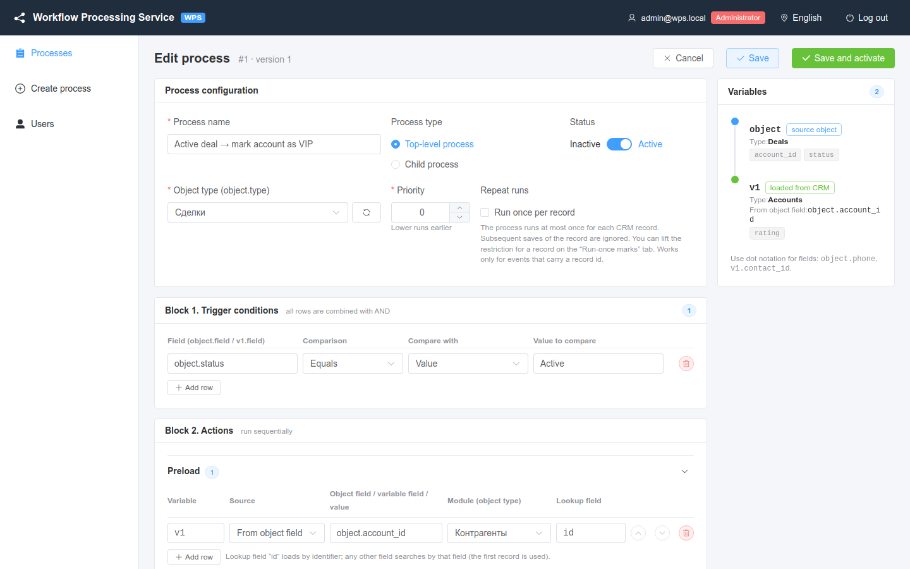
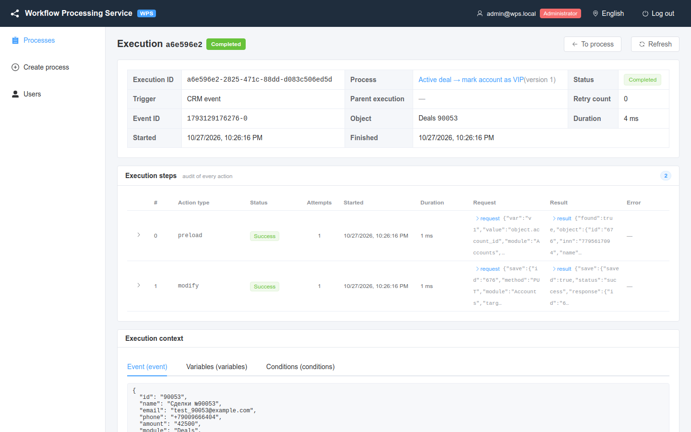
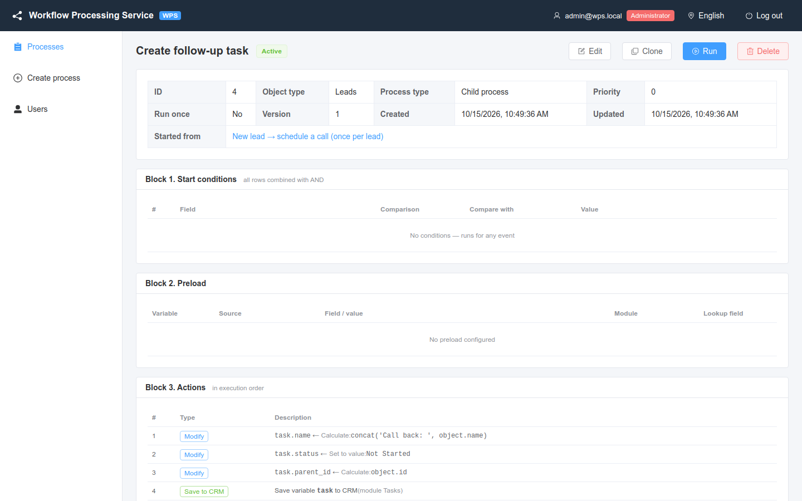
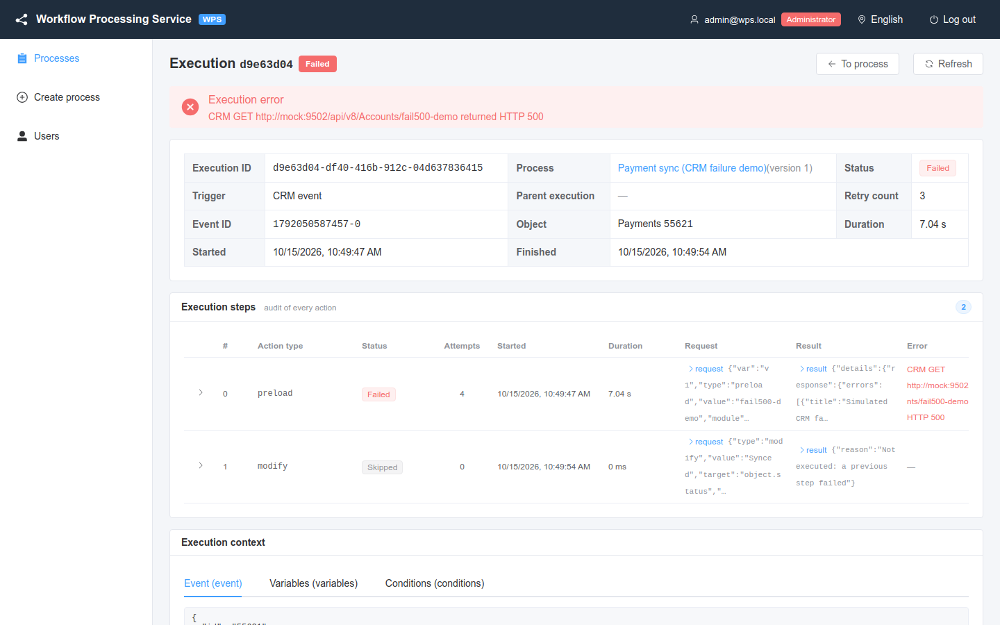
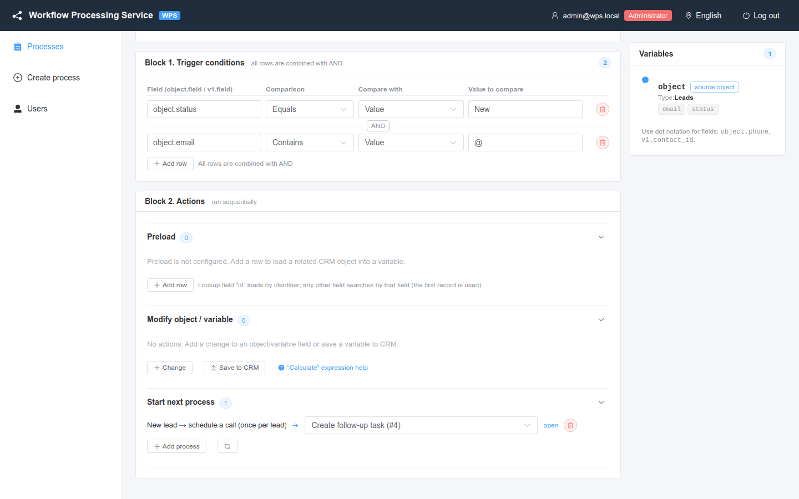
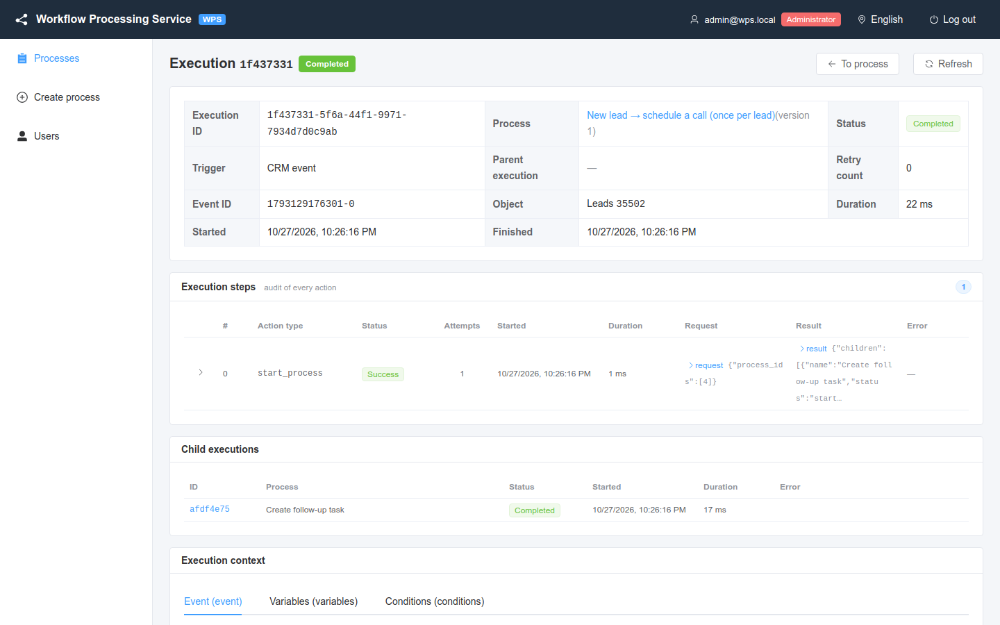

# Recipes

Ready-made end-to-end scenarios: what each process does, how to set it up, its JSON and how to test it with the mock CRM.

<!-- lang-switch -->
🇬🇧 English | [🇷🇺 Русский](../../ru/03-user-guide/recipes.md)
<!-- /lang-switch -->

All recipes were checked on the bundled mock CRM (see [Quick start](../02-getting-started/quick-start.md)): the mock
publishes test events into the stream and emulates the CRM API, so you can try everything without a real CRM.

## How to use a recipe

- **Set it up in the UI**: **Create process**, fill in the fields as described, then **Save and activate**.
- **Or create it through the API** with the JSON from the recipe:

  ```bash
  TOKEN=$(curl -s -X POST http://localhost:9501/api/auth/login -H 'Content-Type: application/json' \
    -d '{"email":"admin@wps.local","password":"admin"}' | python3 -c 'import sys,json;print(json.load(sys.stdin)["data"]["access_token"])')

  curl -s -X POST http://localhost:9501/api/processes -H "Authorization: Bearer $TOKEN" \
    -H 'Content-Type: application/json' -d @recipe.json
  ```

  The JSON files of recipes 1–6 are in the repository: `doc/_meta/demo_processes/`.
- **Send a test event** to the mock. Use `curl -g`, otherwise curl treats the brackets in `set[status]` as a pattern:

  ```bash
  curl -sg "http://localhost:9502/test-event?module=Deals&set[status]=Active"
  ```

  The mock generates an object of the module, stores it in the mock CRM, applies the `set[...]` overrides and publishes
  the event. The response contains the generated `event` (note its `id` and `account_id`).
- **Check the result** on the process card → **Execution log**, then open the execution
  (see [Executions and audit](executions-and-audit.md)). Records of the mock CRM can be read with
  `curl -s http://localhost:9502/mock/objects/<Module>/<id>`.

> **Note**
> A process reacts to events within a second, but the list of processes per object type is cached for up to
> `PROCESS_CACHE_TTL` (60 s). Saving a process clears the cache, so a new process is picked up at once.

| # | Recipe | Object type | Shows |
|---|---|---|---|
| 1 | [Active deal → mark the account as VIP](#1-active-deal--mark-the-account-as-vip) | Deals | condition, preload by id, **Set to value** + **Save to CRM** |
| 2 | [Invoice discount 10 %](#2-invoice-discount-10-) | Invoices | **Calculate**, functions `round`, `concat`, saving the event object |
| 3 | [Contact: copy the account name](#3-contact-copy-the-account-name) | Contacts | condition on a preloaded variable, **Set from variable** |
| 4 | [Child: create a follow-up task](#4-child-create-a-follow-up-task) | Leads (child) | a new variable saved as a new CRM record |
| 5 | [Payment sync: CRM failure](#5-payment-sync-crm-failure) | Payments | retries and a failed execution |
| 6 | [New lead → schedule a call, once per lead](#6-new-lead--schedule-a-call-once-per-lead) | Leads | **Contains**, **Start next process**, **Run once per record** |
| 7 | [Order: find the customer account by INN](#7-order-find-the-customer-account-by-inn) | Orders | preload by a non-id field |
| 8 | [Ticket: note on the account's contact](#8-ticket-note-on-the-accounts-contact) | Tickets | preload chain **From variable field**, guard condition |
| 10 | [Deal category](#10-deal-category-ifs-if) | Deals | **Calculate**, conditional functions `ifs`, `if`, comparisons and `and` |
| 11 | [Best phone to call](#11-best-phone-to-call-coalesce) | Leads | **Calculate**, `coalesce` — the first non-empty value |
| 12 | [A call 3 days before the deal closes at 10:00 local time](#12-a-call-3-days-before-the-deal-closes-at-1000-local-time) | Deals | date functions `add_days`, `datetime` with a zone, `format_date`, creating a call |
| 13 | [Prolong a deal by a month](#13-prolong-a-deal-by-a-month-add_months-end_of_quarter) | Deals | `add_months` clipped to the month end, `end_of_quarter`, `is_weekend` |
| 14 | [Discount from the manager's text and VAT](#14-discount-from-the-managers-text-and-vat-to_number-percent-number_format) | Deals | exact decimal arithmetic, `to_number`, `percent`, `round`, `floor`, `number_format` |
| 15 | [Lead → call: text from templates](#15-lead--call-text-from-templates-template) | Leads | **Template**: substitutions, filters `default`, `upper`, `truncate`, `format_date`, `{{= }}` |
| 16 | [Task for tomorrow at 18:00](#16-task-for-tomorrow-at-1800-date_shift) | Leads | **Date shift**: base `today`, `+1 day`, `set_time` |
| 17 | [A task 3 days before the deal closes, prolong by a month](#17-a-task-3-days-before-the-deal-closes-prolong-by-a-month-date_shift) | Deals | **Date shift** from a field, an hour shift from `now`, month-end clipping |
| 18 | [A deal is won → a task](#18-a-deal-is-won--a-task-changed_to) | Deals | **Changed to**, `object_before` in a template |
| 19 | [The amount changed: was → now](#19-the-amount-changed-was--now-changed-with-cast-decimal) | Deals | **Changed** with `cast: decimal` (no phantom changes) |
| 20 | [A welcome letter to a new lead](#20-a-welcome-letter-to-a-new-lead-send_email) | Leads | **Send an e-mail**: address from a field, a copy, an HTML template, history in the CRM |
| 21 | [Escalation of a case to the assignee and the manager](#21-escalation-of-a-case-to-the-assignee-and-the-manager-send_email) | Cases | **Send an e-mail** through a `Users` preload, `changed_to`, own transport secret |
| 22 | [A lead to the ERP and the order number back to the CRM](#22-a-lead-to-the-erp-and-the-order-number-back-to-the-crm-http_request) | Leads | **HTTP request**: JSON body, JSONPath, a secret, the journal and `Idempotency-Key` |
| 23 | [A Slack / messenger notification by webhook](#23-a-slack--messenger-notification-by-webhook-http_request) | Deals | **HTTP request** to a URL from a `webhook_url` secret, `on_error: continue` |
| 24 | [A meeting with participants for a new lead](#24-a-meeting-with-participants-for-a-new-lead-link_records) | Leads | **Link records**: a meeting participant with `accept_status`, the meeting linked to the lead |
| 25 | [The lead declined → unlink from the meeting](#25-the-lead-declined--unlink-from-the-meeting-unlink_records) | Leads | **Unlink records**, a preload by `parent_id`, `changed_to` |
| 26 | [Different actions for big and small deals](#26-different-actions-for-big-and-small-deals) | Opportunities | **Condition (if / else)**: branches with `cast`, an OR group, a default branch |
| 27 | [Do not process a lead without contacts](#27-do-not-process-a-lead-without-contacts-stop_process) | Leads | **Stop the process** inside a condition branch, a code and a message |
| 28 | [Remind 30 days before the contract ends](#28-remind-30-days-before-the-contract-ends-delay) | AOS_Contracts | **Delay** until a field date with an offset and a time of day |
| 29 | [Call back in 2 days](#29-call-back-in-2-days-delay) | Leads | **Delay** for a period, a call after the wait |
| 30 | [A lead summary: open tasks and calls](#30-a-lead-summary-open-tasks-and-calls-find_records) | Leads | **Find records**: a filter with `not_in`, sort, limit; related records with a local filter |
| 31 | [The account owner changed → hand over its open deals](#31-the-account-owner-changed--hand-over-its-open-deals-foreach) | Accounts | **Loop**: every open deal, `save_object` of the item, `on_item_error: continue` |
| 32 | [Deals of a new customer: next step and sum](#32-deals-of-a-new-customer-next-step-and-sum-foreach--accumulator) | Accounts | **Loop** with `where` and a `set_variable` accumulator |
| 33 | [A deal is lost → defer all open tasks](#33-a-deal-is-lost--defer-all-open-tasks-update_records) | Opportunities | **Update list records**: `set_value` and `calculate` rules, `only_changed` |
| 34 | [The account owner changed → all its contacts](#34-the-account-owner-changed--all-its-contacts-update_records) | Accounts | **Update list records** by relationship; action or loop |
| 35 | [An account summary: deals, tasks, last call](#35-an-account-summary-deals-tasks-last-call-aggregate) | Accounts | **Aggregate over records**: `count`, `sum`, `avg` by relationship, task `count` via `meta.total`, `max` of a date |
| 36 | [Sum of the won deals of an account](#36-sum-of-the-won-deals-of-an-account) | Accounts | Selection by relationship + a loop accumulator; a module aggregate when there is an account column |
| 37 | [A new lead → the bell and Telegram](#37-a-new-lead--the-bell-and-telegram-notify) | Leads | **Notification**: `crm_alert` to the owner, Telegram, a record link |
| 38 | [A big deal is won → Slack](#38-a-big-deal-is-won--slack-notify) | Opportunities | **Notification** to Slack and Teams, `fail_on: all` |
| 39 | [Distributing leads round robin](#39-distributing-leads-round-robin-assign) | Leads | **Assign an owner**: `round_robin` by a security group, `exclude`, `fallback` |
| 40 | [A case to the least busy](#40-a-case-to-the-least-busy-assign) | Cases | **Assign an owner**: `least_busy` by open cases |
| 41 | [Escalation to the manager](#41-escalation-to-the-manager-assign) | Cases | **Assign an owner**: `manager`, then a notification |
| 42 | [A lead with a free e-mail](#42-a-lead-with-a-free-e-mail-ends_with) | Leads | **Starts with**, **Ends with** case-insensitive, an OR group |
| 43 | [A mid-segment deal](#43-a-mid-segment-deal-between) | Opportunities | **Between** in a condition and in a Find records filter (`gte` + `lte`) |
| 44 | [An amount outside the account's limit corridor](#44-an-amount-outside-the-accounts-limit-corridor-not_between) | Opportunities | **Not between** with bounds from account fields, lazy preload |
| 45 | [Contract renewal within the next 30 days](#45-contract-renewal-within-the-next-30-days-relative-dates) | AOS_Contracts | Relative dates `today`, `today+30d` in a condition and a filter |
| 46 | [A case created within the last day became urgent](#46-a-case-created-within-the-last-day-became-urgent-now-24h) | Cases | `now-24h`, a bell notification |
| 47 | [Won deals of a manager this quarter](#47-won-deals-of-a-manager-this-quarter-between-with-relative-dates) | Opportunities | `between` `[start_of_quarter, end_of_quarter]` in an aggregate filter |
| 48 | [A Moscow lead](#48-a-moscow-lead-case-and-spaces-ignored) | Leads | `cast_options`: `case_sensitive: false`, `trim: true` for `equals` and `in` |
| 49 | [A quote with the vip or partner tag but without spam](#49-a-quote-with-the-vip-or-partner-tag-but-without-spam-multienum) | AOS_Quotes | **Contains any of**, **Contains none of** for a `^a^,^b^` multienum |
| 50 | [A deal over 80 % of the account credit limit](#50-a-deal-over-80--of-the-account-credit-limit-value_type-expression) | Opportunities | The right side of a condition is an **expression** `v1.credit_limit_c * 0.8`, lazy preload |
| 51 | [A deal within ±10 % of the plan](#51-a-deal-within-10--of-the-plan-between-with-expressions) | Opportunities | **Between** with a pair of expressions |
| 52 | [An account card: counter, history, rating by industry](#52-an-account-card-counter-history-rating-by-industry-increment-append-clear-map) | Accounts | **Increment by**, **Append**, **Clear**, **Map** |
| 53 | [Case priority by the account rating](#53-case-priority-by-the-account-rating-map) | Cases | **Map** with the `""` key and `default` |

---

## 1. Active deal → mark the account as VIP

**Goal.** When a deal is saved with status `Active`, set the field `rating` of its account to `VIP` in the CRM.

**Setup in the UI**

1. **Process name**: `Active deal → mark account as VIP`; **Process type**: **Top-level process**;
   **Object type (object.type)**: `Deals`.
2. **Block 1. Trigger conditions** → **Add row**: `object.status` · **Equals** · **Value** · `Active`.
3. **Preload** → **Add row**: variable `v1`, source **From object field**, `object.account_id`, module `Accounts`,
   lookup field `id`.
4. **Modify object / variable** → **Change**: target `v1.rating`, **Set to value**, `VIP`, tick **Save to CRM**.



*The edit form: configuration, one condition, the preload of `v1` and the variables sidebar.*

**JSON**

```json
{
  "name": "Active deal → mark account as VIP",
  "object_type": "Deals", "is_child": false, "is_active": true, "priority": 0, "run_once": false,
  "definition": {
    "conditions": [
      { "field": "object.status", "operator": "equals", "value_type": "static", "value": "Active" }
    ],
    "preload": [
      { "var": "v1", "source": "object_field", "module": "Accounts", "by_field": "id", "value": "object.account_id" }
    ],
    "actions": [
      { "type": "modify", "target": "v1.rating", "change_type": "set_value", "value": "VIP", "save_to_crm": true }
    ]
  }
}
```

**Test**

```bash
curl -sg "http://localhost:9502/test-event?module=Deals&set[status]=Active"   # starts the process
curl -sg "http://localhost:9502/test-event?module=Deals&set[status]=Closed"   # does not start it
curl -s  "http://localhost:9502/mock/objects/Accounts/<account_id from the event>"   # "rating": "VIP"
```

**What you see.** One execution per `Active` deal with status **Completed** and two steps: `preload` (`found: true`,
the account in `result_data.object`) and `modify` (`old_value: ""`, `new_value: "VIP"`, and a `save` block with
`"method": "PUT"`, `"attributes": {"rating": "VIP"}`). The `Closed` deal leaves no execution: its conditions are not met.



*Execution of recipe 1: preload of the account, then the change saved to the CRM.*

---

## 2. Invoice discount 10 %

**Goal.** For an `Active` invoice reduce `amount` by 10 %, write a note to `description` and save both fields.

**Setup in the UI**

1. **Object type**: `Invoices`; **Priority**: `10` (when several processes react to one object type, a lower value runs earlier).
2. Condition: `object.status` · **Equals** · **Value** · `Active`.
3. **Modify object / variable**:
   - **Change**: `object.amount`, **Calculate**, `round(object.amount * 0.9, 2)`;
   - **Change**: `object.description`, **Calculate**, `concat('Discount applied, new amount: ', object.amount)`;
   - **Save to CRM** (the button under the table): variable `object`.


*Recipe 2: the second expression already uses the new `object.amount` computed by the first one.*

**JSON**

```json
{
  "name": "Invoice discount 10%",
  "object_type": "Invoices", "is_child": false, "is_active": true, "priority": 10, "run_once": false,
  "definition": {
    "conditions": [
      { "field": "object.status", "operator": "equals", "value_type": "static", "value": "Active" }
    ],
    "preload": [],
    "actions": [
      { "type": "modify", "target": "object.amount", "change_type": "calculate", "value": "round(object.amount * 0.9, 2)", "save_to_crm": false },
      { "type": "modify", "target": "object.description", "change_type": "calculate", "value": "concat('Discount applied, new amount: ', object.amount)", "save_to_crm": false },
      { "type": "save_object", "target": "object" }
    ]
  }
}
```

**Test**

```bash
curl -sg "http://localhost:9502/test-event?module=Invoices&set[status]=Active&set[amount]=19500"
```

**What you see.** Three successful steps. `modify` #0: `old_value "19500"` → `new_value 17550`; `modify` #1:
`"Discount applied, new amount: 17550"`; `save_object`: `"method": "PUT"` with only the two changed fields in
`attributes`. Actions run strictly in order, and unsaved changes are collected and sent in one request.

---

## 3. Contact: copy the account name

**Goal.** When a contact that is not `Closed` is saved and its account is `Active`, copy the account name into the
contact's `description`.

**Setup in the UI**

1. **Object type**: `Contacts`.
2. Conditions:
   - `object.status` · **Not equals** · **Value** · `Closed`;
   - `v1.status` · **Equals** · **Value** · `Active`.
3. **Preload**: `v1`, **From object field**, `object.account_id`, `Accounts`, `id`.
4. **Change**: `object.description`, **Set from variable**, `v1.name`, **Save to CRM**.


*The second condition uses `v1`: the variables sidebar shows that `v1` is loaded from the CRM.*

**How it works.** A condition on a variable triggers a **lazy preload**: WPS first checks the rows on `object.*`; only
if they pass, it runs the preload block and then checks the rest. A contact with status `Closed` therefore costs no
CRM request.

**JSON**

```json
{
  "name": "Contact: copy account name",
  "object_type": "Contacts", "is_child": false, "is_active": true, "priority": 0, "run_once": false,
  "definition": {
    "conditions": [
      { "field": "object.status", "operator": "not_equals", "value_type": "static", "value": "Closed" },
      { "field": "v1.status", "operator": "equals", "value_type": "static", "value": "Active" }
    ],
    "preload": [
      { "var": "v1", "source": "object_field", "module": "Accounts", "by_field": "id", "value": "object.account_id" }
    ],
    "actions": [
      { "type": "modify", "target": "object.description", "change_type": "set_from_variable", "value": "v1.name", "save_to_crm": true }
    ]
  }
}
```

**Test**

```bash
curl -sg "http://localhost:9502/test-event?module=Contacts&set[status]=New"
```

**What you see.** Steps `preload` (the account) and `modify` with `new_value` = the account name and
`save.attributes = {"description": "<account name>"}`. The **Conditions** tab of the context shows both rows with
`result: true`.

---

## 4. Child: create a follow-up task

**Goal.** A reusable child process that creates a `Tasks` record "Call back: <lead name>" linked to the lead. It is
started by recipe 6.

**Setup in the UI**

1. **Process type**: **Child process**; **Object type**: `Leads`; no conditions.
2. **Modify object / variable**:
   - `task.name`, **Calculate**, `concat('Call back: ', object.name)`;
   - `task.status`, **Set to value**, `Not Started`;
   - `task.parent_id`, **Calculate**, `object.id`;
   - **Save to CRM**: variable `task`, module `Tasks`.

`task` is not preloaded: the first change creates it as a new object. A variable without `id` is saved with `POST`,
i.e. as a new CRM record, so its module must be given in the save row.

The name is easier to build with a [template](change-types-and-expressions.md#template): `task.name`, **Template**,
`Call back: {{ object.name }}` — see [scenario 15](#15-lead--call-text-from-templates-template).

**JSON**

```json
{
  "name": "Create follow-up task",
  "object_type": "Leads", "is_child": true, "is_active": true, "priority": 0, "run_once": false,
  "definition": {
    "conditions": [],
    "preload": [],
    "actions": [
      { "type": "modify", "target": "task.name", "change_type": "calculate", "value": "concat('Call back: ', object.name)", "save_to_crm": false },
      { "type": "modify", "target": "task.status", "change_type": "set_value", "value": "Not Started", "save_to_crm": false },
      { "type": "modify", "target": "task.parent_id", "change_type": "calculate", "value": "object.id", "save_to_crm": false },
      { "type": "save_object", "target": "task", "module": "Tasks" }
    ]
  }
}
```

**Test.** A child process does not react to events; test it through recipe 6, or run it manually from its card with
`{"id": "1", "module": "Leads", "name": "Test lead"}`.

**What you see.** Four steps; `save_object` has `"method": "POST"`, `"module": "Tasks"` and `created_id` — the id of
the new task. The execution trigger is **Child** and **Parent execution** links to the execution of recipe 6.



*Recipe 4: **Started from** shows the parent process.*

---

## 5. Payment sync: CRM failure

**Goal.** Show what happens when the CRM fails. The preload requests the account `fail500-demo`; the mock answers any
id starting with `fail500` with HTTP 500.

**JSON**

```json
{
  "name": "Payment sync (CRM failure demo)",
  "object_type": "Payments", "is_child": false, "is_active": true, "priority": 0, "run_once": false,
  "definition": {
    "conditions": [],
    "preload": [],
    "actions": [
      { "type": "preload", "var": "v1", "source": "manual", "module": "Accounts", "by_field": "id", "value": "fail500-demo" },
      { "type": "modify", "target": "object.status", "change_type": "set_value", "value": "Synced", "save_to_crm": true }
    ]
  }
}
```

A preload row can also be an action (`"type": "preload"` in `actions`); **Manual input** uses the typed value
instead of a field.

**Test**

```bash
curl -sg "http://localhost:9502/test-event?module=Payments"
```

**What you see** (after about 7 seconds: retry delays of 1 s, 2 s and 4 s). Status **Failed**, **Retry count** 3,
the banner `CRM GET http://mock:9502/api/v8/Accounts/fail500-demo returned HTTP 500`; the `preload` step has
**Attempts** 4 and `recoverable: true`; the `modify` step is **Skipped**. While retrying, the execution shows the
status **Retrying**.



*Recipe 5: three retries of a temporary error, then the execution fails and stops.*

---

## 6. New lead → schedule a call, once per lead

**Goal.** For a lead with status `New` and an e-mail, start the child process of recipe 4 — but only once per lead,
however many times the lead is saved.

**Setup in the UI**

1. **Object type**: `Leads`; tick **Run once per record**.
2. Conditions: `object.status` · **Equals** · `New`; `object.email` · **Contains** · `@`.
3. **Start next process** → **Add process** → the child process of recipe 4.



*Recipe 6: two conditions joined by AND and the child process #4.*

**JSON** — `4` is the id of **your** child process from recipe 4:

```json
{
  "name": "New lead → schedule a call (once per lead)",
  "object_type": "Leads", "is_child": false, "is_active": true, "priority": 0, "run_once": true,
  "definition": {
    "conditions": [
      { "field": "object.status", "operator": "equals", "value_type": "static", "value": "New" },
      { "field": "object.email", "operator": "contains", "value_type": "static", "value": "@" }
    ],
    "preload": [],
    "actions": [
      { "type": "start_process", "process_id": 4 }
    ]
  }
}
```

**Test**

```bash
curl -sg "http://localhost:9502/test-event?module=Leads&set[status]=New"        # starts the parent and the child
curl -sg "http://localhost:9502/test-event?module=Leads&set[status]=Inactive"   # conditions not met
```

Then repeat for the same lead with a manual run (**Run**) and the lead `id` from the first event:
`{"id": "<lead id>", "module": "Leads", "status": "New", "email": "lead@example.com"}`.

**What you see.** The parent execution has one `start_process` step with
`children: [{"process_id": 4, "status": "started"}]` and the table **Child executions**. The manual repeat answers
**The process has already run for this record — no new run was created**; the tab **Run-once records** shows the
lead with **Blocked** = 1. To allow a new run, click **Reset** (see [Manual run and reset](manual-run-and-reset.md)).



*Recipe 6: the parent finished at once; the child ran in parallel and created the task.*

---

## 7. Order: find the customer account by INN

**Goal.** An order carries the customer's tax number `customer_inn`, not the account id. Find the account by its `inn`
field, link the order to it and write the customer name and phone into the order.

**Setup in the UI**

1. **Object type**: `Orders`.
2. Condition: `object.customer_inn` · **Not equals** · **Value** · empty (leave the value empty).
3. **Preload**: variable `acc`, **From object field**, `object.customer_inn`, module `Accounts`, lookup field `inn`.
   Any lookup field other than `id` searches by that field; if several records match, the first one is used.
4. Changes:
   - `object.account_id`, **Set from variable**, `acc.id`;
   - `object.description`, **Calculate**, `concat('Customer: ', acc.name, ', phone ', acc.phone)`;
   - **Save to CRM**: `object`.

**JSON**

```json
{
  "name": "Order: find customer account by INN",
  "object_type": "Orders", "is_child": false, "is_active": true, "priority": 0, "run_once": false,
  "definition": {
    "conditions": [
      { "field": "object.customer_inn", "operator": "not_equals", "value_type": "static", "value": "" }
    ],
    "preload": [
      { "var": "acc", "source": "object_field", "module": "Accounts", "by_field": "inn", "value": "object.customer_inn" }
    ],
    "actions": [
      { "type": "modify", "target": "object.account_id", "change_type": "set_from_variable", "value": "acc.id", "save_to_crm": false },
      { "type": "modify", "target": "object.description", "change_type": "calculate", "value": "concat('Customer: ', acc.name, ', phone ', acc.phone)", "save_to_crm": false },
      { "type": "save_object", "target": "object" }
    ]
  }
}
```

**Test.** Mock accounts have an `inn`. Take an account id from any generated event, read its `inn` and send an
order with it:

```bash
curl -s  "http://localhost:9502/mock/objects/Accounts/<account_id>"            # → "inn": "7726436001"
curl -sg "http://localhost:9502/test-event?module=Orders&set[customer_inn]=7726436001"
```

**What you see.** The `preload` step has `"strategy": "by_field"`, `"by_field": "inn"`, `lookup_value` = the INN and
the found account in `result_data.object`. After `save_object` the order in the mock CRM has the `account_id` of that
account and `description` like `Customer: ПАО "Восток", phone +74954813492`. An order without `customer_inn` does not
start the process: a missing field makes a condition false.

---

## 8. Ticket: note on the account's contact

**Goal.** When a `New` ticket is saved, find the contact of the ticket's account and write the ticket name into the
contact's `description` — only if such a contact exists.

**Setup in the UI**

1. **Object type**: `Tickets`.
2. Conditions:
   - `object.status` · **Equals** · `New`;
   - `v2.id` · **Not equals** · **Value** · empty — the guard condition, see below.
3. **Preload**, two rows in this order:
   - `v1`, **From object field**, `object.account_id`, `Accounts`, `id`;
   - `v2`, **From variable field**, `v1.id`, `Contacts`, lookup field `account_id`.
4. **Change**: `v2.description`, **Calculate**, `concat('Open ticket: ', object.name, ' (', v1.name, ')')`,
   **Save to CRM**.

A **From variable field** row may only use variables declared above it (**Variable “…” must be declared above**).

> **Warning**
> Without the guard condition `v2.id` the process also runs when the account has no contact. Then `v2` is `null`, the
> change creates a new object `v2`, and **Save to CRM** sends it with `POST` — a new, almost empty `Contacts` record
> appears in the CRM. Always guard changes of a preloaded variable that may be empty with a condition on it, or use a
> separate `save_object` step (it is **Skipped** for an empty variable).

**JSON**

```json
{
  "name": "Ticket: note on the account's contact",
  "object_type": "Tickets", "is_child": false, "is_active": true, "priority": 0, "run_once": false,
  "definition": {
    "conditions": [
      { "field": "object.status", "operator": "equals", "value_type": "static", "value": "New" },
      { "field": "v2.id", "operator": "not_equals", "value_type": "static", "value": "" }
    ],
    "preload": [
      { "var": "v1", "source": "object_field", "module": "Accounts", "by_field": "id", "value": "object.account_id" },
      { "var": "v2", "source": "variable_field", "module": "Contacts", "by_field": "account_id", "value": "v1.id" }
    ],
    "actions": [
      { "type": "modify", "target": "v2.description", "change_type": "calculate", "value": "concat('Open ticket: ', object.name, ' (', v1.name, ')')", "save_to_crm": true }
    ]
  }
}
```

**Test.** Mock contacts are not linked to accounts, so create one with the test helper and send a ticket for that account:

```bash
curl -s -X PUT http://localhost:9502/mock/objects/Contacts/c-706 -H 'Content-Type: application/json' \
  -d '{"name":"Anna Smirnova","account_id":"706","email":"anna@example.com"}'
curl -sg "http://localhost:9502/test-event?module=Tickets&set[status]=New&set[account_id]=706"   # runs
curl -sg "http://localhost:9502/test-event?module=Tickets&set[status]=New"                      # no contact → no run
```

(`706` must be an existing mock account: take an `account_id` from any generated event.)

**What you see.** For the first ticket: two `preload` steps (`v2` found by `account_id`) and a `modify` step with
`save.method: "PUT"` for `c-706`. For the second ticket no execution is created; a manual run with the same object
shows the row `v2.id` with **Actual** empty and **Result** `false`.

## 9. Conditions by type, emptiness and lists (via the API)

Four short conditions from tasks 3.1, 3.2, 3.4. The editor still builds only **Equals** / **Not equals** /
**Contains** / **Does not contain**, so such rows are set through the API (`POST` / `PUT /api/processes`); the editor
keeps them unchanged. Details — [Triggers and conditions](triggers-and-conditions.md#operators).

**Big deal.** The amount is greater than a million — compared as decimals (`"1500000"`, `"1 500 000,00"` and
`1500000` are the same):

```json
{ "field": "object.amount", "operator": "greater_than", "cast": "decimal", "value_type": "static", "value": "1 000 000" }
```

**No mobile phone.** The CRM sends an unfilled field as an empty string — that is "empty":

```json
{ "field": "object.phone_mobile", "operator": "is_empty" }
```

**Company not found in the CRM.** Preload `company` (module `Accounts`, lookup field `name`, value
`object.account_name`); when there is no such company the variable is empty and `company.id` has no data:

```json
{ "field": "company.id", "operator": "is_null" }
```

**Status from a list.** One operator instead of three OR groups:

```json
{ "field": "object.status", "operator": "in", "value_type": "static", "value": ["New", "Assigned", "In Process"] }
```

**How to test.** A manual run (`POST /api/processes/{id}/run`) shows `actual_cast` / `expected_cast` in the condition
trace, `found: false` for `is_null`, the list of items in `expected_cast` for `in`.

---

## 10. Deal category (`ifs`, `if`)

**Goal.** For an active deal, write a category by amount (A — over a million, B — over 100,000, otherwise C) and a
priority note: “In progress” when the probability is at least 50 % and the deal is not lost, otherwise “Low priority”.

**UI setup**

1. **Object type**: `Deals`.
2. Condition: `object.status` · **Equals** · **Value** · `Active`.
3. **Modify object / variable**:
   - **Change**: `object.next_step`, **Calculate**,
     `concat('Category ', ifs(object.amount > 1000000, 'A', object.amount > 100000, 'B', 'C'))`;
   - **Change**: `object.description`, **Calculate**,
     `if(object.probability >= 50 and object.sales_stage != 'Closed Lost', 'In progress', 'Low priority')`;
   - **Save to CRM**: variable `object`.

`ifs` checks the “condition, value” pairs in order and takes the first true one; the odd last argument `'C'` is the
default. Amounts are compared as numbers when the CRM sends them in a strict number format (`"2000000"`, `"250000.00"`);
an amount like `"1 000 000"` would be compared as a string — see
[Comparison rules](change-types-and-expressions.md#comparison-rules).

**JSON**

```json
{
  "name": "Deal category",
  "object_type": "Deals", "is_child": false, "is_active": true, "priority": 20, "run_once": false,
  "definition": {
    "conditions": [
      { "field": "object.status", "operator": "equals", "value_type": "static", "value": "Active" }
    ],
    "preload": [],
    "actions": [
      { "type": "modify", "target": "object.next_step", "change_type": "calculate", "value": "concat('Category ', ifs(object.amount > 1000000, 'A', object.amount > 100000, 'B', 'C'))", "save_to_crm": false },
      { "type": "modify", "target": "object.description", "change_type": "calculate", "value": "if(object.probability >= 50 and object.sales_stage != 'Closed Lost', 'In progress', 'Low priority')", "save_to_crm": false },
      { "type": "save_object", "target": "object" }
    ]
  }
}
```

**Test**

```bash
curl -sg "http://localhost:9502/test-event?module=Deals&set[status]=Active&set[amount]=2000000&set[probability]=60&set[sales_stage]=Negotiation"
curl -sg "http://localhost:9502/test-event?module=Deals&set[status]=Active&set[amount]=250000&set[probability]=10&set[sales_stage]=Prospecting"
```

**What you will see.** The first deal: `next_step` is “Category A”, `description` is “In progress”. The second:
“Category B” and “Low priority”. A process with `ifs(object.amount > 1)` or `if(1)` is not saved:
`Function "ifs" expects at least 2 arguments, got 1`. The same scenario is verified on SuiteCRM 8 (the `Opportunities` module).

---

## 11. Best phone to call (`coalesce`)

**Goal.** For a new lead, write the phone to call into `description`: the mobile one when it is filled in, otherwise the
work one, otherwise the other one; “no phone” when there are none.

**UI setup**

1. **Object type**: `Leads`.
2. Condition: `object.status` · **Equals** · **Value** · `New`.
3. **Modify object / variable**:
   - **Change**: `object.description`, **Calculate**,
     `concat('Call: ', coalesce(object.phone_mobile, object.phone_work, object.phone_other, 'no phone'))`;
   - **Save to CRM**: variable `object`.

`coalesce` returns the first argument that is not `null` and not an empty string — an unfilled CRM field (an empty
string) and a missing field are skipped. For a single fallback `ifempty(object.phone_mobile, object.phone_work)` is shorter.

**JSON**

```json
{
  "name": "Best phone to call",
  "object_type": "Leads", "is_child": false, "is_active": true, "priority": 20, "run_once": false,
  "definition": {
    "conditions": [
      { "field": "object.status", "operator": "equals", "value_type": "static", "value": "New" }
    ],
    "preload": [],
    "actions": [
      { "type": "modify", "target": "object.description", "change_type": "calculate", "value": "concat('Call: ', coalesce(object.phone_mobile, object.phone_work, object.phone_other, 'no phone'))", "save_to_crm": false },
      { "type": "save_object", "target": "object" }
    ]
  }
}
```

**Test**

```bash
curl -sg "http://localhost:9502/test-event?module=Leads&set[status]=New&set[phone_mobile]=&set[phone_work]=%2B7%20495%20000-00-21"
curl -sg "http://localhost:9502/test-event?module=Leads&set[status]=New&set[phone_mobile]=&set[phone_work]=&set[phone_other]="
```

**What you will see.** The first lead: “Call: +7 495 000-00-21” (the mobile is empty — the work phone is taken). The
second: “Call: no phone”.

---

## 12. A call 3 days before the deal closes at 10:00 local time

**Goal.** For a new deal create a call “Call back before …” at 10:00 local time (`WPS_TIMEZONE`) three days before the
close date.

**UI setup**

1. **Object type**: `Deals`.
2. Condition: `object.status` · **Equals** · **Value** · `New`.
3. **Modify object / variable** (new variable `call`):
   - `call.name`, **Calculate**, `concat('Call back before ', format_date(add_days(object.date_closed, -3), 'd.m.Y'))`;
   - `call.date_start`, **Calculate**, `datetime(concat(add_days(object.date_closed, -3), ' 10:00'), 'Y-m-d H:i', 'local')`;
   - `call.status` — **Set to value** `Planned`, `call.parent_type` — `Deals`, `call.parent_id` — **Set from variable** `object.id`;
   - **Save to CRM**: variable `call`, module `Calls`.

`add_days(object.date_closed, -3)` gives a `Y-m-d` date, `concat` appends the time, and `datetime(…, 'local')` reads it
as local time and converts it to UTC — the form the CRM expects. Instead of `'local'` a zone can be given explicitly:
`'Europe/Moscow'`.

**JSON**

```json
{
  "name": "Call 3 days before close",
  "object_type": "Deals", "is_child": false, "is_active": true, "priority": 20, "run_once": true,
  "definition": {
    "conditions": [
      { "field": "object.status", "operator": "equals", "value_type": "static", "value": "New" }
    ],
    "preload": [],
    "actions": [
      { "type": "modify", "target": "call.name", "change_type": "calculate", "value": "concat('Call back before ', format_date(add_days(object.date_closed, -3), 'd.m.Y'))", "save_to_crm": false },
      { "type": "modify", "target": "call.date_start", "change_type": "calculate", "value": "datetime(concat(add_days(object.date_closed, -3), ' 10:00'), 'Y-m-d H:i', 'local')", "save_to_crm": false },
      { "type": "modify", "target": "call.status", "change_type": "set_value", "value": "Planned", "save_to_crm": false },
      { "type": "modify", "target": "call.parent_type", "change_type": "set_value", "value": "Deals", "save_to_crm": false },
      { "type": "modify", "target": "call.parent_id", "change_type": "set_from_variable", "value": "object.id", "save_to_crm": false },
      { "type": "save_object", "target": "call", "module": "Calls" }
    ]
  }
}
```

**Check**

```bash
curl -sg "http://localhost:9502/test-event?module=Deals&set[status]=New&set[date_closed]=2026-01-31"
```

**What you will see.** A call “Call back before 28.01.2026” with `date_start` = `2026-01-28 10:00:00` when
`WPS_TIMEZONE=UTC`, or `2026-01-28 07:00:00` (10:00 Moscow time) when `WPS_TIMEZONE=Europe/Moscow`. On SuiteCRM 8 (the
`Opportunities` module, zone `'Europe/Moscow'`) the scenario is verified by case 5.2.2.

---

## 13. Prolong a deal by a month (`add_months`, `end_of_quarter`)

**Goal.** Move the deal close date one month forward and write the end of the new date's quarter and a weekend flag into
`next_step`.

**UI setup**

1. **Object type**: `Deals`.
2. Condition: `object.status` · **Equals** · **Value** · `Prolong`.
3. **Modify object / variable**:
   - `object.date_closed`, **Calculate**, `add_months(object.date_closed, 1)`;
   - `object.next_step`, **Calculate**,
     `concat('Quarter ends ', format_date(end_of_quarter(object.date_closed), 'd.m.Y'), ', ', if(is_weekend(object.date_closed), 'weekend', 'weekday'))`;
   - **Save to CRM**: variable `object`.

`add_months` clips the day to the end of the month: January 31 + 1 month = February 28 (not March 3). The second row
already sees the new `object.date_closed`. There is no holiday calendar: `is_weekend` only checks Saturday and Sunday.

**JSON**

```json
{
  "name": "Prolong deal by a month",
  "object_type": "Deals", "is_child": false, "is_active": true, "priority": 20, "run_once": false,
  "definition": {
    "conditions": [
      { "field": "object.status", "operator": "equals", "value_type": "static", "value": "Prolong" }
    ],
    "preload": [],
    "actions": [
      { "type": "modify", "target": "object.date_closed", "change_type": "calculate", "value": "add_months(object.date_closed, 1)", "save_to_crm": false },
      { "type": "modify", "target": "object.next_step", "change_type": "calculate", "value": "concat('Quarter ends ', format_date(end_of_quarter(object.date_closed), 'd.m.Y'), ', ', if(is_weekend(object.date_closed), 'weekend', 'weekday'))", "save_to_crm": false },
      { "type": "save_object", "target": "object" }
    ]
  }
}
```

**Check**

```bash
curl -sg "http://localhost:9502/test-event?module=Deals&set[status]=Prolong&set[date_closed]=2026-01-31"
```

**What you will see.** `date_closed` = `2026-02-28`, `next_step` is “Quarter ends 31.03.2026, weekend” (2026-02-28 is a
Saturday). The scenario is verified on SuiteCRM 8 by case 5.2.2.

## 14. Discount from the manager's text and VAT (`to_number`, `percent`, `number_format`)

**Goal.** A manager types the discount percent into the deal description in the familiar Russian format (`7,5`). The
process recalculates the amount exactly and writes the total and the included VAT in Russian number format.

**Setup in the UI**

1. **Object type**: `Deals`.
2. Condition: `object.status` · **Equals** · **Value** · `Discount`.
3. **Modify object / variable**:
   - `object.amount`, **Calculate**, `round(object.amount - percent(object.amount, to_number(object.description)), 2)`;
   - `object.next_step`, **Calculate**, `concat('Total: ', number_format(object.amount, 2, ',', ' '), ' RUB')`;
   - `object.description`, **Calculate**, `concat('incl. VAT 20%: ', number_format(round(object.amount / 6, 2), 2, ',', ' '), '; floored to thousands: ', floor(object.amount, -3))`;
   - **Save to CRM**: variable `object`.

`to_number` understands spaces and a decimal comma (`'7,5'` → `7.5`, `'1 234,56'` → `1234.56`); without it the text
`'7,5'` is not a number and `percent` would fail the step. Arithmetic is exact: `1234567.89 × 0.925 = 1141975.29825` →
`round(…, 2)` = `1141975.3` (half away from zero), no float noise. `floor(x, -3)` rounds down to thousands.

**JSON**

```json
{
  "name": "Discount from manager text and VAT",
  "object_type": "Deals", "is_child": false, "is_active": true, "priority": 20, "run_once": false,
  "definition": {
    "conditions": [
      { "field": "object.status", "operator": "equals", "value_type": "static", "value": "Discount" }
    ],
    "preload": [],
    "actions": [
      { "type": "modify", "target": "object.amount", "change_type": "calculate", "value": "round(object.amount - percent(object.amount, to_number(object.description)), 2)", "save_to_crm": false },
      { "type": "modify", "target": "object.next_step", "change_type": "calculate", "value": "concat('Total: ', number_format(object.amount, 2, ',', ' '), ' RUB')", "save_to_crm": false },
      { "type": "modify", "target": "object.description", "change_type": "calculate", "value": "concat('incl. VAT 20%: ', number_format(round(object.amount / 6, 2), 2, ',', ' '), '; floored to thousands: ', floor(object.amount, -3))", "save_to_crm": false },
      { "type": "save_object", "target": "object" }
    ]
  }
}
```

**Check**

```bash
curl -sg "http://localhost:9502/test-event?module=Deals&set[status]=Discount&set[amount]=1234567.89&set[description]=7,5"
```

**What you will see.** `amount` = `1141975.3`, `next_step` is “Total: 1 141 975,30 RUB”, `description` is “incl. VAT 20%:
190 329,22; floored to thousands: 1141000”. If the description is not a number (`a lot`), the execution fails with
`Cannot convert "a lot" to a number` and the deal stays unchanged. The scenario is verified on SuiteCRM 8 by case 5.2.3.

---

## 15. Lead → call: text from templates (`template`)

**Goal.** For a new lead create a call whose name and description are built with templates — without chains of
`substr(concat(…))` — and mark the lead. If the lead has no mobile phone, the work phone is used.

**Setup in the UI**

1. **Object type**: `Leads`; tick **Run once per record**; condition: `object.status` · **Equals** · `New`.
2. **Modify object / variable**:
   - `object.description`, **Template**, `Обработан WPS: {{ object.salutation | default:'без обращения' }}, источник — {{ object.lead_source | default:'неизвестен' }}`, **Save to CRM**;
   - `call.name`, **Template**, `Позвонить: {{ object.first_name }} {{ object.last_name | upper | truncate:25 }}`;
   - `call.description`, **Template**, `Компания: {{ object.account_name | default:'—' }}. Телефон: {{= coalesce(object.phone_mobile, object.phone_work, 'нет') }}. Лид создан {{ object.date_entered | format_date:'d.m.Y H:i':'Europe/Moscow' }} МСК`;
   - `call.direction` = `Outbound`, `call.status` = `Planned`, `call.date_start`, **Calculate**, `add_days(now(), 1)`,
     `call.duration_hours` = `0`, `call.duration_minutes` = `15`, `call.parent_type` = `Leads`,
     `call.parent_id`, **Set from variable**, `object.id`;
   - **Save to CRM**: variable `call`, module `Calls`.

`truncate:25` limits the length including `…`; `default` inserts text when the field is empty or missing; `{{= … }}`
computes an expression right in the text; `format_date` with a time zone shows the creation date (UTC in the CRM) in
Moscow time.

**JSON**

```json
{
  "name": "New lead → call (template)",
  "object_type": "Leads", "is_child": false, "is_active": true, "priority": 0, "run_once": true,
  "definition": {
    "conditions": [
      { "field": "object.status", "operator": "equals", "value_type": "static", "value": "New" }
    ],
    "preload": [],
    "actions": [
      { "type": "modify", "target": "object.description", "change_type": "template", "value": "Обработан WPS: {{ object.salutation | default:'без обращения' }}, источник — {{ object.lead_source | default:'неизвестен' }}", "save_to_crm": true },
      { "type": "modify", "target": "call.name", "change_type": "template", "value": "Позвонить: {{ object.first_name }} {{ object.last_name | upper | truncate:25 }}" },
      { "type": "modify", "target": "call.description", "change_type": "template", "value": "Компания: {{ object.account_name | default:'—' }}. Телефон: {{= coalesce(object.phone_mobile, object.phone_work, 'нет') }}. Лид создан {{ object.date_entered | format_date:'d.m.Y H:i':'Europe/Moscow' }} МСК" },
      { "type": "modify", "target": "call.direction", "change_type": "set_value", "value": "Outbound" },
      { "type": "modify", "target": "call.status", "change_type": "set_value", "value": "Planned" },
      { "type": "modify", "target": "call.date_start", "change_type": "calculate", "value": "add_days(now(), 1)" },
      { "type": "modify", "target": "call.duration_hours", "change_type": "set_value", "value": "0" },
      { "type": "modify", "target": "call.duration_minutes", "change_type": "set_value", "value": "15" },
      { "type": "modify", "target": "call.parent_type", "change_type": "set_value", "value": "Leads" },
      { "type": "modify", "target": "call.parent_id", "change_type": "set_from_variable", "value": "object.id" },
      { "type": "save_object", "target": "call", "module": "Calls" }
    ]
  }
}
```

**What you see.** For the lead "Анна Смирнова-Голенищева", company "ООО «Ромашка»", work phone only: the call
"Позвонить: Анна СМИРНОВА-ГОЛЕНИЩЕВА…" (25 characters after the first name including `…`), the description
"Компания: ООО «Ромашка». Телефон: +7 495 000-51-11. Лид создан 20.10.2026 10:21 МСК", and the lead gets
"Обработан WPS: без обращения, источник — неизвестен". If the template uses a field the lead does not have (e.g.
`{{ object.no_such_field }}`), an empty string is inserted and the path appears in `result_data.missing` of the step;
with `"missing": "error"` the step fails. Verified on SuiteCRM 8 by case 5.1.1.

---

## 16. Task for tomorrow at 18:00 (`date_shift`)

**Goal.** For a new lead create the task "Qualify the lead" due "tomorrow at 18:00" local time — without formulas.

**UI settings**

1. **Object type**: `Leads`; tick **Run once per record**; condition: `object.status` · **Equals** · `New`.
2. **Modify object / variable**:
   - `task.name`, **Template**, `Квалифицировать: {{ object.last_name | truncate:30 }}`;
   - `task.date_due`, **Date shift**: base `today`, shift `+1 day`, time `18:00`;
   - `task.status` = `Not Started`, `task.parent_type` = `Leads`, `task.parent_id`, **Set from variable**, `object.id`;
   - **Save to CRM**: variable `task`, module `Tasks`.

**JSON**

```json
{
  "name": "New lead → task tomorrow 18:00",
  "object_type": "Leads", "is_child": false, "is_active": true, "priority": 0, "run_once": true,
  "definition": {
    "conditions": [
      { "field": "object.status", "operator": "equals", "value_type": "static", "value": "New" }
    ],
    "preload": [],
    "actions": [
      { "type": "modify", "target": "task.name", "change_type": "template", "value": "Квалифицировать: {{ object.last_name | truncate:30 }}" },
      { "type": "modify", "target": "task.date_due", "change_type": "date_shift", "base": "today", "shift": "+1 day", "set_time": "18:00" },
      { "type": "modify", "target": "task.status", "change_type": "set_value", "value": "Not Started" },
      { "type": "modify", "target": "task.parent_type", "change_type": "set_value", "value": "Leads" },
      { "type": "modify", "target": "task.parent_id", "change_type": "set_from_variable", "value": "object.id" },
      { "type": "save_object", "target": "task", "module": "Tasks" }
    ]
  }
}
```

**What you see.** With `WPS_TIMEZONE=Europe/Moscow` a lead created on 16.10.2026 gets a task due
`2026-10-17 15:00:00` (UTC) — 17.10 18:00 Moscow time in the CRM. With `WPS_TIMEZONE=UTC` — `2026-10-17 18:00:00`.

---

## 17. A task 3 days before the deal closes, prolong by a month (`date_shift`)

**Goal.** For a deal create the task "Prepare closing" due "close date − 3 days, 18:00" starting "in 2 hours", then move
the close date a month ahead.

**UI settings**

1. **Object type**: `Opportunities`; **Run once per record**.
2. **Modify object / variable**:
   - `task.name`, **Template**, `Подготовить закрытие: {{ object.name | truncate:25 }}`;
   - `task.date_due`, **Date shift**: base `object.date_closed`, shift `-3 day`, time `18:00`;
   - `task.date_start`, **Date shift**: base `now`, shift 2 hours;
   - `task.status` = `Not Started`, `task.priority` = `High`, `task.parent_type` = `Opportunities`,
     `task.parent_id`, **Set from variable**, `object.id`; **Save to CRM**: `task`, module `Tasks`;
   - `object.date_closed`, **Date shift**: base `object.date_closed`, shift `+1 month`, **Save to CRM**.

**JSON**

```json
{
  "name": "Deal → prepare closing task",
  "object_type": "Opportunities", "is_child": false, "is_active": true, "priority": 0, "run_once": true,
  "definition": {
    "conditions": [],
    "preload": [],
    "actions": [
      { "type": "modify", "target": "task.name", "change_type": "template", "value": "Подготовить закрытие: {{ object.name | truncate:25 }}" },
      { "type": "modify", "target": "task.date_due", "change_type": "date_shift", "base": "object.date_closed", "shift": "-3 day", "set_time": "18:00" },
      { "type": "modify", "target": "task.date_start", "change_type": "date_shift", "base": "now", "shift": [ { "amount": 2, "unit": "hour" } ] },
      { "type": "modify", "target": "task.status", "change_type": "set_value", "value": "Not Started" },
      { "type": "modify", "target": "task.priority", "change_type": "set_value", "value": "High" },
      { "type": "modify", "target": "task.parent_type", "change_type": "set_value", "value": "Opportunities" },
      { "type": "modify", "target": "task.parent_id", "change_type": "set_from_variable", "value": "object.id" },
      { "type": "save_object", "target": "task", "module": "Tasks" },
      { "type": "modify", "target": "object.date_closed", "change_type": "date_shift", "base": "object.date_closed", "shift": "+1 month", "save_to_crm": true }
    ]
  }
}
```

**What you see.** For a deal closing on 31.01.2026 (with `WPS_TIMEZONE=UTC`): a task due `2026-01-28 18:00:00`, starting
2 hours after the run; the deal's close date becomes `2026-02-28` (the end of the month is clipped). The steps' audit has
`result_data.base` and `result_data.shifts`. If the base is empty, by default (`on_missing: null`) the field is cleared
and `result_data.missing_base` is `true`. The task `name` field in SuiteCRM holds 50 characters, hence `truncate`.
Verified on SuiteCRM 8 by case 5.1.2.

## 18. A deal is won → a task (`changed_to`)

**What it does.** When the deal stage **becomes** `Closed Won`, creates an "issue the invoice" task with the old and new
stage. Further saves of the won deal (a comment, the amount) do not duplicate the task — unlike the condition
`sales_stage equals Closed Won`.

**How to set it up.** Object **Deals**, condition `object.sales_stage` **Changed to** `Closed Won`; actions — templates and
**Save object** to the Tasks module.

```json
{
  "name": "Deal won → task", "object_type": "Deals", "is_child": false, "is_active": true,
  "definition": {
    "conditions": [{ "field": "object.sales_stage", "operator": "changed_to", "value_type": "static", "value": "Closed Won" }],
    "preload": [],
    "actions": [
      { "type": "modify", "target": "task.name", "change_type": "template", "value": "Deal won: invoice for {{ object.amount | number:0:'':' ' }}" },
      { "type": "modify", "target": "task.description", "change_type": "template", "value": "Stage: {{ object_before.sales_stage }} → {{ object.sales_stage }}" },
      { "type": "modify", "target": "task.parent_type", "change_type": "set_value", "value": "Opportunities" },
      { "type": "modify", "target": "task.parent_id", "change_type": "set_from_variable", "value": "object.id" },
      { "type": "save_object", "target": "task", "module": "Tasks" }
    ]
  }
}
```

**Try it on the mock.** A format 2.0 event with a stage change:

```bash
curl -sg "http://localhost:9502/test-event?module=Deals&event_type=update&before[sales_stage]=Prospecting&set[sales_stage]=Closed%20Won&set[amount]=1500"
```

Without `before[sales_stage]` (or with `event_type` but no stage change) the process does not start. Verified on SuiteCRM 8 by
case 3.3: the task "Deal won: invoice for 1 500" (Russian text in the case), description "Prospecting → Closed Won", a repeated
save adds no second task.

## 19. The amount changed: was → now (`changed` with `cast: decimal`)

**What it does.** Writes "amount 1 000 → 1 500" into the deal's `next_step` when the amount really changed. The
normalization `1000.00 → 1000` is not a change thanks to `cast: decimal`.

```json
{
  "name": "Amount changed", "object_type": "Deals", "is_child": false, "is_active": true,
  "definition": {
    "conditions": [{ "field": "object.amount", "operator": "changed", "cast": "decimal" }],
    "preload": [],
    "actions": [
      { "type": "modify", "target": "object.next_step", "change_type": "template",
        "value": "amount {{ object_before.amount | number:0:'':' ' }} → {{ object.amount | number:0:'':' ' }}", "save_to_crm": true }
    ]
  }
}
```

**Try it on the mock.**

```bash
curl -sg "http://localhost:9502/test-event?module=Deals&event_type=update&before[amount]=1000&set[amount]=1500"     # starts
curl -sg "http://localhost:9502/test-event?module=Deals&event_type=update&before[amount]=1000.00&set[amount]=1000"  # does not
```

Saving `next_step` produces an event itself, but the amount does not change in it — the process does not loop. To react only
to a change from a given value, add `changed_from` (`"value": "1000"`, `cast: decimal`).

## 20. A welcome letter to a new lead (`send_email`)

**What it does.** When a lead with an e-mail address is created in the CRM, sends it a welcome letter with a copy to the
sales team and saves the history of the letter in the CRM (`Emails` linked to the lead).

```json
{
  "name": "Welcome letter", "object_type": "Leads", "is_child": false, "is_active": true,
  "trigger_on": ["create"],
  "definition": {
    "conditions": [{ "field": "object.email1", "operator": "is_not_empty" }],
    "preload": [],
    "actions": [
      { "id": "welcome", "type": "send_email",
        "to": ["{{ object.email1 }}"],
        "cc": ["sales-lead@company.ru"],
        "from": { "email": "crm@company.ru", "name": "CRM" },
        "subject": "Welcome, {{ object.first_name }}",
        "html": "<p>Hello, <b>{{ object.first_name | default:'customer' }}</b>!</p><p>Your manager will contact you on {{ object.date_entered | add_days:1 | format_date:'d.m.Y' }}.</p>",
        "save_to_crm": { "module": "Emails", "parent": "object" } }
    ]
  }
}
```

**Check on the mock.** On the stand letters are caught by Mailpit — open `http://localhost:8025`.

```bash
curl -sg "http://localhost:9502/test-event?module=Leads&event_type=create&set[first_name]=Anna&set[email1]=anna@example.com"
```

`trigger_on: ["create"]` gives one letter per lead: changes of the lead do not start the process. A re-delivered event
and a step repeated after a worker crash do not duplicate the letter (side-effect journal, stable `Message-ID`).

## 21. Escalation of a case to the assignee and the manager (`send_email`)

**What it does.** When the case priority **becomes** `P1`, sends a letter to the assignee (address from a user preload)
with a copy to the team lead through the separate SMTP server of the support team.

```json
{
  "name": "P1 escalation", "object_type": "Cases", "is_child": false, "is_active": true,
  "trigger_on": ["update"],
  "definition": {
    "conditions": [{ "field": "object.priority", "operator": "changed_to", "value_type": "static", "value": "P1" }],
    "preload": [
      { "var": "owner", "source": "object_field", "module": "Users", "by_field": "id", "value": "object.assigned_user_id" }
    ],
    "actions": [
      { "type": "send_email",
        "transport": "secret://smtp_support",
        "to": [{ "path": "owner.email1", "name": "{{ owner.first_name }} {{ owner.last_name }}" }],
        "cc": ["support-lead@company.ru"],
        "subject": "[P1] Case {{ object.case_number }}: {{ object.name | truncate:80 }}",
        "text": "The priority was raised to P1 (was {{ object_before.priority | default:'—' }}).\nCustomer: {{ object.account_name | default:'—' }}\n\n{{ object.description | truncate:1000 }}",
        "on_empty_recipients": "fail",
        "retry": { "max_attempts": 5, "base_delay": "30s", "max_delay": "10m" } }
    ]
  }
}
```

The secret `smtp_support` of kind `smtp_dsn` is created by the administrator (see [Secrets](secrets.md)). If the assignee
has no address, the letter still goes to the team lead; if no recipient is left, the step fails (`on_empty_recipients:
fail`). Temporary SMTP refusals are retried by the `retry` profile.

## 22. A lead to the ERP and the order number back to the CRM (`http_request`)

**What it does.** For every new lead sends it to an external system (ERP) with a `POST` request and a JSON body, takes
the order number from the response with JSONPath and writes it to the lead description.

```json
{
  "name": "Lead to ERP", "object_type": "Leads", "is_child": false, "is_active": true,
  "trigger_on": ["create"],
  "definition": {
    "actions": [
      { "id": "to_erp", "type": "http_request", "var": "erp", "method": "POST",
        "url": "https://erp.company.ru/api/leads/{{ object.id }}",
        "auth": { "type": "bearer", "token": "secret://erp_token" },
        "body": { "type": "json", "value": {
          "name": "{{ object.first_name }} {{ object.last_name }}",
          "status": "{{ object.status }}", "crm_id": "{{ object.id }}" } },
        "response": { "extract": { "order_id": "$.data.order_id" } },
        "retry": { "max_attempts": 3, "base_delay": "2s" } },
      { "type": "modify", "target": "object.description", "change_type": "template",
        "value": "ERP order: {{ erp.order_id }} (HTTP {{ erp.status }})", "save_to_crm": true }
    ]
  }
}
```

The `erp_token` secret of kind `bearer` (preferably with `allowed_hosts: ["erp.company.ru"]`) is created by an
administrator. For `POST` an `Idempotency-Key` is sent by default: if the ERP honours it, `5xx` responses and broken
connections are retried safely. If the ERP does not understand the key, set `"idempotency_header": null` — then on an
unknown outcome (a broken connection after sending, `500`) the step fails with `UNKNOWN_OUTCOME` and does **not**
create a second order.

**How to check it on the mock.** The mock answers any `/mock/echo/...` with an echo of the request and an order number
`A-1001`, `A-1002`…: replace the URL with `http://mock:9502/mock/echo/erp/leads/{{ object.id }}` (on the stand the mock
is allowed by the compose SSRF settings) and remove `auth`. What reached the "ERP":
`curl -s "http://localhost:9502/mock/echo-last?key=default"`.

## 23. A Slack / messenger notification by webhook (`http_request`)

**What it does.** When a deal is won, posts a message to a Slack incoming webhook. The webhook address is a secret of
kind `webhook_url`; it appears neither in the definition nor in the audit.

```json
{
  "name": "Won deal to Slack", "object_type": "Opportunities", "is_child": false, "is_active": true,
  "trigger_on": ["update"],
  "definition": {
    "conditions": [{ "field": "object.sales_stage", "operator": "changed_to", "value_type": "static", "value": "Closed Won" }],
    "actions": [
      { "type": "http_request", "method": "POST", "url": "secret://slack_sales",
        "idempotency_header": null,
        "body": { "type": "json", "value": {
          "text": "Deal \"{{ object.name }}\" won: {{ object.amount | number:0:'':' ' }}" } },
        "response": { "type": "text" },
        "on_error": "continue" }
    ]
  }
}
```

The host from the secret passes the same SSRF check on every request. `on_error: continue` — a messenger failure does
not stop the process, the error is in `sys.last_error` and the step audit.

## 24. A meeting with participants for a new lead (`link_records`)

**What it does.** For every new lead creates a meeting tomorrow at 10:00, invites the lead owner (a meeting
participant with `accept_status = accept`) and links the meeting to the lead.

```json
{
  "name": "Meeting with participants", "object_type": "Leads", "is_child": false, "is_active": true,
  "trigger_on": ["create"],
  "definition": {
    "actions": [
      { "type": "modify", "target": "meeting.name", "change_type": "template",
        "value": "Встреча: {{ object.first_name }} {{ object.last_name | truncate:30 }}" },
      { "type": "modify", "target": "meeting.date_start", "change_type": "date_shift", "base": "today", "shift": "+1 day", "set_time": "10:00" },
      { "type": "modify", "target": "meeting.duration_hours", "change_type": "set_value", "value": "1" },
      { "type": "modify", "target": "meeting.duration_minutes", "change_type": "set_value", "value": "0" },
      { "type": "modify", "target": "meeting.status", "change_type": "set_value", "value": "Planned" },
      { "type": "modify", "target": "meeting.parent_type", "change_type": "set_value", "value": "Leads" },
      { "type": "modify", "target": "meeting.parent_id", "change_type": "set_from_variable", "value": "object.id" },
      { "type": "modify", "target": "meeting.assigned_user_id", "change_type": "set_from_variable", "value": "object.assigned_user_id" },
      { "type": "save_object", "target": "meeting", "module": "Meetings" },
      { "id": "invite", "type": "link_records", "record": "meeting", "link": "users",
        "related": [ { "path": "object.assigned_user_id" } ], "fields": { "accept_status": "accept" } },
      { "type": "link_records", "record": "meeting", "link": "leads", "related": [ { "path": "object.id" } ] }
    ]
  }
}
```

`link_records` after `save_object`: the `meeting` variable already has an `id` and the module `Meetings`. A SuiteCRM
meeting name holds up to 50 characters and the CRM cuts the rest, so the last name is limited with `truncate`.

**How to check on the mock.** Send a lead event
(`curl -sg "http://localhost:9502/test-event?module=Leads&event_type=create&set[assigned_user_id]=u7"`), then look at
the meeting links: `curl -s http://localhost:9502/mock/relationships/Meetings/<meeting id>/users` — participant `u7`
with `accept_status: accept`. The meeting id is in the `meeting` variable of the execution.

## 25. The lead declined → unlink from the meeting (`unlink_records`)

**What it does.** When the lead status becomes `Dead`, finds its meeting (a preload by `parent_id`) and unlinks the
lead from the meeting. User participants stay.

```json
{
  "name": "Lead declined — remove from the meeting", "object_type": "Leads", "is_child": false, "is_active": true,
  "trigger_on": ["update"],
  "definition": {
    "conditions": [{ "field": "object.status", "operator": "changed_to", "value_type": "static", "value": "Dead" }],
    "preload": [{ "var": "m", "source": "object_field", "module": "Meetings", "by_field": "parent_id", "value": "object.id" }],
    "actions": [
      { "type": "unlink_records", "record": "m", "link": "leads", "related": [ { "path": "object.id" } ] }
    ]
  }
}
```

Without a meeting the variable `m` is empty and the step ends `skipped` (`Record "m" has no id …`). A repeat is safe:
an already unlinked lead goes to `not_linked`, the step succeeds.

Both recipes are checked on SuiteCRM 8: case `.tehnical/suiteCRM8/processes/cases/4.12-link-records.json`.

## 26. Different actions for big and small deals

**What it does.** One process on new deals instead of three: the `condition` block checks the branches in order and
runs the first matching one. A big deal gets stage "A" and a task for the manager, a medium one (or one marked VIP in
the description — an OR group) gets "B", the rest go to the default branch without conditions.

```json
{
  "name": "Deal size",
  "object_type": "Opportunities",
  "is_child": false,
  "is_active": true,
  "trigger_on": [
    "create"
  ],
  "definition": {
    "conditions": [],
    "preload": [],
    "actions": [
      {
        "id": "deal_size",
        "type": "condition",
        "name": "Deal size",
        "branches": [
          {
            "name": "Over 1M",
            "conditions": [
              {
                "field": "object.amount",
                "operator": "greater_than",
                "cast": "decimal",
                "value_type": "static",
                "value": "1000000"
              }
            ],
            "actions": [
              {
                "type": "modify",
                "target": "object.next_step",
                "change_type": "set_value",
                "value": "A: agree with the manager",
                "save_to_crm": true
              },
              {
                "type": "modify",
                "target": "task.name",
                "change_type": "template",
                "value": "Big deal for {{ object.amount | number:0:'':' ' }}"
              },
              {
                "type": "modify",
                "target": "task.priority",
                "change_type": "set_value",
                "value": "High"
              },
              {
                "type": "modify",
                "target": "task.parent_type",
                "change_type": "set_value",
                "value": "Opportunities"
              },
              {
                "type": "modify",
                "target": "task.parent_id",
                "change_type": "set_from_variable",
                "value": "object.id"
              },
              {
                "type": "save_object",
                "target": "task",
                "module": "Tasks"
              }
            ]
          },
          {
            "name": "Over 100K or VIP",
            "conditions": {
              "logical_operator": "OR",
              "conditions": [
                {
                  "field": "object.amount",
                  "operator": "greater_than",
                  "cast": "decimal",
                  "value_type": "static",
                  "value": "100000"
                },
                {
                  "field": "object.description",
                  "operator": "contains",
                  "value_type": "static",
                  "value": "VIP"
                }
              ]
            },
            "actions": [
              {
                "type": "modify",
                "target": "object.next_step",
                "change_type": "set_value",
                "value": "B: regular process",
                "save_to_crm": true
              }
            ]
          },
          {
            "name": "Others",
            "conditions": [],
            "actions": [
              {
                "type": "modify",
                "target": "object.next_step",
                "change_type": "set_value",
                "value": "C: automatic handling",
                "save_to_crm": true
              }
            ]
          }
        ]
      }
    ]
  }
}
```

| Deal | Chosen branch | `next_step` |
|---|---|---|
| 2,500,000 | 0 "Over 1M" | "A: agree with the manager" + task "Big deal for 2 500 000" |
| 5,000, "VIP" in the description | 1 "Over 100K or VIP" | "B: regular process" |
| 5,000 | 2 "Others" | "C: automatic handling", no task |

**How to check.** In the execution log the `condition` record shows `selected` and the trace of the checked branches
with their names ([Executions and audit](executions-and-audit.md#the-record-of-a-condition-block)); steps of the
branches not chosen are not written. If a branch without conditions is not the last one, saving returns the warning
`Branch 0 has no conditions: the following branches are never reached`.

Verified on SuiteCRM 8: case `.tehnical/suiteCRM8/processes/cases/4.3-condition-branch.json`.

## 27. Do not process a lead without contacts (`stop_process`)

**What it does.** A process for new leads checks that the lead has an e-mail or a phone. Neither — the execution
ends `failed` with the code `NO_CONTACTS` and a clear message; a lead already in status Dead — a successful end without
actions; otherwise a note is written to the lead description.

```json
{
  "name": "Lead check",
  "object_type": "Leads",
  "is_child": false,
  "is_active": true,
  "trigger_on": ["create"],
  "definition": {
    "conditions": [],
    "preload": [],
    "actions": [
      { "id": "check", "type": "condition", "branches": [
        { "name": "no contacts",
          "conditions": [ { "field": "object.email1", "operator": "is_empty" }, { "field": "object.phone_work", "operator": "is_empty" } ],
          "actions": [ { "type": "stop_process", "status": "failed", "code": "NO_CONTACTS", "message": "Lead {{ object.first_name }} {{ object.last_name }} has no e-mail and no phone" } ] },
        { "name": "declined",
          "conditions": [ { "field": "object.status", "operator": "equals", "value_type": "static", "value": "Dead" } ],
          "actions": [ { "type": "stop_process", "status": "completed", "code": "LEAD_DEAD", "message": "The lead is Dead — nothing to do" } ] }
      ] },
      { "type": "modify", "target": "object.description", "change_type": "template", "value": "Checked: {{ object.email1 | default:object.phone_work }}", "save_to_crm": true }
    ]
  }
}
```

| Lead | Outcome |
|---|---|
| no e-mail and no phone | `failed`, `error_message = "[NO_CONTACTS] Lead … has no e-mail and no phone"`, the `modify` step is `skipped` |
| Dead, with a phone | `completed`, `context.stop.code = LEAD_DEAD`, the description is unchanged |
| with an e-mail | `completed`, description "Checked: …" |

**How to check.** The execution log has a `stop_process` record and `skipped` for the following steps
([Executions and audit](executions-and-audit.md#a-stopped-execution)); stopped executions filtered by status `failed`
show the code in `error_message`.

Verified on SuiteCRM 8: case `.tehnical/suiteCRM8/processes/cases/4.14-stop-process.json`.

## 28. Remind 30 days before the contract ends (`delay`)

**What it does.** When a contract (`AOS_Contracts`) is created, the process waits until 09:00 (in `WPS_TIMEZONE`)
30 days before the end date and creates a "Renew the contract" task for the assigned user. The wait lasts months but
holds no worker and survives restarts. If less than 30 days are left, the task is created right away (`if_past: continue`);
a contract without an end date skips the pause (`on_invalid: continue`).

```json
{
  "name": "Contract renewal reminder",
  "object_type": "AOS_Contracts",
  "is_child": false,
  "is_active": true,
  "trigger_on": ["create"],
  "definition": {
    "conditions": [],
    "preload": [],
    "actions": [
      { "id": "wait_end", "type": "delay", "mode": "until", "until": "object.end_date", "cast": "date", "time": "09:00",
        "offset": "-P30D", "if_past": "continue", "on_invalid": "continue" },
      { "type": "modify", "target": "task.name", "change_type": "template", "value": "Renew the contract {{ object.name }}" },
      { "type": "modify", "target": "task.date_due", "change_type": "set_from_variable", "value": "object.end_date" },
      { "type": "modify", "target": "task.assigned_user_id", "change_type": "set_from_variable", "value": "object.assigned_user_id" },
      { "type": "modify", "target": "task.parent_type", "change_type": "set_value", "value": "AOS_Contracts" },
      { "type": "modify", "target": "task.parent_id", "change_type": "set_from_variable", "value": "object.id" },
      { "type": "save_object", "target": "task", "module": "Tasks" }
    ]
  }
}
```

**How to check.** Right after the contract is created the execution is **Waiting**: `GET /api/executions?status=waiting`
shows `waiting_until` — 09:00 30 days before the end. For a quick check set the end date to today + 30 days and `time` to
the next minute. Contract data after the pause comes from the event; if it may have changed over months, re-read the
contract with a preload after the pause ([Delay](actions.md#delay)).

- The `AOS_Contracts` module must be in `WPS_EVENT_MODULES` of the CRM plugin — otherwise no contract events are
  published and the process does not start ([CRM integration](../04-operations/crm-integration.md)).
- When a contract is created through the API, SuiteCRM itself sets `end_date` = start date + 1 year. A contract without
  an end date (`on_invalid: continue` — the task right away) happens only when the field is cleared explicitly.

Verified on SuiteCRM 8 (2026-10-20): end in 30 days — the time has already passed, the task is created right away
(`past_due: true`); end in 60 days — the execution waits until 09:00 UTC 30 days before the end.

## 29. Call back in 2 days (`delay`)

**What it does.** 2 days after a lead is created, it creates a call "Call back …" in the next hour.

```json
{
  "name": "Call back in 2 days",
  "object_type": "Leads",
  "is_child": false,
  "is_active": true,
  "trigger_on": ["create"],
  "definition": {
    "conditions": [],
    "preload": [],
    "actions": [
      { "id": "wait", "type": "delay", "mode": "duration", "duration": "2d" },
      { "type": "modify", "target": "call.name", "change_type": "template", "value": "Call back {{ object.first_name }}" },
      { "type": "modify", "target": "call.date_start", "change_type": "date_shift", "base": "now", "shift": "+1 hour" },
      { "type": "modify", "target": "call.direction", "change_type": "set_value", "value": "Outbound" },
      { "type": "modify", "target": "call.status", "change_type": "set_value", "value": "Planned" },
      { "type": "modify", "target": "call.parent_type", "change_type": "set_value", "value": "Leads" },
      { "type": "modify", "target": "call.parent_id", "change_type": "set_from_variable", "value": "object.id" },
      { "type": "save_object", "target": "call", "module": "Calls" }
    ]
  }
}
```

**How to check.** Temporarily replace `2d` with `30s`: the execution goes **Waiting**, 30 seconds later the `delay` step
becomes `success` with `waited: true`, and the call appears in the CRM.

Verified on SuiteCRM 8 (the same scenario with a pause until "creation date + 10 seconds"): case
`.tehnical/suiteCRM8/processes/cases/4.7-delay.json`.

## 30. A lead summary: open tasks and calls (`find_records`)

**What it does.** When a lead moves to the `In Process` status, finds the two open tasks of the lead with the nearest
due date and the planned calls the lead takes part in, and writes a summary into the lead description.

```json
{
  "name": "Lead summary",
  "object_type": "Leads",
  "is_child": false,
  "is_active": true,
  "trigger_on": ["update"],
  "definition": {
    "conditions": [
      { "field": "object.status", "operator": "changed_to", "value_type": "static", "value": "In Process" }
    ],
    "preload": [],
    "actions": [
      { "type": "find_records", "var": "tasks", "module": "Tasks",
        "filter": [
          { "field": "parent_id", "operator": "equals", "value_type": "from_object_field", "value": "object.id" },
          { "field": "status", "operator": "not_in", "value": ["Completed", "Deferred"] }
        ],
        "sort": [ { "field": "date_due", "direction": "asc" } ], "fields": ["name", "status", "date_due"], "limit": 2 },
      { "type": "find_records", "var": "calls", "related_to": { "record": "object", "link": "calls" },
        "filter": [ { "field": "status", "operator": "equals", "value": "Planned" } ] },
      { "type": "modify", "target": "object.description", "change_type": "template",
        "value": "Open tasks: {{ tasks.count }}{{= if(tasks.has_more, '+', '') }}; nearest: {{ tasks.items.0.name }}; planned calls: {{ calls.count }}" },
      { "type": "save_object", "target": "object", "module": "Leads" }
    ]
  }
}
```

Tasks are searched in the `Tasks` module by `parent_id` — filter, sort and limit run in the CRM; `has_more: true`
means there are more than two open tasks ("2+" in the summary). Calls come through the `Leads.calls` link — calls the
lead is **invited** to; WPS filters them by status. Find calls with the lead as the parent the same way as tasks:
`Calls`, `parent_id equals object.id`.

**How to check.** Create several tasks in different statuses and a call for the lead, invite the lead to the call, move
the lead to `In Process`. The audit of the `find_records` step shows `request_data.crm_filter` — what was sent to the
CRM — and `result_data.ids`.

Verified on SuiteCRM 8: case `.tehnical/suiteCRM8/processes/cases/4.10-find-records.json` (with Russian texts) — "Open
tasks: 2+; nearest: <the task due first>; planned calls: 2".


## 31. The account owner changed → hand over its open deals (`foreach`)

**What it does.** When the responsible user of an account changes, all its open deals (except `Closed Won` and
`Closed Lost`) get the same responsible user.

```json
{
  "name": "Hand over open deals to the new owner",
  "object_type": "Accounts",
  "is_child": false,
  "is_active": true,
  "trigger_on": ["update"],
  "definition": {
    "conditions": [
      { "field": "object.assigned_user_id", "operator": "changed" }
    ],
    "preload": [],
    "actions": [
      { "type": "find_records", "var": "deals", "related_to": { "record": "object", "link": "opportunities" },
        "filter": [ { "field": "sales_stage", "operator": "not_in", "value_type": "static", "value": ["Closed Won", "Closed Lost"] } ] },
      { "id": "each_deal", "type": "foreach", "source": "deals.items", "as": "deal", "on_item_error": "continue",
        "actions": [
          { "type": "modify", "target": "deal.assigned_user_id", "change_type": "set_from_variable", "value": "object.assigned_user_id" },
          { "type": "save_object", "target": "deal" }
        ] }
    ]
  }
}
```

The deals of the account come from the `Accounts.opportunities` link, the open ones are picked by the Find records
filter; the other way works too — take all deals and skip the closed ones with the loop `where` (then the audit shows
`skipped_by_where`). `save_object deal` is required: `modify` changes only the copy of the item.
`on_item_error: continue` — a deal that could not be saved does not stop the hand-over of the others; the `foreach`
totals record has `failed_items` and `failed_indexes`.

**How to check.** Change the responsible user of an account with several deals. The journal has one `foreach` record
with `processed` and `modify` / `save_object` records with iteration numbers `0`, `1`, …

## 32. Deals of a new customer: next step and sum (`foreach` + accumulator)

**What it does.** The account became a customer (`account_type` → `Customer`): every open deal of it gets the next step
"Customer confirmed: agree on the quote", the sum of the open deals is accumulated in a process variable and written to
the account description.

The definition is in [Loop (for each item)](actions.md#example-deals-of-a-new-customer). The key points:

- the `sum` accumulator is initialized **before** the loop (`set_variable` with `0`) and increased in the body
  (`calculate`: `sum.total + deal.amount`) — body variables stay between iterations and after the loop;
- closed deals are skipped by the loop `where`, so the totals show `skipped_by_where`;
- after the loop `deal` and `deal_loop` are gone, `sum` is available.

Checked on SuiteCRM 8: case `.tehnical/suiteCRM8/processes/cases/4.11-foreach.json` (texts in Russian) — the two open
deals got the next step, the won one is unchanged, the account description is "Открытых сделок: 2 на сумму 3500.5".


## 33. A deal is lost → defer all open tasks (`update_records`)

**What it does.** When a deal moves to `Closed Lost`, all its unfinished tasks get the `Deferred` status and "Deferred:
the deal is lost." is appended to the description. Tasks already deferred are left alone.

```json
{
  "name": "Defer tasks of a lost deal",
  "object_type": "Opportunities",
  "is_child": false,
  "is_active": true,
  "trigger_on": ["update"],
  "definition": {
    "conditions": [
      { "field": "object.sales_stage", "operator": "changed_to", "value_type": "static", "value": "Closed Lost" }
    ],
    "preload": [],
    "actions": [
      { "type": "find_records", "var": "tasks", "module": "Tasks",
        "filter": [
          { "field": "parent_id", "operator": "equals", "value_type": "from_object_field", "value": "object.id" },
          { "field": "status", "operator": "not_in", "value": ["Completed"] }
        ],
        "fields": ["name", "status", "description"] },
      { "id": "defer", "type": "update_records", "list": "tasks", "set": [
        { "field": "status", "change_type": "set_value", "value": "Deferred" },
        { "field": "description", "change_type": "calculate",
          "value": "if(item.status == 'Deferred', item.description, trim(concat(item.description, ' Deferred: the deal is lost.')))" }
      ] }
    ]
  }
}
```

`item` is the current task inside the rules. For an already deferred task both rules give the old values, and with
`only_changed: true` (default) it is not sent to the CRM — `unchanged` in the audit. If some task cannot be saved (e.g.
it was deleted), the others are still updated and the step becomes `failed` with a summary; add `"on_error": "continue"`
if the process should go on.

**How to check.** Create tasks in different statuses for a deal and move it to `Closed Lost`. The journal has two
records: `find_records` and `update_records` with `updated`, `unchanged` and the `items` list.

Checked on SuiteCRM 8: case `.tehnical/suiteCRM8/processes/cases/4.6-update-records.json` (texts in Russian) —
`updated = 2`, `unchanged = 1`, the completed task is untouched.

## 34. The account owner changed → all its contacts (`update_records`)

**What it does.** When the responsible user of an account changes, all contacts of the account get the same
responsible user.

```json
{
  "name": "Account owner → contacts",
  "object_type": "Accounts",
  "is_child": false,
  "is_active": true,
  "trigger_on": ["update"],
  "definition": {
    "conditions": [ { "field": "object.assigned_user_id", "operator": "changed" } ],
    "preload": [],
    "actions": [
      { "type": "find_records", "var": "contacts", "related_to": { "record": "object", "link": "contacts" },
        "fields": ["assigned_user_id"] },
      { "type": "update_records", "list": "contacts", "on_error": "continue", "set": [
        { "field": "assigned_user_id", "change_type": "set_from_variable", "value": "object.assigned_user_id" }
      ] }
    ]
  }
}
```

Contacts that already have the right owner are not sent (`unchanged`). The same scenario for deals with selection of
the open ones is recipe [31](#31-the-account-owner-changed--hand-over-its-open-deals-foreach) on a loop.

**Action or loop.**

| Task | What to choose |
|---|---|
| The same fields for all found records | `update_records` (recipes 33, 34): one step, one audit record |
| Several actions per record (an e-mail, a link, a child process, a pause), a sum over records, steps per record in the journal | `foreach` (recipes 31, 32) |

More — [Actions → Action or loop](actions.md#action-or-loop).


## 35. An account summary: deals, tasks, last call (`aggregate`)

**What it does.** When the industry of an account changes (or on any other event — replace the condition) it counts the
number and the sum of the linked deals, the average amount, the number of open tasks and the date of the last call,
writes the sum to `annual_revenue` and the summary to the description.

```json
{
  "name": "Account summary",
  "object_type": "Accounts",
  "is_child": false,
  "is_active": true,
  "trigger_on": ["update"],
  "definition": {
    "conditions": [ { "field": "object.industry", "operator": "changed" } ],
    "preload": [],
    "actions": [
      { "type": "set_variable", "var": "stats", "fields": [
        { "name": "deals", "change_type": "aggregate", "function": "count",
          "source": { "relationship": { "module": "Accounts", "id": "object.id", "link": "opportunities" } } },
        { "name": "total", "change_type": "aggregate", "function": "sum", "field": "amount",
          "source": { "relationship": { "module": "Accounts", "id": "object.id", "link": "opportunities" } } },
        { "name": "avg", "change_type": "aggregate", "function": "avg", "field": "amount",
          "source": { "relationship": { "module": "Accounts", "id": "object.id", "link": "opportunities" } } },
        { "name": "open_tasks", "change_type": "aggregate", "function": "count",
          "source": { "module": "Tasks", "filter": [
            { "field": "parent_id", "operator": "equals", "value_type": "from_object_field", "value": "object.id" },
            { "field": "status", "operator": "not_in", "value": ["Completed", "Deferred"] } ] } },
        { "name": "last_call", "change_type": "aggregate", "function": "max", "field": "date_start", "cast": "datetime",
          "source": { "module": "Calls", "filter": [
            { "field": "parent_id", "operator": "equals", "value_type": "from_object_field", "value": "object.id" } ] },
          "empty_result": "none" }
      ] },
      { "type": "modify", "target": "object.annual_revenue", "change_type": "set_from_variable", "value": "stats.total" },
      { "type": "modify", "target": "object.description", "change_type": "template",
        "value": "Deals: {{ stats.deals }} for {{ stats.total }} (average {{ stats.avg }}); open tasks: {{ stats.open_tasks }}; last call: {{ stats.last_call }}" },
      { "type": "save_object", "target": "object", "module": "Accounts" }
    ]
  }
}
```

Deals come from the `Accounts.opportunities` link (in SuiteCRM a deal is linked to the account through a link table,
`Opportunities` has no `account_id` column to filter on). Tasks and calls — by the `parent_id` column; the task `count`
is one request (`meta.total`). Saving the account causes a new `update` event, but `industry changed` is false on it —
no loop.

**How to check.** In the journal the `set_variable` step shows `records_scanned`, `pages`, `total` per field.

Checked on SuiteCRM 8: case `.tehnical/suiteCRM8/processes/cases/5.1.7-aggregate.json` (there `annual_revenue` is
computed by an aggregate right in `modify`; texts in Russian) — 3 deals for 4000.5, average 1333.5, 2 open tasks, last
call 2026-11-05 14:30:00.

## 36. Sum of the won deals of an account

**What it does.** Writes the sum of the account deals in the `Closed Won` stage to `annual_revenue`.

An aggregate by relationship (`source.relationship`) has no filter — it would add up **all** deals. And a module filter
on `Opportunities` by `account_id` does not work in SuiteCRM: it is a relate field without a column (`422 Unknown filter
field Opportunities.account_id`). So in SuiteCRM the won deals are selected by a Find records step by relationship with
a local filter, and the sum is accumulated in a loop:

```json
{
  "name": "Sum of won deals",
  "object_type": "Accounts",
  "is_child": false,
  "is_active": true,
  "trigger_on": ["update"],
  "definition": {
    "conditions": [],
    "preload": [],
    "actions": [
      { "type": "find_records", "var": "won", "related_to": { "record": "object", "link": "opportunities" },
        "filter": [ { "field": "sales_stage", "operator": "equals", "value": "Closed Won" } ], "fields": ["amount"] },
      { "type": "set_variable", "target": "sum.total", "change_type": "set_value", "value": "0" },
      { "type": "foreach", "source": "won.items", "as": "deal", "actions": [
        { "type": "set_variable", "target": "sum.total", "change_type": "calculate", "value": "sum.total + to_number(deal.amount)" }
      ] },
      { "type": "modify", "target": "object.annual_revenue", "change_type": "set_from_variable", "value": "sum.total",
        "save_to_crm": true }
    ]
  }
}
```

If a deal has an account **column** (a custom field or another CRM), one module aggregate is enough:

```json
{ "type": "modify", "target": "object.annual_revenue", "change_type": "aggregate", "function": "sum", "field": "amount",
  "source": { "module": "Opportunities", "filter": [
    { "field": "account_id", "operator": "equals", "value_type": "from_object_field", "value": "object.id" },
    { "field": "sales_stage", "operator": "equals", "value": "Closed Won" } ] } }
```

Here an empty `object.id` makes no request (result `0`), and the sum uses decimal arithmetic. For SuiteCRM modules with
a real account column (`Cases.account_id`) this variant works as is.

**How to check.** Run the process manually on an account with won and open deals: `annual_revenue` has the sum of the
won ones only. The recipe was not run on the stand; the aggregate and the loop are checked separately by cases 5.1.7 and
4.11.


## 37. A new lead → the bell and Telegram (`notify`)

**What it does.** When a lead is created, sends the responsible user a notification in the SuiteCRM bell and a message
to the sales team group chat in Telegram — with a link to the lead.

```json
{
  "name": "Notify about a new lead",
  "object_type": "Leads",
  "is_child": false,
  "is_active": true,
  "trigger_on": ["create"],
  "definition": {
    "conditions": [],
    "preload": [],
    "actions": [
      { "type": "notify", "title": "New lead",
        "message": "You were assigned the lead {{ object.first_name }} {{ object.last_name }} ({{ object.lead_source | default:'no source' }})",
        "link": { "record": "object" },
        "channels": [
          { "channel": "crm_alert", "users": ["{{ object.assigned_user_id }}"] },
          { "channel": "telegram", "connection": "secret://sales_bot", "chat_id": "-1001234567890" }
        ] }
    ]
  }
}
```

Before the start: the `sales_bot` secret of kind `telegram_bot` with the bot token, the bot is added to the group, the
group `chat_id` is known (see [Connecting messengers](actions.md#connecting-messengers)); `CRM_UI_BASE_URL` is the CRM
UI address for the "Open" button. A lead without a responsible user makes the `crm_alert` channel `skipped` ("No
recipients"), Telegram is sent anyway. Check the channel without a process — `POST /api/notify/test`.

**How to check.** Create a lead with a responsible user: the user gets a notification in the bell (the link leads to the
lead), the group gets a message with a bold title and an "Open" link.

Checked on SuiteCRM 8: case `.tehnical/suiteCRM8/processes/cases/4.8-notify.json` (Telegram and Slack on the mock,
texts in Russian) — an `Alerts` record of admin with `url_redirect = #/leads/record/{id}`, Telegram got an HTML message
linking to `http://localhost:8801/#/leads/record/{id}`.

## 38. A big deal is won → Slack (`notify`)

**What it does.** When a deal of 1,000,000 or more moves to `Closed Won`, posts to the management Slack channel and the
team Teams channel.

```json
{
  "name": "Big deal won",
  "object_type": "Opportunities",
  "is_child": false,
  "is_active": true,
  "trigger_on": ["update"],
  "definition": {
    "conditions": [
      { "field": "object.sales_stage", "operator": "changed_to", "value_type": "static", "value": "Closed Won" },
      { "field": "object.amount", "operator": "greater_or_equal", "value_type": "static", "value": "1000000", "cast": "decimal" }
    ],
    "preload": [],
    "actions": [
      { "type": "notify", "title": "Deal {{ object.name }} won",
        "message": "Amount: {{ object.amount | number_format:2 }}. Owner: {{ object.assigned_user_name | default:'—' }}",
        "link": { "record": "object" },
        "channels": [
          { "channel": "slack", "connection": "secret://slack_management" },
          { "channel": "teams", "connection": "secret://teams_sales" }
        ],
        "fail_on": "all", "on_error": "continue" }
    ]
  }
}
```

`fail_on: all` — the step fails only when the message went nowhere; `on_error: continue` — even then the process goes
on (the error is visible in the journal). The `slack_management` and `teams_sales` secrets are of kind `webhook_url`.
With `HTTP_ALLOW_HOSTS` enabled, add `hooks.slack.com` and the Teams webhook host. `&`, `<`, `>` substituted from the
CRM are escaped for Slack, so the deal name does not break the markup.

**How to check.** Move a deal of 1,200,000 to `Closed Won`: Slack gets "*Deal … won*" with an "Open" link. The journal
shows `deliveries` with `status: 200` per webhook for the `notify` step; on a repeated step (e.g. after a 429 from Teams)
Slack is not duplicated (`replayed: true`). The recipe was not run on the stand; the Slack and Teams channels are checked
by integration tests on the mock.


## 39. Distributing leads round robin (`assign`)

**What it does.** Every new lead gets the next active manager from the "Sales" security group; employees on leave
(`Leave of Absence`) and inactive ones are skipped.

```json
{
  "name": "Leads round robin",
  "object_type": "Leads",
  "is_child": false,
  "is_active": true,
  "trigger_on": ["create"],
  "definition": {
    "conditions": [],
    "preload": [],
    "actions": [
      { "id": "rr", "type": "assign", "target": "object", "strategy": "round_robin",
        "pool": { "security_group": "<id of the Sales group>" }, "queue_key": "leads_sales",
        "exclude": [ { "path": "object.created_by" } ],
        "fallback": { "mode": "user", "user": { "value": "1" } },
        "save_to_crm": true }
    ]
  }
}
```

`queue_key` is set explicitly so that the queue does not restart after the process is edited and another process (e.g.
leads from a web form) can share the queue. `exclude` keeps the lead from going to its author. If the group has no
active employees, the lead gets the backup owner (`fallback: user`). A new group member joins the queue within
`ASSIGN_POOL_CACHE_TTL`.

**How to check.** Create as many leads in a row as there are employees in the group, plus one: the owners go round
robin. The journal shows `reason` ("round_robin: next after …"), `pool`, `inactive` for the `assign` step. Reset the
queue with `DEL assign:rr:leads_sales` in redis-data.

Checked on SuiteCRM 8: case `.tehnical/suiteCRM8/processes/cases/4.9-assign.json` (group `wps-case-sales`) — 4 leads
got three different active managers, the fourth the first one again, the inactive one was skipped.

## 40. A case to the least busy (`assign`)

**What it does.** A new case goes to the support employee with the fewest open cases.

```json
{
  "name": "Case to the least busy",
  "object_type": "Cases",
  "is_child": false,
  "is_active": true,
  "trigger_on": ["create"],
  "definition": {
    "conditions": [],
    "preload": [],
    "actions": [
      { "type": "assign", "target": "object", "strategy": "least_busy",
        "pool": { "security_group": "<id of the Support group>" },
        "least_busy": { "module": "Cases", "user_field": "assigned_user_id",
          "filter": [ { "field": "state", "operator": "not_equals", "value": "Closed" } ] },
        "save_to_crm": true }
    ]
  }
}
```

One CRM count request per employee (up to 10 in parallel), so the pool is capped by `ASSIGN_LEAST_BUSY_MAX_POOL` (50).
With an equal load the one who got nothing for the longest time wins.

**How to check.** The step journal shows `counts` (open cases of each employee) and `reason`
("least_busy: … has 0 open Cases (min)").

Checked on SuiteCRM 8: case 4.9 — with two open cases of u1, one of u2 and one closed of u3 the case went to u3.

## 41. Escalation to the manager (`assign`)

**What it does.** When a case gets priority P1, the manager of the current owner (the "Reports to" field —
`reports_to_id` — of the user record) becomes the owner.

```json
{
  "name": "Escalation to the manager",
  "object_type": "Cases",
  "is_child": false,
  "is_active": true,
  "trigger_on": ["update"],
  "definition": {
    "conditions": [ { "field": "object.priority", "operator": "changed_to", "value_type": "static", "value": "P1" } ],
    "preload": [],
    "actions": [
      { "type": "assign", "target": "object", "strategy": "manager", "fallback": { "mode": "keep" }, "save_to_crm": true },
      { "type": "notify", "title": "Case escalation",
        "message": "Case {{ object.name }} is handed over to you: priority P1",
        "link": { "record": "object" },
        "channels": [ { "channel": "crm_alert", "users": ["{{ object.assigned_user_id }}"] } ] }
    ]
  }
}
```

No manager or an inactive one — `fallback: keep`: the owner stays, the step is `skipped` with the reason ("user … has
no manager"). The notification goes to the new owner: `object.assigned_user_id` was already changed by the `assign`
step.

**How to check.** Set priority P1 on a case: the owner is the manager of the previous one, the journal shows `reason`
"manager of …", `previous_user_id`.

Checked on SuiteCRM 8: case 4.9 — a case of `wps-case-u3` moved to `wps-case-u1` on P1 (the notification step was not
part of the case).


## 42. A lead with a free e-mail (`ends_with`)

**What it does.** A lead with a gmail.com or mail.ru address and a Russian mobile number gets a note in the description
and the `Assigned` status — worth qualifying separately from corporate ones.

```json
{
  "name": "Lead with a free e-mail",
  "object_type": "Leads",
  "is_child": false,
  "is_active": true,
  "trigger_on": ["create"],
  "definition": {
    "conditions": {
      "logical_operator": "AND",
      "conditions": [
        { "field": "object.phone_mobile", "operator": "starts_with", "value": "+7" }
      ],
      "groups": [
        { "logical_operator": "OR", "conditions": [
          { "field": "object.email1", "operator": "ends_with", "value": "@gmail.com", "cast": "string", "cast_options": { "case_sensitive": false } },
          { "field": "object.email1", "operator": "ends_with", "value": "@mail.ru", "cast": "string", "cast_options": { "case_sensitive": false } }
        ] }
      ]
    },
    "preload": [],
    "actions": [
      { "type": "modify", "target": "object.description", "change_type": "template", "value": "Free e-mail, RU. {{ object.description }}" },
      { "type": "modify", "target": "object.status", "change_type": "set_value", "value": "Assigned", "save_to_crm": true }
    ]
  }
}
```

`ends_with` with `case_sensitive: false` also catches `Ivan@Gmail.com`, but not `x@gmail.com.evil.ru` — while
**Contains** `gmail.com` would fire on it.

**How to check.** Create a lead with `+7 900 …` and an `…@Gmail.com` address — the conditions are met; a lead with
`…@gmail.com.evil.ru` does not start the process (a manual run with the condition trace shows it).

Checked on SuiteCRM 8: case `.tehnical/suiteCRM8/processes/cases/3.5-starts-ends-with.json` (there also `starts_with`
in a Find records filter → `filter[name][like]=…%`).


## 43. A mid-segment deal (`between`)

**What it does.** A new deal of 10,000 to 50,000 inclusive gets the next step "Mid segment" and the number of similar
deals in the same range.

```json
{
  "name": "Mid segment",
  "object_type": "Opportunities",
  "is_child": false,
  "is_active": true,
  "trigger_on": ["create"],
  "definition": {
    "conditions": [
      { "field": "object.amount", "operator": "between", "value_type": "static", "value": ["10000", "50000"], "cast": "decimal" }
    ],
    "preload": [],
    "actions": [
      { "type": "find_records", "var": "similar", "module": "Opportunities",
        "filter": [ { "field": "amount", "operator": "between", "value": ["10000", "50000"], "cast": "decimal" },
                    { "field": "sales_stage", "operator": "not_in", "value": ["Closed Won", "Closed Lost"] } ] },
      { "type": "modify", "target": "object.next_step", "change_type": "template",
        "value": "Mid segment; open deals in the segment: {{ similar.count }}{{= if(similar.has_more, '+', '') }}" },
      { "type": "save_object", "target": "object", "module": "Opportunities" }
    ]
  }
}
```

The bounds are included: a deal of exactly 50,000 is in the segment, 50,000.01 is not. In the search filter `between`
goes to the CRM as `filter[amount][gte]=10000&filter[amount][lte]=50000`.

**How to check.** Create deals of 50,000 and 50,000.01: the process starts only for the first; the `find_records`
journal shows `request_data.crm_filter`.

Checked on SuiteCRM 8: case `.tehnical/suiteCRM8/processes/cases/3.6-between.json`.

## 44. An amount outside the account's limit corridor (`not_between`)

**What it does.** If the amount of a new deal is outside the corridor set on the account record (the "minimum" and
"maximum" limit fields), a warning is written to the next step of the deal.

```json
{
  "name": "Deal outside the account limits",
  "object_type": "Opportunities",
  "is_child": false,
  "is_active": true,
  "trigger_on": ["create"],
  "definition": {
    "conditions": [
      { "field": "object.amount", "operator": "not_between", "value_type": "from_object_field",
        "value": ["v1.limit_min_c", "v1.limit_max_c"], "cast": "decimal" }
    ],
    "preload": [ { "var": "v1", "source": "object_field", "module": "Accounts", "by_field": "name", "value": "object.account_name_c" } ],
    "actions": [
      { "type": "modify", "target": "object.next_step", "change_type": "template",
        "value": "Amount {{ object.amount | number:0 }} outside the limit {{ v1.limit_min_c }}–{{ v1.limit_max_c }}" },
      { "type": "save_object", "target": "object", "module": "Opportunities" }
    ]
  }
}
```

`limit_min_c` and `limit_max_c` are custom account fields (use your own; the verified case keeps the corridor in the
standard `employees` and `annual_revenue`). The account is found by a preload by the name from the deal field
`account_name_c`: use the deal field that really holds the account name or id (e.g. your own `account_id_c` field with
`"by_field": "id"`). The standard `Opportunities.account_id` in SuiteCRM is a relate field without a column: it is most
likely absent from the deal event, and a filter on it is rejected (`422`).

The bounds are paths, so the account is loaded by the lazy preload while the condition is checked. If the account is not
found or its limit is empty, the condition is **false** (not "outside the corridor"); if the minimum limit is greater
than the maximum, the condition is false and the trace has `range_inverted`.

**How to check.** Set a 100–500 corridor on an account and create deals of 700 and 300: the process starts only for the
first. A manual run shows the condition trace with the bounds `expected: ["100", "500"]`.

Checked on SuiteCRM 8: case 3.6 (the corridor is kept in the `employees` and `annual_revenue` fields of the test
account; texts in Russian) — "Сумма 700 вне лимита 100–500", a deal of 300 does not start the process.


## 45. Contract renewal within the next 30 days (relative dates)

**What it does.** When a contract is signed and at most 30 days remain until its end, creates a "Renew the contract" task
for the owner and states how many tasks of the contract are already overdue.

```json
{
  "name": "Contract expires soon",
  "object_type": "AOS_Contracts",
  "is_child": false,
  "is_active": true,
  "trigger_on": ["update"],
  "definition": {
    "conditions": [
      { "field": "object.end_date", "operator": "between", "cast": "date", "value_type": "static", "value": ["today", "today+30d"] },
      { "field": "object.status", "operator": "changed_to", "value_type": "static", "value": "Signed" }
    ],
    "preload": [],
    "actions": [
      { "type": "find_records", "var": "overdue", "module": "Tasks", "filter": [
        { "field": "parent_id", "operator": "equals", "value_type": "from_object_field", "value": "object.id" },
        { "field": "date_due", "operator": "less_than", "value": "today", "cast": "datetime" } ] },
      { "type": "modify", "target": "task.name", "change_type": "template", "value": "Renew the contract (overdue tasks: {{ overdue.count }})" },
      { "type": "modify", "target": "task.date_due", "change_type": "date_shift", "base": "today", "shift": "+3 day", "set_time": "12:00" },
      { "type": "modify", "target": "task.assigned_user_id", "change_type": "set_from_variable", "value": "object.assigned_user_id" },
      { "type": "modify", "target": "task.parent_type", "change_type": "set_value", "value": "AOS_Contracts" },
      { "type": "modify", "target": "task.parent_id", "change_type": "set_from_variable", "value": "object.id" },
      { "type": "save_object", "target": "task", "module": "Tasks" }
    ]
  }
}
```

`["today", "today+30d"]` — from today to the day "today + 30" inclusive, in `WPS_TIMEZONE`. The filter
`date_due less_than today` goes to the CRM as today's midnight in `WPS_TIMEZONE` expressed in UTC. The `AOS_Contracts`
module must be in the plugin `WPS_EVENT_MODULES`.

**How to check.** Sign a contract ending in 20 days — the task is created; in 60 days — the process does not start. The
condition trace has `expected_resolved` (the computed bounds) and `timezone`.

Checked on SuiteCRM 8: case `.tehnical/suiteCRM8/processes/cases/3.7-relative-dates.json` (it uses the condition
`less_than today+30d`; texts in Russian) — the task with 2 overdue tasks, a 60-day contract does not start the process.

## 46. A case created within the last day became urgent (`now-24h`)

**What it does.** If a case gets priority P1 within 24 hours after creation, the owner gets a notification in the CRM
bell — the customer is probably waiting for an answer right now.

```json
{
  "name": "Fresh case became P1",
  "object_type": "Cases",
  "is_child": false,
  "is_active": true,
  "trigger_on": ["update"],
  "definition": {
    "conditions": [
      { "field": "object.priority", "operator": "changed_to", "value_type": "static", "value": "P1" },
      { "field": "object.date_entered", "operator": "greater_or_equal", "cast": "datetime", "value_type": "static", "value": "now-24h" }
    ],
    "preload": [],
    "actions": [
      { "type": "notify", "title": "Urgent case", "message": "{{ object.name }}: priority P1 within the first day",
        "link": { "record": "object" },
        "channels": [ { "channel": "crm_alert", "users": ["{{ object.assigned_user_id }}"] } ] }
    ]
  }
}
```

`now-24h` is exactly 24 hours ago (exact time, the daylight saving switch does not matter); `date_entered` from the CRM
is stored in UTC. For "since the start of today" use `today`, for "within the last 7 calendar days" — `today-7d`.

**How to check.** Set P1 on a just created case — there is a notification; on a week-old case — none (a manual run shows
`expected_resolved`). The recipe was not run on the stand; `now-24h` is checked by the `[relative dates]` integration
test.

## 47. Won deals of a manager this quarter (`between` with relative dates)

**What it does.** When a deal is won, counts the owner's won deals of the current quarter and their sum and writes the
total into the next step of the deal.

```json
{
  "name": "Manager deals this quarter",
  "object_type": "Opportunities",
  "is_child": false,
  "is_active": true,
  "trigger_on": ["update"],
  "definition": {
    "conditions": [ { "field": "object.sales_stage", "operator": "changed_to", "value_type": "static", "value": "Closed Won" } ],
    "preload": [],
    "actions": [
      { "type": "set_variable", "var": "q", "fields": [
        { "name": "count", "change_type": "aggregate", "function": "count",
          "source": { "module": "Opportunities", "filter": [
            { "field": "assigned_user_id", "operator": "equals", "value_type": "from_object_field", "value": "object.assigned_user_id" },
            { "field": "sales_stage", "operator": "equals", "value": "Closed Won" },
            { "field": "date_closed", "operator": "between", "cast": "date", "value": ["start_of_quarter", "end_of_quarter"] } ] } },
        { "name": "total", "change_type": "aggregate", "function": "sum", "field": "amount",
          "source": { "module": "Opportunities", "filter": [
            { "field": "assigned_user_id", "operator": "equals", "value_type": "from_object_field", "value": "object.assigned_user_id" },
            { "field": "sales_stage", "operator": "equals", "value": "Closed Won" },
            { "field": "date_closed", "operator": "between", "cast": "date", "value": ["start_of_quarter", "end_of_quarter"] } ] } }
      ] },
      { "type": "modify", "target": "object.next_step", "change_type": "template",
        "value": "Deals won by the manager this quarter: {{ q.count }} for {{ q.total }}", "save_to_crm": true }
    ]
  }
}
```

`between` with relative bounds goes to the CRM as `filter[date_closed][gte]=<quarter start>&filter[date_closed][lte]=<quarter
end>`; quarters follow `WPS_TIMEZONE`. An empty `assigned_user_id` of the deal — the aggregate makes no request (`0`).

**How to check.** Win a deal of a manager: the next step shows the number and the sum of their won deals this quarter;
the `set_variable` journal shows `total` (one-request count) and `records_scanned` for the fields. The recipe was not run
on the stand; the quarter `between` is checked by the `RelativeDateTest` unit test, the aggregate by case 5.1.7.


## 48. A Moscow lead (case and spaces ignored)

**What it does.** A lead from Moscow coming from the website or a partner gets a note in the description — however the
city was typed: "Москва", "МОСКВА", " москва ".

```json
{
  "name": "Moscow lead",
  "object_type": "Leads",
  "is_child": false,
  "is_active": true,
  "trigger_on": ["create"],
  "definition": {
    "conditions": [
      { "field": "object.primary_address_city", "operator": "equals", "value": "Москва",
        "cast": "string", "cast_options": { "case_sensitive": false, "trim": true } },
      { "field": "object.lead_source", "operator": "in", "value": ["WEB SITE", "Partner"],
        "cast": "string", "cast_options": { "case_sensitive": false, "trim": true } }
    ],
    "preload": [],
    "actions": [
      { "type": "modify", "target": "object.description", "change_type": "set_value", "value": "Moscow lead from the website or a partner", "save_to_crm": true }
    ]
  }
}
```

The options go into `cast_options`, not next to `cast`. For a "city changed" process (`changed` with the same options)
an edit "МОСКВА" → "москва" does not count as a change.

**How to check.** Create a lead with the city "  МОСКВА " and the source `Web Site`: the condition trace has
`actual_cast: "москва"`, the description is filled.

Checked on SuiteCRM 8: case `.tehnical/suiteCRM8/processes/cases/3.8-case-insensitive.json` (also the "city changed"
process).


## 49. A quote with the vip or partner tag but without spam (multienum)

**What it does.** A quote (`AOS_Quotes`) whose multienum has the `vip` or `partner` tag and no `spam` / `test` gets the
note "Important quote".

```json
{
  "name": "Important quote",
  "object_type": "AOS_Quotes",
  "is_child": false,
  "is_active": true,
  "trigger_on": ["create", "update"],
  "definition": {
    "conditions": [
      { "field": "object.template_ddown_c", "operator": "contains_any", "value": ["vip", "partner"],
        "cast": "list", "cast_options": { "wrapper": "^", "case_sensitive": false } },
      { "field": "object.template_ddown_c", "operator": "contains_none", "value": "^spam^,^test^",
        "cast": "list", "cast_options": { "wrapper": "^" } }
    ],
    "preload": [],
    "actions": [
      { "type": "modify", "target": "object.description", "change_type": "set_value", "value": "Important quote", "save_to_crm": true }
    ]
  }
}
```

`template_ddown_c` is the standard quote multienum in SuiteCRM; for your own field use its name. `wrapper: "^"` parses
`^VIP^,^CRM^` into `[VIP, CRM]`; the right side of `contains_none` can be pasted in the CRM format. Unlike `contains`,
`^vipclient^` does not contain the `vip` tag. The `AOS_Quotes` module must be in the plugin `WPS_EVENT_MODULES`. Saving
the description causes a new `update` event and a new check: it passes, but the description is already the same — add
the condition `object.description not_equals "Important quote"` if the repeated write is unwanted.

**How to check.** Create a quote with the tags `^VIP^,^CRM^` — the description is "Important quote", the trace has
`matched: ["vip"]`; with `^partner^,^spam^` or `^vipclient^` — the process does not start.

Checked on SuiteCRM 8: case `.tehnical/suiteCRM8/processes/cases/3.9-list-operators.json` (also `contains_all`; texts in
Russian).


## 50. A deal over 80 % of the account credit limit (`value_type: expression`)

**What it does.** If the amount of a new deal is more than 80 % of the account credit limit, "Needs approval" is written
to the next step.

```json
{
  "name": "Deal over 80 % of the limit",
  "object_type": "Opportunities",
  "is_child": false,
  "is_active": true,
  "trigger_on": ["create"],
  "definition": {
    "conditions": [
      { "field": "object.amount", "operator": "greater_than", "cast": "decimal",
        "value_type": "expression", "value": "coalesce(v1.credit_limit_c, 0) * 0.8" }
    ],
    "preload": [ { "var": "v1", "source": "object_field", "module": "Accounts", "by_field": "name", "value": "object.account_name_c" } ],
    "actions": [
      { "type": "modify", "target": "object.next_step", "change_type": "template",
        "value": "Needs approval: the amount is over 80 % of the limit {{ v1.credit_limit_c }}", "save_to_crm": true }
    ]
  }
}
```

`credit_limit_c` is the account limit field, `account_name_c` the deal field with the account name (use your own; the
verified case keeps the limit in `annual_revenue` and the name in the deal `description`). The standard
`Opportunities.account_id` does not fit: in SuiteCRM it is a relate field without a column (see recipe 44). The account
is loaded by the lazy preload while the condition is checked. Without `coalesce` an empty limit gives `null` and a false
condition; with `coalesce(…, 0)` any deal with an empty limit counts as over the limit — choose what the business needs.

**How to check.** Limit 100,000: a deal of 90,000 starts the process (`expected = 80000` in the trace), 70,000 does not.

Checked on SuiteCRM 8: case `.tehnical/suiteCRM8/processes/cases/3.10-expression-value.json`.

## 51. A deal within ±10 % of the plan (`between` with expressions)

**What it does.** A deal whose amount differs from the account planned amount by at most 10 % gets the "Existing
Customer" source.

```json
{
  "name": "Deal on plan",
  "object_type": "Opportunities",
  "is_child": false,
  "is_active": true,
  "trigger_on": ["create"],
  "definition": {
    "conditions": [
      { "field": "object.amount", "operator": "between", "cast": "decimal",
        "value_type": "expression", "value": ["v1.plan_amount_c * 0.9", "v1.plan_amount_c * 1.1"] }
    ],
    "preload": [ { "var": "v1", "source": "object_field", "module": "Accounts", "by_field": "name", "value": "object.account_name_c" } ],
    "actions": [
      { "type": "modify", "target": "object.lead_source", "change_type": "set_value", "value": "Existing Customer", "save_to_crm": true }
    ]
  }
}
```

Both bounds are expressions; the bounds are included. An empty plan gives `null` bounds — the condition is false. The
case keeps the plan in the `employees` field of the test account.

**How to check.** Plan 50,000: a deal of 52,000 starts the process (`expected = [45000, 55000]`), 90,000 does not.

Checked on SuiteCRM 8: case 3.10.


## 52. An account card: counter, history, rating by industry (`increment`, `append`, `clear`, `map`)

**What it does.** When the account ticker changes, increments a counter, appends the event to the history in the
description, clears an obsolete code and sets the rating by industry.

```json
{
  "name": "Account card",
  "object_type": "Accounts",
  "is_child": false,
  "is_active": true,
  "trigger_on": ["update"],
  "definition": {
    "conditions": [ { "field": "object.ticker_symbol", "operator": "changed" } ],
    "preload": [],
    "actions": [
      { "type": "modify", "target": "object.employees", "change_type": "increment" },
      { "type": "modify", "target": "object.description", "change_type": "append",
        "value": "ticker {{ object.ticker_symbol }}", "separator": "; ", "max_length": 2000 },
      { "type": "modify", "target": "object.sic_code", "change_type": "clear" },
      { "type": "modify", "target": "object.rating", "change_type": "map", "source": "object.industry",
        "map": { "Banking": "Hot", "Technology": "Warm" }, "default": "Cold",
        "cast": "string", "cast_options": { "case_sensitive": false } },
      { "type": "save_object", "target": "object", "module": "Accounts" }
    ]
  }
}
```

`employees` is just a numeric field for the counter here; in your CRM take a dedicated field. Saving the account causes
a new `update` event, but the ticker does not change in it — the process does not loop. `max_length` keeps the history
from overflowing the field: over the limit the end (the newest entries) is kept.

**How to check.** Change the ticker twice (the second time together with the industry to Other): the counter +2, two
entries in the description, rating Hot → Cold.

Checked on SuiteCRM 8: case `.tehnical/suiteCRM8/processes/cases/5.1.3-change-types.json` (without `max_length`; texts in
Russian).

## 53. Case priority by the account rating (`map`)

**What it does.** A new case gets a priority by the rating of its account: Hot — P1, Warm — P2, others — P3.

```json
{
  "name": "Priority by rating",
  "object_type": "Cases",
  "is_child": false,
  "is_active": true,
  "trigger_on": ["create"],
  "definition": {
    "conditions": [],
    "preload": [ { "var": "acc", "source": "object_field", "module": "Accounts", "by_field": "id", "value": "object.account_id" } ],
    "actions": [
      { "type": "modify", "target": "object.priority", "change_type": "map", "source": "acc.rating",
        "map": { "Hot": "P1", "Warm": "P2", "": "P3" }, "default": "P3",
        "cast": "string", "cast_options": { "case_sensitive": false, "trim": true } },
      { "type": "save_object", "target": "object", "module": "Cases" }
    ]
  }
}
```

The `""` key matches an empty rating and also a missing account (no value); `default` covers any other rating.
`Cases.account_id` is a real column, so the preload by id works. For an amount or a date use `mode: "ranges"` (e.g. a
deal amount → a category).

**How to check.** Create a case for an account rated Hot — priority P1; without a rating — P3. The `modify` step journal
shows `old_value` and `new_value`. The recipe was not run on the stand; `map` is checked by case 5.1.3.

---

See also: [Triggers and conditions](triggers-and-conditions.md), [Actions](actions.md),
[Change types and expressions](change-types-and-expressions.md), [Child processes](subprocesses.md).

<!-- footer-nav -->
---

← Previous: [Users and roles](users-and-roles.md) | [Contents](../README.md) | [Deployment](../04-operations/deployment.md) Next →
<!-- /footer-nav -->
