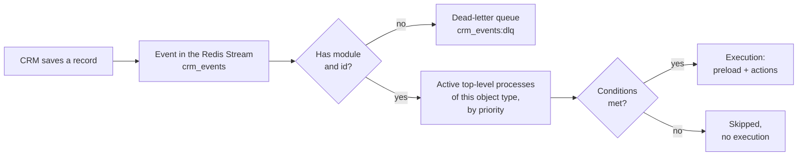

# Trigger conditions

When WPS starts a process and how to write the conditions in **Block 1. Trigger conditions**.

<!-- lang-switch -->
🇬🇧 English | [🇷🇺 Русский](../../ru/03-user-guide/triggers-and-conditions.md)
<!-- /lang-switch -->

## When a process starts



1. The CRM saves a record and publishes an event: the object with its fields, the module (`module` or `object_type`) and the record `id`.
2. An event without a module or without `id` is not processed; it is moved to the dead-letter stream `crm_events:dlq`.
3. WPS selects all processes that are **active**, **top-level** (not child) and have **Object type** equal to the event module, for example `Deals`.
4. The processes are checked one after another in ascending **Priority** (equal priority — by ID). Each process gets its own fresh copy of the event.
5. If the conditions of a process are met, an execution is created and its preload and actions run. If not, nothing is written to the audit for this process.

An event for which no process matched is simply acknowledged. A child process is never started directly by an event; it is started by another process (see [Child processes](subprocesses.md)) and checks its own conditions in the same way.

> **Note**
> If **Run once per record** is enabled and the record already has a mark, the process is skipped even when the conditions are met. See [Manual run and run-once reset](manual-run-and-reset.md).

## Conditions block


*Two conditions: one on the event object and one on the preloaded variable `v1`. The rows are joined with **AND**.*

Each row has four columns:

| Column | Purpose | Values | Example |
|---|---|---|---|
| **Field (object.field / v1.field)** | What to check: a field of the event object or of a preloaded variable | path `object.<field>` or `<variable>.<field>` | `object.status`, `v1.rating` |
| **Comparison** | Comparison operator | **Equals**, **Not equals**, **Contains**, **Does not contain** | **Equals** |
| **Compare with** | Where the right-hand value comes from | **Value** — a fixed value; **Object/variable field** — another field | **Value** |
| **Value to compare** | A fixed value, or a path when **Object/variable field** is selected | text/number, or a path | `Active`, `object.assigned_user_id` |

Click **Add row** to add a condition and the delete icon to remove it. All rows are combined with **AND**: the process starts only if every row is true.

**No conditions** — the process runs for any event of its object type.

### Operators

Both sides are converted to text before the comparison: numbers as written (`100`, `0.5`), `true`/`false` for booleans, an empty string for an empty value. The comparison is case-sensitive.

| Operator (UI) | Code | True when | Example |
|---|---|---|---|
| **Equals** | `equals` | the texts are identical | `object.status` **Equals** `Active` |
| **Not equals** | `not_equals` | the texts differ | `object.status` **Not equals** `Closed` |
| **Contains** | `contains` | the field contains the value as a substring | `object.email` **Contains** `@` |
| **Does not contain** | `not_contains` | the field does not contain the substring | `object.name` **Does not contain** `test` |

> **Warning**
> **A missing field never satisfies a condition — for any operator.** If the event has no `nofield`, then `object.nofield` **Not equals** `x` is **false**, not true. The same applies when the right-hand field (**Object/variable field**) is missing, and when a preloaded variable was not found in the CRM. A field that exists with an empty value is not missing: it compares as an empty string.

Case and spaces matter: `Active` is not equal to `active` or `Active `. Numbers are compared as text: `100` is not equal to `100.00`.

### Comparing with another field

Select **Object/variable field** in **Compare with** and type a path in **Value to compare**:

```json
{ "field": "object.assigned_user_id", "operator": "equals", "value_type": "from_object_field", "value": "v1.assigned_user_id" }
```

The condition is true when the deal and the loaded account have the same responsible user.

### Conditions on preloaded variables (lazy preload)

A condition may refer to a variable from the **Preload** block, for example `v1.status` where `v1` is the account of the deal. WPS then checks the conditions in two passes:

1. Rows that use only `object.*` are checked first. If one of them is false, the process does not start and **nothing is loaded from the CRM**.
2. Otherwise the **Preload** block runs, and the remaining rows are checked on the loaded data.

So cheap checks on the event never cost CRM requests. When the conditions pass, the preload steps already done are recorded in the audit as the first steps of the execution; they are not repeated.

Recipe: [Contact: copy account name](recipes.md) uses exactly this — `object.status` **Not equals** `Closed` AND `v1.status` **Equals** `Active`.

### Errors

| Message | Cause |
|---|---|
| `Condition 1: specify a field (object.field)` | The field is empty or has no dot |
| `Condition 1: specify the field path to compare with` | **Object/variable field** without a path |
| `Variable "v9" is not defined at this point` (server) | The variable is not declared in **Preload** |
| `Unknown comparison operator` (server) | Operator not in the dictionary (API only) |
| `Must be "static" or "from_object_field"` (server) | Wrong `value_type` (API only) |

## Advanced form: groups and OR (API only)

The editor builds a flat list joined with AND. The API also accepts a nested form with `AND`/`OR` groups:

```json
{
  "logical_operator": "AND",
  "conditions": [
    { "field": "object.status", "operator": "equals", "value_type": "static", "value": "Active" }
  ],
  "groups": [
    {
      "logical_operator": "OR",
      "conditions": [
        { "field": "object.amount", "operator": "contains", "value_type": "static", "value": "000" },
        { "field": "object.name", "operator": "contains", "value_type": "static", "value": "VIP" }
      ]
    }
  ]
}
```

This means: status is `Active` **and** (amount contains `000` **or** name contains `VIP`). An OR group with no rows is true.

If a process has conditions in this form, the editor shows the badge **advanced** and the warning **Conditions are defined in advanced form (groups / OR). The table editor does not support them — they will be saved unchanged.** The button **Replace with table conditions (AND)** converts them: a simple AND list without groups keeps its rows, anything else is replaced by an empty list. The process card shows **Conditions in advanced form (groups / OR)**.

## Checking conditions

- **Manual run** (**Run** on the process card) shows the result of every condition (field, expected, actual value, result) without creating an execution when they fail. See [Manual run and run-once reset](manual-run-and-reset.md).
- For every execution, the **Conditions (conditions)** tab of the execution page shows the same trace. See [Executions and audit](executions-and-audit.md).

<!-- footer-nav -->
---

← Previous: [Processes](processes.md) | [Contents](../README.md) | [Actions](actions.md) Next →
<!-- /footer-nav -->
