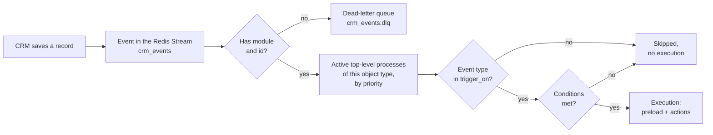
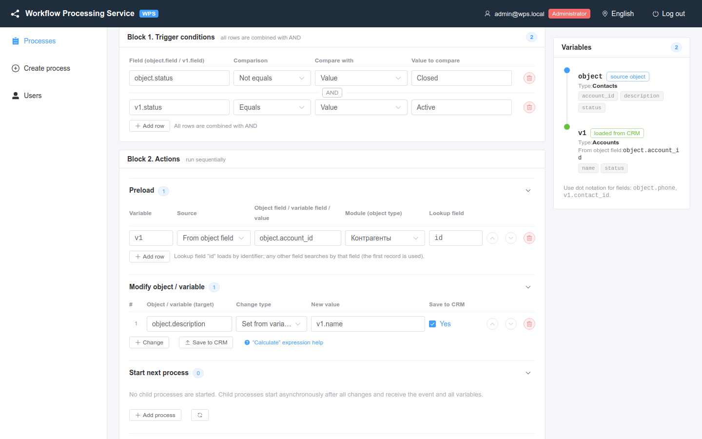

# Trigger conditions

When WPS starts a process and how to write the conditions in **Block 1. Trigger conditions**.

<!-- lang-switch -->
🇬🇧 English | [🇷🇺 Русский](../../ru/03-user-guide/triggers-and-conditions.md)
<!-- /lang-switch -->

## When a process starts



1. The CRM saves a record and publishes an event: the object with its fields, the module (`module` or `object_type`) and the record `id`.
2. An event without a module or without `id` is not processed; it is moved to the dead-letter stream `crm_events:dlq`.
3. WPS selects all processes that are **active**, **top-level** (not child) and have **Object type** equal to the event module, for example `Deals`. Of them, only those whose ["Run on"](#event-type-and-the-run-on-field-trigger_on) field (`trigger_on`) contains the event type (`create` / `update` / `delete`) remain.
4. The processes are checked one after another in ascending **Priority** (equal priority — by ID). Each process gets its own fresh copy of the event.
5. If the conditions of a process are met, an execution is created and its preload and actions run. If not, nothing is written to the audit for this process.

An event for which no process matched is simply acknowledged. A child process is never started directly by an event; it is started by another process (see [Child processes](subprocesses.md)) and checks its own conditions in the same way.

> **Note**
> If **Run once per record** is enabled and the record already has a mark, the process is skipped even when the conditions are met. See [Manual run and run-once reset](manual-run-and-reset.md).

### Event type and the "Run on" field (trigger_on)

Every CRM event has a type: `create` — the record was created, `update` — changed, `delete` — deleted. The process field
`trigger_on` lists the types that start the process:

| `trigger_on` | Starts |
|---|---|
| `["create", "update"]` | **default**, also for every process created before the field existed: when a record is created or changed |
| `["create"]`, `["update"]`, `["delete"]`, any combination | only on the listed types |
| `[]` | never by CRM events — only [manually](manual-run-and-reset.md) (later — by an incoming webhook) |

- The type filter is applied **before the conditions**: a process not subscribed to the event type is not checked and gets no audit.
- **Child processes** are started only by their parent; `trigger_on` is ignored for them (the field is stored as sent).
- A **manual run** does not check `trigger_on`. The event type comes from the `event_type` field of the object in the request body, `update` by default.
- An event of an old plugin without `event_type` is a creation when `wps_is_update = "0"`, otherwise an update.
- Relationship events (`link`, `unlink`) and unknown types are acknowledged without starting processes.

The event type of an execution is in the audit: `context.event_info.event_type`.

#### A process on record deletion

A `delete` event carries the **last stored state** of the record (`deleted = "1"`); its `object_before` is empty.

| What a process does on `delete` | Behaviour |
|---|---|
| Conditions on `object.*` | work on the last state of the record |
| Preload by fields of `object` (e.g. the account of a deleted deal) | works: related records are not deleted |
| Preload of the deleted record itself | returns `null` (404) — the regular "not found" |
| `modify object.*` | allowed (computed in memory) |
| `save_object` / `save_to_crm` for `object` | the step is **`skipped`**: "Record was deleted in the CRM — nothing to save" |
| Saving other variables, `start_process` and other actions | as usual |

A process with `trigger_on: ["delete"]` that saves `object` (`save_object` with `target: object` or `modify object.*` with
`save_to_crm: true`) is rejected on save: `The process runs only on delete: the deleted record cannot be saved`. When `delete` is
combined with other types, saving `object` is allowed and is simply skipped on a deletion.

Example — a task when a deal is deleted, with the last state of the deal:

```json
{
  "name": "Task on deal deletion",
  "object_type": "Opportunities",
  "is_child": false,
  "trigger_on": ["delete"],
  "definition": {
    "actions": [
      { "type": "modify", "target": "task.name", "change_type": "template",
        "value": "Deal of {{ object.amount | number:0:'':' ' }} deleted" },
      { "type": "modify", "target": "task.description", "change_type": "template",
        "value": "Deal \"{{ object.name }}\" was deleted; the stage was {{ object.sales_stage }}" },
      { "type": "modify", "target": "task.status", "change_type": "set_value", "value": "Not Started" },
      { "type": "save_object", "target": "task", "module": "Tasks" }
    ]
  }
}
```

## Conditions block



*Two conditions: one on the event object and one on the preloaded variable `v1`. The rows are joined with **AND**.*

Each row has four columns:

| Column | Purpose | Values | Example |
|---|---|---|---|
| **Field (object.field / v1.field)** | What to check: a field of the event object or of a preloaded variable | path `object.<field>` or `<variable>.<field>` | `object.status`, `v1.rating` |
| **Comparison** | Comparison operator | **Equals**, **Not equals**, **Contains**, **Does not contain**; via the API also order, emptiness, presence and list operators (table below) | **Equals** |
| **Compare with** | Where the right-hand value comes from | **Value** — a fixed value; **Object/variable field** — another field; through the API also `expression` — an [expression](#comparing-with-an-expression) | **Value** |
| **Value to compare** | A fixed value, or a path when **Object/variable field** is selected | text/number, or a path | `Active`, `object.assigned_user_id` |

Click **Add row** to add a condition and the delete icon to remove it. All rows are combined with **AND**: the process starts only if every row is true.

**No conditions** — the process runs for any event of its object type.

### Operators

Without a `cast` field both sides are converted to text before the comparison: numbers as written (`100`, `0.5`), `true`/`false` for booleans, an empty string for an empty value. The comparison is case-sensitive. To compare as numbers, dates, booleans or lists, set a type — see [Comparison type (cast)](#comparison-type-cast).

| Operator (UI) | Code | True when | Allowed `cast` | Example |
|---|---|---|---|---|
| **Equals** | `equals` | the values are equal (for text — the texts are identical) | all | `object.status` **Equals** `Active` |
| **Not equals** | `not_equals` | the values differ | all | `object.status` **Not equals** `Closed` |
| **Contains** | `contains` | the field contains the value as a substring; with `cast: list` — the list contains the element | `string`, `list` | `object.email` **Contains** `@` |
| **Does not contain** | `not_contains` | the field does not contain the substring; with `cast: list` — the element is not in the list | `string`, `list` | `object.name` **Does not contain** `test` |
| **Starts with** | `starts_with` | the field text starts with the value | `string` (or no `cast`) | `object.phone_mobile` **Starts with** `+7` |
| **Ends with** | `ends_with` | the field text ends with the value | the same | `object.email1` **Ends with** `@gmail.com` |
| **Contains any of** | `contains_any` | the list field has at least one element of the right side | `list` (**required**) | `object.tags` **Contains any of** `["vip", "partner"]` |
| **Contains all of** | `contains_all` | the list field has all elements of the right side | the same | `object.products` **Contains all of** `["CRM", "Integration"]` |
| **Contains none of** | `contains_none` | the list field has no element of the right side | the same | `object.tags` **Contains none of** `["spam", "test"]` |
| **Greater than** | `greater_than` | the field is greater than the value | `int`, `decimal`, `date`, `datetime` (**required**) | `object.amount` **Greater than** `1 000 000` (`decimal`) |
| **Greater or equal** | `greater_or_equal` | the field is greater than or equal to the value | same | `object.amount` **Greater or equal** `100` |
| **Less than** | `less_than` | the field is less than the value | same | `object.date_closed` **Less than** `01.01.2027` (`date`) |
| **Less or equal** | `less_or_equal` | the field is less than or equal to the value | same | `object.probability` **Less or equal** `50` (`int`) |
| **Between** | `between` | `from ≤ field ≤ to`, bounds included; the value is a pair `[from, to]` | the same | `object.amount` **Between** `["10000", "50000"]` (`decimal`) |
| **Not between** | `not_between` | the field is less than `from` or greater than `to` | the same | `object.amount` **Not between** `["v1.min", "v1.max"]` |
| **In** | `in` | the value equals one of the list items | `string`, `int`, `decimal`, `date` | `object.status` **In** `["New", "Assigned"]` |
| **Not in** | `not_in` | the value equals none of the list items | same | `object.lead_source` **Not in** `["Other"]` |
| **Is empty** | `is_empty` | the field **exists** and is empty (`null`, empty or blank string, empty list) | no value, `cast` is ignored | `object.phone_mobile` **Is empty** |
| **Is not empty** | `is_not_empty` | the field **exists** and is not empty | same | `object.email1` **Is not empty** |
| **No data** | `is_null` | the variable was not found, the field is missing or `null` | same | `v1.id` **No data** |
| **Has data** | `is_not_null` | the field exists and is not `null` (an empty string is data too) | same | `v1.id` **Has data** |
| **Changed** | `changed` | the field changed in this CRM save | all; no value | `object.assigned_user_id` **Changed** |
| **Not changed** | `not_changed` | changes are known and the field did not change | same | `object.amount` **Not changed** (`decimal`) |
| **Changed to** | `changed_to` | changed, and the new value equals the given one | all | `object.sales_stage` **Changed to** `Closed Won` |
| **Changed from** | `changed_from` | changed, and the old value equals the given one | all | `object.status` **Changed from** `New` |

> **Warning**
> **A missing field never satisfies a condition — for any operator except `is_null`.** If the event has no `nofield`, then `object.nofield` **Not equals** `x` is **false**, not true. The same applies when the right-hand field (**Object/variable field**) is missing, and when a preloaded variable was not found in the CRM. A field that exists with an empty value is not missing: it compares as an empty string.

Case and spaces matter: `Active` is not equal to `active` or `Active `. Without a `cast`, numbers are compared as text: `100` is not equal to `100.00` (with `cast: decimal` they are equal).

#### Starts with and ends with

A prefix and a suffix are more precise than **Contains**: `object.email1` **Ends with** `@gmail.com` does not fire on
`x@gmail.com.evil.ru`, while **Contains** `gmail.com` would.

```json
{ "field": "object.email1", "operator": "ends_with", "value": "@GMAIL.COM", "cast": "string", "cast_options": { "case_sensitive": false } }
{ "field": "object.phone_mobile", "operator": "starts_with", "value": "+7" }
```

- The type is `string` only (or no `cast`); another type is a save error `Operator "starts_with" does not support cast "int" (supported: string)`.
- Case matters; `cast_options: {"case_sensitive": false}` compares case-insensitively (Cyrillic too), `trim: true` trims
  spaces on both sides.
- An empty prefix matches any string, so a static value cannot be empty or only spaces:
  `Value is required for operator "starts_with"`. When the value comes **from a field** and that field is empty, the
  condition is true; when the field is missing — false.
- In the filter of Find records, an aggregate and `least_busy` the operators go to the CRM as `like 'x%'` / `like '%x'`
  (`%`, `_`, `\` are escaped).

#### Greater and less than

Order operators work only with a type: `cast` is `int`, `decimal`, `date` or `datetime`; without it the process is not saved (`Operator "greater_than" requires cast: int, decimal, date or datetime`).

```json
{ "field": "object.amount", "operator": "greater_than", "cast": "decimal", "value_type": "static", "value": "1 000 000" }
{ "field": "object.date_closed", "operator": "less_than", "cast": "date", "value_type": "static", "value": "01.01.2027" }
```

- A missing field (left or right), an empty value or a value that cannot be cast gives **false** (with `on_cast_error: "error"` — an error, see [Comparison type (cast)](#comparison-type-cast)).
- `100` and `100.00` with `cast: decimal` are equal: **Greater or equal** is true, **Greater than** is false.
- With `cast: date` a value with a time is moved into the `WPS_TIMEZONE` time zone and compared by day.
- There are no negations (`not_greater_than`): use the opposite operator.

#### Relative dates

A static condition value with `cast: date` or `datetime` can be a **relative date** — then it is computed when the
condition is checked instead of being a stored date:

```json
{ "field": "object.end_date", "operator": "less_than", "cast": "date", "value_type": "static", "value": "today+30d" }
{ "field": "object.date_entered", "operator": "greater_or_equal", "cast": "datetime", "value_type": "static", "value": "now-24h" }
{ "field": "object.date_closed", "operator": "between", "cast": "date", "value_type": "static", "value": ["start_of_quarter", "end_of_quarter"] }
```

Grammar: `anchor (±N unit)*`, up to 5 shifts, spaces and case do not matter (`Today + 30d`).

| Anchor | Meaning |
|---|---|
| `now` | the current moment |
| `today` / `start_of_day`, `yesterday`, `tomorrow` | midnight today / yesterday / tomorrow |
| `end_of_day` | 23:59:59 today |
| `start_of_week`, `end_of_week` | Monday 00:00:00 / Sunday 23:59:59 of the current week |
| `start_of_month`, `end_of_month` | the first day of the month 00:00:00 / the last day 23:59:59 |
| `start_of_quarter`, `end_of_quarter` | start / end of the quarter |
| `start_of_year`, `end_of_year` | January 1 00:00:00 / December 31 23:59:59 |

Units: `min` — minutes, `h` — hours, `d` — days, `w` — weeks, `mo` — months, `y` — years
(dictionary [`GET /api/dictionaries/relative-dates`](../06-api-reference/endpoints.md#get-apidictionariesrelative-dates)).

- Anchors are computed in **`WPS_TIMEZONE`** (UTC by default): `today` is midnight in that zone. The week starts on
  Monday. `end_of_*` is the **last second** of the period, so `less_or_equal end_of_month` includes the whole last day.
- `d`, `w`, `mo`, `y` are calendar units in local time: `today+1mo` on January 31 is February 28 (29). `h` and `min` are
  exact time: on the night of the daylight saving switch `now+1d` and `now+24h` differ by an hour.
- **There are no working days** (the customer's decision): `today+10wd` is the error `Invalid relative date
  "today+10wd": unknown unit "wd" at position 8 (use min, h, d, w, mo, y)`.
- A concrete date starts with a digit (`2026-12-31`, `31.12.2026`) and is never relative. A value that looks like a
  relative date is parsed when the process is saved; an error is a `422` with the position (`today+`, `tomorrow++1d`,
  `start_of_decade`, more than 5 shifts).
- Values **from fields** (`from_object_field`) are never interpreted: the text `today` in a record field is just text.
- All relative dates of one condition check use **one** "now", also with the lazy preload (both condition passes).
- For `between` both bounds or one of them can be relative; the `from ≤ to` order is then checked at run time.
- The row trace has `expected_resolved` (what the value turned into), `evaluated_at` (the moment of the check) and
  `timezone`.

#### Between and not between

The value is a **pair** `[from, to]`. Both bounds are static, or both are paths (**From an object/variable field**), or
both are expressions (`value_type: expression`):

```json
{ "field": "object.amount", "operator": "between", "cast": "decimal", "value_type": "static", "value": ["10000", "50000"] }
{ "field": "object.date_closed", "operator": "between", "cast": "date", "value_type": "static", "value": ["01.01.2026", "31.03.2026"] }
{ "field": "object.amount", "operator": "not_between", "cast": "decimal", "value_type": "from_object_field", "value": ["v1.min_limit", "v1.max_limit"] }
```

- `cast` is required: `int`, `decimal`, `date` or `datetime`, as for the order operators. The field and both bounds are
  cast with one type.
- The bounds are **included**: 50,000 **Between** `[10000, 50000]` is true, 50,000.01 is false.
- A missing or empty field, a missing or empty bound, a value that cannot be cast — **false for both** operators: "not
  between" does not mean "no data".
- Static bounds are checked on save: an empty one — `Range bound is required`, one that cannot be cast — a cast error,
  `from > to` — `Range start must not be greater than range end`. If an inverted range comes from the data (bounds from
  fields), the condition is false and the trace has the `range_inverted` warning: the bounds are not swapped silently.
- A bound that is a path to a preload variable triggers the lazy preload, as the field on the left does.
- Mixed bounds (one static, the other from a field) are set with [expressions](#comparing-with-an-expression):
  `"value_type": "expression", "value": ["1000", "v1.max_limit"]`.
- In the filter of Find records, an aggregate and `least_busy` `between` goes to the CRM as `gte` + `lte` (static bounds
  only); `not_between` is not available in CRM filters — it needs an OR, which the contract does not have.

#### Emptiness and presence of data

These four operators have no right-hand side: do not set `value` or `value_type` (otherwise `Operator "is_null" does not take a value`); `cast` is ignored.

```json
{ "field": "object.phone_mobile", "operator": "is_empty" }
{ "field": "v1.id", "operator": "is_null" }
```

| Situation | `is_empty` | `is_not_empty` | `is_null` | `is_not_null` |
|---|---|---|---|---|
| The field is not in the object | false | false | **true** | false |
| The preloaded variable was not found in the CRM | false | false | **true** | false |
| The field exists, `null` | true | false | true | false |
| The field exists, `''` (or only spaces) | true | false | false | true |
| The field exists, `'0'` or `false` | false | true | false | true |
| The field exists, empty list `[]` | true | false | false | true |
| The field exists, a non-empty value | false | true | false | true |

For emptiness the rule "a missing field does not satisfy a condition" stays: a missing field is neither "empty" nor "not empty". Checking that there is no data at all is the job of `is_null` / `is_not_null`. SuiteCRM sends all stored fields in the event, so an unfilled field arrives as an empty string: `is_empty` is true for it, `is_null` is false. With lazy preload a condition on a variable that is not loaded yet is "unknown" first, as with other operators. The trace row has the key `found` (whether the field was found) and `missing: "actual"` when the field is missing.

#### In a list

The right-hand side of `in` / `not_in` is a list. A static list is a JSON array; `cast` is the type of the items and of the field (`string` by default, `int`, `decimal`, `date`):

```json
{ "field": "object.status", "operator": "in", "value_type": "static", "value": ["New", "Assigned", "In Process"] }
{ "field": "object.code", "operator": "not_in", "cast": "int", "value_type": "static", "value": [1, 2] }
{ "field": "object.state", "operator": "in", "cast": "string", "cast_options": {"case_sensitive": false, "trim": true},
  "value_type": "static", "value": ["msk", "spb"] }
```

A list from a field is an array, a JSON array as a string, or a separated string; `value_list_options` tells how to split a string (`separator`, default `,`; `wrapper`, e.g. `^` for a SuiteCRM multienum):

```json
{ "field": "object.lead_source", "operator": "in", "value_type": "from_object_field", "value": "company.description",
  "value_list_options": { "separator": "," } }
```

| Situation | `in` | `not_in` |
|---|---|---|
| The left field is missing | false | false |
| The field is empty, `cast` is not `string` | false | false |
| The field is empty, `cast: string` | `''` is compared with the items as an ordinary string | |
| The right list field is missing / the variable was not found | false | false |
| The list from the field is empty | false | **true** |
| An item of the list from the field cannot be cast | the item is skipped, `cast_error` in the trace (an error with `on_cast_error: "error"`) | |

In the trace `expected_cast` is the list of cast items. A static list must not be empty or longer than 500 items; items are strings or numbers that cast to `cast`. For multienums (`^a^,^b^` on the left) use the [multienum](#multienums) operators or `contains` with `cast: list`.

#### Multienums

SuiteCRM stores a multienum as a string `^vip^,^partner^`. With `cast: list` and `cast_options: {"wrapper": "^"}` the
field is parsed into the list `[vip, partner]` (the delimiter is `separator`, `,` by default; case — `case_sensitive`),
and it can be compared with a set of values:

```json
{ "field": "object.template_ddown_c", "operator": "contains_any", "value": ["vip", "partner"],
  "cast": "list", "cast_options": { "wrapper": "^", "case_sensitive": false } }
{ "field": "object.template_ddown_c", "operator": "contains_none", "value": "^spam^,^test^",
  "cast": "list", "cast_options": { "wrapper": "^" } }
```

- The right side is a JSON array or a string parsed **the same way as the field** (handy to paste a value copied from
  the CRM: `"^spam^,^test^"`). With **From an object/variable field** the list from the field is also parsed by the
  field's `cast_options` unless `value_list_options` is set.
- These are set operations: order and duplicates do not matter. `contains_any` — the intersection is not empty,
  `contains_all` — the right side is wholly inside the field, `contains_none` — no intersection.
- Unlike `contains`, **whole elements** are compared: `^vipclient^` does not contain `vip`.
- The trace has `actual_cast`, `expected_cast`, and for `contains_any` / `contains_none` — `matched` (the matching
  elements).
- `cast: list` is required (otherwise a save error); a static right side is a non-empty array or a string that gives a
  non-empty list (`List of values must not be empty`).

| Situation | `contains_any` | `contains_all` | `contains_none` |
|---|---|---|---|
| No field | false | false | false |
| The field is an empty list (no tags) | false | false | **true** |
| The right side is empty (e.g. an empty field on the right) | false | false | false |
| At least one element matched | true | true if all matched | false |

### Comparison type (cast)

The type both sides are cast to before the comparison is set in the condition row itself. WPS does not read CRM field metadata, so the same mechanism works for event fields, preloaded records and process variables.

```json
{
  "field": "object.amount",
  "operator": "equals",
  "cast": "decimal",
  "cast_options": { "scale": 2 },
  "on_cast_error": "false",
  "value_type": "from_object_field",
  "value": "v1.credit_limit"
}
```

| Field | Values | Default |
|---|---|---|
| `cast` | `string`, `int`, `decimal`, `date`, `datetime`, `bool`, `list` | `string` |
| `cast_options` | an object of options, depends on the type (table below) | `{}` |
| `on_cast_error` | `"false"` — the condition is false; `"error"` — an error (strict mode) | `"false"` |

A row without `cast` works exactly as before: text, case-sensitive, spaces not trimmed. For now these fields are set through the API — the table editor keeps them unchanged.

| Type | How the value is cast | `cast_options` | Example |
|---|---|---|---|
| `string` | text, as without `cast` | `case_sensitive` (`true`), `trim` (`false`) | `Active` = `active` with `case_sensitive: false` |
| `int` | integer; spaces (including no-break ones) and a leading `+` are removed; a zero fraction is accepted (`100.00` → `100`), a non-zero one is an error; out of range is an error (use `decimal`) | — | `"1 200"` → `1200` |
| `decimal` | decimal number compared without precision loss (`bcmath`); spaces are removed, `,` is the decimal separator when there is no `.`; `1,234.56` (both separators) is an error; an exponent in a string is an error; extra digits are rounded to `scale` (half away from zero) | `scale` (`10`, 0 to 20) | `"1 234,56"` → `1234.56`; `100` = `100.00` |
| `date` | date without time; default formats: `Y-m-d`, `Y-m-d H:i:s`, `Y-m-d H:i`, ISO 8601 (`2026-10-16T10:00:00Z`, with an offset, with microseconds), `d.m.Y`, `d.m.Y H:i:s`, `d.m.Y H:i`; an impossible date (`2026-02-30`), `10/16/2026` and `20261016` without an explicit format are errors | `format` (a string or a list of PHP `DateTime::createFromFormat` formats, replaces the defaults; `U` — Unix time), `timezone` (zone of values without an offset, default `UTC`) | `"16.10.2026"` → `2026-10-16` |
| `datetime` | date and time, converted to UTC, compared as a moment (with microseconds); a date-only value is 00:00 in the `timezone` zone | `format`, `timezone` | `"2026-10-16 10:00:00"` = `"2026-10-16T13:00:00+03:00"` |
| `bool` | case-insensitive; true: `true`, `1`, `t`, `yes`, `y`, `on`, `да`; false: `false`, `0`, `f`, `no`, `n`, `off`, `нет`, an empty value; anything else is an error | — | `"on"` = `true` |
| `list` | list of strings: an array, a JSON array in a string or a separated string; elements are trimmed, empty ones dropped; `equals` ignores order and duplicates | `separator` (`,`), `wrapper` (e.g. `^` for SuiteCRM multienums `^a^,^b^`), `case_sensitive` (`true`) | `"^vip^,^partner^"` → `[vip, partner]` |

**Dates and time zone.** A value with a time is first moved into the business time zone (`WPS_TIMEZONE`, default `UTC`, see [Configuration](../04-operations/configuration.md)), then its calendar date is taken. A date-only value is not shifted. Example: `"2026-10-16 22:30:00"` (UTC) with `WPS_TIMEZONE=Europe/Moscow` is the date `2026-10-17`. Dates from the CRM are UTC; if a value is written in another zone, set `cast_options.timezone`.

**Empty values.** For `string` an empty value is an empty string (as before), for `bool` it is `false`. For the other types an empty value (`null`, a blank string, an empty array) is not compared: the condition is **false**, the trace has `empty`.

**Cast error** (`"abc"` as `decimal`):

- `on_cast_error: "false"` (default) — the condition is false for any operator, the trace has `cast_error`, a warning is logged, the metric `wps_condition_cast_errors_total` grows;
- `on_cast_error: "error"` (strict mode):
  - in the process start conditions an execution with status **Failed** is created; its first step is `conditions` with the trace and the error text; the event is acknowledged and not redelivered;
  - on a manual run the response is `200` with `conditions_met: false`, `error: "CAST_ERROR"` and `error_message`.

**Condition trace** (manual run, the **Conditions** tab of an execution) gets new keys: `cast` and `cast_options` (when a type is set), `actual_cast` / `expected_cast` — the cast values, `missing` (`actual` / `expected` — which side is missing), `empty` (which side is empty), `cast_error` (`{"side": "actual", "message": "…"}`). The `actual` / `expected` keys still hold the original values.

```json
{ "field": "object.amount", "operator": "equals", "value_type": "static", "value": "100",
  "cast": "decimal", "actual": "100.00", "expected": "100", "actual_cast": "100", "expected_cast": "100", "result": true }
```

Examples:

```json
{ "field": "object.date_closed", "operator": "equals", "value": "16.10.2026", "cast": "date" }
{ "field": "object.do_not_call", "operator": "equals", "value": "true", "cast": "bool" }
{ "field": "object.status", "operator": "equals", "value": "active", "cast": "string", "cast_options": { "case_sensitive": false } }
{ "field": "object.tags_c", "operator": "contains", "value": "vip", "cast": "list", "cast_options": { "wrapper": "^" } }
```

#### Case and spaces

By default string comparison is exact: `Moscow` ≠ `moscow`, `Moscow` ≠ `Moscow `. The options are set in the
`cast_options` of the `string` type (`list` has `case_sensitive`; list elements are always trimmed):

```json
{ "field": "object.primary_address_city", "operator": "equals", "value": "Москва",
  "cast": "string", "cast_options": { "case_sensitive": false, "trim": true } }
```

| Option | Default | Effect |
|---|---|---|
| `case_sensitive` | `true` | `false` — case does not matter: both sides are converted by Unicode case folding (Cyrillic too) |
| `trim` | `false` | `true` — spaces at the edges of both sides are dropped, including the no-break space and BOM (they come with imports and copy-paste) |

- The options apply to **all** string and list operators: `equals` / `not_equals`, `contains` / `not_contains`,
  `starts_with` / `ends_with`, `in` / `not_in`, and also `changed`, `changed_to`, `changed_from`: with
  `case_sensitive: false` a change "МОСКВА" → "москва" is **not a change**.
- Both sides are normalized: the field and the value (or the second field).
- Limits: `ё` and `е` are different letters, `ß` does not become `ss` (`Straße` ≠ `STRASSE`), spaces inside a string are
  not collapsed.
- Flat keys next to `cast` are not accepted: `"case_sensitive": false` in the condition row itself is the save error
  `Use "cast_options": {"case_sensitive": ...}` (earlier such a key was silently ignored). An option for a type without
  it — `Option "trim" is not supported by cast "int"`.
- The trace has `cast_options` and the normalized values `actual_cast` / `expected_cast` (e.g. `"москва"`).

### Comparing with another field

Select **Object/variable field** in **Compare with** and type a path in **Value to compare**:

```json
{ "field": "object.assigned_user_id", "operator": "equals", "value_type": "from_object_field", "value": "v1.assigned_user_id" }
```

The condition is true when the deal and the loaded account have the same responsible user.

### Comparing with an expression

The third value type is `"value_type": "expression"` ("Expression", API only; the editor keeps such conditions
unchanged). The right side is computed by an [expression](change-types-and-expressions.md#calculate) — with arithmetic,
functions and variable fields:

```json
{ "field": "object.amount", "operator": "greater_than", "cast": "decimal",
  "value_type": "expression", "value": "v1.credit_limit * 0.8" }
{ "field": "object.amount", "operator": "between", "cast": "decimal",
  "value_type": "expression", "value": ["v1.plan * 0.9", "v1.plan * 1.1"] }
{ "field": "object.date_closed", "operator": "less_than", "cast": "date",
  "value_type": "expression", "value": "add_days(today(), coalesce(v1.payment_days, 30))" }
{ "field": "object.email1", "operator": "ends_with", "value_type": "expression", "value": "concat('@', lower(v1.domain))" }
```

- The result is cast with **the same `cast`** as the field: `'1 200,50'` with `decimal` is 1200.5.
- `between` / `not_between` — a pair of expressions; list operators (`in`, `contains_any`, …) — an expression that
  returns a list or a string (a string is parsed as a list).
- A `null` result — there is no right side, the condition is false (`missing: expected` in the trace); an empty string —
  the empty value of the type. A safeguard — `coalesce(v1.limit, 0)`.
- An evaluation error (division by zero, a wrong function argument) makes the condition row **false**, with
  `expression_error` in the trace, the log warning `Condition expression failed` and the
  `wps_condition_expression_errors_total` metric. With `"on_cast_error": "error"` — a condition check error, as for a
  cast error.
- Variables of the expression take part in the [lazy preload](#conditions-on-preloaded-variables-lazy-preload): while a
  variable is not loaded, the row is "unknown".
- Change operators (`changed`, `changed_to`, `changed_from`, `not_changed`) do not take expressions:
  `Operator "changed_to" does not support value_type "expression"`.
- [Relative dates](#relative-dates) (`today+30d`) are not recognized inside an expression — it is text; use functions:
  `add_days(today(), 30)`, `add_hours(now(), -24)`.
- In the trace `expected` is the expression result, `expected_cast` — after the cast.
- On save the syntax and functions, variables (`Variable "v9" is not defined at this point`), the length (up to 1000
  characters, `Expression is too long (max 1000 characters)`), an empty expression (`Expression is required`) and the
  pair for `between` are checked. A wrong value type — `Must be "static", "from_object_field" or "expression"`.

### Values before the change (object_before)

A contract 2.0 CRM plugin sends the old values of the **changed** fields together with the save. WPS puts them into the variable
`object_before`, available in every process (child processes too) — in conditions, expressions and templates:

| Path | Result |
|---|---|
| `object_before.status` (the field changed) | the old value, e.g. `New` |
| `object_before.status` (the field did not change) | **not found**: a condition on it is false with any operator, an expression gets an empty string |
| `object_before.phone` (the field was empty) | found, value `null` — not the same as "not found" |
| any field of an old-format event | not found: old values are unknown (`object_before` = `null`) |

A field missing from `object_before` means "not changed" **or** "unknown" (an old plugin, a manual run without `before`).
The value "before" even for an unchanged field: `coalesce(object_before.x, object.x)`.

`object_before` is **read-only**: it cannot be written (`modify`, `save_object`) and its name cannot be taken by a preload.

Example — start only on the lead status transition `New → Assigned`, not on every save of a lead with status `Assigned`:

```json
{
  "conditions": [
    { "field": "object_before.status", "operator": "equals", "value_type": "static", "value": "New" },
    { "field": "object.status", "operator": "equals", "value_type": "static", "value": "Assigned" }
  ],
  "actions": [
    { "type": "modify", "target": "object.description", "change_type": "template",
      "value": "Status: {{ object_before.status }} → {{ object.status }}", "save_to_crm": true }
  ]
}
```

Creating a lead (`create`, empty `object_before`) and a save without a status change do not start the process. The event type and
the changed field list are visible in the execution audit (`context.event_info`). To skip the process on creation altogether, set
`"trigger_on": ["update"]` (see [Event type](#event-type-and-the-run-on-field-trigger_on)). The same condition is shorter with the
`changed_from` operator — see [Conditions on a field change](#conditions-on-a-field-change).

### Conditions on a field change

Four operators answer "what changed **in this save** of the record". They need CRM plugin 1.2.0 (contract 2.0: the event
carries `event_type`, `before`, `changed_fields` — see
[How WPS parses an event](../04-operations/crm-integration.md#how-wps-parses-an-event)).

```json
{ "field": "object.sales_stage", "operator": "changed_to", "value_type": "static", "value": "Closed Won" }
{ "field": "object.assigned_user_id", "operator": "changed" }
{ "field": "object.amount", "operator": "changed", "cast": "decimal" }
```

| Operator | True when |
|---|---|
| `changed` | the field is in the event's `changed_fields` **and** the values before and after differ after the `cast` |
| `not_changed` | changes are known and the field is not `changed` |
| `changed_to X` | `changed` and the new value equals `X` |
| `changed_from X` | `changed` and the old value equals `X` |

- `field` — only `object.<field>`: changes are known for the event object only.
- `changed` / `not_changed` take no right-hand side (no `value`, `value_type`). `changed_to` / `changed_from` take
  `value_type` `static` or `from_object_field` and a required `value`.
- **The new value comes from the event**, not from the `object` variable: a `modify` before a branch does not change the
  result, and a child process sees the changes of the source event. The old value is `object_before.<field>`.
- Values are compared after the `cast`, any type. A phantom change `1000.00 → 1000` without a `cast` is a change (the texts
  differ), with `cast: decimal` it is not. A multienum `^a^,^b^ → ^b^,^a^` with `cast: list` (`wrapper: "^"`) is not a change:
  order does not matter.
- Empty values: both empty — not changed; empty ↔ non-empty — changed. `changed_from ''` means "the field was empty".
- A cast error makes the row false with `cast_error` in the trace (with `on_cast_error: "error"` — the execution fails).

| Situation | `changed` | `not_changed` | `changed_to X` | `changed_from X` |
|---|---|---|---|---|
| Old-format event, mock without `changed_fields`, manual run without service fields | false | false | false | false (`change_info: "missing"`) |
| `event_type = create` | true for non-empty fields | false for them | new value = `X` | false (there was no value before) |
| `event_type = delete` | false | false | false | false (`change_info: "delete"`) |
| Field in `changed_fields` but not in `before` | the old value counts as empty | | | |

"Unknown" is not "not changed": that is why `not_changed` is false without change info — otherwise processes using it
would fire on every old-format event. Such cases go to the log (`Change operators used but the event has no change info`,
at most once a minute per process and worker) and to the metric `wps_condition_change_info_missing_total`.

Trace row:

```json
{ "field": "object.sales_stage", "operator": "changed_to", "value": "Closed Won",
  "actual": "Closed Won", "before": "Prospecting", "before_cast": "Prospecting", "expected_cast": "Closed Won",
  "changed": true, "event_type": "update", "result": true }
```

Example — a deal is won → a task (saving the won deal again does not duplicate the task):

```json
{
  "conditions": [
    { "field": "object.sales_stage", "operator": "changed_to", "value_type": "static", "value": "Closed Won" }
  ],
  "actions": [
    { "type": "modify", "target": "task.name", "change_type": "template", "value": "Deal won: invoice for {{ object.amount | number:0:'':' ' }}" },
    { "type": "modify", "target": "task.description", "change_type": "template", "value": "Stage: {{ object_before.sales_stage }} → {{ object.sales_stage }}" },
    { "type": "modify", "target": "task.parent_type", "change_type": "set_value", "value": "Opportunities" },
    { "type": "modify", "target": "task.parent_id", "change_type": "set_from_variable", "value": "object.id" },
    { "type": "save_object", "target": "task", "module": "Tasks" }
  ]
}
```

### Conditions on preloaded variables (lazy preload)

A condition may refer to a variable from the **Preload** block, for example `v1.status` where `v1` is the account of the deal. WPS then checks the conditions in two passes:

1. Rows that use only `object.*` are checked first. If one of them is false, the process does not start and **nothing is loaded from the CRM**.
2. Otherwise the **Preload** block runs, and the remaining rows are checked on the loaded data.

So cheap checks on the event never cost CRM requests. When the conditions pass, the preload steps already done are recorded in the audit as the first steps of the execution; they are not repeated.

Recipe: [Contact: copy account name](recipes.md) uses exactly this — `object.status` **Not equals** `Closed` AND `v1.status` **Equals** `Active`.

How it works in detail:

- In the first pass a row that refers to a not-yet-loaded variable (in `field`, in a `from_object_field` path, in a range
  bound or inside an `expression`) is **unknown**. AND with a false row is false, OR with a true row is true — then the
  answer is known without the CRM. Only when the result depends on an unknown row does the second pass start.
- The second pass runs the **whole** Preload block (all rows, in order), not only the variables the conditions need.
- `sys.*`, `config.*` and `object_before.*` are known in the first pass and never trigger the preload.
- If a preload step fails during the lazy check, an execution is still created: the failed step is recorded and the
  execution ends with **Error** — the error is not silently turned into "conditions not met".
- Both passes use one "now" for [relative dates](#relative-dates).
- A manual run with `"force": true` skips the conditions entirely; the preload then runs as ordinary first steps.
- A preload variable that is not found in the CRM is `null`: rows on it are false (except `is_null`), see
  [Operators](#operators).

### System variables and constants in conditions

`sys.*` and `config.*` (see [System variables and constants](change-types-and-expressions.md#system-variables-and-constants))
can be used on both sides of a row: as `field`, as a `from_object_field` path and inside an expression.

```json
{ "field": "sys.trigger", "operator": "equals", "value": "manual" }
{ "field": "object.annual_revenue", "operator": "greater_or_equal", "cast": "decimal",
  "value_type": "expression", "value": "config.vip_threshold" }
{ "field": "object.sales_stage", "operator": "in", "value_type": "from_object_field", "value": "config.open_stages" }
```

Checked by a manual run with `{"id": "acc-1", "annual_revenue": "150 000"}` and the constant `vip_threshold = 100000`:
the trace shows `actual_cast: "150000"`, `expected_cast: "100000"`, `result: true`, and `sys.trigger` = `manual`.
Unknown names are save errors: `Unknown system variable "sys.foo"; available: sys.execution_id, …`,
`Constant "missing" is not defined in definition.constants`. Before the execution is created `sys.execution_id` and
`sys.started_at` are empty, so do not use them in conditions.

### Errors

| Message | Cause |
|---|---|
| `Condition 1: specify a field (object.field)` | The field is empty or has no dot |
| `Condition 1: specify the field path to compare with` | **Object/variable field** without a path |
| `Variable "v9" is not defined at this point` (server) | The variable is not declared in **Preload** |
| `Unknown comparison operator` (server) | Operator not in the dictionary (API only) |
| `Must be "static", "from_object_field" or "expression"` (server) | Wrong `value_type` (API only) |
| `Must be AND or OR` (server, field `…logical_operator`) | Wrong operator of a [group](#advanced-form-groups-and-or-api-only) |
| `Condition must be an object` (server) | A row is not a JSON object |
| `Unknown system variable "sys.foo"; available: …`, `Constant "x" is not defined in definition.constants` (server) | Unknown `sys.*` field or undeclared constant |
| `Expression is required`, `Expression is too long (max 1000 characters)`, `Operator "between" expects a pair [from, to]` (server) | Errors of a right-hand [expression](#comparing-with-an-expression) |
| `Range bound is required`, `Range start must not be greater than range end` (server) | Wrong static bounds of `between` / `not_between` |
| `List of values must not be empty` (server) | Empty right side of `contains_any` / `contains_all` / `contains_none` |
| `Use "cast_options": {"case_sensitive": ...}` (server) | A cast option written next to `cast` instead of inside `cast_options` |
| `Value is required for operator "starts_with"` (server) | Empty prefix / suffix |
| `Unknown cast "money" (allowed: string, int, decimal, date, datetime, bool, list)` (server) | Unknown `cast` |
| `Operator "contains" does not support cast "decimal" (supported: string, list)` (server) | The operator does not work with this type |
| `Value "abc" is not a valid decimal` (server, field `value`) | The static value cannot be cast to the type |
| `Value is required for cast "decimal"` (server) | Empty static value for a type other than `string` / `bool` |
| `Option "scale" is not supported by cast "string"` (server) | The option does not fit the type (`cast_options.<name>`) |
| `Must be an integer from 0 to 20`, `Must be true or false`, `Unknown timezone "Moscow"`, `Must be a non-empty string or a list of strings`, `Must be a non-empty string up to 5 characters` (server) | Wrong option value in `cast_options` |
| `Must be "false" or "error"` (server) | Wrong `on_cast_error` |
| `Operator "greater_than" requires cast: int, decimal, date or datetime` (server) | An order operator without `cast` or with a non-orderable type |
| `Operator "is_null" does not take a value` (server, field `value` / `value_type`) | An emptiness or presence operator has a value |
| `Operator "in" requires a list of values` (server) | The static value of `in` / `not_in` is not an array |
| `List must not be empty`, `List is too long (max 500 items)` (server) | Empty or too long static list |
| `List item must be a string or a number`, `Empty item is not allowed for cast "int"`, `Value "x1" is not an integer` (server, field `value[k]`) | Wrong list item |
| `Only used with value_type "from_object_field"` (server) | `value_list_options` with a static list |
| `Must be an object`, `Unknown option "x" (allowed: separator, wrapper)` (server) | Wrong `value_list_options` |
| `Variable "object_before" is read-only` (server) | Writing into `object_before` (`modify.target`, `save_object.target`) |
| `Name "object_before" is reserved` (server, field `preload[k].var`) | A preload into the variable `object_before` |
| `Variable "sys" is read-only`, `Name "sys" is reserved` (server) | A write or preload into the system variable `sys` (`sys.last_error`, `sys.errors_count` — see [Step errors](actions.md#the-sys-variable-the-last-error)) |
| `Must be an array of event types` (server, field `trigger_on`) | `trigger_on` is not an array |
| `Unknown event type "link" (allowed: create, update, delete)` (server, field `trigger_on`) | Unknown event type (duplicates are dropped silently) |
| `The process runs only on delete: the deleted record cannot be saved` (server, field `actions[k]`) | A delete-only process saves `object` |
| `Operator "changed" works only with event object fields (object.<field>)` (server, field `field`) | A change operator on a variable field, not on `object` |
| `Operator "changed" does not take a value` (server, field `value` / `value_type`) | `changed` / `not_changed` has a value |
| `Value is required` (server, field `value`) | `changed_to` / `changed_from` has no value |

## Advanced form: groups and OR (API only)

The editor builds a flat list joined with AND. The API also accepts a nested form with `AND`/`OR` groups:

```json
{
  "logical_operator": "AND",
  "conditions": [
    { "field": "object.status", "operator": "equals", "value_type": "static", "value": "Active" }
  ],
  "groups": [
    {
      "logical_operator": "OR",
      "conditions": [
        { "field": "object.amount", "operator": "contains", "value_type": "static", "value": "000" },
        { "field": "object.name", "operator": "contains", "value_type": "static", "value": "VIP" }
      ]
    }
  ]
}
```

This means: status is `Active` **and** (amount contains `000` **or** name contains `VIP`).

Rules of the advanced form:

| Rule | Detail |
|---|---|
| Node | `{ "logical_operator": "AND" \| "OR", "conditions": [...], "groups": [...] }`; `logical_operator` is case-insensitive, `AND` by default |
| Nesting | a group can be put into `groups` or directly into `conditions` (an object with `conditions` / `groups` is a group, not a row); depth is not limited |
| A flat list | `"conditions": [row, row]` is the same as `{ "logical_operator": "AND", "conditions": [row, row] }` |
| An empty group | true both for `AND` and for `OR`; no conditions at all — the process starts on every event |
| Evaluation | all rows are evaluated (for a complete trace), the result is combined: AND — false if any row is false; OR — true if any row is true |
| Unknown rows (lazy preload) | see [lazy preload](#conditions-on-preloaded-variables-lazy-preload): `false AND unknown` = false, `true OR unknown` = true without loading |
| Errors | `Must be AND or OR` (field `definition.conditions…logical_operator`) |

Example — a deal of at least 1,000,000 **or** a deal of a VIP account (`v1` — preloaded account), and only if the stage is not
closed:

```json
{
  "logical_operator": "AND",
  "conditions": [
    { "field": "object.sales_stage", "operator": "not_in", "value": ["Closed Won", "Closed Lost"] },
    { "logical_operator": "OR", "conditions": [
      { "field": "object.amount", "operator": "greater_or_equal", "cast": "decimal", "value": "1000000" },
      { "field": "v1.rating", "operator": "equals", "value": "VIP" }
    ] }
  ]
}
```

For a closed deal `v1` is not loaded (the first row is false); for a deal of 2,000,000 it is not loaded either (OR is
already true); otherwise the preload runs and `v1.rating` decides.

If a process has conditions in this form, the editor shows the badge **advanced** and the warning **Conditions are defined in advanced form (groups / OR). The table editor does not support them — they will be saved unchanged.** The button **Replace with table conditions (AND)** converts them: a simple AND list without groups keeps its rows, anything else is replaced by an empty list. The process card shows **Conditions in advanced form (groups / OR)**.

## Checking conditions

- **Manual run** (**Run** on the process card) shows the result of every condition (field, expected, actual value, result) without creating an execution when they fail. See [Manual run and run-once reset](manual-run-and-reset.md).
- For every execution, the **Conditions (conditions)** tab of the execution page shows the same trace. See [Executions and audit](executions-and-audit.md).

<!-- footer-nav -->
---

← Previous: [Processes](processes.md) | [Contents](../README.md) | [Actions](actions.md) Next →
<!-- /footer-nav -->
