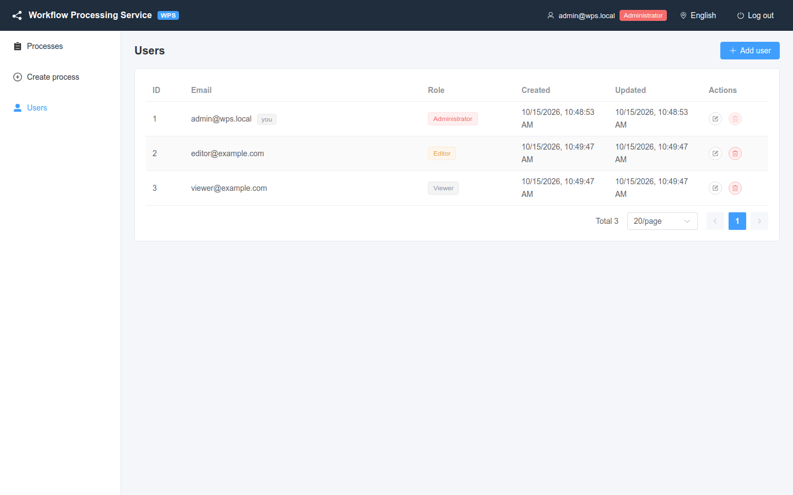

# Users and roles

Who can do what in WPS, how an administrator manages users and why to change the default password first.

<!-- lang-switch -->
🇬🇧 English | [🇷🇺 Русский](../../ru/03-user-guide/users-and-roles.md)
<!-- /lang-switch -->

## Roles

| Role | UI label | In short |
|---|---|---|
| `admin` | **Administrator** | full access, user management |
| `editor` | **Editor** | create and edit processes, manual runs |
| `viewer` | **Viewer** | view processes and audit only |

What each role is allowed to do (the backend checks every request, the UI hides what is not allowed):

| Operation | Administrator | Editor | Viewer |
|---|:---:|:---:|:---:|
| View processes, execution log, execution pages, run-once marks | ✅ | ✅ | ✅ |
| Create, edit, clone processes | ✅ | ✅ | — |
| Manual run (**Run**) | ✅ | ✅ | — |
| Reset a run-once mark | ✅ | ✅ | — |
| Refresh the CRM module list (**Refresh module list from CRM**) | ✅ | ✅ | — |
| Delete a process | ✅ | — | — |
| Manage users (**Users** menu) | ✅ | — | — |

A forbidden request returns `403 FORBIDDEN`; the UI shows
**You do not have permission to perform this operation**. Pages a role cannot open (for example `/users` for an
editor, `/processes/create` for a viewer) redirect to the process list.

> **Note**
> The role is stored in the access token. After an administrator changes a user's role, the new role takes effect when
> the user's access token is renewed (at most `JWT_ACCESS_TTL`, 15 minutes by default) or after the user signs in again.

## Change the default administrator password

The first start creates the administrator `admin@wps.local` with the password `admin`. Change it right after the first
sign-in:

1. Sign in as `admin@wps.local`.
2. Open **Users**.
3. Click **Edit** in the row of `admin@wps.local` (marked **you**).
4. Enter a new **Password** (at least 6 characters) and click **Save**.

Through the API:

```bash
curl -s -X PUT http://localhost:9501/api/users/1 -H "Authorization: Bearer $TOKEN" \
  -H 'Content-Type: application/json' -d '{"password":"a-long-new-password"}'
```

> **Warning**
> Also replace `JWT_SECRET` in production: with the value from `docker-compose.yml` anybody can sign tokens. See
> [Security](../04-operations/security.md).

## Manage users

The **Users** page is available to administrators only.



*Users page: the administrator (**you**), an editor and a viewer.*

### Add a user

1. Click **Add user**.
2. In **New user** fill in **Email**, **Password** (at least 6 characters) and select the **Role**.
3. Click **Create**. The message **User created** confirms it.

### Edit a user

1. Click **Edit** in the user's row.
2. Change **Email**, **Role** or **Password**. Leave the password empty to keep it (**Leave empty to keep unchanged**).
3. Click **Save** (**User updated**).

### Delete a user

1. Click **Delete** in the user's row.
2. Confirm **Delete user …?** (**User deleted**).

The button is disabled in your own row (**You cannot delete yourself**).

### Restrictions

| Situation | Error | UI message |
|---|---|---|
| Delete yourself | `409 CANNOT_DELETE_SELF` | **You cannot delete yourself** |
| Delete the last administrator or change their role | `409 LAST_ADMIN` | **You cannot delete or demote the last administrator** |
| Email already used | `409 EMAIL_EXISTS` | **A user with this email already exists** |
| Password shorter than 6 characters | `422 VALIDATION_ERROR` (`password`) | **At least 6 characters** |
| Invalid email | `422 VALIDATION_ERROR` (`email`) | **Invalid email** |

The password hash is never returned by the API. A deleted user cannot renew the session: the refresh token is rejected
with `401 INVALID_TOKEN`.

### API

| Method | URI | Body |
|---|---|---|
| GET | `/api/users?page=&per_page=` | — |
| GET | `/api/users/{id}` | — |
| POST | `/api/users` | `{ "email", "password", "role" }` |
| PUT | `/api/users/{id}` | `{ "email"?, "password"?, "role"? }` |
| DELETE | `/api/users/{id}` | — |

```bash
curl -s -X POST http://localhost:9501/api/users -H "Authorization: Bearer $TOKEN" \
  -H 'Content-Type: application/json' -d '{"email":"editor@example.com","password":"editor123","role":"editor"}'
```

See also: [Sign-in and interface](login-and-ui.md), [Security](../04-operations/security.md),
[API endpoints](../06-api-reference/endpoints.md).

<!-- footer-nav -->
---

← Previous: [Manual run and run-once reset](manual-run-and-reset.md) | [Contents](../README.md) | [Recipes](recipes.md) Next →
<!-- /footer-nav -->
