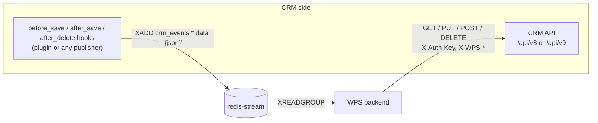

# CRM integration

How WPS talks to a CRM in both directions: events into the stream and calls to the CRM API; contract 1.0 and 2.0; the mock, SuiteCRM 7 and SuiteCRM 8.

<!-- lang-switch -->
🇬🇧 English | [🇷🇺 Русский](../../ru/04-operations/crm-integration.md)
<!-- /lang-switch -->

## Two directions



1. **CRM → WPS: events.** When a record is saved, the CRM appends a message to the Redis Stream `crm_events`.
2. **WPS → CRM: API.** Preload, `save_object` and `save_to_crm` call a small REST API with a JSON:API-like format.

WPS works with **one** CRM at a time — the one in `CRM_API_BASE_URL`.

The contract has two versions. **1.0** is the minimum: read by id, search by field equality, create, update, an event with the
new values of the record. **2.0** extends it without breaking 1.0: filter operators, sort, cursor pagination, field selection,
count, delete, relationships with link fields, event v2 with old values and the origin of the change. WPS learns which version
the CRM implements from `GET {base}/capabilities` (see [Capabilities and degradation](#capabilities-and-degradation)).
The SuiteCRM plugins since version 1.2.0 and the mock implement contract 2.0.

## Event format (CRM → WPS)

`Wps\Services\EventProcessorService::parse()` accepts two message shapes:

| Shape | Example | Notes |
|---|---|---|
| Field `data` with a JSON object | `XADD crm_events * data '{"id":"42","module":"Deals","status":"Active"}'` | Used by the mock and the SuiteCRM plugin. Values keep their JSON types |
| Flat fields | `XADD crm_events * module Deals id 42 status Active` | Every value is a string |

Required and special fields of the object:

| Field | Required | Meaning |
|---|---|---|
| `module` or `object_type` | yes | CRM module = process **object type**. Processes are selected by it |
| `id` | yes | Id of the saved CRM record. Used by preload paths like `object.id`, by `save_object` and by run-once marks |
| `event_id` | no | Idempotency id of the event. If absent, the Redis message id is used |
| any other fields | no | Become `object.<field>` in conditions and actions |

A message without `module`/`object_type`, without `id`, or with `data` that is not a JSON object is moved to the dead-letter
stream `crm_events:dlq` with the reason, and acknowledged. A message for a module that has no active top-level process is
acknowledged and counted in `wps_events_skipped_total`.

### Publishing events from any system

Anything that can talk to Redis can be a CRM for WPS. Example with `redis-cli`:

```bash
redis-cli -h <redis-stream host> -p 6379 XADD crm_events MAXLEN '~' 100000 '*' \
  data '{"id":"70001","module":"Deals","status":"Active","account_id":"512","event_id":"crm-save-70001-1"}'
```

`MAXLEN ~ 100000` keeps the stream bounded (the SuiteCRM plugin does the same). WPS acknowledges messages but does not trim
the stream.

> **Note**
> Send a stable `event_id` if your publisher can retry: two messages with the same `event_id` start each process only once
> within `IDEMPOTENCY_TTL_HOURS` (see [Reliability](reliability.md)).

### Event version 2 (contract 2.0)

A publisher of contract 2.0 adds service fields to the fields of the record (new values):

```json
{
  "id": "8f1c…", "module": "Opportunities", "object_type": "Opportunities",
  "event_type": "update",
  "before": { "sales_stage": "Prospecting", "amount": "1000" },
  "changed_fields": ["sales_stage", "amount"],
  "wps_event_version": 2,
  "wps_origin": { "execution_id": "2b0c…", "process_id": 12, "depth": 1 },
  "wps_event": "after_save", "wps_is_update": "1", "wps_user_id": "1", "wps_published_at": "2026-10-20T09:00:00Z",
  "name": "…", "sales_stage": "Closed Won", "amount": "1200"
}
```

| Field | Meaning |
|---|---|
| `event_type` | `create` — the record was created; `update` — changed; `delete` — deleted (also by a save with `deleted = 1`). `link` / `unlink` — relationship events, not published by default (`publish_relationship_events`); WPS acknowledges them without starting processes (see below). Which types start a process — the process field [`trigger_on`](../03-user-guide/triggers-and-conditions.md#when-a-process-starts) |
| `before` | Old values of the **changed** fields only. `{}` for `create` and `delete` |
| `changed_fields` | Changed fields. For `create` — all non-empty fields. Fields from `ignore_change_fields` (default `date_modified`, `modified_user_id`, `date_entered`, `created_by`, `deleted`) are never listed here or in `before`, otherwise every save would "change" `date_modified` |
| `wps_origin` | Present only when the save was made by WPS: the `X-WPS-*` headers of the request (see [below](#origin-headers-x-wps)). Protects against process cascades |
| `wps_event_version` | `2` — format marker for diagnostics |
| `wps_event`, `wps_is_update`, `wps_user_id`, `wps_published_at` | Contract 1.0 fields, kept for compatibility. `wps_user_id` is the id of the CRM user who saved the record; the system variable `sys.user_id` takes the neutral `user_id` field of the event and falls back to `wps_user_id` (plugins 1.2.0 publish only `wps_user_id`) |

The publisher detects changes after normalizing by the field type: `1000.000000` equals `1000`, `NULL` equals `''`, the order of
multienum values does not matter; strings are compared as is (case and spaces matter). A save without changes is published as
`update` with empty `before` and `changed_fields` (setting `publish_unchanged`).

### How WPS parses an event

`Wps\Events\EventEnvelope` is the single event parser for the stream and manual runs. The service fields `event_type`, `before`,
`changed_fields`, `wps_origin` are **removed from the record** and reach neither `object` nor `context.event`:

| Where | What |
|---|---|
| `object` | Record fields (new values). Contract 1.0 fields (`wps_event`, `wps_is_update`, `wps_user_id`, `wps_published_at`) and `wps_event_version` stay — conditions may rely on them |
| `object_before` | Old values of the changed fields (a read-only variable, see [Conditions](../03-user-guide/triggers-and-conditions.md#values-before-the-change-object_before)). `null` — old values are unknown |
| `context.event_info` | `event_type`, `changed_fields` (`null` — unknown), `has_before`, `origin` (`wps_origin`), `legacy` (the event has no `event_type`) |

Rules when some fields are missing:

| Event | `object_before` | `changed_fields` |
|---|---|---|
| `before` present, no `changed_fields` | `before` | keys of `before` |
| `changed_fields` present, no `before` | `null` (old values unknown) | as sent |
| `event_type: create` without `before` | `{}` | as sent or `null` |
| `event_type: update`, `before: {}` | `{}` | `[]` — the save changed nothing |
| neither | `null` | `null` |
| no `event_type` (contract 1.0) | `null` | `null`, `legacy: true`; the type is `create` when `wps_is_update = "0"`, otherwise `update` |

- `id` and `module` inside `before` are ignored; extra `before` keys not listed in `changed_fields` are kept.
- In the flat XADD format nested values are sent as a JSON string: `before '{"status":"New"}'`, `changed_fields '["status"]'`.
- `changed_fields` is cleaned of duplicates, empty strings and non-strings.
- A service field of a wrong type (`before` — a non-JSON string, a list, a number; `changed_fields` — not a list; `wps_origin` with a
  non-numeric `depth`) is dropped: the warning `Invalid service fields in event` is logged and the metric
  `wps_events_malformed_fields_total` grows. **The event does not go to the DLQ** — losing a save because of a service field is worse
  than losing only the old values.
- Events without `event_type` are counted in `wps_events_legacy_format_total` and processed as before: `wps_is_update = "0"` —
  a creation, `"1"` or no field — an update.
- An unsupported `event_type` (`link`, `unlink`, a typo, an empty string) — the event is **acknowledged without starting processes**
  (status `unsupported_event_type`, `info` log `Unsupported event_type, no process is started`, metric
  `wps_events_unsupported_type_total`); it does not go to the DLQ.
- Processes of the module are filtered by [`trigger_on`](../03-user-guide/triggers-and-conditions.md#when-a-process-starts) before
  the conditions are checked. When the module has processes but none subscribes to the type, `wps_events_skipped_by_type_total` grows.

## CRM API contract (WPS → CRM)

Implemented in `Wps\Services\ExternalApiAdapterService` with the Swoole coroutine HTTP client.

| Operation | Request | Expected response |
|---|---|---|
| Load by id (preload, `by_field: id`) | `GET {base}/{module}/{id}` | `200 {"data": {"type", "id", "attributes": {...}}}`; `404` = not found (variable becomes `null`) |
| Search by field (preload, other `by_field`) — 1.0 syntax, works with every plugin | `GET {base}/{module}?filter[{field}]={value}&size=1` | `200 {"data": [ {...} ]}` — the first record is used; empty list = not found |
| Update (`save_object`, `save_to_crm`, record has `id`) | `PUT {base}/{module}/{id}` with `{"data": {"type", "id", "attributes": {changed fields}}}` | `200 {"data": {...}}` |
| Create (record without `id`) | `POST {base}/{module}` with `{"data": {"type", "attributes": {...}}}` | `201 {"data": {"id", ...}}` — the new id is written back to the variable |
| Modules dictionary | `GET {base}/modules` | list of `{value,label}` / `{name,label}` / JSON:API items with `id` and `attributes.label` |

Methods of `ExternalApiAdapterService` and the requests they make (all through the coroutine
`Swoole\Coroutine\Http\Client`, timeout `CRM_API_TIMEOUT`, headers `X-Auth-Key` and `X-WPS-*`):

| Method | Request | Used by |
|---|---|---|
| `getById(module, id)` | `GET {base}/{module}/{id}`; `404` → `null` | preload `by_id`, `assign` (user, manager) |
| `findOneByField(module, field, value)` | `GET {base}/{module}?filter[field]=value&size=1` | preload `by_field` |
| `create(module, attributes)` / `update(module, id, attributes)` | `POST {base}/{module}` / `PUT {base}/{module}/{id}` | `save_object`, `save_to_crm`, `update_records`, the `crm_alert` channel |
| `findPage(module, filter, sort, fields, size, cursor, withTotal)` | `GET {base}/{module}?filter[f][op]=…&sort=&fields=&page[size]=&page[after]=&count=1` | `find_records`, `aggregate`, `assign` |
| `findMany(…, limit)` | `findPage` page by page up to `limit` | `find_records`, `aggregate` |
| `count(module, filter)` | `GET …&fields=id&page[size]=1&count=1` → `meta.total` | `aggregate` (`count` without a field), `assign` (`least_busy`) |
| `delete(module, id)` | `DELETE {base}/{module}/{id}`; `404` → `false` | tests, future actions |
| `listRelated(module, id, link, fields, size, cursor)` | `GET {base}/{module}/{id}/relationships/{link}` | `find_records` (`related_to`), `link_records`, `assign` (group) |
| `link(module, id, link, items)` / `unlink(…, relatedId)` | `POST …/relationships/{link}` / `DELETE …/relationships/{link}/{related_id}` | `link_records`, `unlink_records` |
| `capabilities()` | `GET {base}/capabilities`; `404`/`405` → contract 1.0 | `CrmCapabilitiesService` |
| `getModules()` | `GET {base}/modules` | `DictionaryService` |

When the CRM lacks a capability the method needs (a filter operator, sorting, relationships), the method throws
`CrmCapabilityMissingException` before sending the request (see [Capabilities and degradation](#capabilities-and-degradation)).

`null` in `attributes` clears the field (WPS plugins for SuiteCRM 7 and 8 since 1.2.0; before that SugarBean skipped such a field on save) —
this is what, e.g., `date_shift` with `on_missing: null` and `set_value` with `null` rely on.

`{"id", "attributes"}` is flattened to `{id, ...attributes}`. All requests send `Accept` and `Content-Type: application/json`.

### `X-Auth-Key`

```text
X-Auth-Key = CRM_API_STATIC_KEY . gmdate("Y.m.d H")
```

Example: key `mySecretKey` at 08:15 UTC on 15 Oct 2026 → `mySecretKey2026.10.15 08`. The key changes every hour; the mock
and the SuiteCRM plugin also accept the key of the previous hour to tolerate clock skew. Keep server clocks in sync (NTP).

### Base URL and API version

`AppConfig::crmUrl()` appends `/api/v8` to `CRM_API_BASE_URL` **unless** the URL already ends with `/api/v<N>`:

| `CRM_API_BASE_URL` | Request for `Accounts/1` |
|---|---|
| `http://mock:9502` | `http://mock:9502/api/v8/Accounts/1` |
| `http://mock:9502/api/v8` | `http://mock:9502/api/v8/Accounts/1` |
| `http://suitecrm7/api/v9` | `http://suitecrm7/api/v9/Accounts/1` |

### Error handling

| CRM answer | WPS reaction |
|---|---|
| Connection failed, timeout (`CRM_API_TIMEOUT`), reset, HTTP `5xx` | Recoverable: the step is retried (`ACTION_RETRY_MAX`) |
| `404` on `GET` | Not found: the preload variable becomes `null` |
| `404` on `DELETE` | There was no record: `delete()` returns `false` |
| Other `4xx` (including `404` on `PUT`), invalid JSON | Non-recoverable: the step and the execution fail at once |
| Invalid module name (not `^[A-Za-z][A-Za-z0-9_]*$`) | Non-recoverable, no request is sent |

## CRM API contract 2.0

An extension of contract 1.0: every 1.0 request works as before. Responses use the same JSON:API format, errors are
`{"errors": [{"status", "title", "detail"?}]}`.

### Capabilities: `GET {base}/capabilities`

```json
{ "data": {
    "contract_version": "2.0",
    "crm": { "name": "SuiteCRM", "version": "8.10.2", "plugin_version": "1.2.0" },
    "features": ["filter_operators", "filter_nin", "sort", "cursor_pagination", "fields", "count", "delete",
                 "relationships", "relationship_fields", "event_v2", "delete_events", "origin_headers"],
    "limits": { "max_page_size": 100, "max_link_batch": 100, "max_in_values": 100 } } }
```

`404` or `405` — the CRM implements contract 1.0 without capabilities.

### Search

```text
GET {base}/Opportunities?filter[account_id][eq]=42
                       &filter[sales_stage][in][]=Prospecting&filter[sales_stage][in][]=Qualification
                       &filter[amount][gte]=1000.5&filter[date_closed][lt]=2026-11-01
                       &filter[description][null]=1
                       &sort=-date_entered&fields=id,name,amount&page[size]=100&page[after]=<cursor>&count=1
```

| Parameter | Meaning |
|---|---|
| `filter[f]=v` | 1.0 syntax, the same as `filter[f][eq]=v` |
| `filter[f][op]=v` | Operators: `eq`, `neq`, `gt`, `gte`, `lt`, `lte`, `like` (pattern with `%` and `_`), `in` (array `[]`, at most `max_in_values`), `nin` — "not in the list" (array `filter[f][nin][]=a&filter[f][nin][]=b`, at most `max_in_values`; like `neq`, records with an empty field match too: `NOT IN (…) OR IS NULL`; feature `filter_nin`), `null` / `notnull` (value ignored; an empty string counts as empty). Several operators per field are allowed (`gte` + `lt`). All conditions are joined by **AND**; there is no OR — use `in` for "A or B" |
| Empty value | `eq ''` — `'' OR NULL`; `neq ''` — has a value. `neq v` includes records with an empty field |
| Value format | As the CRM stores it: datetime — UTC `Y-m-d H:i:s`, date — `Y-m-d`, boolean — `1`/`0`, number — with a dot. WPS casts values (`cast`, [Triggers and conditions](../03-user-guide/triggers-and-conditions.md)) |
| `sort` | Up to 2 comma-separated fields, `-` = descending. A hidden `id` key is always added last (stable order). Default — `date_entered` |
| `page[size]` (alias `size`) | 1..`max_page_size`, default 20 |
| `page[after]` | Opaque cursor from `meta.next_cursor` of the previous page (keyset by the sort keys). A cursor of another query — `422` |
| `fields` | Fields in the response; `id` is always present |
| `count=1` | Adds `meta.total` (a separate count; not computed without the parameter) |

```json
{ "data": [ { "type": "Opportunities", "id": "8f1c…", "attributes": { "name": "…", "amount": "1200" } } ],
  "meta": { "size": 100, "count": 37, "next_cursor": null, "total": 37 } }
```

`next_cursor = null` — no more pages. The cursor is built from values: a record changed during the walk can move; for a full
walk sort by immutable fields (`date_entered`, `id`).

### Delete: `DELETE {base}/{module}/{id}`

Soft delete. `200 {"meta": {"deleted": true}}`; no record or already deleted — `404`; read-only module — `405`.
The publisher emits a `delete` event.

### Relationships

| Request | Meaning |
|---|---|
| `GET {base}/{module}/{id}/relationships/{link}?page[size]=&page[after]=&fields=` | Related records; each has `meta.relationship` with the link fields (`{"accept_status": "accept", "required": "1"}`). No filter or sort |
| `POST {base}/{module}/{id}/relationships/{link}` `{"data": [{"type": "Users", "id": "1", "meta": {"accept_status": "accept"}}]}` | Link (at most `max_link_batch`). Idempotent: an existing link gets its fields updated. Response `{"meta": {"linked": [...], "updated": [...], "not_found": [...]}}`; missing records go to `not_found`, the request does not fail |
| `DELETE {base}/{module}/{id}/relationships/{link}/{related_id}` | Unlink. Idempotent: `{"meta": {"removed": true\|false}}` |

`{link}` is the link field of the module: `Meetings.users`, `Meetings.contacts`, `Calls.contacts`, `Accounts.contacts`,
`SecurityGroups.users`, `Users.reportees`. Link fields are the extra columns of the join table of a many-to-many relationship.
Read-only modules (`Users`, `Employees`) allow `GET` of relationships and refuse changes (`405`).

### Error codes

| Code | When |
|---|---|
| `401` | Wrong `X-Auth-Key` |
| `404` | Module, record or route not found |
| `405` | Method not supported; read-only module |
| `422` | Unknown field, operator, link or link field; `in` without values or above the limit; cursor of another query; more than 2 sort fields |
| `400` | The body is not JSON or has a wrong shape |
| `5xx` | CRM error; WPS retries the step |

## Capabilities and degradation

WPS loads `GET {base}/capabilities` and caches it in Redis `crm:capabilities` for `DICT_CACHE_TTL`; the cache is reset together
with the modules dictionary (`POST /api/dictionaries/modules/refresh`). The current state is shown by
`GET /api/dictionaries/crm-capabilities`. Capabilities are checked at run time, not when a process is saved.

| WPS feature | Capability | With an old plugin (contract 1.0) |
|---|---|---|
| Preload by id and by field, `save_object`, `save_to_crm` | — | Works |
| Search for a set of records by equality only, no sort, up to 100 records | — | Works with the old `filter[f]=v&size=N` syntax |
| Search with other operators, sort, cursor or more than 100 records | `filter_operators`, `sort`, `cursor_pagination` | The step fails with `CRM_CAPABILITY_MISSING` |
| "Not in the list" filter (`not_in` in "Find records") | `filter_nin` | `CRM_CAPABILITY_MISSING` (a plugin without `filter_nin` — update the plugin) |
| Count (`count` without `field` in an aggregate by a filter) | `count` | `CRM_CAPABILITY_MISSING` |
| Delete a record | `delete` | `CRM_CAPABILITY_MISSING` |
| Relationships (list, link, unlink) | `relationships` | `CRM_CAPABILITY_MISSING` |
| Link fields when linking | `relationship_fields` | The link is created without fields, with a warning in the step result |
| Old values, event type | `event_v2` (seen in the event itself) | An event without `event_type` is accepted as before |
| `wps_origin` in events | `origin_headers` | `X-WPS-*` headers are always sent (extra headers are harmless), but events have no `wps_origin` |

`CRM_CAPABILITY_MISSING` is a non-recoverable step error with the text
`CRM does not support "<feature>" (contract 1.0); update the CRM plugin` and `error_code` in `result_data`.

### Load on the CRM: search, aggregates, bulk updates

Steps that read or change many records use the same API, without separate aggregate endpoints:

- [Aggregate over records](../03-user-guide/change-types-and-expressions.md#aggregate-over-records) (`aggregate`):
  `count` without `field` by a filter is **one** request with `count=1` (`meta.total`); the other functions read
  records in pages of 100 (`fields=id,<field>`) and are folded in WPS. The cap is the step `limit` (1000 by default)
  and `AGGREGATE_MAX_RECORDS` (5000, at most 50000): more records — a step error or a partial result
  (`on_limit: partial`). An aggregate over a whole module without a filter is rejected when the process is saved;
- Find records — up to `FIND_RECORDS_MAX` records (a relationship is scanned up to `FIND_RECORDS_SCAN_MAX`);
- Update list records — one `PUT` per changed record, up to `UPDATE_RECORDS_MAX`.

Each such step runs on **every** execution of the process: a frequent event (e.g. any save of a deal) with an
aggregate by relationship over thousands of records means thousands of reads. Narrow the launch conditions and the
filters, use `count` without `field`, keep `limit` as small as is enough; the number of records read is in the
`wps_aggregate_records_scanned` metric ([Monitoring](monitoring.md)).

### Notifications in the bell (`Alerts`)

The `crm_alert` channel of the [Notification](../03-user-guide/actions.md#notification) action creates an `Alerts`
record per recipient with an ordinary API call (`POST {base}/Alerts`) — no separate endpoint is needed. The SuiteCRM UI
polls `index.php?module=Alerts&action=get` and shows the user's unread records in the bell.

| `Alerts` field | Value | SuiteCRM 7 | SuiteCRM 8 |
|---|---|---|---|
| `name` | the title (without a title — the first 80 characters of the text) | yes | yes |
| `description` | the text | yes | yes |
| `assigned_user_id` | the recipient | yes | yes |
| `is_read` | `0` | yes | yes |
| `type` | `info` | yes | yes |
| `target_module` | module of the record from `link.record` | yes | yes |
| `url_redirect` | the record link (`CRM_RECORD_URL_TEMPLATE`, by the profile by default) | yes | yes |
| `date_start`, `snooze`, `status` | creation time UTC, empty, empty | no — the plugin drops them (`meta.ignored_attributes`) | yes |

The field profile is `CRM_ALERT_PROFILE` (`suitecrm8` also suits SuiteCRM 7: the extra fields are ignored); for another
CRM — `profile: custom` with the channel's own `fields` or its own `module`. Adding `Alerts` to the plugin
`WPS_EVENT_MODULES` is **not needed**: WPS only writes notifications and does not react to their events.

### Users and groups (`assign`)

The [Assign an owner](../03-user-guide/actions.md#assign-an-owner) action reads users through the same API:

| What | Request | Fields |
|---|---|---|
| A pool from a list of ids | `GET {base}/Users?filter[id][in][]=…&fields=id,status,employee_status,is_group,portal_only,reports_to_id` | up to 200 ids per request |
| A pool from a security group | `GET {base}/SecurityGroups/{id}/relationships/users` (the `relationships` feature), in pages; cached for `ASSIGN_POOL_CACHE_TTL` | the same |
| The manager (`manager`), activity check (`user`) | `GET {base}/Users/{id}` | `reports_to_id`, activity fields |
| Load (`least_busy`) | `GET {base}/{module}?filter[…]&filter[assigned_user_id][eq]=…&count=1` per user (the `count` feature) | `meta.total` |

- The `Users` module is **read-only** in the plugin API: writing (`POST`/`PUT`/`DELETE`) answers `405 Module Users is
  read-only for the WPS API`. The stand creates test users straight in the database
  (`.tehnical/suiteCRM8/scripts/seed_case_users.sh`).
- An active user: `status = Active`, `employee_status` `Active` or empty (`Leave of Absence` excludes), not `is_group`,
  not `portal_only`.
- SuiteCRM security groups (`SecurityGroups`, the "Security Groups" module) — the `users` link through the
  `securitygroups_users` table. The group id is visible in the address of its record in the CRM.
- The assignment writes an ordinary record field (`assigned_user_id`) with a `PUT` — `save_to_crm` or a separate "Save
  to CRM".

## Origin headers X-WPS

Every request WPS makes to the CRM inside an execution carries:

```text
X-WPS-Execution-Id: 2b0c…      execution UUID
X-WPS-Process-Id: 12
X-WPS-Depth: 1                 nesting depth of child processes
```

A contract 2.0 publisher adds them as `wps_origin` to **every** event published during this HTTP request, including cascade
saves of other records made by logic hooks. This lets WPS see that a change was caused by its own process. The values live in
the coroutine context (`Wps\Crm\CrmCallOrigin`), so parallel executions do not mix them up.

## Modules dictionary

The "Object type" and "Module" selectors in the UI come from `GET /api/dictionaries/modules`, cached in Redis `dict:modules`
for `DICT_CACHE_TTL` (300 s). Sources, in order:

1. `MOCK_SERVICE_URL/modules` — only if `MOCK_SERVICE_URL` is not empty;
2. `{CRM API}/modules`.

After switching the CRM, reset the cache with the refresh button next to the "Object type" field or
`POST /api/dictionaries/modules/refresh`.

## Option 1: the mock (default for development)

The `mock` service emulates both directions:

- `GET|POST http://localhost:9502/test-event?module=Deals&set[status]=Active&count=1` generates an event, stores the object in
  the mock CRM storage and publishes it. Use `curl -g` because of the square brackets.
- `&event_type=create|update|delete&before[field]=old` on `/test-event` — an event of contract 2.0 (`changed_fields` = the keys of
  `before`, for `create` — all non-empty fields). Without `event_type` and `before` the event is published in the old format
  (`legacy`) — that is how backward compatibility is checked. A status transition:
  `curl -g 'http://localhost:9502/test-event?module=Leads&event_type=update&before[status]=New&set[status]=Assigned'`.
- `/api/v8/…` and `/api/v9/…` — the same contract 2.0 API with an `X-Auth-Key` check (`MOCK_CRM_STATIC_KEY`): `capabilities`,
  search with operators, sort, cursor, `fields`, `count`, `DELETE`, relationships. The mock has no schema: there are no unknown
  fields or links, values are compared as numbers when both sides are numeric. Ids starting with `fail500` answer `500`, ids
  starting with `slow` answer after 3 s — handy for testing retries and timeouts.
- `GET|PUT /mock/objects/{module}/{id}` — read or seed an object without authentication;
  `GET /mock/relationships/{module}/{id}/{link}`, `PUT …/{related_id}` `{"related_module", "fields"}` — relationships.
- Targets for `http_request` (request counters are kept in Redis by the key from the `X-Mock-Key` header or `?key=`):
  `ANY /mock/echo[/…]?delay_ms=&status=` — returns the request (method, path, query, headers, body, `json`, `count`) and
  `order_id` = `A-{1000+count}`; `GET /mock/echo-last?key=` — the last request and the request count of the key;
  `GET /mock/status/{code}?retry_after=` — the status code (with `Retry-After`); `GET /mock/redirect?to=&code=302` — a redirect;
  `GET /mock/big?bytes=` — a body of the given size; `GET /mock/text?charset=windows-1251` — a non-UTF-8 text;
  `POST /mock/oauth/token` — client credentials `wps` / `wps-secret` → `access_token` `tok-N`;
  `GET /mock/protected` — `200` with `Authorization: Bearer tok-…`, otherwise `401`.
- `GET|PUT /mock/config` `{"contract": "1.0"|"2.0", "publish_on_write": true|false}` — modes at run time (kept in Redis):
  `contract: 1.0` emulates an old plugin (`404` on `capabilities`, search by equality of the first key only, no relationships or
  delete); `publish_on_write` publishes an event v2 (with `before` and `wps_origin` from the `X-WPS-*` headers) on every `POST`,
  `PUT`, `DELETE` through the API. Defaults: variables `MOCK_CRM_CONTRACT` (`2.0`) and `MOCK_PUBLISH_ON_WRITE` (`0`).
- `GET /modules` — 15 modules with Russian labels; `GET /health`.

Backend settings for the mock:

```bash
CRM_API_BASE_URL=http://mock:9502
CRM_API_STATIC_KEY=mySecretKey     # = MOCK_CRM_STATIC_KEY
MOCK_SERVICE_URL=http://mock:9502
```

These are the defaults of `docker-compose.yml`, used when `./.env` does not set them.

## Option 2: SuiteCRM 7 or SuiteCRM 8

The built-in SuiteCRM API V8 uses OAuth2 and another format, so WPS integrates through a **plugin installed in the CRM**.
It is shipped as two separate packages next to the repository, one per CRM version: `../suiteCRM7` (SuiteCRM 7.14) and
`../SuiteCRM8` (SuiteCRM 8.10, installed into the legacy layer `public/legacy`). Each package contains the Module Loader
package, `bin/install.sh` / `bin/uninstall.sh` (a CRM on the host or in a Docker container), `bin/build.sh` (zip for
Admin → Module Loader) and web-server snippets; its `README.md` describes the installation step by step.

| Part | Implementation |
|---|---|
| Events | Application-level logic hooks `WpsEventHook`: `before_save` remembers the row before the save, `after_save` and `after_delete` publish an event v2 (`XADD crm_events MAXLEN ~ 100000 * data '{json}'` with a pure-PHP RESP client); relationship hooks — by a setting. Modules are listed in `WPS_EVENT_MODULES` |
| API for WPS | Custom entry point `wpsApi` + web-server rewrite `/api/v9/(.*)` → `index.php?entryPoint=wpsApi&wps_path=$1` (SuiteCRM 8: `/legacy/index.php?...`) |
| Event content | `id`, `module`, `object_type` and all stored fields of the record (re-read from the DB), plus the [event v2](#event-version-2-contract-20) fields |
| API contract | 2.0 since plugin version 1.2.0 (1.1.0 — contract 1.0). Check an installed plugin with `bin/contract_check.sh <url>/api/v9 <key> <redis-stream container>` from the package |
| Failure mode | If Redis is down, the CRM save still succeeds; the event is lost and logged as `[WPS] publish failed` |
| Record creation | A record is new when it has no `fetched_row` and its row is not in the DB yet. SugarBean assigns the `id` of a new record before `before_save`, so "no `id`" is not a reliable sign: before the fix in 1.2.0 creating an opportunity (Opportunities) was published as an `update` without changes |
| E-mail address (`email1`) | The primary address of people and companies (Leads, Contacts, Accounts, Users…) is kept in a separate SuiteCRM table; since 1.2.0 the plugin returns it as the field `email1` in the API and events, and saves `email1` in the record `attributes` as the primary address. A changed address is in `changed_fields` with the old value in `before`. Needed by [`send_email`](../03-user-guide/actions.md#send-an-e-mail) to the record address. The body and addresses of the `Emails` module (letter history) are kept separately too — the plugin skips such fields (`meta.ignored_attributes`) |

Ready-to-run Docker setups of a clean CRM are in `.tehnical/suiteCRM7` (SuiteCRM 7.14.9, port 8701) and
`.tehnical/suiteCRM8` (SuiteCRM 8.10.2, port 8801); the plugin is not in their images and is installed with the package.
They join the WPS network `WPS_NETWORK` (`swoole_worckflow_default`), so start WPS first:

```bash
cd .tehnical/suiteCRM8          # or suiteCRM7
cp .env.example .env            # set passwords and WPS_API_STATIC_KEY
docker compose up -d --build
../../../SuiteCRM8/bin/install.sh --docker wps-suitecrm8-web-1 --env-file .env   # or ../../../suiteCRM7/... wps-suitecrm7-web-1
```

Switch WPS to the CRM in the root `./.env`:

```bash
CRM_API_BASE_URL=http://suitecrm8/api/v9     # or http://suitecrm7/api/v9
CRM_API_STATIC_KEY=<WPS_API_STATIC_KEY from .tehnical/suiteCRM8/.env>
MOCK_SERVICE_URL=                            # empty: modules come from the CRM
```

Then `docker compose up -d --build backend` and `POST /api/dictionaries/modules/refresh`. To return to the mock, remove the
three lines. Plugin installation into any other CRM is described in the `README.md` of the package; the full API contract and example processes
(`processes/*.processes.json`, imported with `scripts/wps_processes.php`) are described in `.tehnical/suiteCRM7/README.md`
and `.tehnical/suiteCRM8/README.md`.

### Plugin packages: SuiteCRM 7 and SuiteCRM 8

The plugins are two **separate** packages with the same PHP code in `custom/include/WPS` (`WpsApi`, `WpsEventHook`,
`WpsRedisClient`, `WpsBeanSerializer`, `WpsConfig`) but different installers and web-server rules. Each one is changed and
tested separately. The current version of both is 1.2.0 (contract 2.0).

| | SuiteCRM 7 (`../suiteCRM7`) | SuiteCRM 8 (`../SuiteCRM8`) |
|---|---|---|
| Supported CRM | 7.14.x (`manifest.php`: `^7\.14\.`), PHP 8.1–8.2 | 8.10.x (`^8\.10\.`), PHP 8.2–8.4 |
| Installed into | the CRM root (with `include/entryPoint.php`) | the legacy layer `public/legacy`; `--crm-path` is the CRM root with `bin/console` |
| Rewrite `/api/v9/(.*)` | `/index.php?entryPoint=wpsApi&wps_path=$1` | `/legacy/index.php?entryPoint=wpsApi&wps_path=$1`, in the vhost before the Symfony front controller |
| `.htaccess` variant | yes (`--htaccess`; the block goes to the top of the file and survives "Rebuild .htaccess") | no: `public/.htaccess` is the Symfony front controller |
| After installation | — | `php bin/console cache:clear` (done by `install.sh`) |
| Plugin logs | `suitecrm.log` (`[WPS]` lines) | `logs/legacy/suitecrm.log`, `logs/prod/` |
| Marker field | `Leads.wps_processed_c` | `Leads.wps_processed_c` |

Package content: `package/` (zip for Module Loader, `manifest.php` at the root), `bin/install.sh`, `bin/uninstall.sh`,
`bin/build.sh` (→ `dist/wps_integration-<version>-suitecrm<7|8>.zip`), `bin/wps_setup.php` (CLI `config` / `install` /
`uninstall` / `status`), `bin/contract_check.sh`, `config/wps.env.example`, `config/apache-wps.conf`,
`config/nginx-wps.conf` (SuiteCRM 7 also has `config/htaccess-wps.conf`).

### Installing the plugin

```bash
cd /path/to/SuiteCRM8                      # or suiteCRM7
cp config/wps.env.example config/wps.env   # set WPS_API_STATIC_KEY and the WPS Redis address

# CRM on this machine (as root, www-data or via sudo)
bin/install.sh --crm-path /var/www/html --apache-conf /etc/apache2/sites-available/000-default.conf

# CRM in a Docker container (paths are inside the container)
bin/install.sh --docker <container> --env-file config/wps.env \
    --apache-conf /etc/apache2/sites-available/000-default.conf
```

What `install.sh` does:

1. Checks that this is an installed CRM of the right version, that PHP `zip` exists and that it can write (otherwise
   `is not the legacy root of SuiteCRM`, `bin/console not found: is this SuiteCRM 8?`, `does not support SuiteCRM x.y`).
2. Writes the `WPS_*` settings to `$sugar_config['wps']` (`config_override.php`); environment variables win over the file.
3. Installs the package through `ModuleInstaller`, registers it in Module Loader, creates the field
   `Leads.wps_processed_c` if missing. Running it again is an upgrade/reinstall: the files of the previous version are
   removed first.
4. SuiteCRM 8: `bin/console cache:clear`.
5. With `--apache-conf` adds the rewrite between the `# BEGIN/END WPS integration` markers, checks `apachectl -t` and
   reloads gracefully; without it only prints the snippet.
6. Self-check: `GET /api/v9/modules` with the right and a wrong key (expects `200` and `401`), at `--site-url`
   (default `http://localhost`).

Exit code: `0` — installed and the API answers; `3` — installed, but the self-check failed. Options: `--web-user`,
`--skip-config` (keep the settings), `--skip-check`, `--force` (another CRM version, at your own risk), `--help`.

Manually: `bin/build.sh` → Admin → Module Loader → Upload → Install → Commit; then the settings
(`sudo -u www-data env $(grep -v '^#' config/wps.env | xargs) php bin/wps_setup.php config` from the legacy-layer
directory), `cache:clear` (SuiteCRM 8) and the web-server rewrite. Open Module Loader through the Admin menu: a direct link
without a Referer triggers the SuiteCRM XSRF protection.

> **Warning**
> In Docker the `--apache-conf` rule lives in the container configuration and disappears when the container is recreated
> (`up --force-recreate`, a new image). Put the rewrite into the image (as the `.tehnical/suiteCRM*` stands do) or use
> `--htaccess` (SuiteCRM 7). Recreating the CRM **volume** removes the plugin itself.

### Plugin settings (`WPS_*`)

Written to `$sugar_config['wps']` by `wps_setup.php config` (called by `install.sh`). To change them without reinstalling:
`bin/install.sh … --skip-check` or `wps_setup.php config`.

| Variable | Key of `$sugar_config['wps']` | Default | Meaning |
|---|---|---|---|
| `WPS_ENABLED` | `enabled` | `true` | `false` — no events are published, the `/api/v9` API keeps working |
| `WPS_REDIS_HOST` | `redis_host` | `redis-stream` | Host of the WPS Redis Stream (= `REDIS_STREAM_HOST` of WPS) |
| `WPS_REDIS_PORT` | `redis_port` | `6379` | Port |
| `WPS_REDIS_PASSWORD` | `redis_password` | empty | `AUTH` password (= `REDIS_STREAM_PASSWORD`) |
| `WPS_REDIS_TIMEOUT` | `redis_timeout` | `1.0` | Connect and read timeout, s: a record save never waits longer when Redis is down |
| `WPS_REDIS_STREAM` | `stream` | `crm_events` | Stream name (= `REDIS_STREAM_NAME`) |
| `WPS_REDIS_STREAM_MAXLEN` | `stream_maxlen` | `100000` | `XADD MAXLEN ~` (`0` — unlimited). WPS does not trim the stream |
| `WPS_EVENT_MODULES` | `event_modules` | `Leads,Contacts,Accounts,Opportunities,Cases,Calls,Tasks,Meetings` | Modules whose saves are published (empty — all). The module of a WPS process must be in the list |
| `WPS_API_STATIC_KEY` | `api_static_key` | empty | API key (= `CRM_API_STATIC_KEY` of WPS); empty — the API answers `401` to everything |
| `WPS_API_USER_ID` | `api_user_id` | `1` | CRM user the API writes records as (`created_by`, `modified_user_id`) |
| — | `api_readonly_modules` | `Users, Employees` | Read-only modules (`405`) |
| `WPS_IGNORE_CHANGE_FIELDS` | `ignore_change_fields` | `date_modified,modified_user_id,date_entered,created_by,deleted` | Fields not counted as changes (`before`, `changed_fields`) |
| `WPS_PUBLISH_UNCHANGED` | `publish_unchanged` | `true` | Publish `update` without changed fields |
| `WPS_PUBLISH_DELETE_EVENTS` | `publish_delete_events` | `true` | `after_delete` → `delete` event |
| `WPS_PUBLISH_RELATIONSHIP_EVENTS` | `publish_relationship_events` | `false` | `link` / `unlink` events (WPS acknowledges them without starting processes) |
| `WPS_MAX_PAGE_SIZE` | `max_page_size` | `100` | Largest `page[size]` of search and relationship lists (`limits.max_page_size`) |
| `WPS_MAX_LINK_BATCH` | `max_link_batch` | `100` | Items in one `POST …/relationships/{link}` |
| `WPS_MAX_IN_VALUES` | `max_in_values` | `100` | Values of the `in` / `nin` operator |

On the stands the plugin is reinstalled after `WPS_EVENT_MODULES` changes (`install.sh … --force`).

### Checking an installed plugin

```bash
# 1. status: package, hook, entry point, field, settings, Redis reachability
#    (SuiteCRM 8 — from public/legacy, SuiteCRM 7 — from the CRM root, as www-data)
sudo -u www-data php /path/to/SuiteCRM8/bin/wps_setup.php status

# 2. API with the key of the current hour (UTC)
KEY="${WPS_API_STATIC_KEY}$(date -u '+%Y.%m.%d %H')"
curl -s -H "X-Auth-Key: $KEY" http://<crm>/api/v9/capabilities                                   # contract_version 2.0
curl -s -o /dev/null -w '%{http_code}\n' -H 'X-Auth-Key: wrong' http://<crm>/api/v9/modules      # 401

# 3. event: save a lead in the CRM and look at the tail of the WPS stream
docker compose exec -T redis-stream redis-cli XREVRANGE crm_events + - COUNT 1

# 4. full check of contract 2.0: search operators, cursor, fields, count, 422, v2 events, DELETE, relationships
bin/contract_check.sh http://<crm>/api/v9 "$WPS_API_STATIC_KEY" <WPS redis-stream container>
```

`contract_check.sh` prints `ok …` / `FAIL …: got […] expected […]` lines and finally `ALL OK` or `FAILURES: N`. It creates
test records — three opportunities `ct-<time>-<amount>`, a lead (removed by the `DELETE` check) and a meeting with a
relationship — and does not remove the rest: on a production CRM delete them after the check. It needs `curl`, `jq` and
`docker` (the stream is read with `docker exec <container> redis-cli`). The base URL includes `/api/v9`.

On the WPS stand: `bin/contract_check.sh http://localhost:8801/api/v9 <key> swoole_worckflow-redis-stream-1`.

### Upgrading and removing the plugin

- **Upgrade** — `bin/install.sh` with the new package version: the files of the previous version are removed, the new one is
  installed, the Module Loader record is updated; the `wps_processed_c` field with its data and the settings are kept.
  Through Module Loader — first Uninstall the old version with "Do not remove tables".
- **Removal** — `bin/uninstall.sh --crm-path <root> [--apache-conf <vhost>] [--htaccess] [--keep-config]
  [--remove-fields]` (or `--docker <container>`). By default the files, hook, entry point, Module Loader record and the
  `$sugar_config['wps']` block are removed; the `Leads.wps_processed_c` field with its data and the rewrite stay
  (`--remove-fields`, `--apache-conf` / `--htaccess` remove them).

### Plugin troubleshooting

| Symptom | Cause | Fix |
|---|---|---|
| `install.sh`: `is not the legacy root of SuiteCRM` | Wrong `--crm-path` | SuiteCRM 8 — the root with `bin/console`, SuiteCRM 7 — the root with `include/entryPoint.php` |
| `bin/console not found: is this SuiteCRM 8?` | The SuiteCRM 8 package is installed into SuiteCRM 7 | Use the `suiteCRM7` package |
| `does not support SuiteCRM x.y` | CRM version outside the manifest | Upgrade the CRM or `--force` at your own risk |
| Self-check: `404` for both keys | No rewrite or the entry point is not registered | Web-server rule; `wps_setup.php status` |
| Self-check: `401` for both keys | Empty or another `WPS_API_STATIC_KEY`, server clock | The key; time sync (UTC, NTP) |
| `/api/v9/...` returns the new UI HTML or redirects to `#/Login` (SuiteCRM 8) | The rewrite is in `public/.htaccess`, the request went to the Symfony front controller | Put the rule into the vhost |
| `POST/PUT` → `Bad data passed in` | Body without `Content-Type: application/json` | WPS sends it; add it to your own requests |
| Saving a record is slow, the log has `[WPS] publish failed` | WPS Redis unreachable from the CRM | Network, `WPS_REDIS_HOST`; timeout — `WPS_REDIS_TIMEOUT`. The event is lost (no outbox) |
| After a Module Loader install the field is missing / the hook does not fire (SuiteCRM 8) | The Symfony cache keeps old legacy metadata | `php bin/console cache:clear` |
| Module Loader: `Possible Cross Site Request Forgery` | A direct URL without a Referer | Go through Admin → Module Loader |
| No events for a module | The module is not in `WPS_EVENT_MODULES` or `WPS_ENABLED=false` | Fix the settings, `install.sh --skip-check` |

> **Warning**
> A process that saves the same record it was triggered by causes a new `after_save` event, which can start the process again.
> The SuiteCRM example processes use [run once per record](../03-user-guide/manual-run-and-reset.md) (`run_once`) and a marker
> field `wps_processed_c` to stop such loops. Do the same in your processes.

## Option 3: another CRM

Any system can be connected if it (1) publishes events in the format above and (2) exposes the API contract above —
directly or through a small adapter service. Contract 1.0 is enough; contract 2.0 enables searching record sets,
relationships, delete and conditions on changes. The backend has no pluggable adapter interface (`ExternalApiAdapterService`
is a `final` class used directly by the handlers), so a completely different API is connected through such a bridge
service: see [New CRM adapter](../07-developer-guide/extending/new-crm-adapter.md).

<!-- footer-nav -->
---

← Previous: [Configuration](configuration.md) | [Contents](../README.md) | [Monitoring](monitoring.md) Next →
<!-- /footer-nav -->
