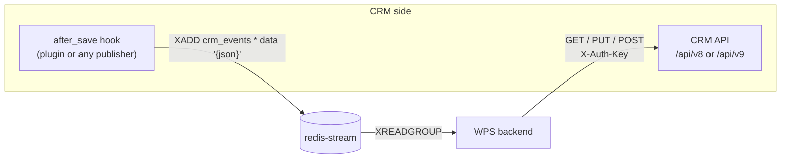

# CRM integration

How WPS talks to a CRM in both directions: events into the stream and calls to the CRM API; the mock, SuiteCRM 7 and SuiteCRM 8.

<!-- lang-switch -->
🇬🇧 English | [🇷🇺 Русский](../../ru/04-operations/crm-integration.md)
<!-- /lang-switch -->

## Two directions



1. **CRM → WPS: events.** When a record is saved, the CRM appends a message to the Redis Stream `crm_events`.
2. **WPS → CRM: API.** Preload, `save_object` and `save_to_crm` call a small REST API with a JSON:API-like format.

WPS works with **one** CRM at a time — the one in `CRM_API_BASE_URL`.

## Event format (CRM → WPS)

`Wps\Services\EventProcessorService::parse()` accepts two message shapes:

| Shape | Example | Notes |
|---|---|---|
| Field `data` with a JSON object | `XADD crm_events * data '{"id":"42","module":"Deals","status":"Active"}'` | Used by the mock and the SuiteCRM plugin. Values keep their JSON types |
| Flat fields | `XADD crm_events * module Deals id 42 status Active` | Every value is a string |

Required and special fields of the object:

| Field | Required | Meaning |
|---|---|---|
| `module` or `object_type` | yes | CRM module = process **object type**. Processes are selected by it |
| `id` | yes | Id of the saved CRM record. Used by preload paths like `object.id`, by `save_object` and by run-once marks |
| `event_id` | no | Idempotency id of the event. If absent, the Redis message id is used |
| any other fields | no | Become `object.<field>` in conditions and actions |

A message without `module`/`object_type`, without `id`, or with `data` that is not a JSON object is moved to the dead-letter
stream `crm_events:dlq` with the reason, and acknowledged. A message for a module that has no active top-level process is
acknowledged and counted in `wps_events_skipped_total`.

### Publishing events from any system

Anything that can talk to Redis can be a CRM for WPS. Example with `redis-cli`:

```bash
redis-cli -h <redis-stream host> -p 6379 XADD crm_events MAXLEN '~' 100000 '*' \
  data '{"id":"70001","module":"Deals","status":"Active","account_id":"512","event_id":"crm-save-70001-1"}'
```

`MAXLEN ~ 100000` keeps the stream bounded (the SuiteCRM plugin does the same). WPS acknowledges messages but does not trim
the stream.

> **Note**
> Send a stable `event_id` if your publisher can retry: two messages with the same `event_id` start each process only once
> within `IDEMPOTENCY_TTL_HOURS` (see [Reliability](reliability.md)).

## CRM API contract (WPS → CRM)

Implemented in `Wps\Services\ExternalApiAdapterService` with the Swoole coroutine HTTP client.

| Operation | Request | Expected response |
|---|---|---|
| Load by id (preload, `by_field: id`) | `GET {base}/{module}/{id}` | `200 {"data": {"type", "id", "attributes": {...}}}`; `404` = not found (variable becomes `null`) |
| Search by field (preload, other `by_field`) | `GET {base}/{module}?filter[{field}]={value}&size=1` | `200 {"data": [ {...} ]}` — the first record is used; empty list = not found |
| Update (`save_object`, `save_to_crm`, record has `id`) | `PUT {base}/{module}/{id}` with `{"data": {"type", "id", "attributes": {changed fields}}}` | `200 {"data": {...}}` |
| Create (record without `id`) | `POST {base}/{module}` with `{"data": {"type", "attributes": {...}}}` | `201 {"data": {"id", ...}}` — the new id is written back to the variable |
| Modules dictionary | `GET {base}/modules` | list of `{value,label}` / `{name,label}` / JSON:API items with `id` and `attributes.label` |

`{"id", "attributes"}` is flattened to `{id, ...attributes}`. All requests send `Accept` and `Content-Type: application/json`.

### `X-Auth-Key`

```text
X-Auth-Key = CRM_API_STATIC_KEY . gmdate("Y.m.d H")
```

Example: key `mySecretKey` at 08:15 UTC on 15 Oct 2026 → `mySecretKey2026.10.15 08`. The key changes every hour; the mock
and the SuiteCRM plugin also accept the key of the previous hour to tolerate clock skew. Keep server clocks in sync (NTP).

### Base URL and API version

`AppConfig::crmUrl()` appends `/api/v8` to `CRM_API_BASE_URL` **unless** the URL already ends with `/api/v<N>`:

| `CRM_API_BASE_URL` | Request for `Accounts/1` |
|---|---|
| `http://mock:9502` | `http://mock:9502/api/v8/Accounts/1` |
| `http://mock:9502/api/v8` | `http://mock:9502/api/v8/Accounts/1` |
| `http://suitecrm7/api/v9` | `http://suitecrm7/api/v9/Accounts/1` |

### Error handling

| CRM answer | WPS reaction |
|---|---|
| Connection failed, timeout (`CRM_API_TIMEOUT`), reset, HTTP `5xx` | Recoverable: the step is retried (`ACTION_RETRY_MAX`) |
| `404` on `GET` | Not found: the preload variable becomes `null` |
| Other `4xx` (including `404` on `PUT`), invalid JSON | Non-recoverable: the step and the execution fail at once |
| Invalid module name (not `^[A-Za-z][A-Za-z0-9_]*$`) | Non-recoverable, no request is sent |

## Modules dictionary

The "Object type" and "Module" selectors in the UI come from `GET /api/dictionaries/modules`, cached in Redis `dict:modules`
for `DICT_CACHE_TTL` (300 s). Sources, in order:

1. `MOCK_SERVICE_URL/modules` — only if `MOCK_SERVICE_URL` is not empty;
2. `{CRM API}/modules`.

After switching the CRM, reset the cache with the refresh button next to the "Object type" field or
`POST /api/dictionaries/modules/refresh`.

## Option 1: the mock (default for development)

The `mock` service emulates both directions:

- `GET|POST http://localhost:9502/test-event?module=Deals&set[status]=Active&count=1` generates an event, stores the object in
  the mock CRM storage and publishes it. Use `curl -g` because of the square brackets.
- `/api/v8/{module}[/{id}]` — CRM API v8 emulation with `X-Auth-Key` check (`MOCK_CRM_STATIC_KEY`).
  Ids starting with `fail500` answer `500`, ids starting with `slow` answer after 3 s — handy for testing retries and timeouts.
- `GET|PUT /mock/objects/{module}/{id}` — read or seed an object without authentication.
- `GET /modules` — 15 modules with Russian labels; `GET /health`.

Backend settings for the mock:

```bash
CRM_API_BASE_URL=http://mock:9502
CRM_API_STATIC_KEY=mySecretKey     # = MOCK_CRM_STATIC_KEY
MOCK_SERVICE_URL=http://mock:9502
```

These are the defaults of `docker-compose.yml`, used when `./.env` does not set them.

## Option 2: SuiteCRM 7 or SuiteCRM 8

The built-in SuiteCRM API V8 uses OAuth2 and another format, so WPS integrates through a **plugin installed in the CRM**.
It is shipped as two separate packages next to the repository, one per CRM version: `../suiteCRM7` (SuiteCRM 7.14) and
`../SuiteCRM8` (SuiteCRM 8.10, installed into the legacy layer `public/legacy`). Each package contains the Module Loader
package, `bin/install.sh` / `bin/uninstall.sh` (a CRM on the host or in a Docker container), `bin/build.sh` (zip for
Admin → Module Loader) and web-server snippets; its `README.md` describes the installation step by step.

| Part | Implementation |
|---|---|
| Events | Application-level `after_save` logic hook `WpsEventHook`: `XADD crm_events MAXLEN ~ 100000 * data '{json}'` with a pure-PHP RESP client. Modules are listed in `WPS_EVENT_MODULES` |
| API for WPS | Custom entry point `wpsApi` + web-server rewrite `/api/v9/(.*)` → `index.php?entryPoint=wpsApi&wps_path=$1` (SuiteCRM 8: `/legacy/index.php?...`) |
| Event content | `id`, `module`, `object_type` and all stored fields of the record (re-read from the DB), plus `wps_event`, `wps_is_update`, `wps_user_id`, `wps_published_at` |
| Failure mode | If Redis is down, the CRM save still succeeds; the event is lost and logged as `[WPS] publish failed` |

Ready-to-run Docker setups of a clean CRM are in `.tehnical/suiteCRM7` (SuiteCRM 7.14.9, port 8701) and
`.tehnical/suiteCRM8` (SuiteCRM 8.10.2, port 8801); the plugin is not in their images and is installed with the package.
They join the WPS network `WPS_NETWORK` (`swoole_worckflow_default`), so start WPS first:

```bash
cd .tehnical/suiteCRM8          # or suiteCRM7
cp .env.example .env            # set passwords and WPS_API_STATIC_KEY
docker compose up -d --build
../../../SuiteCRM8/bin/install.sh --docker wps-suitecrm8-web-1 --env-file .env   # or ../../../suiteCRM7/... wps-suitecrm7-web-1
```

Switch WPS to the CRM in the root `./.env`:

```bash
CRM_API_BASE_URL=http://suitecrm8/api/v9     # or http://suitecrm7/api/v9
CRM_API_STATIC_KEY=<WPS_API_STATIC_KEY from .tehnical/suiteCRM8/.env>
MOCK_SERVICE_URL=                            # empty: modules come from the CRM
```

Then `docker compose up -d --build backend` and `POST /api/dictionaries/modules/refresh`. To return to the mock, remove the
three lines. Plugin installation into any other CRM is described in the `README.md` of the package; the full API contract and example processes
(`processes/*.processes.json`, imported with `scripts/wps_processes.php`) are described in `.tehnical/suiteCRM7/README.md`
and `.tehnical/suiteCRM8/README.md`.

> **Warning**
> A process that saves the same record it was triggered by causes a new `after_save` event, which can start the process again.
> The SuiteCRM example processes use [run once per record](../03-user-guide/manual-run-and-reset.md) (`run_once`) and a marker
> field `wps_processed_c` to stop such loops. Do the same in your processes.

## Option 3: another CRM

Any system can be connected if it (1) publishes events in the format above and (2) exposes the API contract above —
directly or through a small adapter service. The backend has no pluggable adapter interface (`ExternalApiAdapterService`
is a `final` class used directly by the handlers), so a completely different API is connected through such a bridge
service: see [New CRM adapter](../07-developer-guide/extending/new-crm-adapter.md).

<!-- footer-nav -->
---

← Previous: [Configuration](configuration.md) | [Contents](../README.md) | [Monitoring](monitoring.md) Next →
<!-- /footer-nav -->
