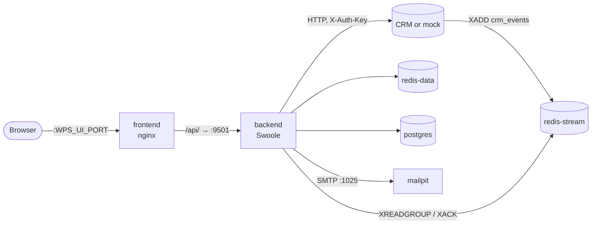

# Deployment

How to deploy, update and scale WPS with Docker Compose, and what to change before going to production.

<!-- lang-switch -->
🇬🇧 English | [🇷🇺 Русский](../../ru/04-operations/deployment.md)
<!-- /lang-switch -->

## Services

`docker-compose.yml` in the repository root describes the full stack. All services share one Docker network
(`<project>_default`, for example `swoole_worckflow_default`), so they reach each other by service name.

| Service | Image / build | Container port | Host port (variable, default) | Volume | Purpose |
|---|---|---|---|---|---|
| `postgres` | `postgres:15-alpine` | 5432 | `WPS_PG_PORT` (5432) | `pgdata` | Processes, executions, step audit, users, run-once marks |
| `redis-stream` | `redis:7-alpine`, `--appendonly yes` | 6379 | `WPS_REDIS_STREAM_PORT` (6379) | `redis-stream` | Event bus: stream `crm_events`, group `wps_workers`, dead-letter stream `crm_events:dlq` |
| `redis-data` | `redis:7-alpine`, `--appendonly yes` | 6379 | `WPS_REDIS_DATA_PORT` (6380) | `redis-data` | Caches, live execution state, locks, idempotency keys |
| `backend` | `back/Dockerfile` (`phpswoole/swoole:6.0-php8.3` + PHP extensions `bcmath`, `intl`) | 9501 | `WPS_API_PORT` (9501) | — | REST API, stream consumer, recovery job |
| `mock` | `mock/Dockerfile` | 9502 | `WPS_MOCK_PORT` (9502) | — | Event generator and CRM API emulation (development and demos) |
| `mailpit` | `axllent/mailpit:v1.21` | 1025 (SMTP), 8025 (web and API) | `WPS_MAILPIT_PORT` (8025) | — | Test SMTP server: `send_email` letters are not delivered but shown in the web UI and the API `/api/v1/messages`. The backend uses it through `MAILER_DSN=smtp://mailpit:1025`. In production point `MAILER_DSN` to a real SMTP server and remove the service |
| `frontend` | `front/Dockerfile` (build with Node, serve with nginx) | 80 | `WPS_UI_PORT` (3000) | — | Single-page UI; nginx proxies `/api/` to `backend:9501` |



The backend needs PostgreSQL to be healthy (`depends_on: condition: service_healthy`) and both Redis instances to be started.
The Redis Stream and the data Redis are deliberately separate instances: the event bus can be owned by the CRM side,
while caches and execution state stay private to WPS.

> **Note**
> The two Redis instances can be one server in a small installation — point `REDIS_STREAM_*` and `REDIS_DATA_*` to the same
> host and use a different `REDIS_DATA_DB`. Keys do not collide: the stream uses `crm_events*`, data uses `proc_cache:*`,
> `dict:modules`, `crm:capabilities`, `exec:*`, `lock:exec:*`, `idem:*`, `assign:*`, `mail:*`, `oauth:token:*`,
> `side_effects:purge`. The mock keeps its objects in redis-stream (`mock_crm:*`, `mock_crm_rel:*`, `mock:*`).

## First start

```bash
docker compose up -d --build
docker compose ps
curl -s http://localhost:9501/api/health
```

What happens on the backend start (`back/docker/entrypoint.sh`):

1. If there is no `/srv/back/.env` in the container, it is copied from `.env.example`. The real environment from
   `docker-compose.yml` always wins over this file (see [Configuration](configuration.md)).
2. `php migrations/migrate.php` waits for the database (up to `DB_WAIT_SECONDS`, 60 s) and applies new
   `migrations/*.sql` files in name order. Applied files are recorded in the `schema_migrations` table, so restarts are safe.
3. `php server.php` starts the Swoole HTTP server. The log line `[WPS] listening on 0.0.0.0:9501` means the API is up.

The default administrator `admin@wps.local` / `admin` is created by migration `002_seed_admin.sql`.

## Images

| Image | Dockerfile | Base | Content |
|---|---|---|---|
| backend, stage `prod` | `back/Dockerfile` (build context — the repository root) | `phpswoole/swoole:6.0-php8.3` + `bcmath`, `intl` (`libicu-dev`) | `composer install --no-dev`, optimised autoload, `ENTRYPOINT docker/entrypoint.sh`, port 9501. This is the stage `docker-compose.yml` builds (`target: prod`) |
| backend, stage `test` | the same | the same base | Dev dependencies and `ENTRYPOINT vendor/bin/phpunit` |
| mock | `mock/Dockerfile` | `phpswoole/swoole:6.0-php8.3` (already with `ext-redis`) | PHP built-in server `php -S 0.0.0.0:9502 mock_server.php` |
| frontend | `front/Dockerfile` | `node:22-alpine` (build) → `nginx:1.27-alpine` | `npm ci && npm run build`, `dist/` and `front/nginx.conf` |

`bcmath` is needed for exact `decimal` arithmetic and comparison; `intl` — for `format_date_locale()` (without it the
function is not registered). Unit tests:

```bash
docker build -q -f back/Dockerfile --target test -t wps-backend-test .
docker run --rm wps-backend-test --testsuite unit
```

`vendor/` is not in the repository: dependencies are installed when the image is built. Adding a package:
`docker run --rm -v $PWD/back:/app -w /app --entrypoint composer wps-backend-test require <package> --ignore-platform-req=ext-swoole`.

## Migrations

`back/migrations/migrate.php` runs on every start of the backend container (`entrypoint.sh`) before the server:

1. waits for PostgreSQL up to `DB_WAIT_SECONDS` (`[migrate] waiting for database...` every 2 s);
2. sets `SET TIME ZONE 'UTC'` for the session and creates the table `schema_migrations (version, applied_at)`;
3. applies the `*.sql` files missing from `schema_migrations` **in name order**, each in its own transaction; on an error
   the file is rolled back, `[migrate] <version> failed: …` is printed and the script exits with code 1 (the backend does
   not start);
4. prints `[migrate] applied <version>` per file and the total `[migrate] done, N new migration(s)`.

There are no down migrations; every file is idempotent (`IF NOT EXISTS`, `ON CONFLICT DO NOTHING`).

| File | What it does |
|---|---|
| `001_create_tables.sql` | Tables `users`, `processes`, `executions`, `execution_actions` and their indexes |
| `002_seed_admin.sql` | Administrator `admin@wps.local` / `admin` (if this e-mail does not exist yet) |
| `003_run_once.sql` | `processes.run_once`, the marks table `process_object_runs` |
| `004_program_audit.sql` | Flat-program audit columns `execution_actions.pc`, `step_path`, `iteration`, `step_id`; `pc = step_index` for old rows; index `(execution_id, pc)` |
| `005_secrets.sql` | Table `secrets` (encrypted secrets) |
| `006_side_effects.sql` | Side-effect journal `step_side_effects` |
| `007_trigger_on.sql` | `processes.trigger_on TEXT[]` (default `{create,update}`) and a `CHECK` of the allowed types |
| `008_step_error_handling.sql` | `executions.handled_errors`, `execution_actions.error_code`, `execution_actions.handled` |
| `009_execution_waits.sql` | `executions.waiting_until`, `wait_reason`, table `execution_waits`, partial index of waiting executions |
| `010_reserved_names_check.sql` | Does not change the schema: a **report** of processes that use the names `sys`, `config`, `object_before` as ordinary variables (reserved since task 5.2.9) |

> **Warning**
> Migration 010 reports the processes it finds with `RAISE NOTICE`, and `migrate.php` (PDO) does not print PostgreSQL
> notices — the backend log only shows `[migrate] applied 010_reserved_names_check`. The processes found keep running (on
> their snapshot) but **cannot be saved** after an edit until the variables are renamed. Check them manually with the same
> condition:
>
> ```bash
> docker compose exec -T postgres psql -U wps -d wps -c "SELECT id, name FROM processes
>   WHERE definition::text ~ '\"(var|as|item_var)\"\s*:\s*\"(sys|config|object_before)\"'
>      OR definition::text ~ '\"(target|record)\"\s*:\s*\"(sys|config|object_before)(\.|\")'"
> ```

Migration state: `docker compose exec -T postgres psql -U wps -d wps -c 'SELECT * FROM schema_migrations ORDER BY 1'`.
Apply migrations without restarting the server: `docker compose exec backend php migrations/migrate.php`.

## Backups

```bash
# PostgreSQL: processes, executions, audit, waits, secrets (encrypted), users
docker compose exec -T postgres pg_dump -U wps -Fc wps > wps-$(date +%F).dump
# restore into an empty database
docker compose exec -T postgres pg_restore -U wps -d wps --clean --if-exists < wps-2026-10-27.dump
```

Keep `WPS_SECRETS_KEY` together with the dump: the `secrets` table cannot be decrypted without it. Data Redis does not
need a backup (caches and the state of running executions); `redis-stream` holds events not processed yet — when you stop
the CRM for maintenance, wait for `lag = 0` and `pending = 0` in `/api/health`.

## Ports

Only the UI port must be published for users. Everything else can stay inside the Docker network:

| Port | Who needs it |
|---|---|
| UI (`WPS_UI_PORT`) | Users |
| API (`WPS_API_PORT`) | Scripts and integrations that call the REST API directly; Prometheus for `/metrics` |
| `redis-stream` | The CRM (it publishes events). If the CRM runs in the same Docker network, do not publish the port |
| Mailpit (`WPS_MAILPIT_PORT`) | Developers and testers: viewing the letters of the stand. Not present in production |
| `postgres`, `redis-data`, `mock` | Nobody in production; publish only for debugging |

To change host ports, edit `./.env` (variables `WPS_*_PORT`) — this repository's `.env` already moves the UI to 3080 and
PostgreSQL to 55432 because 3000 and 5432 were taken on the developer machine.

## Updating

The backend code is baked into the image. After pulling new code, rebuild the changed services:

```bash
git pull
docker compose up -d --build backend frontend
```

Migrations are applied automatically on the backend start. Data lives in the named volumes `pgdata`, `redis-stream`
and `redis-data`; `docker compose down` keeps them, `docker compose down -v` deletes them.

The PHP framework SwooleApp is a regular Composer dependency (`sidalex/swoole-app`, pinned in `back/composer.lock`).
To update only the framework, see "Сборка бэкенда" in the root `README.md`.

## Running several instances side by side

Compose project names isolate stacks. This is how the documentation screenshots were taken without touching the main stack:

```bash
WPS_UI_PORT=3081 WPS_API_PORT=9511 WPS_MOCK_PORT=9512 WPS_PG_PORT=55433 \
WPS_REDIS_STREAM_PORT=6389 WPS_REDIS_DATA_PORT=6390 \
CRM_API_BASE_URL=http://mock:9502 CRM_API_STATIC_KEY=mySecretKey MOCK_SERVICE_URL=http://mock:9502 \
docker compose -p wpsdoc up -d --build
```

Variables given on the command line override `./.env`.

## Scaling

- **Workers inside one backend.** `SWOOLE_WORKER_NUM` (default 2) HTTP workers. Cyclic jobs run with the strategy
  `ALL_WORKERS`, so every worker is a separate consumer of the group `wps_workers` and reads its own share of the stream.
  Every worker has its own PostgreSQL pool (`DB_POOL_SIZE`, 16) and Redis pools. Inside a worker, steps run in coroutines,
  so a slow CRM call does not block other executions.
- **Several backend containers.** Supported: the consumer name is `<hostname>-<pid>`, so all instances join the same consumer
  group and Redis distributes the messages between them. Idempotency keys and execution locks live in the shared `redis-data`,
  so a message re-delivered to another instance is not executed twice (see [Reliability](reliability.md)).
  Put the instances behind a load balancer for the API; the UI only needs the `/api/` proxy.
- **Metrics** are kept in shared memory of one backend process and are reset on restart. With several instances, scrape each one.

```bash
docker compose up -d --scale backend=2   # remove the fixed host port of backend first, or ports will clash
```

> **Warning**
> With `--scale` the `ports: "9501:9501"` mapping of the backend conflicts. Remove the host port mapping (the UI talks to the
> backend through the Docker network) or put a reverse proxy in front.

## Production checklist

- [ ] Set a long random `JWT_SECRET` in `docker-compose.yml` (the shipped value `change-me-in-production-…` is public).
- [ ] Log in and change the password of `admin@wps.local`, or create your own admin and delete the default one.
- [ ] Change `POSTGRES_PASSWORD` / `DB_POSTGRES_PASSWORD` (`secret` by default).
- [ ] Set `CORS_ALLOW_ORIGIN` to the UI origin instead of `*` if the API is reachable from other origins.
- [ ] Point `CRM_API_BASE_URL` / `CRM_API_STATIC_KEY` to the real CRM, empty `MOCK_SERVICE_URL`, and do not run the `mock` service.
- [ ] Point `MAILER_DSN` to a real SMTP server (or use a secret of kind `smtp_dsn` in the actions), set `MAILER_FROM` and `MAILER_ALLOWED_FROM`, do not run the `mailpit` service.
- [ ] Publish only the UI port (and the API port if integrations need it); keep PostgreSQL and Redis internal or protect them with passwords (`REDIS_*_PASSWORD`).
- [ ] Keep `APP_DEBUG=false`: with `true` internal error messages are returned to clients.
- [ ] Back up the `pgdata` volume. Redis volumes contain only short-lived state and caches, but `redis-stream` holds events not yet processed.
- [ ] Scrape `/metrics` and alert on `/api/health` returning `503` (see [Monitoring](monitoring.md)).
- [ ] Review [Security](security.md).

<!-- footer-nav -->
---

← Previous: [Recipes](../03-user-guide/recipes.md) | [Contents](../README.md) | [Configuration](configuration.md) Next →
<!-- /footer-nav -->
