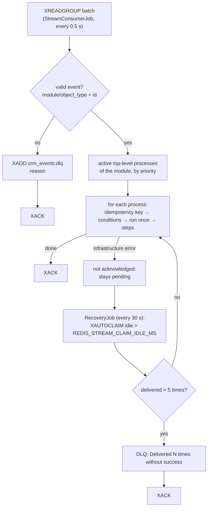

# Reliability

How WPS avoids losing and duplicating work: delivery guarantees, idempotency, retries, recovery after crashes and run once per record.

<!-- lang-switch -->
🇬🇧 English | [🇷🇺 Русский](../../ru/04-operations/reliability.md)
<!-- /lang-switch -->

## Delivery: at-least-once

WPS reads the stream `crm_events` as the consumer group `wps_workers` (`XREADGROUP`). A message is acknowledged (`XACK`)
**only after it has been fully handled** — every matching process was started and run to the end (or skipped).
Child processes and manual runs are not part of the message: they run in their own coroutines.



- An event with no matching process is acknowledged (counted in `wps_events_skipped_total`).
- A failed **step** is not an infrastructure error: the execution is marked `failed`, the message is acknowledged.
- An exception that escapes the processing of a message (database or Redis unavailable, crash) leaves it **pending**.
  `RecoveryJob` re-claims messages idle longer than `REDIS_STREAM_CLAIM_IDLE_MS` (5 min) with `XAUTOCLAIM`. After more than
  **5** deliveries the message goes to `crm_events:dlq` and is acknowledged (poison message protection).
- A newly created group starts from id `0`, so events published before the first WPS start are processed too.

## Idempotency: no double runs on re-delivery

At-least-once means a message can come twice. Every start of a process for an event first takes the Redis key

```text
idem:<event_id>:<process_id>   SET NX, TTL IDEMPOTENCY_TTL_HOURS (24 h)
```

- Key taken → normal run; the key stores the execution id (or `skipped` if the conditions were not met).
- Key exists with `skipped` → nothing to do (`duplicate`).
- Key exists with an execution id → the execution is **resumed** from its Redis state if it is unfinished, ignored if it
  finished; if its state is lost, it is marked failed and the process is started again.

`event_id` is the `event_id` field of the event if present, otherwise the stream message id. A publisher that may send the
same save twice should set a stable `event_id`.

Child processes use the key `idem:<parent execution id>.<step index>:<child process id>`, so a parent step that is re-executed
after recovery does not start a second child.

## Retries of a step

Every step (preload row or action) is executed with retries. An error is **classified** first: it gets a code and a
"temporary" flag (class `transient`):

| Error | Code | Temporary |
|---|---|---|
| CRM timeout / connection failure | `TIMEOUT` / `TRANSPORT` | yes |
| CRM HTTP `5xx`, `408`, `425`, `429` | `HTTP_<status>` | yes |
| Other HTTP `4xx`, invalid JSON from the CRM | `HTTP_<status>` | no |
| `RedisException`, lost DB connection | `REDIS`, `DATABASE` | yes |
| `RecoverableException` from a custom action | `TRANSIENT` (or its own `error_code` from `details`) | yes |
| `NonRecoverableException` from a custom action | `ERROR` (or its own `error_code`) | no |
| Configuration error (invalid module, unknown function …) | `CONFIG` | no, **never retried** |
| The CRM plugin lacks a feature | `CRM_CAPABILITY_MISSING` | no, never retried |
| Unknown outcome of a side effect (`at_most_once`) | `UNKNOWN_OUTCOME` | no, never retried |
| Any other PHP error | `INTERNAL` | no |

By default temporary errors are retried: up to `ACTION_RETRY_MAX` (3) retries, the execution status is `retrying`
during the wait. The step's `retry` profile changes the number of attempts, the delays and the retried classes
(`retry_on`: `transient`, `5xx`, `4xx`, `any`, specific codes) — see [Actions → Step errors](../03-user-guide/actions.md#step-errors-on_error-and-retries).

Delay before the retry after failed attempt *n* (1-based):

```text
d = min(max_delay, base_delay × backoff^(n−1))       — 1000, 2000, 4000 ms with the defaults
jitter: none  → d
        full  → random in [0, d]                       (default, ACTION_RETRY_JITTER=full)
        equal → d/2 + random in [0, d/2]
Retry-After (429 / 503, respect_retry_after) → d = max(d, min(Retry-After, max_delay))
```

The default jitter (`full`) spreads retries of different executions over time, so that after a CRM outage they do not
arrive as a "wave"; `ACTION_RETRY_JITTER=none` restores the former behaviour without spread. The CRM `Retry-After`
header is read as seconds or as an HTTP date.

With the defaults a step makes at most 4 attempts and waits at most 7 s in total — the demo process
"Payment sync (CRM failure demo)" shows it (`attempts: 4`, `retry_count: 3`).

**Long delays.** A delay up to `WAIT_INLINE_MAX_SECONDS` (5 s) runs inside the worker: a coroutine sleep, the execution
lock is refreshed every 5 s. A longer delay **parks** the execution: status `waiting`, `wait_reason = retry`, the step is
temporarily `waiting` in the audit with `result_data.retry = {attempt, next_at, error}`. The worker is free; when the time
comes the step runs again under the same audit record number and the attempt count continues
(see [Waiting executions](#waiting-executions)).
Before every retry the execution context is restored to the state before the failed attempt, so a half-done step does not
leave partial changes in variables.

When a step fails finally, its `on_error` applies. By default (`stop`) the remaining steps are recorded as `skipped`
("Not executed: a previous step failed"), the execution becomes `failed` with the error message, and the context
snapshot is saved. With `continue` / `goto` the error is handled: the step audit has `handled`, the execution's
`handled_errors` grows, metric `wps_step_errors_handled_total`.

The `retry` profile of a step and the bounds of its fields:

| `retry` field | Default | Bound / format |
|---|---|---|
| `max_attempts` | `ACTION_RETRY_MAX + 1` (4) | at most 20 attempts (including the first) |
| `base_delay` | `ACTION_RETRY_BASE_DELAY_MS` (1 s) | duration (`500ms`, `2s`, `PT1M`) |
| `backoff` | `ACTION_RETRY_BACKOFF` (2) | number ≥ 1 |
| `max_delay` | `ACTION_RETRY_MAX_DELAY` (1 h) | at most 7 days |
| `jitter` | `ACTION_RETRY_JITTER` (`full`) | `none`, `full`, `equal` |
| `retry_on` | `["transient"]` | `transient`, `5xx`, `4xx`, `any` or specific HTTP codes (`"409"`) |
| `respect_retry_after` | `true` | honour `Retry-After` of `429` / `503` answers |

Errors marked permanent (`CONFIG`, `CRM_CAPABILITY_MISSING`, `UNKNOWN_OUTCOME`) are never retried, even with
`retry_on: ["any"]`.

**Handling a final error (`on_error`).**

| `on_error` | Where the execution goes | Step audit | Execution |
|---|---|---|---|
| `stop` (default) | nowhere; inside a `foreach` with `on_item_error: continue` — to the next item (`handled = item_continue`) | `failed` | `failed` (or the loop goes on) |
| `continue` | the next instruction; for a failed `condition` block — past the whole block | `failed`, `handled = continue` | goes on, `handled_errors + 1` |
| `{"goto": "<step id>"}` | only **forward** to a top-level step with this `id`; open loops are closed (`left_by: goto`) | `failed`, `handled = goto` | goes on, `handled_errors + 1` |

A handled error is kept in `sys.last_error` (`step_id`, `step_path`, `action_type`, `code`, `message`, `http_status`,
`attempts`, `at`, `iteration`), the counter in `sys.errors_count`; later steps can use them (for example, send an error
notification). `stop_process` with `failed` is an intended end, not a step error: `on_error` does not catch it. An
execution whose errors are all handled ends as `completed`.

> **Warning**
> A retry repeats the whole step. If the CRM applied a `PUT`/`POST` but the answer was lost (timeout), the request is sent
> again. `PUT` is naturally idempotent; a `POST` (creating a new record) can create a duplicate.

## Recovery of interrupted executions

While an execution runs, its state is kept in the data Redis:

| Key | TTL | Content |
|---|---|---|
| `exec:<uuid>` | `EXECUTION_TTL_HOURS` (24 h) while running, `EXECUTION_FINISHED_TTL_SECONDS` (1 h) after finish | status, `current_step`, retry count, event, variables, dirty fields, process definition snapshot, condition trace |
| `exec:<uuid>:loop:<pc>` | as for `exec:<uuid>` | item snapshot of a `foreach` loop (the list is written once at the loop start and removed when the loop is left) |
| `lock:exec:<uuid>` | `EXECUTION_LOCK_TTL` (30 s), refreshed before each attempt | owner token of the worker running it |

After every step the progress (`current_step` and the context) is written to Redis and the step to PostgreSQL. If a worker dies,
`RecoveryJob` (every 30 s, first run 15 s after start) finds executions that are unfinished and started more than
`RECOVERY_STALE_SECONDS` (300 s) ago:

- Redis state exists and the lock has expired → the execution is **resumed from `current_step`** with the saved definition
  version (the process may have been edited meanwhile). The step that was running at the crash is executed again; inside
  a `foreach` loop — from the same item over the same item snapshot (a lost snapshot — `failed` "Loop items snapshot is
  lost; the execution cannot be resumed").
- Redis state is gone → the execution is marked `failed` with "Execution context expired or lost; it could not be resumed".

This covers manual runs and child processes, which have no stream message to re-deliver.
Waiting executions (`waiting`) are not touched by `RecoveryJob` — `WaitResumeJob` continues them.

## Waiting executions

A step can pause an execution for a long time: a [`delay`](../03-user-guide/actions.md#delay) or a long retry delay. Such
an execution is **parked**: it holds no worker and is not kept in Redis.

1. The step returns "wait until `due_at`". The engine writes the step to the audit with the status `waiting` and saves the
   progress so that it continues at the same step after waking.
2. In one PostgreSQL transaction: a row in `execution_waits` (the full `exec:<uuid>` state snapshot, due time, reason) and
   `executions.status = 'waiting'` checked against "still `running`/`retrying`" (compare-and-set). If the execution was
   cancelled or finished meanwhile, it is not parked — it simply stops.
3. Only **after the commit** is the `exec:<uuid>` key deleted from Redis and the lock released. A crash in between is safe:
   the execution is `waiting`, `RecoveryJob` ignores it, and waking overwrites Redis.

Waking is the cyclic job `WaitResumeJob` in every worker (every `WAIT_POLL_INTERVAL_MS`, first run 5 s after start):

- it claims up to `WAIT_BATCH` due waits with one `UPDATE … WHERE … FOR UPDATE SKIP LOCKED` and a **lease** of
  `WAIT_LEASE_SECONDS` — workers do not wait for each other and never take a row twice;
- each row in its own coroutine: `executions` `waiting → running` (compare-and-set; if it fails the execution was
  cancelled and the row is deleted), the state goes back to Redis, the lock `lock:exec:<uuid>` is taken, the
  `execution_waits` row is deleted, the execution continues;
- the pause step is finished by its handler (`waited_seconds`, lateness) and gets its final status in the same audit
  record; a parked retry runs the step again;
- an error before the row is deleted: the lease expires and the next iteration tries again; after `WAIT_MAX_ATTEMPTS`
  (10) attempts the execution ends `failed` "Could not resume waiting execution: …".

Result: with several workers and several backend containers one wait is continued **exactly once** (status
compare-and-set + execution lock). All time comparisons use the PostgreSQL clock (`now()`), so worker clock drift does
not matter.

**Restart and loss of Redis.** While an execution waits its state lives only in PostgreSQL: a container restart, a
`SIGKILL` of the worker and even a flush of the data Redis lose nothing. The SuiteCRM 8 case of task 7.2 checks it: the
backend is killed (`docker compose kill -s KILL backend`) in the middle of a pause and started again — the execution
continues and writes its result to the CRM. If a worker dies **after** waking, the `running` execution with its Redis state
is picked up by the regular `RecoveryJob`; the "started more than `RECOVERY_STALE_SECONDS` ago" criterion is met at once
for a long-waiting execution, and the `lock:exec` lock prevents two workers from running it at the same time.

**Limits.** A state snapshot larger than `WAIT_STATE_MAX_BYTES` (1 MB) cannot be parked — the step fails with "Execution
state is too large to wait". Editing a process does not affect its waiting executions: they continue their own definition
snapshot. Deactivating the process does not stop them either. A process with waiting executions can be deleted only with
`?force=true` (admin) — they are cancelled (`cancelled`, "Process deleted").

## Side effects and repeats

A step runs **at least once**: if a worker stops in the middle of a step, the step runs again after recovery. That is safe
for a CRM write (`PUT` of the same fields) but not for an e-mail, a webhook or a notification: a repeat means a second
e-mail to the customer or a second order in the external system. So actions with external effects (`send_email`,
`http_request`, [`notify`](../03-user-guide/actions.md#notification) — one record per delivery) run every external call through the **side-effect journal**
(table `step_side_effects`).

**How the journal works.** A `started` row is written before the call, `done` with the response (secrets masked) after a
successful call, `failed` after a final error. A recoverable error (timeout, `5xx`, broken connection) keeps `started`:
the external system may have executed the request. When the step runs again:

| Row state | What happens |
|---|---|
| no row | the call is made, the row goes `started` → `done` / `failed` |
| `done` | the external system is **not called**, the step returns the stored response (`result_data.replayed: true`) |
| `failed` | the call is repeated: the previous error was final, there was no effect |
| `started` by the same attempt | an ordinary retry inside the step (`ACTION_RETRY_MAX`) |
| `started` by another attempt (trace of a crashed worker) | **unknown outcome** → according to `delivery` |

Attempts are told apart by `attempt_token`: a step gets a new token once, before its retry loop, so a retry inside the
step is never mistaken for the trace of a crashed worker.

**Keys.** The effect key is the position of the call in the process program: `{pc}`, inside loops `{pc}@{iteration}`,
for several calls in one step `{pc}@{iteration}#{sub}`. It does not change after a crash (the execution uses its
definition snapshot). The external idempotency key `{execution_id}:{effect_key}` is passed to the outside world: the
`Idempotency-Key` header for HTTP and `Message-ID: <…@WPS_MAIL_MESSAGE_ID_DOMAIN>` for e-mails. If the external system
honours the key, even a repeat is safe.

**`delivery` policy** (a step field, allowed only on actions with external effects):

| Value | Unknown outcome | Default for |
|---|---|---|
| `at_most_once` | the step fails with `UNKNOWN_OUTCOME`, the external system is not called | `send_email`, `notify`, `http_request` with `POST`/`PATCH` |
| `at_least_once` | the call is repeated with the same idempotency key | `http_request` with `GET`/`HEAD`/`PUT`/`DELETE` |

For `at_most_once`, a timeout or a broken connection **after** the request was sent is an unknown outcome right away,
without retries; an error **before** sending (no connection, DNS) is safe and retried as usual.

**`http_request` and the journal.** A `done` response is stored in the journal exactly as it goes to the variable
(secrets masked), so a repeated step restores the variable without a new request. Codes `408`, `425`, `429`, `503` mean
the server did not process the request — they are safe to retry (respecting `Retry-After`). But `500`, `502`, `504` and a
broken connection after sending may mean the request **was already executed**: with `at_most_once` and no idempotency
key such a step is not retried and fails with `UNKNOWN_OUTCOME`. To retry such requests automatically there are two ways:

- the external system deduplicates requests by `Idempotency-Key` — keep the default `idempotency_header` (it is sent for
  `POST`/`PATCH`), then `5xx` and broken connections are retried with the same key;
- the request is safe to run twice — set `delivery: at_least_once` on the step.

The case `.tehnical/suiteCRM8/processes/cases/4.2-http-request.json` checks this on the stand: the worker is killed in the
middle of a request to a slow system, after recovery the step fails with `UNKNOWN_OUTCOME`, and the external system
receives the request exactly once.

**What an operator does on `UNKNOWN_OUTCOME`.** The step audit shows `status = failed`, `result_data.error_code =
UNKNOWN_OUTCOME`, and the effect key and the call start time in `result_data.details`. Check the external system (did the
e-mail arrive, was the order created). Repeating the step by hand comes with task 7.3 (the operator clears the unknown
outcome), handling the error inside the process — `on_error` (task 7.1). The journal rows of an execution are available
through `GET /api/executions/{id}/side-effects`.

**Retention.** Rows are deleted together with their execution (cascade) and hourly when older than
`SIDE_EFFECTS_RETENTION_DAYS` (30 days; `RecoveryJob` purges them, one worker per hour thanks to the Redis key
`side_effects:purge`). A dry run (task 7.6) does not use the journal and makes no external calls.

## Restarts and loss of components

What happens to the work when a component stops or is lost:

| Event | Running executions | Waiting (`waiting`) | Stream messages | Other |
|---|---|---|---|---|
| `docker compose restart backend` / `SIGTERM` | Stay `running` with the state in Redis; `RECOVERY_STALE_SECONDS` after start `RecoveryJob` continues them from the interrupted instruction (the interrupted step runs again) | Not affected: the state is in PostgreSQL, woken after the start | Unacknowledged ones stay pending; `XAUTOCLAIM` takes them after `REDIS_STREAM_CLAIM_IDLE_MS` | Metrics are reset; new consumers `{hostname}-{pid}` appear in the group |
| `SIGKILL` of a worker / container in the middle of a step | The same; for `send_email`, `notify`, `http_request` with `at_most_once` the interrupted call gives `UNKNOWN_OUTCOME` instead of a repeat | Not affected | The same | — |
| A retry pause inside the worker (≤ `WAIT_INLINE_MAX_SECONDS`) is interrupted | Status `retrying`; recovered as `running` | — | — | The attempt count continues from Redis |
| Loss of `redis-data` (no AOF or flushed) | Executions in `running`/`retrying` are marked `failed` ("Execution context expired or lost") | Not affected (except `assign` queues and caches) | A re-delivered event whose `idem:*` key is lost starts the process again | Caches, idempotency keys, mail limits, `assign` queues, OAuth2 tokens are recreated |
| Loss of `redis-stream` | Not affected | Not affected | Unacknowledged and unread events are lost; the group is recreated with id `0` | The CRM plugin logs `[WPS] publish failed` while Redis is down |
| PostgreSQL unavailable | The step fails with the transient error `DATABASE` and is retried; the stream message stays pending | Waking is postponed until the database is back | Stay pending | `/api/health` → `503` |
| CRM unavailable | CRM steps are retried per `retry`, then `failed` (or `on_error`) | Woken on time, the step behaves the same | Acknowledged (a step error is not an infrastructure error) | — |

Upgrading the backend with a changed program compiler: executions whose `program_hash` does not match end as `failed`
("Program changed after an upgrade; the execution cannot be resumed safely", metric `wps_program_resume_mismatch_total`).
Before an upgrade wait until there are no `running` and `retrying` executions; waiting executions continue with the
snapshot of their definition.

## Run once per record

The `run_once` process flag guarantees that a process starts at most once for a CRM record (`object_type` + `id`), regardless of
the source (`stream`, `child`, `manual`) and of the number of saves. It is the main protection against loops when a process
saves the record that triggered it.

- The mark is a row in `process_object_runs` (primary key process + object type + object id), inserted atomically at the start,
  and only when the conditions are met. Two parallel events for the same record cannot both start the process.
- A blocked start creates no execution; it increments `blocked_count` of the mark and `wps_run_once_skipped_total`.
- The mark stays after a `failed` execution. `force: true` in a manual run skips conditions but not the mark.
- Remove a mark in the UI ("Run-once records" tab) or with `DELETE /api/processes/{id}/runs/{object_type}/{object_id}`.
- Without an `id` the flag is not applied (`wps_run_once_no_id_total`); stream events without `id` are rejected to the DLQ anyway.

Details for users: [Manual run and reset](../03-user-guide/manual-run-and-reset.md).

## Other safeguards

| Safeguard | Where |
|---|---|
| Launch cycles (A → B → A) are rejected when saving | `422 CYCLE_DETECTED` |
| Nesting of child processes is limited | `MAX_CHILD_DEPTH` (10), the step fails with "Maximum child process depth (10) exceeded" |
| A process cannot start itself; only child processes can be started | validation on save |
| A process referenced by `start_process` cannot be deleted | `409 PROCESS_IN_USE` |
| Processes are soft-deleted | executions keep a valid reference (`processes.deleted_at`) |
| Executions store `process_version` and the definition snapshot | an edit does not change running executions |
| Process cache failure falls back to PostgreSQL | `ProcessResolverService` |

## What is not guaranteed

- **Ordering** between events: workers process messages in parallel; two saves of the same record can be handled concurrently.
- **Exactly-once side effects in the CRM** (see the warning about retries). E-mails and webhooks go through the side-effect journal
  (see [above](#side-effects-and-repeats)): on an unknown outcome `at_most_once` prefers an error to a repeat.
- **Events lost before the stream**: if the CRM cannot publish (e.g. Redis down), the SuiteCRM plugin logs the error and the
  save proceeds without an event; there is no outbox.
- **Durability of Redis**: both Redis instances run with `appendonly yes`; losing `redis-data` loses live state (running
  executions are then marked failed) and idempotency keys.

<!-- footer-nav -->
---

← Previous: [Monitoring](monitoring.md) | [Contents](../README.md) | [Security](security.md) Next →
<!-- /footer-nav -->
