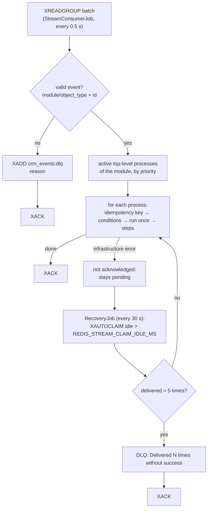

# Reliability

How WPS avoids losing and duplicating work: delivery guarantees, idempotency, retries, recovery after crashes and run once per record.

<!-- lang-switch -->
🇬🇧 English | [🇷🇺 Русский](../../ru/04-operations/reliability.md)
<!-- /lang-switch -->

## Delivery: at-least-once

WPS reads the stream `crm_events` as the consumer group `wps_workers` (`XREADGROUP`). A message is acknowledged (`XACK`)
**only after it has been fully handled** — every matching process was started and run to the end (or skipped).
Child processes and manual runs are not part of the message: they run in their own coroutines.



- An event with no matching process is acknowledged (counted in `wps_events_skipped_total`).
- A failed **step** is not an infrastructure error: the execution is marked `failed`, the message is acknowledged.
- An exception that escapes the processing of a message (database or Redis unavailable, crash) leaves it **pending**.
  `RecoveryJob` re-claims messages idle longer than `REDIS_STREAM_CLAIM_IDLE_MS` (5 min) with `XAUTOCLAIM`. After more than
  **5** deliveries the message goes to `crm_events:dlq` and is acknowledged (poison message protection).
- A newly created group starts from id `0`, so events published before the first WPS start are processed too.

## Idempotency: no double runs on re-delivery

At-least-once means a message can come twice. Every start of a process for an event first takes the Redis key

```text
idem:<event_id>:<process_id>   SET NX, TTL IDEMPOTENCY_TTL_HOURS (24 h)
```

- Key taken → normal run; the key stores the execution id (or `skipped` if the conditions were not met).
- Key exists with `skipped` → nothing to do (`duplicate`).
- Key exists with an execution id → the execution is **resumed** from its Redis state if it is unfinished, ignored if it
  finished; if its state is lost, it is marked failed and the process is started again.

`event_id` is the `event_id` field of the event if present, otherwise the stream message id. A publisher that may send the
same save twice should set a stable `event_id`.

Child processes use the key `idem:<parent execution id>.<step index>:<child process id>`, so a parent step that is re-executed
after recovery does not start a second child.

## Retries of a step

Every step (preload row or action) is executed with retries:

| Error | Examples | Behaviour |
|---|---|---|
| **Recoverable** | CRM timeout, connection failure, CRM HTTP `5xx`, `RedisException`, lost DB connection, `RecoverableException` from a custom action | Retried up to `ACTION_RETRY_MAX` (3) times. The execution status is `retrying` during the wait |
| **Non-recoverable** | CRM `4xx`, invalid JSON from the CRM, invalid module, unknown function in an expression, child process not found, depth exceeded, `NonRecoverableException` | Fails at once |

Delay before retry *n* (1-based):

```text
delay_ms = ACTION_RETRY_BASE_DELAY_MS × ACTION_RETRY_BACKOFF^(n−1)
         = 1000 ms, 2000 ms, 4000 ms with the defaults
```

With the defaults a step makes at most 4 attempts and waits 7 s in total — exactly what the demo process
"Payment sync (CRM failure demo)" shows (`attempts: 4`, `retry_count: 3`, duration ≈ 7 s).
Before every retry the execution context is restored to the state before the failed attempt, so a half-done step does not
leave partial changes in variables.

When a step fails finally, the remaining steps are recorded as `skipped` ("Not executed: a previous step failed"), the
execution becomes `failed` with the error message, and the context snapshot is saved.

> **Warning**
> A retry repeats the whole step. If the CRM applied a `PUT`/`POST` but the answer was lost (timeout), the request is sent
> again. `PUT` is naturally idempotent; a `POST` (creating a new record) can create a duplicate.

## Recovery of interrupted executions

While an execution runs, its state is kept in the data Redis:

| Key | TTL | Content |
|---|---|---|
| `exec:<uuid>` | `EXECUTION_TTL_HOURS` (24 h) while running, `EXECUTION_FINISHED_TTL_SECONDS` (1 h) after finish | status, `current_step`, retry count, event, variables, dirty fields, process definition snapshot, condition trace |
| `lock:exec:<uuid>` | `EXECUTION_LOCK_TTL` (30 s), refreshed before each attempt | owner token of the worker running it |

After every step the progress (`current_step` and the context) is written to Redis and the step to PostgreSQL. If a worker dies,
`RecoveryJob` (every 30 s, first run 15 s after start) finds executions that are unfinished and started more than
`RECOVERY_STALE_SECONDS` (300 s) ago:

- Redis state exists and the lock has expired → the execution is **resumed from `current_step`** with the saved definition
  version (the process may have been edited meanwhile). The step that was running at the crash is executed again.
- Redis state is gone → the execution is marked `failed` with "Execution context expired or lost; it could not be resumed".

This covers manual runs and child processes, which have no stream message to re-deliver.

## Run once per record

The `run_once` process flag guarantees that a process starts at most once for a CRM record (`object_type` + `id`), regardless of
the source (`stream`, `child`, `manual`) and of the number of saves. It is the main protection against loops when a process
saves the record that triggered it.

- The mark is a row in `process_object_runs` (primary key process + object type + object id), inserted atomically at the start,
  and only when the conditions are met. Two parallel events for the same record cannot both start the process.
- A blocked start creates no execution; it increments `blocked_count` of the mark and `wps_run_once_skipped_total`.
- The mark stays after a `failed` execution. `force: true` in a manual run skips conditions but not the mark.
- Remove a mark in the UI ("Run-once records" tab) or with `DELETE /api/processes/{id}/runs/{object_type}/{object_id}`.
- Without an `id` the flag is not applied (`wps_run_once_no_id_total`); stream events without `id` are rejected to the DLQ anyway.

Details for users: [Manual run and reset](../03-user-guide/manual-run-and-reset.md).

## Other safeguards

| Safeguard | Where |
|---|---|
| Launch cycles (A → B → A) are rejected when saving | `422 CYCLE_DETECTED` |
| Nesting of child processes is limited | `MAX_CHILD_DEPTH` (10), the step fails with "Maximum child process depth (10) exceeded" |
| A process cannot start itself; only child processes can be started | validation on save |
| A process referenced by `start_process` cannot be deleted | `409 PROCESS_IN_USE` |
| Processes are soft-deleted | executions keep a valid reference (`processes.deleted_at`) |
| Executions store `process_version` and the definition snapshot | an edit does not change running executions |
| Process cache failure falls back to PostgreSQL | `ProcessResolverService` |

## What is not guaranteed

- **Ordering** between events: workers process messages in parallel; two saves of the same record can be handled concurrently.
- **Exactly-once side effects in the CRM** (see the warning about retries).
- **Events lost before the stream**: if the CRM cannot publish (e.g. Redis down), the SuiteCRM plugin logs the error and the
  save proceeds without an event; there is no outbox.
- **Durability of Redis**: both Redis instances run with `appendonly yes`; losing `redis-data` loses live state (running
  executions are then marked failed) and idempotency keys.

<!-- footer-nav -->
---

← Previous: [Monitoring](monitoring.md) | [Contents](../README.md) | [Security](security.md) Next →
<!-- /footer-nav -->
