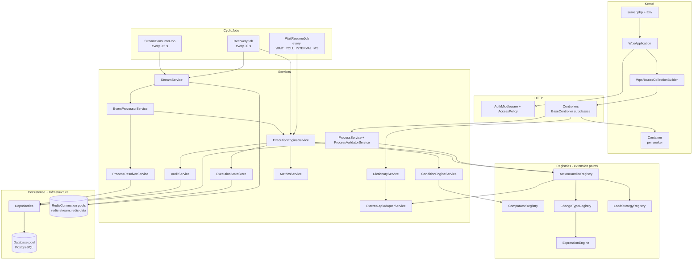
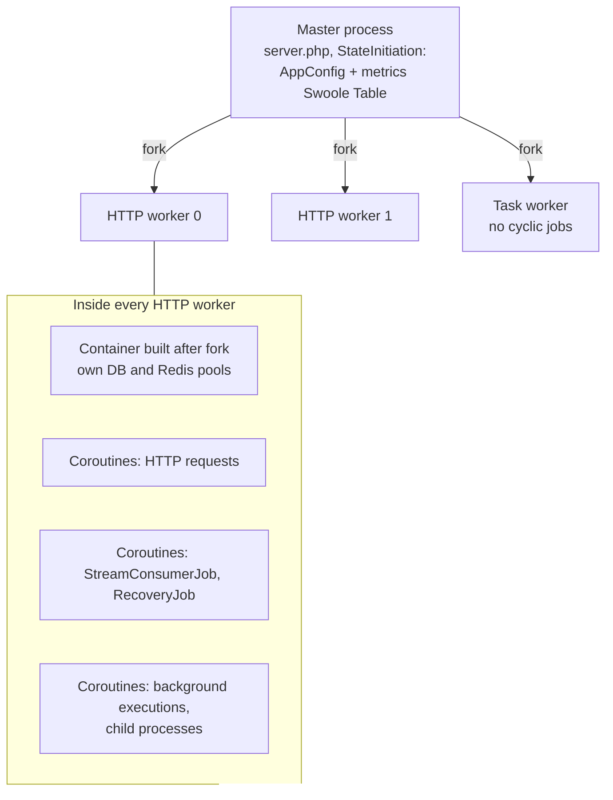
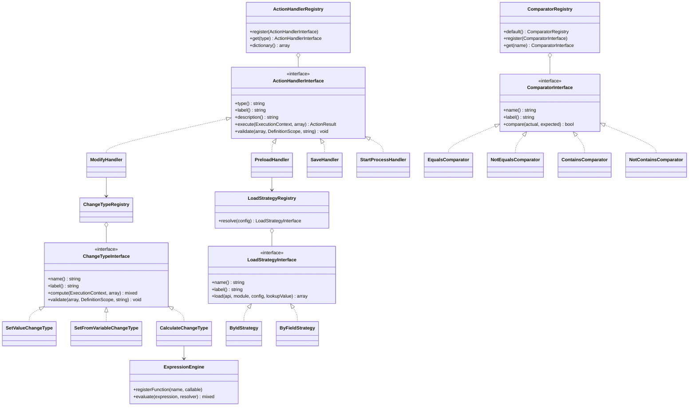

# Backend architecture

How the PHP/Swoole backend is organised: layers, components, the process model and the extension points.

<!-- lang-switch -->
🇬🇧 English | [🇷🇺 Русский](../../ru/05-architecture/backend.md)
<!-- /lang-switch -->

## Layers

| Layer | Namespace / file | Responsibility |
|---|---|---|
| Bootstrap | `back/server.php`, `Wps\Kernel\Env` | Loads `.env` (real environment variables win), maps env into `config/config.json`, enables `SWOOLE_HOOK_ALL`, starts the server |
| Kernel | `Wps\Kernel\WpsApplication`, `WpsRoutesCollectionBuilder`, `Container` | Request dispatch, exact route matching, CORS preflight, JSON 404/500; per-worker service container |
| HTTP | `Wps\Controllers\*`, `BaseController`, `Wps\Http\*` | One controller class per endpoint, response envelope, `ApiException` |
| Security | `Wps\Middleware\AuthMiddleware`, `Wps\Auth\AccessPolicy`, `JwtService` | JWT check and role rules for every route |
| Services | `Wps\Services\*` | Event processing, condition engine, execution engine, validation, CRM adapter, dictionaries, metrics |
| Extension registries | `Wps\Actions`, `Wps\Comparators`, `Wps\Actions\ChangeTypes`, `Wps\LoadStrategies`, `Wps\Program\Blocks`, `Wps\Notify\Channels`, `Wps\Expression` | Pluggable action types, operators, change types, load strategies, blocks, notification channels, expression functions |
| Background jobs | `Wps\CyclicJobs\StreamConsumerJob`, `RecoveryJob`, `WaitResumeJob` | Reading the stream (0.5 s); recovery of pending messages and interrupted executions, purge of the side-effect journal (30 s, first run 15 s after start); waking waiting executions (`WAIT_POLL_INTERVAL_MS`, first run 5 s after start) |
| Persistence | `Wps\Persistence\*Repository`, `Process` | SQL access to PostgreSQL |
| Infrastructure | `Wps\Infrastructure\Database`, `RedisConnection` | Coroutine connection pools (PDO pgsql, phpredis) |
| Shared state | `Wps\State\StateInitiation`, `WpsState` | `AppConfig` and the shared metrics table, created once in the master process |

### `back/src` directories

| Directory | Content |
|---|---|
| `Kernel/` | `Container` (builds every service and registry), `Env`, `WpsApplication`, `WpsRoutesCollectionBuilder` |
| `Config/`, `State/` | `AppConfig` (every environment variable with bounds), `StateInitiation` / `WpsState` (shared master-process state) |
| `Controllers/` | REST endpoints (`#[Route]` attribute), dictionaries in `Controllers/Dictionaries/` (23 endpoints `/api/dictionaries/*`) |
| `Auth/`, `Middleware/`, `Http/` | JWT, `AccessPolicy`, `AuthMiddleware`, `ApiException`, `JsonResponder` |
| `Http/Outbound/` | Outgoing HTTP of `http_request` and messengers: `OutboundHttpClient`, `EgressGuard` (SSRF), `CidrList`, `JsonPathExtractor`, `Auth/OAuth2TokenProvider` |
| `Services/` | Engine, conditions, stream, events, processes, validation (`Validation/DefinitionScope`), errors (`Errors/`), assignment (`Assign/`), `WaitService`, `MetricsService`, CRM adapter |
| `Program/` | Flat-program compiler and interpreter, blocks, loops |
| `Actions/` | Action handlers, `ChangeTypes/` (change types), `Support/RelatedIdsResolver` |
| `Comparators/`, `Types/` | Condition operators; `TypeCaster`, `CastOptions`, `RelativeDate` |
| `Expression/` | `ExpressionLexer` / `Parser` / `Engine`, `Decimal`, `SafeRegex`, functions `Functions/{Text,Number,Logic,Date,List,Type}Functions` |
| `Template/` | `TemplateEngine`, parser, `TemplateValidator`, `EscapeMode`, `MissingPolicy` |
| `Crm/` | `CrmFilter`, `FilterTranslator`, `FilterRulesValidator`, `CrmPage`, `CrmCapabilities*`, `CrmCallOrigin` |
| `Events/`, `Context/` | `EventEnvelope`; `ExecutionContext`, `EventInfo` |
| `Mail/` | `MailerFactory` (symfony/mailer), `MailRateLimiter`, recipients, SMTP error classification |
| `Notify/` | `ChannelRegistry`, channels `crm_alert`, `telegram`, `slack`, `teams`, `RecordLinks` |
| `Secrets/` | `SecretCipher` (XChaCha20-Poly1305), `SecretService`, `SecretResolver`, `SecretMasker`, `SecretUsageScanner` |
| `SideEffects/` | `SideEffectLedger`, `DeliveryPolicy`, `UnknownOutcomeException` |
| `Time/` | `Clock` (`SystemClock`, `FrozenClock`), `DateMath`, `Duration` |
| `Persistence/` | PostgreSQL repositories, `Process` (definition normalisation) |
| `Infrastructure/` | `Database` (PDO pgsql) and `RedisConnection` pools |
| `CyclicJobs/` | `StreamConsumerJob`, `RecoveryJob`, `WaitResumeJob` |
| `Support/` | `Logger` (JSON lines), `JsonPath`, `Transliterator`, `Uuid`, `Json` |
| `Exceptions/` | `RecoverableException`, `NonRecoverableException`, `ConfigurationException`, `CrmApiException` … |

## Components

There are two entry points into the business logic: HTTP requests (UI and API clients) and the cyclic jobs that read the
event stream. Both obtain their services from `Wps\Kernel\Container`, a lazy service locator that builds every service
once per worker. The execution engine does not know any concrete action: it asks `ActionHandlerRegistry` for a handler
by the `type` of the step, and the handlers in turn use the other registries. Only repositories and the two connection
classes touch PostgreSQL and Redis.

### Request path

1. Swoole calls `WpsApplication::execute()`. `OPTIONS` requests get a CORS preflight answer right away.
2. `WpsRoutesCollectionBuilder` finds the controller whose `#[Route]` pattern has **the same number of URI segments**
   (the stock SwooleApp matcher compares only the pattern length, so `/api/processes/5` would match `/api/processes`).
   No match → `404 NOT_FOUND` in the JSON envelope.
3. `BaseController::getMiddlewares()` prepends the global middlewares from `config.json` (`AuthMiddleware`). The middleware
   asks `AccessPolicy::rolesFor(method, path)`, verifies the Bearer JWT and puts the user into `AuthContext`.
4. `BaseController::execute()` calls `handle()`; an `ApiException` becomes an error envelope, any other exception becomes
   `500 INTERNAL_ERROR` (the message is shown only with `APP_DEBUG=true`).

## Swoole process model

- `config.json` sets `worker_num: 2` and `task_worker_num: 1` (env `SWOOLE_WORKER_NUM`, `SWOOLE_TASK_WORKER_NUM`).
  The cyclic jobs use the strategy `ALL_WORKERS`: each HTTP worker runs its own `StreamConsumerJob` and is a separate
  consumer (`{hostname}-{pid}`) of the group `wps_workers`. The task worker skips cyclic jobs.
- `StateInitiation` runs once in the master process before the fork, because a `Swoole\Table` (shared metrics) must be
  created before workers exist. The parsed `AppConfig` is shared the same way.
- `Container::get()` compares the current pid with the pid it was built in, so every worker builds its own services and
  its own connection pools (`DB_POOL_SIZE` 16 PDO connections, 32 connections to redis-data, 8 to redis-stream).
- `SWOOLE_HOOK_ALL` makes PDO, phpredis, sockets and `sleep` non-blocking inside coroutines. A slow CRM call or a retry
  delay (`Coroutine::sleep`) suspends only its coroutine; the worker keeps serving HTTP requests and other events.
- A manual run and every child process run in their own coroutine (`Coroutine::create`) and are not awaited.

## Extension points

Each extension point is an interface, a set of built-in implementations and a registry keyed by the code stored in the
process definition (`type`, `operator`, `change_type`, `strategy`). The registries are filled in `Container`
(`actions()`, `comparators()`, `changeTypes()`, `loadStrategies()`, `expressions()`), and the dictionary endpoints
(`/api/dictionaries/*`) read them, so a registered implementation also appears in the UI lists. Adding one requires a
restart of the service (customer answers #25, #26). Step-by-step guides are in the developer guide, for example
[New action type](../07-developer-guide/extending/new-action-type.md) and
[New comparator](../07-developer-guide/extending/new-comparator.md).

| Extension point | Interface | Built-in | Registered in |
|---|---|---|---|
| Action type | `ActionHandlerInterface` | `preload`, `modify`, `save_object`, `set_variable`, `find_records`, `update_records`, `delay`, `send_email`, `http_request`, `assign`, `notify`, `link_records`, `unlink_records`, `start_process` (14) | `Container::actions()` |
| Block | `BlockTypeInterface` | `condition`, `foreach`, `stop_process` | `Container::blocks()` (`BlockTypeRegistry`) |
| Comparison operator | `ComparatorInterface` | 25: `equals`, `not_equals`, `greater_than`, `greater_or_equal`, `less_than`, `less_or_equal`, `between`, `not_between`, `in`, `not_in`, `contains`, `not_contains`, `starts_with`, `ends_with`, `contains_any`, `contains_all`, `contains_none`, `is_empty`, `is_not_empty`, `is_null`, `is_not_null`, `changed`, `not_changed`, `changed_to`, `changed_from` | `ComparatorRegistry::default()` |
| Change type | `ChangeTypeInterface` | 13: `set_value`, `set_from_variable`, `calculate`, `template`, `date_shift`, `increment`, `decrement`, `clear`, `append`, `prepend`, `remove`, `map`, `aggregate` | `Container::changeTypes()` |
| Load strategy | `LoadStrategyInterface` | `by_id`, `by_field` | `LoadStrategyRegistry::default()` |
| Notification channel | `ChannelInterface` | `crm_alert`, `telegram`, `slack`, `teams` | `Container::notifyChannels()` (`ChannelRegistry`) |
| Expression function | `callable` + dictionary description | 121 functions in the groups `string` (35), `number` (14), `logic` (5), `date` (32), `list` (18), `type` (17); the same functions are template filters (plus `raw`) | `ExpressionEngine::registerFunction()`: built-ins, `DateFunctions::register()`, `TypeFunctions::register()` in `Container::expressions()` |

The class diagram above shows the design with the original implementations; the full current lists are served by the
dictionaries `GET /api/dictionaries/action-types`, `operators`, `change-types`, `notify-channels`, `functions`,
`template-filters`.

## Errors

Exceptions thrown while a step is executed decide what the engine does next:

| Class | Meaning | Engine behaviour |
|---|---|---|
| `RecoverableException` | Temporary failure (CRM timeout, 5xx, network) | Retried with exponential backoff |
| `CrmApiException` | CRM HTTP error; recoverable for transport errors and 5xx, otherwise not | Depends on the flag |
| `NonRecoverableException` | Permanent failure (invalid module, CRM 4xx, depth limit) | Step `failed`, execution `failed` |
| `ConfigurationException` | Invalid configuration (unknown type, bad path) | Same as non-recoverable |
| `RedisException`, PDO connection errors | Lost infrastructure connection | Treated as recoverable |

Details are in [Execution engine](execution-engine.md).

<!-- footer-nav -->
---

← Previous: [Architecture overview](overview.md) | [Contents](../README.md) | [Event flow](event-flow.md) Next →
<!-- /footer-nav -->
