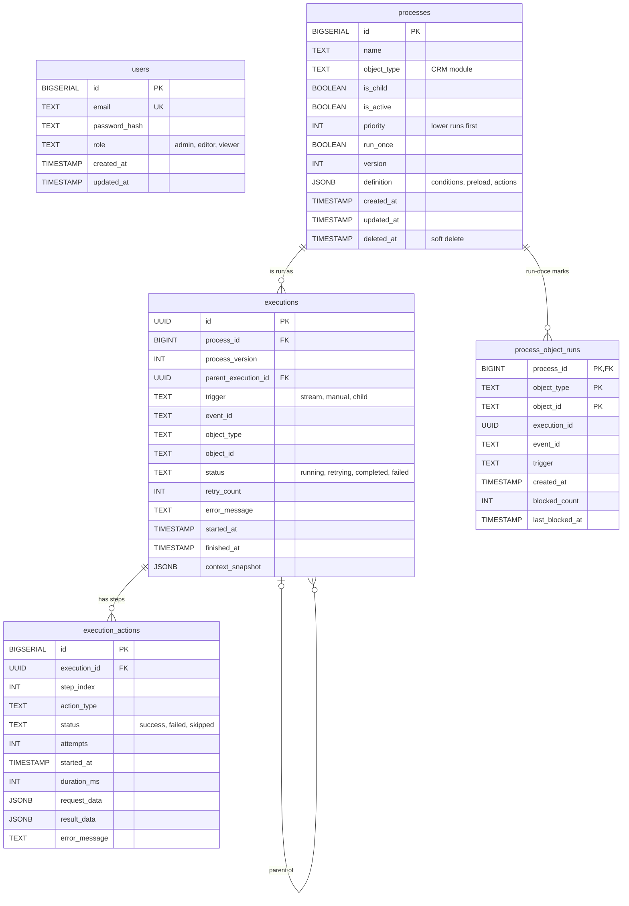
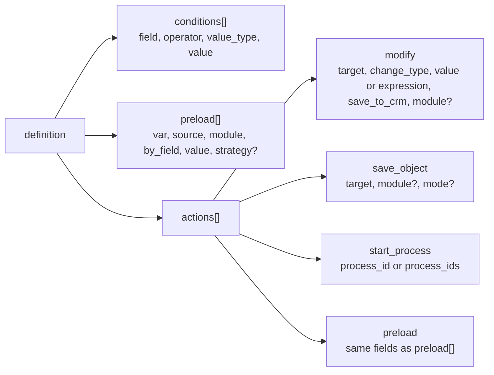

# Data model

PostgreSQL tables, the structure of a process definition and the Redis keys used by WPS.

<!-- lang-switch -->
🇬🇧 English | [🇷🇺 Русский](../../ru/05-architecture/data-model.md)
<!-- /lang-switch -->

The schema is created by the migrations in `back/migrations/` (`001_create_tables.sql`, `002_seed_admin.sql`,
`003_run_once.sql`), which `back/docker/entrypoint.sh` applies with `migrations/migrate.php` on every start of the
backend. All `TIMESTAMP` columns are stored in UTC.

## ER diagram



`users` is independent of the other tables: the audit does not store who changed a process. A process has many
executions; an execution has one row per step and may have a parent execution (child processes). `process_object_runs`
holds at most one mark per process and CRM record. Its `execution_id` has no foreign key on purpose, because the mark is
written before the `executions` row exists.

## Tables

### `users`

| Column | Description |
|---|---|
| `id` | Primary key |
| `email` | Login, unique |
| `password_hash` | `password_hash()` (bcrypt); never returned by the API |
| `role` | `admin`, `editor` or `viewer` (CHECK constraint) |
| `created_at`, `updated_at` | Timestamps |

The migration `002_seed_admin.sql` creates `admin@wps.local` with the password `admin`.

### `processes`

| Column | Description |
|---|---|
| `id` | Primary key, used in `start_process.process_id` |
| `name` | Display name, up to 255 characters |
| `object_type` | CRM module the process belongs to (`Accounts`, `Leads`, …). For a top-level process it selects the events |
| `is_child` | `true` — the process is started only by `start_process` of another process and never directly by an event |
| `is_active` | Inactive processes are ignored by the resolver and skipped by `start_process` |
| `priority` | Order among top-level processes of the same object type, ascending |
| `run_once` | Run at most once per CRM record (migration `003`) |
| `version` | Incremented on every update; an execution stores the version it ran with |
| `definition` | JSONB, see below |
| `deleted_at` | Soft delete: the row stays so that old executions still point to it |

Indexes: `object_type`, partial indexes on `is_child = false` and `is_active = true`, and the resolver index
`(object_type, priority) WHERE deleted_at IS NULL AND is_active AND NOT is_child`.

### `executions`

| Column | Description |
|---|---|
| `id` | UUID generated by the engine |
| `process_id`, `process_version` | Process and the version of its definition |
| `parent_execution_id` | Execution that started this one by `start_process`; `ON DELETE SET NULL` |
| `trigger` | `stream` (CRM event), `manual` (manual run), `child` (started by another process) |
| `event_id` | `event_id` of the object, the stream message id, or `manual-{uuid}` |
| `object_type`, `object_id` | Module and `id` of the event object |
| `status` | `running`, `retrying`, `completed`, `failed` |
| `retry_count` | Number of retries over all steps |
| `error_message` | Error of the failed step |
| `started_at`, `finished_at` | `finished_at` is `NULL` while the execution is not finished |
| `context_snapshot` | Final `{event, variables, meta, conditions}`; `{lost: true}` for an execution that could not be recovered |

Indexes: `process_id`, `event_id`, `status`, `started_at DESC`, `parent_execution_id`.

### `execution_actions`

| Column | Description |
|---|---|
| `execution_id`, `step_index` | Unique pair; index 0 is the first preload row or the first action |
| `action_type` | `preload`, `modify`, `save_object`, `start_process` or a custom type |
| `status` | `success`, `failed`, `skipped` |
| `attempts` | 1 + number of retries; 0 for a step skipped because a previous step failed |
| `started_at`, `duration_ms` | Timing, including the retry delays |
| `request_data` | What the step did or sent (for a failed step — the step configuration) |
| `result_data` | What it got: old/new value, found object, CRM response, `error_class`, `recoverable` |
| `error_message` | Error text |

The rows are deleted together with the execution (`ON DELETE CASCADE`).

### `process_object_runs`

| Column | Description |
|---|---|
| `process_id`, `object_type`, `object_id` | Primary key: one mark per process and CRM record |
| `execution_id` | The first (blocking) execution |
| `event_id`, `trigger` | Where the first run came from |
| `created_at` | When the mark was taken |
| `blocked_count`, `last_blocked_at` | How many later starts were blocked and when the last one was |

Indexes: `(object_type, object_id)`, `(process_id, created_at DESC)`. A mark is removed with
`DELETE /api/processes/{id}/runs/{object_type}/{object_id}`.

## Process definition (`processes.definition`)



```json
{
  "conditions": [
    { "field": "object.status", "operator": "equals", "value_type": "static", "value": "Active" }
  ],
  "preload": [
    { "var": "v1", "source": "object_field", "module": "Accounts", "by_field": "id", "value": "object.account_id" }
  ],
  "actions": [
    { "type": "modify", "target": "v1.rating", "change_type": "set_value", "value": "VIP", "save_to_crm": true },
    { "type": "save_object", "target": "object" },
    { "type": "start_process", "process_id": 4 }
  ]
}
```

- `conditions` is a flat list joined by AND. The engine also accepts a tree
  `{ "logical_operator": "AND" | "OR", "conditions": [...], "groups": [...] }`, prepared for OR and brackets (customer
  answer #8); the current UI does not edit it.
- `preload` rows are executed before the actions; `preload` may also appear inside `actions`.
- `Process::normalizeDefinition()` always produces the three keys, so a missing block is an empty list.

The field-by-field meaning is described in the user guide: [Conditions](../03-user-guide/triggers-and-conditions.md),
[Actions](../03-user-guide/actions.md), [Change types and expressions](../03-user-guide/change-types-and-expressions.md).

## Redis keys

**redis-data** (cache and state):

| Key | Type | Content | TTL |
|---|---|---|---|
| `proc_cache:{object_type}` | String (JSON) | Active top-level processes of the type, sorted by priority | `PROCESS_CACHE_TTL` (60 s); deleted when a process of the type is saved |
| `dict:modules` | String (JSON) | Modules dictionary from the CRM | `DICT_CACHE_TTL` (300 s); `POST /api/dictionaries/modules/refresh` reloads it |
| `exec:{uuid}` | Hash | Live execution context | 24 h while running, 1 h after finish |
| `lock:exec:{uuid}` | String | Owner token of the worker that runs the execution | `EXECUTION_LOCK_TTL` (30 s) |
| `idem:{event_id}:{process_id}` | String | Execution id or `skipped` | `IDEMPOTENCY_TTL_HOURS` (24 h) |
| `idem:{parent_execution_id}.{step}:{child_id}` | String | Same for a child process | 24 h |

**redis-stream** (event bus):

| Key | Type | Content |
|---|---|---|
| `crm_events` (`REDIS_STREAM_NAME`) | Stream | CRM events; consumer group `wps_workers` (`REDIS_STREAM_CONSUMER_GROUP`) |
| `crm_events:dlq` | Stream | Invalid and poison messages: `original_id`, `reason`, `fields`, `at`; trimmed to about 10 000 entries |
| `mock_crm:{module}` | Hash | Objects of the mock CRM (only when the `mock` container is used) |

<!-- footer-nav -->
---

← Previous: [Execution engine](execution-engine.md) | [Contents](../README.md) | [Frontend architecture](frontend.md) Next →
<!-- /footer-nav -->
