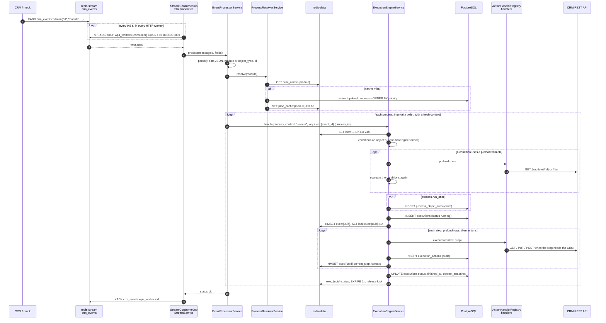
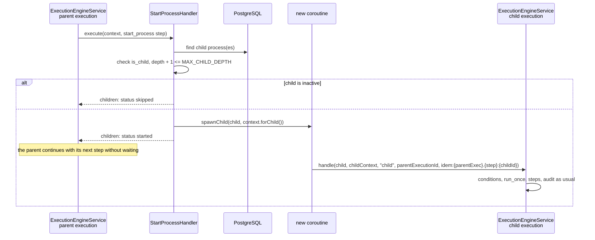
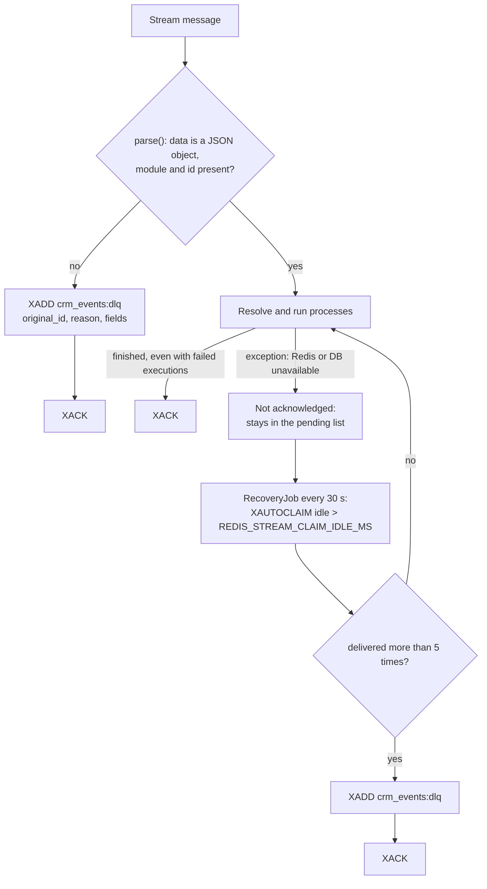

# Event flow

The path of one CRM event: from the save of a record to the Redis Stream, the execution of the matching processes, the audit and the acknowledgement.

<!-- lang-switch -->
🇬🇧 English | [🇷🇺 Русский](../../ru/05-architecture/event-flow.md)
<!-- /lang-switch -->

## Main flow

1. The CRM publishes the whole saved object (customer answer #2). The SuiteCRM plugin does it from an `after_save` logic
   hook; the mock does it from `/test-event`. The accepted formats are a field `data` with a JSON object or the object
   fields directly.
2. Every HTTP worker is a consumer of the group `wps_workers`; Redis delivers each message to one consumer only.
3. `EventProcessorService::parse()` needs `module` (or `object_type`) and `id`. `event_id` is taken from the object when
   present, otherwise the stream message id is used.
4. `ProcessResolverService` returns active, not deleted, **top-level** processes of that object type, sorted by
   `priority` ascending. The list is cached for `PROCESS_CACHE_TTL` seconds and invalidated when a process is saved.
   Then `EventProcessorService` keeps the processes whose `trigger_on` contains the event type (`Process::triggersOn()`;
   the cache key does not depend on the type). An event with an unsupported `event_type` (`link`, `unlink`) is acknowledged
   at once with the status `unsupported_event_type`. The `Event handled` log (debug) has `processes_total` and
   `processes_matched`.
5. For every process the engine builds its own `ExecutionContext` from the event and runs `handle()` — the details are
   in [Execution engine](execution-engine.md). A process whose conditions are not met leaves no execution, only the
   idempotency key with the value `skipped`.
6. The message is acknowledged after all processes are handled — also when no process matched (customer answer #23).

### Event envelope and event info

`EventProcessorService::parse()` turns a message into `Wps\Events\EventEnvelope` — an immutable envelope shared by the stream
and manual runs (the future webhook 6.5 uses it too):

| Envelope field | Content |
|---|---|
| `module`, `object` | the module and the record **without** the service keys `event_type`, `before`, `changed_fields`, `wps_origin` |
| `eventType` | `create` / `update` / `delete`; without `event_type` in the event — `create` when `wps_is_update = "0"`, otherwise `update` |
| `unsupportedType` | `event_type` is not `create`, `update` or `delete` — no process is started |
| `before` | old values of the changed fields; `null` — unknown, `[]` — known to be none |
| `changedFields` | the changed field list; `null` — unknown |
| `origin` | `wps_origin` (`execution_id`, `process_id`, `depth`) — for the cascade guard (7.5) |
| `legacy` | the event has no `event_type` (a contract 1.0 publisher) |
| `warnings` | dropped service fields of a wrong type — logged and counted in `wps_events_malformed_fields_total` |

How missing fields are derived — see [CRM integration](../04-operations/crm-integration.md#how-wps-parses-an-event).

`ExecutionContext::fromEnvelope()` builds the context of a process:

- the variable `object` is the envelope record, `object_before` is `before` (metadata `source: event_before`); `object_before` is
  **read-only**: `set()`, `setVariable()`, `setClean()`, `setModule()` throw `ConfigurationException`, and the validator rejects such
  targets when a process is saved (`DefinitionScope::checkWritePath()`, preload, `save_object`);
- `ExecutionContext::$eventInfo` is an immutable `Wps\Context\EventInfo` (`eventType`, `changedFields`, `hasBefore`, `origin`,
  `legacy`, method `isChanged(field)`: `true` / `false` / `null` — unknown). It is used by the change operators (3.3), system
  variables (5.2.9) and the cascade guard (7.5).

`event_info` is serialized with the context: in the Redis state of the execution (the `event_info` hash field, so it survives
`resume()` after a worker crash) and in `executions.context_snapshot`. `forChild()` passes both `object_before` and `event_info`
to a child process. State saved before 6.1 is restored with the default `EventInfo` (`legacy: true`).

## Child processes

The `start_process` step finishes as soon as the children are started; it never waits for them (customer answer #13).
The child receives a copy of the parent's event and **all** variables, with the depth increased by one (answer #20).
The idempotency key includes the parent execution and the step index, so a parent step re-executed after a crash does
not start the same child twice. The child execution stores `parent_execution_id`, which the UI uses to show the
"Child executions" table.

## Invalid events and failures

A failed **execution** (for example, the CRM returned HTTP 500 after all retries) is a normal outcome: it is recorded in
the audit and the message is acknowledged. Only an **infrastructure** error that prevents processing leaves the message
unacknowledged, so that it is delivered again — this is the at-least-once guarantee (answer #22). Repeated deliveries are
safe because each process run is protected by the idempotency key `idem:{event_id}:{process_id}`. Messages that cannot be
parsed and messages delivered more than five times go to the dead-letter stream `crm_events:dlq` (capped at about 10 000
entries).

## Manual runs

`POST /api/processes/{id}/run` takes a different entry: `ExecutionEngineService::runManual()` evaluates the conditions
synchronously (or skips them with `force: true`), applies `run_once`, creates the execution and runs the steps in a
background coroutine. The HTTP response comes back immediately with the `execution_id`; the UI then polls
`GET /api/executions/{id}`, which returns the live context from Redis while the execution is running. See
[Manual run and reset](../03-user-guide/manual-run-and-reset.md).

<!-- footer-nav -->
---

← Previous: [Backend architecture](backend.md) | [Contents](../README.md) | [Execution engine](execution-engine.md) Next →
<!-- /footer-nav -->
