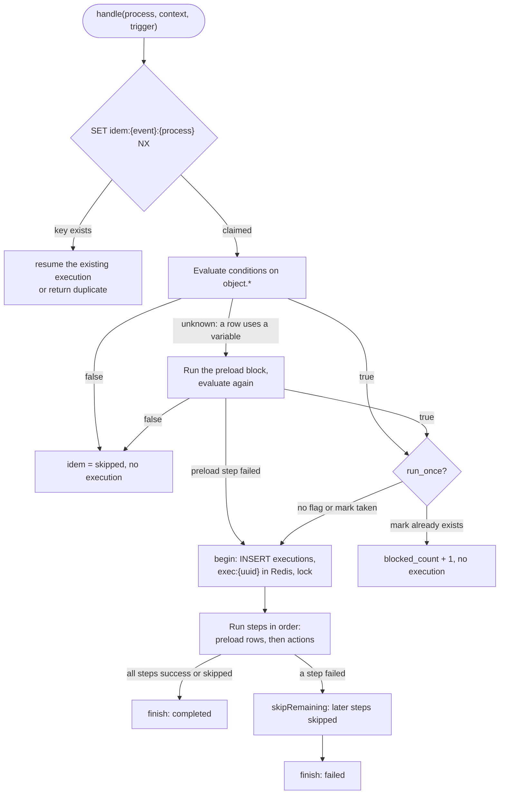
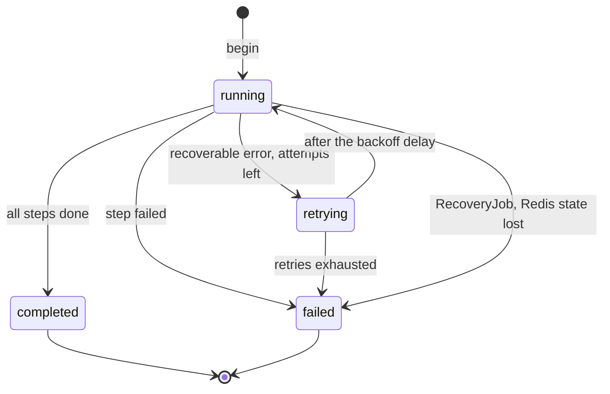
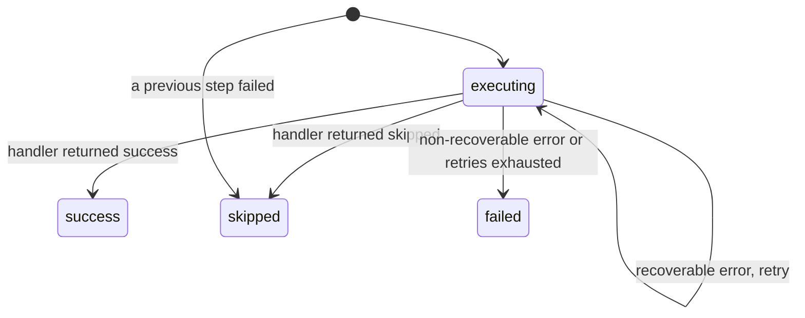
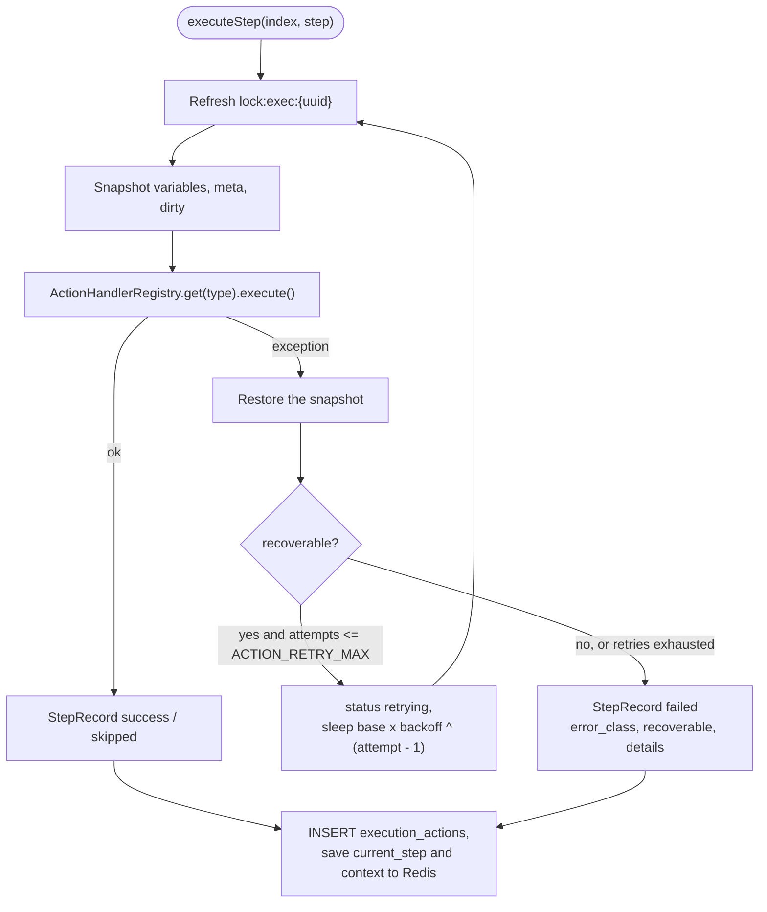
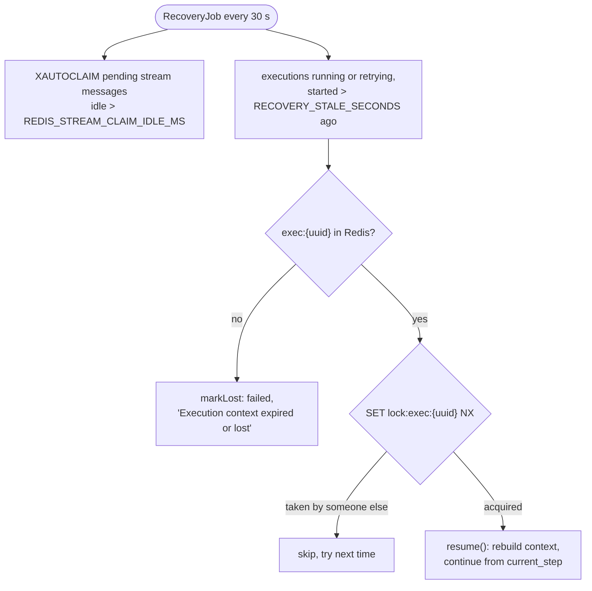

# Execution engine

How `ExecutionEngineService` runs one process for one event: the execution context, statuses, retries, idempotency and recovery after a crash.

<!-- lang-switch -->
🇬🇧 English | [🇷🇺 Русский](../../ru/05-architecture/execution-engine.md)
<!-- /lang-switch -->

## Execution context

`Wps\Context\ExecutionContext` is the memory of one execution. Every step reads from it and writes to it.

| Part | Content |
|---|---|
| `eventId` | `event_id` of the event (or the stream message id; `manual-{uuid}` for a manual run) |
| `event` | The original object from the event, never changed |
| `variables` | `object` (a working copy of the event object) and the variables created by preload or by `modify` (`v1`, `task`, …). A value is an associative array or `null` ("loaded, but not found in the CRM") |
| `meta` | Per variable: CRM `module` and `source` (`event`, `preload`, `created`) |
| `dirty` | Per variable: fields changed in memory and not yet saved to the CRM — `save_object` sends only these (unless `mode: "full"`) |
| `depth` | Nesting level of child processes, limited by `MAX_CHILD_DEPTH` |

Fields are addressed with paths `<variable>.<field>`: `object.status`, `v1.rating`, `task.name`. A path without a field
(`v1`) means the whole variable and is allowed only where an object is expected (`save_object.target`). For non-flat
objects nested paths such as `v1.address.city` are resolved too. A path to a missing variable or field resolves to
"not found" — a condition with it is false (customer answer #10), an expression gets an empty string. Writing to a
variable that does not exist yet creates it as a new object with the source `created`; saving it later sends a `POST`
and stores the new `id`.

A child process gets `forChild()`: the same event and variables, an empty `dirty` set and `depth + 1`.

## Execution lifecycle

- The conditions are evaluated in two passes (**lazy preload**). Rows on `object.*` are checked first, without calls to
  the CRM. If the result depends on a row that uses a preload variable, the `preload` block is executed and the
  conditions are evaluated again. The preload steps executed here are recorded as the first steps of the execution and
  are not repeated.
- If a preload step fails during condition evaluation, the execution is still created and immediately finished as
  `failed`, so that the problem is visible in the audit.
- The `run_once` mark is taken only when the conditions are met and before the execution row is written. If writing the
  execution fails, the mark is released again.
- The steps are `Process::steps()`: all `definition.preload` rows (as `type: preload`) followed by `definition.actions`.
  They run strictly one after another (customer answer #13).
- `finish()` writes the status, the retry counter and the final `context_snapshot` (event, variables, meta, condition
  trace) into PostgreSQL and keeps the Redis hash for `EXECUTION_FINISHED_TTL_SECONDS` (1 h).

## Execution statuses

| Status | Meaning | UI (`front/src/utils/format.ts`) |
|---|---|---|
| `running` | Steps are being executed | blue, live updates |
| `retrying` | A step failed with a recoverable error and waits for the next attempt | orange, live updates |
| `completed` | All steps finished with `success` or `skipped` | green |
| `failed` | A step failed, or the execution was lost and could not be resumed | red |

## Step statuses

| Status | When |
|---|---|
| `success` | The handler finished normally |
| `skipped` | The handler decided there is nothing to do (`save_object` of an empty variable or without changed fields), or a previous step failed and this one was not executed |
| `failed` | The error is not recoverable, or all retries were used |

An inactive child process does not make the `start_process` step `skipped`: the step is `success`, and the child is
listed with `status: skipped` in `result_data.children`.

Each step is one row in `execution_actions` with `attempts`, `duration_ms`, `request_data` (what the step sent),
`result_data` (what it got: old/new value, CRM response, error class) and `error_message`.

## Step execution, retries and errors

- **Recoverable**: `RecoverableException`, `CrmApiException` for transport errors (connection failed, timeout, reset) and
  HTTP ≥ 500, `RedisException`, PDO connection errors.
- **Non-recoverable**: `NonRecoverableException`, `ConfigurationException`, `CrmApiException` for HTTP 4xx (except 404 on
  `GET`, which means "not found" and gives `null`), and any other exception.
- With the defaults (`ACTION_RETRY_MAX=3`, `ACTION_RETRY_BASE_DELAY_MS=1000`, `ACTION_RETRY_BACKOFF=2`) a step is tried
  4 times with pauses of 1 s, 2 s and 4 s. The demo screenshot of a failed execution shows exactly this: 4 attempts in
  about 7 s.
- The snapshot is restored before every retry, so a non-idempotent change such as `x = x * 2` is not applied twice.

## Recovery after a crash

The context and `current_step` are written to Redis after every step, so an execution interrupted by a worker crash can
continue from the step where it stopped (customer answers #14, #22). The lock `lock:exec:{uuid}` (TTL `EXECUTION_LOCK_TTL`,
30 s, refreshed before every attempt) makes sure that only one worker works on an execution. Executions started by a
stream message are additionally recovered when the message itself is re-delivered: `handle()` finds the idempotency key
and calls `resume()` instead of starting the process again. Manual and child executions have no stream message and rely
on `RecoveryJob` alone.

## Redis keys used by the engine

All keys live in **redis-data**.

| Key | Type | Content | TTL |
|---|---|---|---|
| `exec:{uuid}` | Hash | `status`, `current_step`, `retry_count`, `trigger`, `parent_execution_id`, `process`, `definition`, `conditions`, `event`, `variables`, `meta`, `dirty`, `depth`, `started_at`, `finished_at` | `EXECUTION_TTL_HOURS` (24 h) while running, `EXECUTION_FINISHED_TTL_SECONDS` (1 h) after finish |
| `lock:exec:{uuid}` | String | owner token | `EXECUTION_LOCK_TTL` (30 s), refreshed on every step |
| `idem:{event_id}:{process_id}` | String | execution id or `skipped` | `IDEMPOTENCY_TTL_HOURS` (24 h) |
| `idem:{parent_execution_id}.{step}:{child_id}` | String | same, for child processes | `IDEMPOTENCY_TTL_HOURS` |

See also [Data model](data-model.md) for the PostgreSQL tables and [Reliability](../04-operations/reliability.md) for the
operational side.

<!-- footer-nav -->
---

← Previous: [Event flow](event-flow.md) | [Contents](../README.md) | [Data model](data-model.md) Next →
<!-- /footer-nav -->
