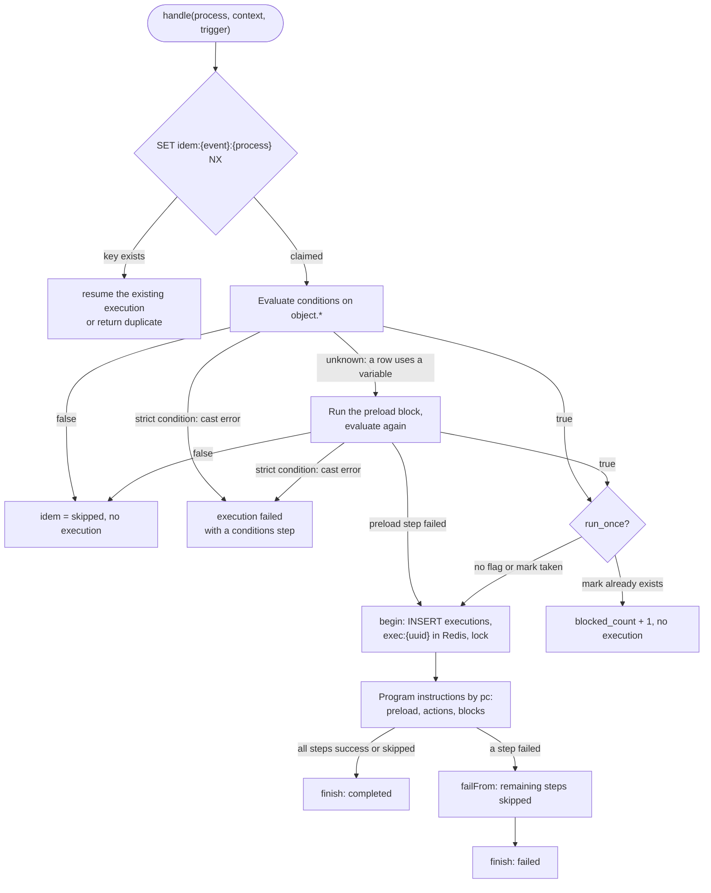
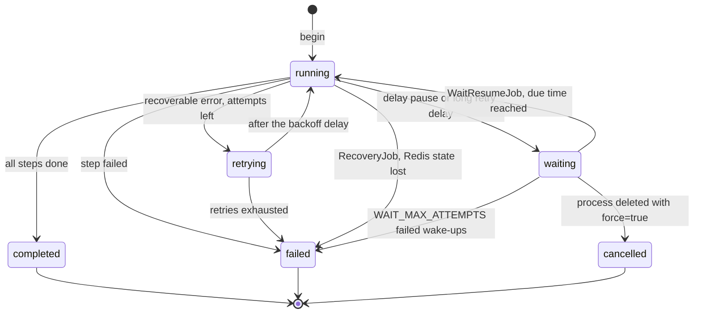
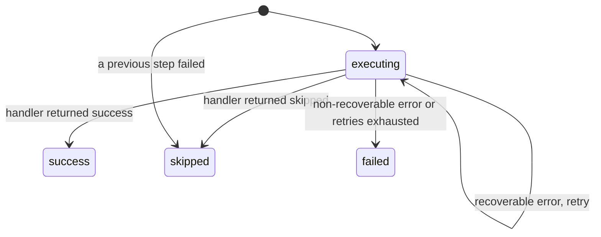
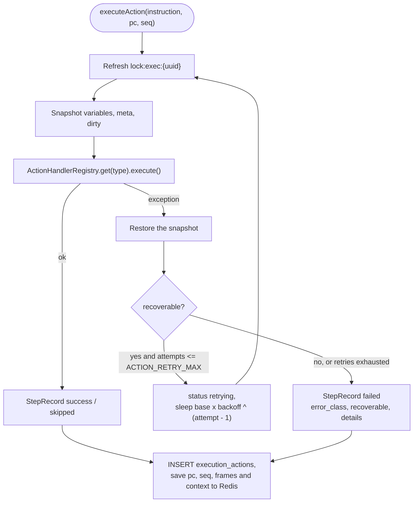
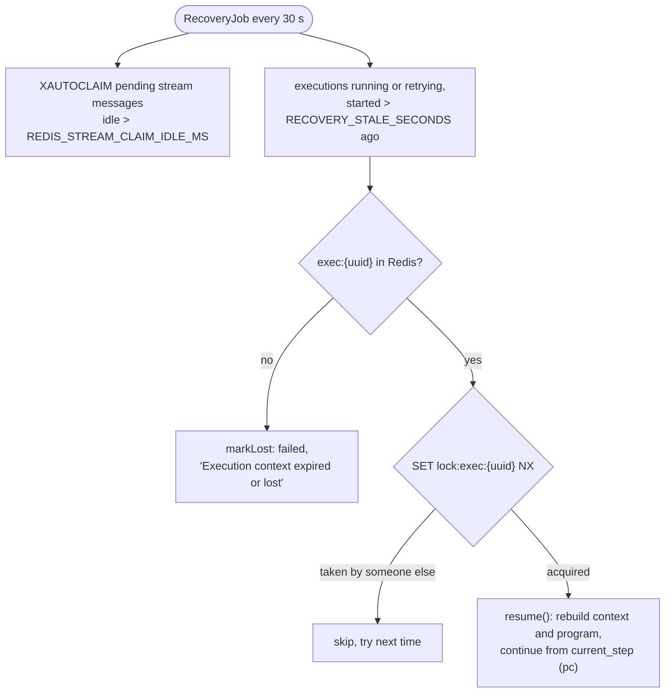
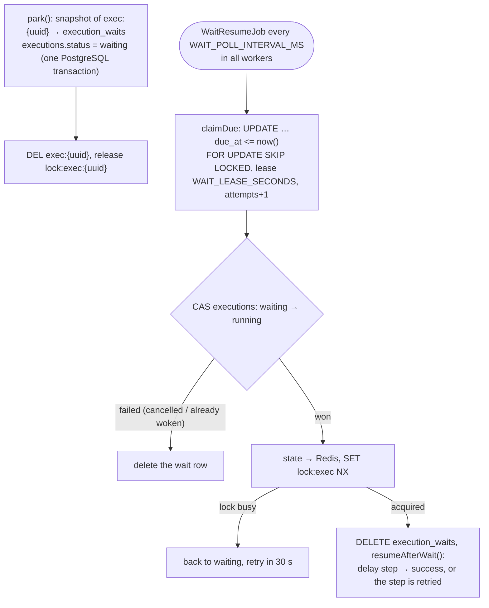

# Execution engine

How `ExecutionEngineService` runs one process for one event: the execution context, statuses, retries, idempotency and recovery after a crash.

<!-- lang-switch -->
🇬🇧 English | [🇷🇺 Русский](../../ru/05-architecture/execution-engine.md)
<!-- /lang-switch -->

## Execution context

`Wps\Context\ExecutionContext` is the memory of one execution. Every step reads from it and writes to it.

| Part | Content |
|---|---|
| `eventId` | `event_id` of the event (or the stream message id; `manual-{uuid}` for a manual run) |
| `event` | The original object from the event, never changed |
| `variables` | `object` (a working copy of the event object) and the variables created by preload or by `modify` (`v1`, `task`, …). A value is an associative array or `null` ("loaded, but not found in the CRM") |
| `meta` | Per variable: CRM `module` and `source` (`event`, `preload`, `created`) |
| `dirty` | Per variable: fields changed in memory and not yet saved to the CRM — `save_object` sends only these (unless `mode: "full"`) |
| `depth` | Nesting level of child processes, limited by `MAX_CHILD_DEPTH` |

Fields are addressed with paths `<variable>.<field>`: `object.status`, `v1.rating`, `task.name`. A path without a field
(`v1`) means the whole variable and is allowed only where an object is expected (`save_object.target`). For non-flat
objects nested paths such as `v1.address.city` are resolved too. A path to a missing variable or field resolves to
"not found" — a condition with it is false (customer answer #10), an expression gets an empty string. Writing to a
variable that does not exist yet creates it as a new object with the source `created`; saving it later sends a `POST`
and stores the new `id`.

A child process gets `forChild()`: the same event and variables, an empty `dirty` set and `depth + 1`.

### System variables `sys.*` and constants `config.*`

`sys` and `config` are **virtual** variables (task 5.2.9): they are not stored in `variables` but computed on read
(`ExecutionContext::getVariable()` / `resolve()`), so they are available in launch conditions, expressions, templates and
preload, but do not reach the Redis state (except `last_error` / `errors_count`). Both are read-only. The list of fields
with labels is served by `GET /api/dictionaries/system-variables`.

| `sys.*` field | Type | Value |
|---|---|---|
| `execution_id` | string | Execution UUID; empty while launch conditions are checked (no execution yet) |
| `parent_execution_id` | string | Parent execution of a child process, otherwise empty |
| `process_id`, `process_name`, `process_version` | integer / string / integer | The process and the version of its definition |
| `event_id` | string | `event_id` of the event, the stream message id or `manual-{uuid}` |
| `trigger` | string | `stream`, `manual`, `child` |
| `depth` | integer | Nesting depth of child processes |
| `module`, `record_id` | string | Module and `id` of the event record |
| `event_type` | string | `create`, `update`, `delete` |
| `changed_fields` | list | Changed fields (`[]` when unknown) |
| `user_id` | string | Who saved the record: the `user_id` field of the event or `wps_user_id` |
| `now` | datetime | Current UTC time (`Y-m-d H:i:s`) **at the moment of reading**, through `Wps\Time\Clock` |
| `started_at` | datetime | Execution start, UTC; empty before `begin()` |
| `last_error` | object | Last handled error (`on_error: continue/goto`, `on_item_error: continue`): `step_id`, `step_path`, `action_type`, `code`, `message`, `http_status`, `attempts`, `at`, `iteration`. No field — no errors |
| `errors_count` | integer | Number of handled errors |

The values are set by `ExecutionEngineService::configureContext()` before the conditions are checked (process, version,
`trigger`, constants, clock) and by `begin()` / `resume()` (execution id, `started_at`). After recovery (`resume()`)
`trigger`, `parent_execution_id` and `started_at` come from the Redis hash. A snapshot of `sys` is written to
`context_snapshot.system` of a failed or finished execution.

`config.<name>` is a value of `definition.constants` of the execution's definition snapshot: editing the constants does not
affect running and waiting executions. On save the validator checks that `config.x` is declared in `constants`.

## Execution lifecycle



- The conditions are evaluated in two passes (**lazy preload**). Rows on `object.*` are checked first, without calls to
  the CRM. If the result depends on a row that uses a preload variable, the `preload` block is executed and the
  conditions are evaluated again. The preload steps executed here are recorded as the first steps of the execution and
  are not repeated.
- A condition row is evaluated like this (`ConditionEngineService::evaluateLeaf`):
  1. `cast`, `cast_options` → `CastOptions` (a configuration error throws `ConfigurationException`);
  2. a row on a variable that is not loaded yet → "unknown" (lazy preload);
  3. both paths are resolved; a missing field → the row is false, the trace has `missing` (answer #10);
  4. both sides are cast by `TypeCaster`: the left one with the `CastOptions`, the right one with the comparator's
     `expectedCast()`;
  5. an empty side (types other than `string` / `bool`) → false, the trace has `empty`;
  6. a cast error → false, the trace has `cast_error`, a warning is logged, the metric
     `wps_condition_cast_errors_total` grows; with `on_cast_error: "error"` — `ConditionCastException`;
  7. the comparator compares the cast values.
- `ConditionCastException` in the start conditions is caught by `prepare()` (`PreparedRun::$castError`). For a stream
  event or a child process `handle()` creates an execution, records the lazy preload steps already done and a
  `conditions` step with status `failed` (trace and error text), and finishes the execution as `failed`; the idempotency
  key points to it, so the event is acknowledged and not processed again. A manual run returns `error: "CAST_ERROR"`
  without an execution.
- If a preload step fails during condition evaluation, the execution is still created and immediately finished as
  `failed`, so that the problem is visible in the audit.
- The `run_once` mark is taken only when the conditions are met and before the execution row is written. If writing the
  execution fails, the mark is released again.
- The definition is compiled into a **flat program** (see [below](#program-and-instructions)): the `definition.preload`
  rows (as `type: preload`), then `definition.actions`; blocks (`condition`) become jumps. Instructions run strictly one
  after another (customer answer #13).
- `finish()` writes the status, the retry counter and the final `context_snapshot` (event, variables, meta, condition
  trace) into PostgreSQL and keeps the Redis hash for `EXECUTION_FINISHED_TTL_SECONDS` (1 h).

## Program and instructions

Before it runs, the definition tree is compiled into a flat list of instructions with jumps
(`Wps\Program\ProgramCompiler`, task 0.1). The execution cursor is a single integer `pc`, so recovery after a crash
works the same way as for a linear process.

A definition with a `condition` block:

```json
{ "preload": [ { "var": "acc", "source": "object_field", "value": "object.account_id", "module": "Accounts" } ],
  "actions": [
    { "type": "modify", "target": "object.description", "change_type": "set_value", "value": "x" },
    { "type": "condition", "id": "big_deal",
      "branches": [ { "conditions": [ { "field": "object.amount", "operator": "equals", "cast": "decimal", "value": "1000" } ],
                      "actions": [ { "type": "modify", "target": "object.priority", "change_type": "set_value", "value": "High" } ] } ],
      "else": [ { "type": "modify", "target": "object.priority", "change_type": "set_value", "value": "Normal" } ] },
    { "type": "save_object", "target": "object" } ] }
```

compiles into the program:

| pc | op | Parameters | path |
|---|---|---|---|
| 0 | `action` | `preload acc` | `preload[0]` |
| 1 | `action` | `modify object.description` | `actions[0]` |
| 2 | `branch` | branch 0 → pc 3, else → pc 5, end → pc 6 | `actions[1]` (`id = big_deal`) |
| 3 | `action` | `modify object.priority = High` | `actions[1].branches[0].actions[0]` |
| 4 | `jump` | → pc 6 | `actions[1].branches[0]` |
| 5 | `action` | `modify object.priority = Normal` | `actions[1].else[0]` |
| 6 | `action` | `save_object object` | `actions[2]` |

Instruction set (`Wps\Program\Instruction`, executed by `Wps\Program\Interpreter`):

| op | What it does | Audit record |
|---|---|---|
| `action` | Runs the step through `ActionHandlerRegistry` with retries, then `pc + 1` | One record (as before) |
| `branch` | Checks the branch conditions in order; the first true one → its start, none → `else` (or the end of the block) | One `condition` record: `result_data.selected` and the traces of the checked branches |
| `jump` | Jumps to `target` | None |
| `jump_if_false` | False conditions → `target`, otherwise `pc + 1` (simple form for filters) | None |
| `halt` | Finishes the execution as `completed` or `failed` | One `stop_process` record |
| `loop_begin` | Start of a `foreach` loop (`LoopRunner`): evaluates the source, saves the item snapshot, pushes a frame to `frames`, sets the first item that passes `where` → `pc + 1`; an empty list → the end of the loop | One `foreach` record |
| `loop_next` | End of the body: the next matching item → the start of the body; items are over → the frame is removed, jump past the loop | Overwrites the `foreach` record with the totals (`seq` does not advance) |

The program ends when `pc` equals the number of instructions — the execution is `completed`. Compilation is
deterministic and cached by the definition hash; blocks are registered in `BlockTypeRegistry` (see
[New block type](../07-developer-guide/extending/new-block-type.md)).

**State and audit.**

- `current_step` in `exec:{uuid}` is the `pc` of the next instruction; `seq` is the number of the next audit record
  (the `step_index` in `execution_actions`); `frames` is the stack of loop frames; `instructions_executed` counts
  instructions; `program_hash` is the hash of the compiled program.
- Helper instructions (`jump`, `jump_if_false`) are not audited, so `seq` and `pc` differ for a process with blocks.
  Every record has `pc`, `step_path`, `iteration`, `step_id`.
- **Compatibility.** A linear process without blocks compiles one-to-one into the old step list:
  `seq == pc == the old step_index`. An execution started before the upgrade (no `seq` in the hash) is resumed with
  `seq = current_step`.
- Lazy preload steps are the first instructions of the program (`pc = seq = 0..n-1`).
- An execution compiles the program from **its own snapshot** of `definition` in Redis, so editing the process does not
  affect running executions. If on recovery the program hash differs from `program_hash` (the compiler changed between
  releases), the execution finishes as `failed` with `Program changed after an upgrade; the execution cannot be resumed
  safely`, metric `wps_program_resume_mismatch_total`.

**Skipped steps.** When an instruction fails (or `halt` stops the process), `failFrom()` writes `skipped` for the
following elements of its list and of every enclosing list up to the top level (`Program::remainingAfter()`; `preload`
and `actions` form one top-level sequence). Branches that were not chosen and the nested lists of later blocks are not
written.

**`foreach` loops** (`Wps\Program\LoopRunner`, task 4.11). The block compiles into `loop_begin`, the body and
`loop_next`; `where` is checked by the loop itself while it looks for the next item (rejected items are only counted).

- **The frame** in `frames` (a stack, the inner loop last): `begin`, `next`, `end` (pc), `as`, `loop_var`, `module`,
  `items_key`, `index`, `count`, `audit_seq` (number of the `foreach` record), `started_at`, `stats` (the total
  counters), `where_traces`, `on_item_error`. `ExecutionContext::$iteration` = frame indexes joined with `/` — written
  to `execution_actions.iteration`; recomputed from `frames` on recovery.
- **The item snapshot** is a separate Redis list `exec:{uuid}:loop:{pc}` (`LoopItemsStore`, one `RPUSH`, TTL as for
  `exec:{uuid}`); an item is read with `LINDEX` when the iteration starts. The execution hash keeps only the frame and
  the current item, so it does not grow with the list, and after a worker crash the loop goes over the same set. A lost
  snapshot — `Loop items snapshot is lost; the execution cannot be resumed`.
- **Loop variables**: the item has the source `loop` (a copy, saved with `save_object`), the iteration data —
  `loop_info` (read-only: `set()` and `CrmObjectSaver` refuse). Both are removed after the loop (`unsetVariable`).
- **The totals record.** `loop_begin` writes the `foreach` record with the number `audit_seq`; when the loop is left
  (`loop_next`, an error, `goto`, `stop_process`) `LoopRunner::close()` overwrites it with the totals —
  `InstructionOutcome::$overwrite`, `seq` does not grow.
- **An error in the body** (`on_error` of the step is `stop`): `LoopRunner::itemError()` looks for the nearest loop with
  `on_item_error: continue`; inner loops are closed as `failed`, the step gets `handled = item_continue`, the error goes
  to `sys.last_error`, the jump goes to `loop_next` of that loop (the iteration is not counted in `processed`). No such
  loop — `closeLoops('failed')` and the usual `failFrom()`. `goto` closes loops with `left_by: goto`, `halt` with
  `stopped: true`; `finish()` closes the remaining frames and removes the snapshots.
- **Waiting inside a loop.** `WaitService::park()` puts the contents of the snapshots of all frames into
  `execution_waits.state` (`loop_items`) and removes the keys from Redis; on waking the snapshots are restored before the
  execution continues.

**Limit.** More than `EXECUTION_MAX_INSTRUCTIONS` (5000) instructions in one execution — the execution fails with
`LIMIT_EXCEEDED` (guard against endless jumps). Block nesting depth is limited by `PROGRAM_MAX_DEPTH` (5).

## Execution statuses



| Status | Meaning | UI (`front/src/utils/format.ts`) |
|---|---|---|
| `running` | Steps are being executed | blue, live updates |
| `retrying` | A step failed with a recoverable error and waits for the next attempt | orange, live updates |
| `waiting` | The execution is parked until `waiting_until`: its state is in PostgreSQL (`execution_waits`), no worker or Redis is used | grey (`info`), "Waiting"; not refreshed automatically |
| `cancelled` | A waiting execution was cancelled by deleting the process (`DELETE /api/processes/{id}?force=true`) | grey, "Cancelled" |
| `completed` | All steps finished with `success` or `skipped` | green |
| `failed` | A step failed, or the execution was lost and could not be resumed | red |

## Step statuses



| Status | When |
|---|---|
| `success` | The handler finished normally |
| `waiting` | The step (a `delay` pause) waits for its due time; after the wake-up it becomes `success` with `waited_seconds` in `result_data` |
| `skipped` | The handler decided there is nothing to do (`save_object` of an empty variable or without changed fields), or a previous step failed (or the process was stopped) and this one was not executed |
| `failed` | The error is not recoverable, or all retries were used |

An inactive child process does not make the `start_process` step `skipped`: the step is `success`, and the child is
listed with `status: skipped` in `result_data.children`.

Each step is one row in `execution_actions` with `attempts`, `duration_ms`, `request_data` (what the step sent),
`result_data` (what it got: old/new value, CRM response, error class), `error_message` and its place in the program:
`pc`, `step_path`, `iteration`, `step_id`.

## Step execution, retries and errors



- **Recoverable**: `RecoverableException`, `CrmApiException` for transport errors (connection failed, timeout, reset) and
  HTTP ≥ 500, `RedisException`, PDO connection errors.
- **Non-recoverable**: `NonRecoverableException`, `ConfigurationException`, `CrmApiException` for HTTP 4xx (except 404 on
  `GET`, which means "not found" and gives `null`), and any other exception.
- With the defaults (`ACTION_RETRY_MAX=3`, `ACTION_RETRY_BASE_DELAY_MS=1000`, `ACTION_RETRY_BACKOFF=2`) a step is tried
  4 times with pauses of 1 s, 2 s and 4 s. The demo screenshot of a failed execution shows exactly this: 4 attempts in
  about 7 s.
- The snapshot is restored before every retry, so a non-idempotent change such as `x = x * 2` is not applied twice.
- Before the attempt loop the step gets an `attempt_token` (one for all its retries) and a fresh secret masker
  `$context->secretMasker`. `request`, `result`, the error text and `details` go through the masker before they are
  audited; an error code from `details` (e.g. `UNKNOWN_OUTCOME`) is copied into `result_data.error_code`.
- External calls of actions (`send_email`, `http_request`, `notify`) go through the side-effect journal
  `step_side_effects`: `started` before the call, `done` / `failed` after it. When a step is repeated after a worker
  crash, a `done` row returns the stored response without calling (`replayed: true`), and a foreign `started` row with
  `delivery: at_most_once` gives `UNKNOWN_OUTCOME` instead of a second send
  ([Reliability](../04-operations/reliability.md#side-effects-and-repeats)).

## Templates (TemplateEngine)

`Wps\Template\TemplateEngine` substitutes values into text `{{ path | filter:arg }}`, `{{= expression }}`. It is used by
the `template` change type ([Template](../03-user-guide/change-types-and-expressions.md#template)) and later by actions
that build text (e-mail, HTTP request, notification). A filter `x | f:a:b` is a call of the expression function
`f(x, a, b)` through `ExpressionEngine::call()`, so templates and expressions share conversion rules and functions. A
parsed template is cached (up to 1000 entries, then the cache is cleared), like expression ASTs.

**Escaping is chosen by the consumer of the template (the field), not by its author** — `EscapeMode`:

| Mode | Where | Rule for a substitution |
|---|---|---|
| `text` | `modify`, e-mail subject, notification text | the value as is |
| `header` | HTTP and mail headers | CR/LF are replaced with a space and a warning goes to `RenderResult::$warnings` (header injection) |
| `html` | HTML e-mail body | `htmlspecialchars(ENT_QUOTES \| ENT_SUBSTITUTE)`; the `nl2br` filter escapes the value first and then inserts `<br>`; the `raw` filter turns escaping off only where the consumer allows it (`TemplateValidator::validate(..., allowRaw: true)`) |
| `url` | HTTP request URL | `rawurlencode`; substitutions are allowed only in the path and the query — the validator forbids them in the scheme, host and port (SSRF) |
| `json` | HTTP request body | `renderStructure()`: string leaves of the document are templates; a leaf made of one substitution keeps the value type (number, list, object) |

A missing value (`resolve()` returned "not found") is handled by `MissingPolicy`: `empty` (an empty string, the path in
`RenderResult::$missing`), `error` (`NonRecoverableException`), `keep` (the tag stays in the text). Run-time
substitution errors are counted by `wps_template_render_errors_total`. Saving a process checks a template with
`TemplateValidator`: syntax, filters and their arity, declared paths, `raw`, the URL host.

The `template` change type reports missing paths in `result_data.missing` of the step through the optional interface
`ReportsDetails::computeWithDetails()`; `ModifyHandler` calls it instead of `compute()`. The interface is stateless on
purpose: one change type instance serves concurrent executions (coroutines), so details are returned together with
the value instead of being kept in the object.

## Recovery after a crash



The context, `current_step` (`pc`), `seq` and `frames` are written to Redis after every instruction, so an execution
interrupted by a worker crash continues from the instruction where it stopped (customer answers #14, #22), inside a
branch and inside a loop too (from the same item — by `frames` and the item snapshot). The interrupted step runs again with the same `seq`, overwriting its audit record. The lock `lock:exec:{uuid}` (TTL `EXECUTION_LOCK_TTL`,
30 s, refreshed before every attempt) makes sure that only one worker works on an execution. Executions started by a
stream message are additionally recovered when the message itself is re-delivered: `handle()` finds the idempotency key
and calls `resume()` instead of starting the process again. Manual and child executions have no stream message and rely
on `RecoveryJob` alone.

`RecoveryJob` leaves waiting executions (`waiting`) alone: they have no Redis key on purpose.

## Waiting and waking up (WaitResumeJob)

A handler that has to wait longer than `WAIT_INLINE_MAX_SECONDS` (5 s) returns `ActionResult::wait()` (the `delay`
pause), and a long retry delay is parked by the engine itself (`wait_reason: retry`).



- Waiting inside a `foreach` loop: the item snapshots of the open loops move to `state.loop_items` and are restored in
  Redis on waking.
- A snapshot larger than `WAIT_STATE_MAX_BYTES` is not parked: the step fails with `Execution state is too large to wait (N bytes, limit M)`.
- The wait row `info`: `pc`, `seq`, `mode` (`after_wait` or `retry`), `parked_at`, `attempts`. In `retry` mode the step
  runs again with the same `step_index`, and the attempt count continues.
- A failed wake-up logs `Resume attempt failed` and waits for the lease to expire; after `WAIT_MAX_ATTEMPTS` (10) the
  execution becomes `failed` with `Could not resume waiting execution: …`.
- The `RecoveryJob` criterion still uses `started_at`: a woken execution is protected by `lock:exec:{uuid}`, and one that
  crashes after the wake-up is picked up by `RecoveryJob` right away.
- Metrics: `wps_executions_parked_total`, `wps_executions_woken_total`, `wps_wait_resume_failed_total`,
  `wps_wait_lateness_seconds`, `wps_executions_waiting` ([Monitoring](../04-operations/monitoring.md)).

## Engine components

| Class | Role |
|---|---|
| `Services\ExecutionEngineService` | Orchestrator: `handle()` (stream, children), `runManual()`, `resume()` (`RecoveryJob`, re-delivery), `resumeAfterWait()`; idempotency, conditions, `run_once`, the instruction loop, retries, `on_error`, `finish()` |
| `Services\PreparedRun` | Result of the condition check: true/false, trace, steps run by lazy preload, cast error |
| `Services\ExecutionHandle` | In-memory state of a running execution: id, process, context, program, `pc`, `seq`, `frames`, `retryCount`, `trigger`, `parentId` |
| `Services\StepRecord` | Audit record of one step (`request`, `result`, `error_code`, `handled`, `pc`, `step_path`, `iteration`, `step_id`) |
| `Services\ExecutionStateStore` | Redis: `exec:{uuid}`, `lock:exec:{uuid}`, `idem:*` |
| `Services\AuditService` | Writes `execution_actions` (`INSERT … ON CONFLICT` — overwriting the record with the same `seq`) |
| `Services\ConditionEngineService` | Conditions: type casting, operand kinds, relative dates, expressions, trace |
| `Program\ProgramCompiler`, `ProgramEmitter`, `Program`, `Instruction` | Compiles the tree into a flat program (cached by the definition hash), instructions with paths |
| `Program\Interpreter`, `InstructionOutcome` | One instruction: `branch`/`jump`/`halt` here, `action` — by a callback into the engine |
| `Program\BlockTypeRegistry`, `Blocks\{Condition,Foreach,StopProcess}Block` | Blocks: compilation and validation on save |
| `Program\LoopRunner`, `LoopItemsStore` | `loop_begin` / `loop_next`, item errors, closing loops, item snapshots |
| `Services\Errors\ErrorClassifier`, `ErrorInfo` | Exception → code, transient / permanent, HTTP status, `Retry-After` |
| `Services\Errors\RetryPolicy`, `ErrorPolicy` | The step `retry` profile and `on_error` (`stop` / `continue` / `goto`) |
| `Services\WaitService`, `Persistence\ExecutionWaitRepository`, `CyclicJobs\WaitResumeJob` | Parking and waking waiting executions |
| `SideEffects\SideEffectLedger`, `DeliveryPolicy` | Journal of external calls and the `delivery` policy |
| `Services\CrmObjectSaver` | Saves variables to the CRM (`PUT` of changed fields / `POST` of a new record) |

## Handling a final step error

`handleFailure()` applies `on_error` of the failed instruction (`ErrorPolicy::fromStep()`):

1. `stop` — when a loop with `on_item_error: continue` is open, `LoopRunner::itemError()` closes the inner loops and goes
   to `loop_next` of that loop (`handled = item_continue`); otherwise `failFrom()` and `finish('failed')`.
2. `goto` — `Program::pcOf(id)` looks for a top-level step; a target that is missing or not ahead (`target <= pc`) behaves
   like `stop` (the validator rejects it, but an old definition may still carry it); otherwise open loops are closed
   (`left_by: goto`), `iteration` is cleared and the engine jumps.
3. `continue` — the next instruction; for a `branch` — the `end_target` of the block.

For `continue`/`goto`/`item_continue` the error goes to `sys.last_error`; `sys.errors_count`,
`executions.handled_errors` and the metric `wps_step_errors_handled_total` grow, the log gets `Step error handled`.

## Redis keys used by the engine

All keys live in **redis-data**.

| Key | Type | Content | TTL |
|---|---|---|---|
| `exec:{uuid}` | Hash | `status`, `current_step` (`pc`), `seq`, `frames`, `instructions_executed`, `program_hash`, `retry_count`, `trigger`, `parent_execution_id`, `process`, `definition`, `conditions`, `event`, `variables`, `meta`, `dirty`, `depth`, `started_at`, `finished_at` | `EXECUTION_TTL_HOURS` (24 h) while running, `EXECUTION_FINISHED_TTL_SECONDS` (1 h) after finish |
| `exec:{uuid}:loop:{pc}` | List | item snapshot of the `foreach` loop that started at `pc` (JSON items) | as for `exec:{uuid}`; removed when the loop is left and when the execution finishes |
| `lock:exec:{uuid}` | String | owner token | `EXECUTION_LOCK_TTL` (30 s), refreshed on every step |
| `idem:{event_id}:{process_id}` | String | execution id or `skipped` | `IDEMPOTENCY_TTL_HOURS` (24 h) |
| `idem:{parent_execution_id}.{seq}:{child_id}` | String | same, for child processes (`seq` — audit number of the `start_process` step) | `IDEMPOTENCY_TTL_HOURS` |

See also [Data model](data-model.md) for the PostgreSQL tables and [Reliability](../04-operations/reliability.md) for the
operational side.

<!-- footer-nav -->
---

← Previous: [Event flow](event-flow.md) | [Contents](../README.md) | [Data model](data-model.md) Next →
<!-- /footer-nav -->
