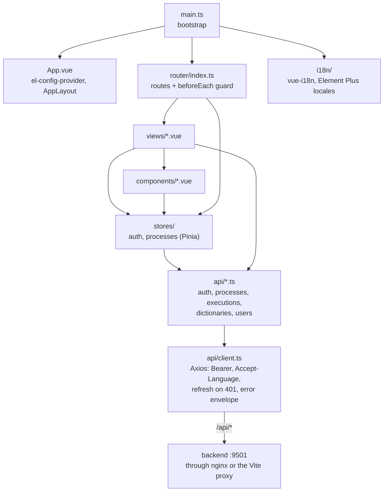
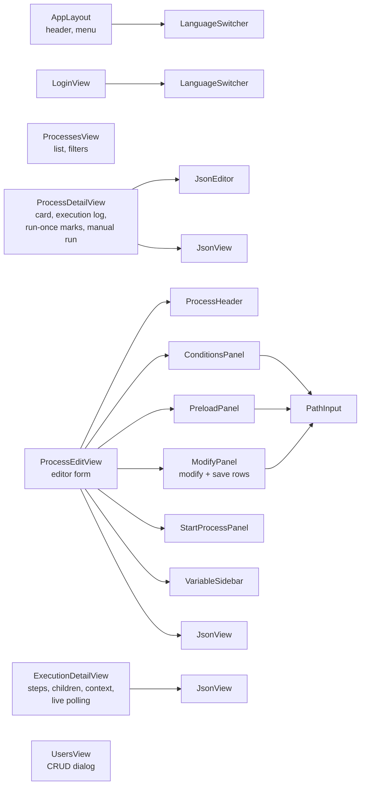
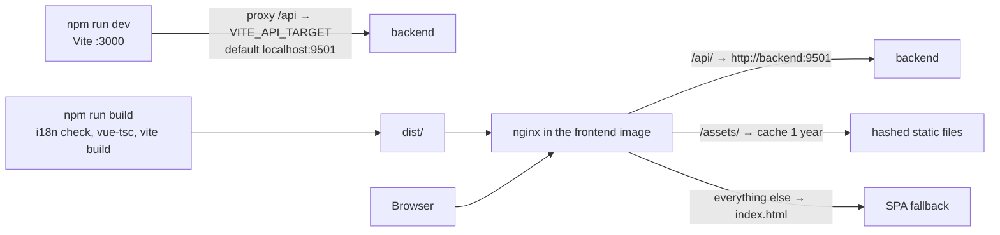

# Frontend architecture

Structure of the Vue 3 single-page application: bootstrap, routing and access guards, state, the API client, localisation and delivery through nginx.

<!-- lang-switch -->
🇬🇧 English | [🇷🇺 Русский](../../ru/05-architecture/frontend.md)
<!-- /lang-switch -->

## Overview

`main.ts` installs Pinia, vue-i18n, the router and Element Plus, registers the Element Plus icons, sets the "session
expired" handler of the API client and loads the language **before** the first render (`setLocale(detectLocale())`),
so texts do not flicker. Views talk to the backend only through the modules in `src/api/`, which all use one Axios
instance. Shared types are in `src/types/index.ts`.

## Routing and access

| Path | View | Roles |
|---|---|---|
| `/login` | `LoginView.vue` | public |
| `/processes` | `ProcessesView.vue` | all |
| `/processes/create` | `ProcessEditView.vue` | admin, editor |
| `/processes/:id` | `ProcessDetailView.vue` | all |
| `/processes/:id/edit` | `ProcessEditView.vue` | admin, editor |
| `/executions/:id` | `ExecutionDetailView.vue` | all |
| `/users` | `UsersView.vue` | admin |

The global `beforeEach` guard initialises the auth store, sends unauthenticated users to `/login?redirect=…`, loads the
current user (`GET /api/auth/me`) when only a token is known and redirects to `/processes` when the role in
`meta.roles` does not match. Page titles come from `meta.titleKey` (a translation key) and are updated when the
language changes. The UI checks are a convenience only — the backend enforces the same rules in `AccessPolicy`.

## Views and components

The editor splits `definition.actions` into panels: `formFromProcess()` in `stores/processes.ts` distributes the
actions by type, and `definitionFromForm()` assembles them back: first the modify/save rows in their order, then one
`start_process` action per selected child process. Action types the editor does not know (for example `preload` inside
`actions`) are kept unchanged, and a condition tree (`logical_operator`) is kept as is. The editor writes only the fields
it shows, so optional keys set through the API (`modify.module`, `save_object.mode`, `preload.strategy`) are dropped when
the process is saved from the UI.
`VariableSidebar` shows the variables known at each point (the event object, preload variables, variables created
by `modify`) with their fields, using `utils/variables.ts`. `ExecutionDetailView` polls the execution while its status
is `running` or `retrying`. `ConditionsPanel`, `PreloadPanel` and `ModifyPanel` use the `PathInput` component to suggest
field paths.

## State

| Store | Content |
|---|---|
| `auth` | `accessToken`, `refreshToken` (persisted in `localStorage` as `wps_access_token`, `wps_refresh_token`), `user`, computed `role`, `isAdmin`, `canEdit`; `login()`, `refresh()`, `fetchMe()`, `logout()`, `hasRole()` |
| `processes` | Process list with pagination and filters, loading one process, `saveProcess()`; form helpers `emptyForm()`, `formFromProcess()`, `definitionFromForm()`, `payloadFromForm()` |

Other data (executions, dictionaries, users) is loaded by the views directly through `src/api/`.

## API client

`src/api/client.ts` creates an Axios instance with `baseURL: '/api'` and a 30 s timeout:

- the request interceptor adds `Authorization: Bearer <access token>` (except for `/auth/login` and `/auth/refresh`) and
  `Accept-Language` with the current UI language;
- on `401` the response interceptor calls `POST /api/auth/refresh` once — parallel requests wait for the same refresh
  promise — and repeats the original request; if refresh fails, the user is logged out and sent to `/login` with a
  `redirect` back;
- errors are normalised to `ApiRequestError { status, code, message, details }` from the backend envelope
  (`NETWORK_ERROR` when there is no response) and shown with `ElMessage` unless the request is marked `silent`.

## Localisation

| Part | Where |
|---|---|
| Messages | `src/locales/ru.json` (reference and fallback), `src/locales/en.json` |
| Setup, `setLocale()`, `detectLocale()` | `src/i18n/index.ts` |
| Supported languages | `src/i18n/locales.ts` (`SUPPORTED_LOCALES`, `LOCALE_META`) |
| Element Plus locales | `src/i18n/element-plus.ts`, applied by `el-config-provider` in `App.vue` |
| Check | `scripts/i18n-check.mjs` (`npm run i18n:check`, part of `npm run build`) |

The language is chosen from `?lang=` → `localStorage['wps_locale']` → browser languages → `ru`. Russian is bundled,
other languages are loaded as separate chunks. Labels of backend dictionaries (operators, change types, preload
sources) are translated in the UI by their `value` (`dict.*` keys); module names are shown as the CRM returns them.
How to add a language: [New language](../07-developer-guide/extending/new-language.md).

## Build and delivery

In development Vite serves the app on port 3000 and proxies `/api` to the backend. In Docker the image builds `dist/`
and serves it with nginx (`front/nginx.conf`): `/api/` is proxied to `backend:9501` with a 60 s read timeout and a
10 MB body limit, `/assets/` files are cached for a year, and every other path falls back to `index.html` so that the
router can handle deep links.

<!-- footer-nav -->
---

← Previous: [Data model](data-model.md) | [Contents](../README.md) | [Architecture decisions](decisions.md) Next →
<!-- /footer-nav -->
