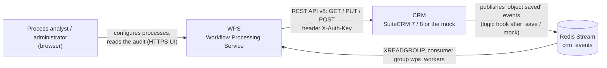
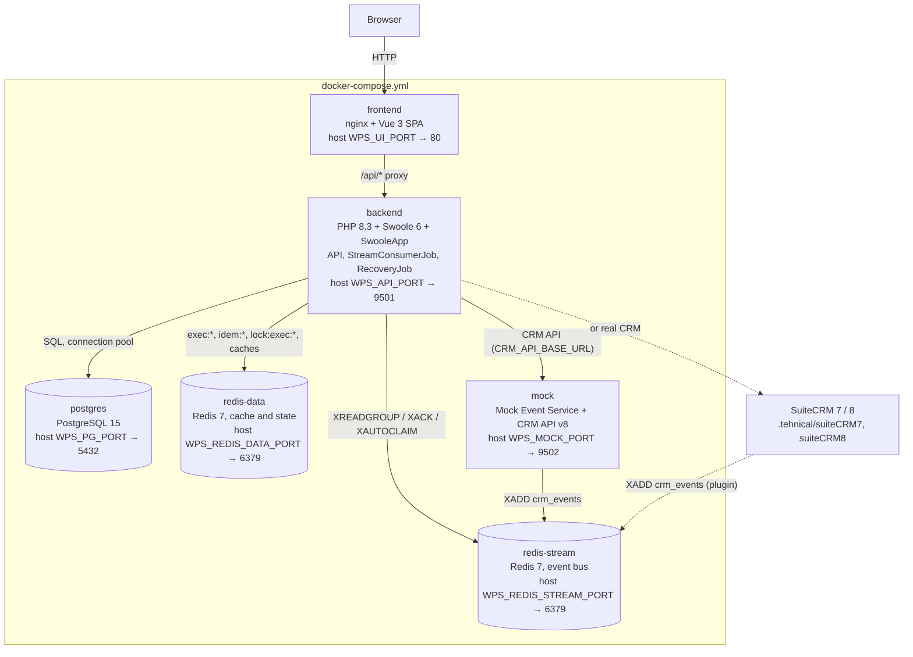

# Architecture overview

The big picture of WPS: the systems around it, the containers it consists of and the technology stack.

<!-- lang-switch -->
🇬🇧 English | [🇷🇺 Русский](../../ru/05-architecture/overview.md)
<!-- /lang-switch -->

## System context (C4, level 1)

The CRM is the owner of the data. It does not call WPS directly: every save of a record is published into the Redis Stream
`crm_events`, and WPS reads that stream as a consumer group. When a process needs more data or has to write a change back,
WPS calls the CRM REST API (SuiteCRM API v8 format, authenticated with a dynamic `X-Auth-Key`). People only work with the
web UI: they configure processes and inspect the execution audit.

## Containers (C4, level 2)

| Container | Responsibility | Data it owns |
|---|---|---|
| `frontend` | Serves the built SPA, proxies `/api/` to `backend:9501`, SPA fallback to `index.html` | — |
| `backend` | REST API for the UI, stream consumer, execution engine, recovery | — (stateless; the state is in PostgreSQL and redis-data) |
| `postgres` | Consistent storage | users, processes, executions, step audit, run-once marks |
| `redis-stream` | Event bus between the CRM and WPS | stream `crm_events`, group `wps_workers`, dead-letter stream `crm_events:dlq` |
| `redis-data` | Fast temporary state, kept separate from the bus (customer answer #4) | execution context `exec:{uuid}`, locks, idempotency keys, process and module caches |
| `mock` | Development CRM: generates events and emulates CRM API v8 | mock CRM objects (in redis-stream) |

The backend is the only component that talks to the databases. Several backend workers read the stream in parallel as
separate consumers of one group, so an event is processed by exactly one worker at a time. The `mock` container plays both
roles of a CRM — event publisher and REST API — so the whole system runs without SuiteCRM. A real SuiteCRM 7/8 is
connected by changing `CRM_API_BASE_URL` (see [CRM integration](../04-operations/crm-integration.md)).

## Technology stack

| Layer | Technology | Where |
|---|---|---|
| HTTP server, concurrency | PHP 8.3, Swoole 6 (coroutines, `SWOOLE_HOOK_ALL`) | `back/Dockerfile`, `back/server.php` |
| Application framework | SwooleApp (`sidalex/swoole-app` ^0.3.0, Packagist) | `back/composer.json`, `back/config/config.json` |
| Storage | PostgreSQL 15 (JSONB for process definitions) | `back/migrations/*.sql` |
| Event bus | Redis 7 Streams with a consumer group | `back/src/Services/StreamService.php` |
| Cache and execution state | Redis 7 (separate instance) | `back/src/Services/ExecutionStateStore.php` |
| Authentication | JWT (access + refresh), roles admin / editor / viewer | `back/src/Auth/` |
| Metrics | Prometheus text format, shared `Swoole\Table` | `back/src/Services/MetricsService.php` |
| UI | Vue 3.5, TypeScript, Vite 5, Element Plus, Pinia, Vue Router, Axios, vue-i18n | `front/` |
| UI delivery | nginx | `front/nginx.conf` |
| CRM | SuiteCRM 7 / 8 with the WPS plugin, or the PHP mock | `.tehnical/`, `mock/` |

## Where to go next

- [Backend](backend.md) — layers, components and the Swoole process model.
- [Event flow](event-flow.md) — what happens to one CRM event from the stream to the audit.
- [Execution engine](execution-engine.md) — context, statuses, retries and recovery.
- [Data model](data-model.md) — tables and Redis keys.
- [Frontend](frontend.md) — the SPA structure.
- [Architecture decisions](decisions.md) — why it is built this way.

<!-- footer-nav -->
---

← Previous: [Troubleshooting](../04-operations/troubleshooting.md) | [Contents](../README.md) | [Backend architecture](backend.md) Next →
<!-- /footer-nav -->
