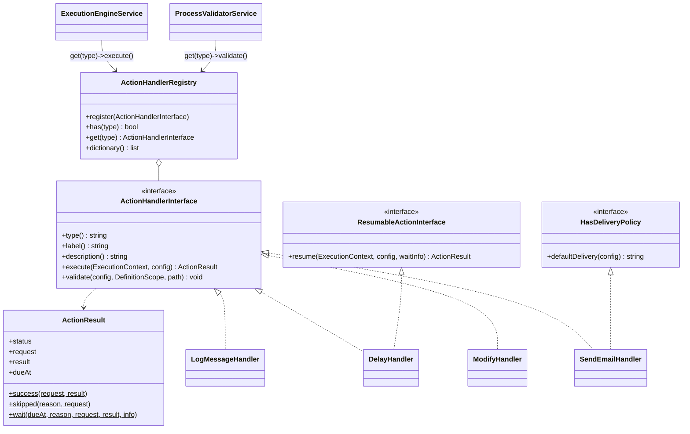

# New action type

How to add a new kind of step to process definitions, using the tutorial `log_message` action ("Write to log") as the example.

<!-- lang-switch -->
🇬🇧 English | [🇷🇺 Русский](../../../ru/07-developer-guide/extending/new-action-type.md)
<!-- /lang-switch -->

## 1. When you need it

Actions are the steps of a process. Built-in ones (`back/src/Actions/`, dictionary `GET /api/dictionaries/action-types`):
`preload`, `modify`, `save_object`, `set_variable`, `find_records`, `update_records`, `link_records` / `unlink_records`,
`delay`, `send_email`, `http_request`, `notify`, `assign`, `start_process`; the `condition`, `foreach`,
`stop_process` blocks work differently ([New block type](new-block-type.md)). Add a new type when a process must do
something none of them can: call a custom API, write to a queue, log a business message. For webhooks and messengers
look at `http_request` and [`notify` channels](new-notify-channel.md) first. If you only need a new way to *compute a value*, write a [change type](new-change-type.md) instead; for a new
way to *load an object*, a [load strategy](new-load-strategy.md).

## 2. How it works



The `Wps\Actions\ActionHandlerInterface` interface (`back/src/Actions/ActionHandlerInterface.php`):

| Method | Purpose |
|---|---|
| `type(): string` | the action code in a definition (`"log_message"`); unique among actions **and** blocks |
| `label(): string`, `description(): string` | label and description for `GET /api/dictionaries/action-types` (`"kind": "action"`) |
| `execute(ExecutionContext $context, array $actionConfig): ActionResult` | runs the step |
| `validate(array $actionConfig, DefinitionScope $scope, string $path): void` | static check when a process is saved |

Optional interfaces: `ResumableActionInterface` (a waiting action, [below](#a-waiting-action-parking)) and
`Wps\SideEffects\HasDeliveryPolicy` (external side effects, [below](#external-calls-and-the-side-effect-journal)).
`ActionResult` is `final` with `readonly` fields `status` (`success` / `skipped` / `failed` / `waiting`), `request`,
`result`, `dueAt`, `waitReason`, `waitInfo` and the factories `success()`, `skipped()`, `wait()`.

- A step in `definition.actions[]` is a JSON object with `"type"`; all other keys are the handler's config. Common step
  keys (`id`, `name`, `on_error`, `retry`, and `delivery` for `HasDeliveryPolicy`) are checked and handled by the
  engine; the handler receives them but should not interpret them.
- **Save time** — `ProcessValidatorService` walks the definition in execution order and calls `validate($config, $scope, $path)`.
  Report problems with `$scope->error("{$path}.field", 'message')`; they become `422 VALIDATION_ERROR` with
  `details[].field = "definition.actions[N].field"`. Check paths you read with `$scope->checkReadPath()` (the variable
  must already exist at this point), declare variables you create with `$scope->declare()` / `checkWritePath()`.
- **Run time** — `ExecutionEngineService::executeStep()` calls `execute($context, $config)`:
  - read and write process data through `ExecutionContext` (`get('object.phone')`, `set('v1.rating', 'VIP')`,
    `getVariable()`, `setVariable()`, `executionId`, `processId`, `stepIndex`);
  - return `ActionResult::success($request, $result)` or `ActionResult::skipped($reason)`. `$request` and `$result` go
    through the step's secret masker and are written to the audit (`execution_actions.request_data` / `result_data`);
    they are visible in the UI and in `GET /api/executions/{id}`. Put there what helps to investigate an execution,
    not huge responses: the audit lives in PostgreSQL;
  - throw `RecoverableException` for temporary failures — the engine restores the context snapshot (`restoreState()`)
    and retries the step (`ACTION_RETRY_MAX` times with exponential backoff `ACTION_RETRY_BASE_DELAY_MS` ×
    `ACTION_RETRY_BACKOFF`, overridden by the step's `retry`; a long delay parks the execution); throw
    `NonRecoverableException` / `ConfigurationException` for permanent failures: the step fails and the step's
    `on_error` decides what happens next (by default the execution fails and the remaining steps are `skipped`);
  - the error class is decided by `Services/Errors/ErrorClassifier`: the exception `details` may carry `error_code`
    (goes to the `error_code` of the audit record and to `sys.last_error.code`), `http_status` and
    `retry_after_seconds` (delay of the next retry).
- `GET /api/dictionaries/action-types` returns `type`, `label`, `description` of every registered handler.
- Handlers are created in `Wps\Kernel\Container::actions()` **once per worker** and serve every coroutine: they can
  receive any service (CRM adapter, logger, expression engine, repositories) through the constructor, but must not
  keep per-call state in fields — everything about an execution lives in `ExecutionContext`, and what must survive a
  retry lives in Redis (this is how `AssignHandler` remembers the chosen user for the step).

## 3. Step by step

| File | What to do |
|---|---|
| `back/src/Actions/LogMessageHandler.php` | **new** — the handler |
| `back/src/Kernel/Container.php` | registration in `actions()` |
| `back/tests/Unit/Actions/LogMessageHandlerTest.php` | **new** — unit test |
| `back/tests/IntegrationTest.php` | a `[log_message]` block (or the shared `testExtensions()` template from [6](#6-test)) |
| `front/src/views/ProcessDetailView.vue`, `front/src/locales/*.json` | type label (or a full editor) |
| `doc/{ru,en}/03-user-guide/actions.md`, `back/API.md` | action description |

### 3.1 The handler — `back/src/Actions/LogMessageHandler.php`

The action evaluates a `calculate`-style expression and writes the result to the service log and to the step audit:
`{ "type": "log_message", "message": "concat('Deal ', object.id, ' processed')", "level": "info" }`.

```php
<?php

declare(strict_types=1);

namespace Wps\Actions;

use Psr\Log\LoggerInterface;
use Wps\Context\ExecutionContext;
use Wps\Exceptions\ConfigurationException;
use Wps\Exceptions\NonRecoverableException;
use Wps\Expression\ExpressionEngine;
use Wps\Services\Validation\DefinitionScope;

/**
 * Writes a message to the service log and to the step audit.
 * "message" is a calculate-style expression: "concat('Deal ', object.id, ' processed')".
 */
final class LogMessageHandler implements ActionHandlerInterface
{
    public const LEVELS = ['debug', 'info', 'notice', 'warning', 'error'];
    private const MAX_LENGTH = 2000;

    public function __construct(
        private readonly ExpressionEngine $expressions,
        private readonly LoggerInterface $logger,
    ) {
    }

    public function type(): string
    {
        return 'log_message';
    }

    public function label(): string
    {
        return 'Записать в журнал';
    }

    public function description(): string
    {
        return 'Вычисляет выражение и пишет результат в лог сервиса и в аудит шага';
    }

    public function execute(ExecutionContext $context, array $actionConfig): ActionResult
    {
        $expression = (string)($actionConfig['message'] ?? '');
        $level = (string)($actionConfig['level'] ?? 'info');
        if ($expression === '' || !in_array($level, self::LEVELS, true)) {
            // the validator rejects it on save; a definition saved before the rule may still carry it
            throw new ConfigurationException('log_message: message is required and level must be one of ' . implode(', ', self::LEVELS));
        }
        $message = ExpressionEngine::toString(
            $this->expressions->evaluate($expression, static fn (string $path) => $context->get($path)),
        );
        if (mb_strlen($message) > self::MAX_LENGTH) {
            throw new NonRecoverableException('log_message: the message is longer than ' . self::MAX_LENGTH . ' characters');
        }
        $this->logger->log($level, $message, [
            'execution_id' => $context->executionId,
            'process_id' => $context->processId,
            'step' => $context->stepIndex,
        ]);
        return ActionResult::success(['message' => $expression, 'level' => $level], ['logged' => $message]);
    }

    public function validate(array $actionConfig, DefinitionScope $scope, string $path): void
    {
        $message = $actionConfig['message'] ?? null;
        if (!is_string($message) || trim($message) === '') {
            $scope->error("{$path}.message", 'Message expression is required');
        } else {
            try {
                foreach ($this->expressions->paths($message) as $ref) {
                    $scope->checkReadPath($ref, "{$path}.message");
                }
            } catch (ConfigurationException $e) {
                $scope->error("{$path}.message", $e->getMessage());
            }
        }
        if (array_key_exists('level', $actionConfig) && !in_array($actionConfig['level'], self::LEVELS, true)) {
            $scope->error("{$path}.level", 'Level must be one of: ' . implode(', ', self::LEVELS));
        }
    }
}
```

### 3.2 Registration — `back/src/Kernel/Container.php`

```php
use Wps\Actions\LogMessageHandler;

public function actions(): ActionHandlerRegistry
{
    return $this->share(ActionHandlerRegistry::class, function () {
        $saver = new CrmObjectSaver($this->crm());
        $registry = new ActionHandlerRegistry();
        $registry->register(new PreloadHandler($this->crm(), $this->loadStrategies()));
        $registry->register(new ModifyHandler($this->changeTypes(), $saver));
        $registry->register(new SaveHandler($saver));
        // … set_variable, find_records, update_records, delay, send_email, http_request, assign, notify, link / unlink …
        $registry->register(new StartProcessHandler(
            $this->processes(),
            fn (): ExecutionEngineService => $this->engine(),
            $this->config()->maxChildDepth,
        ));
        $registry->register(new LogMessageHandler($this->expressions(), $this->logger()));
        return $registry;
    });
}
```

> **Warning**
> Do not call `$this->engine()` directly in a handler constructor: the engine itself depends on the action registry.
> Pass a closure, as `StartProcessHandler` does. The type must not equal a block type: `Container::blocks()` throws a
> `LogicException` when a name is used by both. Registering the same `type()` again silently replaces a built-in
> action.

### 3.3 Rebuild and use

```bash
docker compose up -d --build backend
```

```json
{
  "name": "Deal log", "object_type": "Deals", "is_child": false,
  "definition": {
    "conditions": [], "preload": [],
    "actions": [ { "type": "log_message", "message": "concat('Deal ', object.id, ' ', object.status)" } ]
  }
}
```

Each executed step writes one log line (JSON format of `Wps\Support\Logger`), e.g. for the message
`concat('ext ', object.id, ' ', acc.name)`:

```json
{"timestamp":"2026-10-15T08:06:27.619Z","level":"info","message":"ext e1 INN Company","context":{"execution_id":"38839d14-…","process_id":13,"step":3},"pid":14}
```

## 4. Validation and errors

| Situation | What to do | Result |
|---|---|---|
| Missing/invalid config | `$scope->error()` in `validate()` | `422`, `details[].field = definition.actions[N].<key>` |
| Reads a variable that does not exist yet | `$scope->checkReadPath($path, $field)` | `Variable "v9" is not defined at this point` |
| Creates a variable | `$scope->declare('name', 'created')` or `checkWritePath()` | later steps may use it |
| Puts a read-only list of records | `$scope->declare('name', ExecutionContext::SOURCE_LIST)`; at run time `setVariable($name, $value, $module, ExecutionContext::SOURCE_LIST)` | `modify` / `save_object` on it are rejected, `set()` throws `ConfigurationException` (as `FindRecordsHandler` does) |
| Needs a variable only while computing (the current record) | at validation — `$scope->declare($var, ExecutionContext::SOURCE_LOOP)` before checking the parameters and `$scope->undeclare($var)` after; at run time — `$context->withTemporaryVariable($var, $record, $module, fn () => …)` | the variable is removed also on an exception; `UpdateRecordsHandler` does this for `item` |
| External system temporarily down | `throw new RecoverableException('…')` | retried, status `retrying`, then `failed` |
| Permanent failure (4xx, bad data) | `throw new NonRecoverableException('…', ['response' => …])` | step `failed`, details in `result_data.details` |
| Nothing to do | `return ActionResult::skipped('reason')` | step `skipped`, execution continues |

The engine restores the context snapshot before a retry, so `execute()` may change the context before it fails.
External side effects are not rolled back — run them through the side-effect journal (see
[below](#external-calls-and-the-side-effect-journal)) or make them idempotent.

In child processes the scope is created with `inheritsVariables: true`, so `checkReadPath()` accepts unknown variables there.

### Fields that accept a secret

If an action needs credentials (a token, a password, a DSN), declare a field where the process author puts a reference
`secret://name` or `secret://name.field`, and resolve it in `execute()` with `SecretResolver`
(`Container::secretResolver()`, pass it to the handler constructor):

```php
$token = $this->secrets->resolve($actionConfig['auth']['token'], $context->secretMasker); // string|array
$hosts = $this->secrets->allowedHosts($actionConfig['auth']['token']);                      // [] = any host
$kind = $this->secrets->kind($actionConfig['auth']['token']);                               // 'bearer', 'basic_auth', …
```

- `resolve()` decrypts the value (cached in the worker memory, `SECRETS_CACHE_TTL`) and registers it and its derived forms
  in the step masker `$context->secretMasker`. The engine passes the step `request`, `result`, error text and `details`
  through this masker before writing the audit, so the value becomes `***` automatically. Do not put a secret value into
  process variables, and do not log it without the masker.
- No such secret or field — `NonRecoverableException` (`Secret "x" not found`, `Secret "x" has no field "y"`).
- When a process is saved, the validator itself checks that the secret exists and rejects references in data fields
  (`value`, `expression`, `field`, `target`, `template`, `subject`, `body`, `text`, `html`) and in conditions. So do not
  name a credential field like a data field. If the action expects particular kinds of secrets, check `kind()` in
  `execute()` and fail the step with a clear error.
- If the secret goes to an external system, check the request host against `allowedHosts()`.

### Text fields and templates

If an action field is text with substitutions (e-mail subject and body, URL, headers, request body), do not build it
yourself: use `TemplateEngine` (`Container::templates()`) and check it on save with `TemplateValidator`
(`Container::templateValidator()`). The action picks the `EscapeMode` by the purpose of the field:

```php
use Wps\Template\EscapeMode;
use Wps\Template\MissingPolicy;

// validate()
$this->templateValidator->validate($config['subject'] ?? null, $scope, "{$path}.subject", EscapeMode::Header);
$this->templateValidator->validate($config['html'] ?? null, $scope, "{$path}.html", EscapeMode::Html, allowRaw: false);
$this->templateValidator->validate($config['url'] ?? null, $scope, "{$path}.url", EscapeMode::Url);   // fixed host
$this->templateValidator->validate($config['body'] ?? null, $scope, "{$path}.body", EscapeMode::Json); // a document array

// execute()
$resolve = static fn (string $p) => $context->resolve($p);
$subject = $this->templates->render($config['subject'], $resolve, EscapeMode::Header)->value;
$to = $this->templates->render($config['to'], $resolve, EscapeMode::Text, MissingPolicy::Error)->value;
$body = $this->templates->renderStructure($config['body'], $resolve)->value; // numbers stay numbers
```

- `text` — as is; `header` — CR/LF removed (plus a warning in `RenderResult::$warnings`); `html` — `htmlspecialchars`,
  the `raw` filter is allowed only if you pass `allowRaw: true` for a trusted field; `url` — `rawurlencode` and no
  substitutions in the scheme, host and port; `json` — `renderStructure()`.
- Use `MissingPolicy::Error` for recipients and URLs: an empty address must not go out silently.
- Put `RenderResult::$missing` and `$warnings` into the step `result` so they show in the audit.

### External calls and the side-effect journal

A step runs at least once: after a worker crash it is repeated as a whole. If the action sends something to an external
system (an e-mail, a webhook, a notification), run the call through `SideEffectLedger` (`Container::sideEffects()`),
otherwise a repeat sends it a second time. The model is described in
[Reliability](../../04-operations/reliability.md#side-effects-and-repeats).

A complete example is the `push_to_erp` action that sends a JSON document to an ERP
(`back/src/Actions/PushToErpHandler.php`; the class and the test below were run against the current code):

```php
<?php

declare(strict_types=1);

namespace Wps\Actions;

use Wps\Context\ExecutionContext;
use Wps\Exceptions\NonRecoverableException;
use Wps\Exceptions\RecoverableException;
use Wps\Http\Outbound\HttpRequestException;
use Wps\Http\Outbound\OutboundHttpClient;
use Wps\Secrets\SecretReference;
use Wps\Secrets\SecretResolver;
use Wps\Services\Validation\DefinitionScope;
use Wps\SideEffects\DeliveryPolicy;
use Wps\SideEffects\HasDeliveryPolicy;
use Wps\SideEffects\SideEffectLedger;
use Wps\SideEffects\UnknownOutcomeException;
use Wps\Template\EscapeMode;
use Wps\Template\TemplateEngine;
use Wps\Template\TemplateValidator;

/**
 * Sends a JSON document to the ERP: { "type": "push_to_erp", "token": "secret://erp", "body": {"deal": "{{ object.id }}"} }.
 * The call goes through the side effect journal: a repeated step does not create a second ERP document.
 */
final class PushToErpHandler implements ActionHandlerInterface, HasDeliveryPolicy
{
    public function __construct(
        private readonly OutboundHttpClient $http,
        private readonly SideEffectLedger $ledger,
        private readonly SecretResolver $secrets,
        private readonly TemplateEngine $templates,
        private readonly TemplateValidator $templateValidator,
        private readonly string $erpUrl,
    ) {
    }

    public function type(): string
    {
        return 'push_to_erp';
    }

    public function label(): string
    {
        return 'Отправить в ERP';
    }

    public function description(): string
    {
        return 'Отправляет JSON-документ в ERP; повтор шага не создаёт дубль';
    }

    public function defaultDelivery(array $config): string
    {
        // a repeated POST may create a duplicate → "at most once" by default
        return DeliveryPolicy::AT_MOST_ONCE;
    }

    public function execute(ExecutionContext $context, array $actionConfig): ActionResult
    {
        $delivery = DeliveryPolicy::resolve($actionConfig['delivery'] ?? null, $this->defaultDelivery($actionConfig));
        $rendered = $this->templates->renderStructure($actionConfig['body'] ?? [], static fn (string $path) => $context->resolve($path));
        $body = $rendered->value;
        $request = ['url' => $this->erpUrl, 'body' => $body];                 // what goes out (no secrets)
        $effectKey = $this->ledger->effectKey($context);

        $out = $this->ledger->run($context, $this->type(), '', $delivery, $request,
            function (string $idempotencyKey) use ($context, $actionConfig, $body, $delivery, $effectKey): array {
                // resolved only when really sending: the value is registered in the step masker and never reaches the audit
                $token = (string)$this->secrets->resolve((string)$actionConfig['token'], $context->secretMasker);
                try {
                    $response = $this->http->send('POST', $this->erpUrl, [
                        'Content-Type' => 'application/json',
                        'Authorization' => "Bearer {$token}",
                        'Idempotency-Key' => $idempotencyKey,
                    ], (string)json_encode($body, JSON_UNESCAPED_UNICODE | JSON_UNESCAPED_SLASHES), 15.0);
                } catch (HttpRequestException $e) {
                    if ($e->sent() && $delivery === DeliveryPolicy::AT_MOST_ONCE) {
                        // a timeout after sending: the ERP may have the document
                        throw UnknownOutcomeException::forEffect($effectKey, null, 'push_to_erp: ' . $e->getMessage());
                    }
                    throw $e; // not sent (DNS, connection refused): recoverable, the step is retried
                }
                $status = $response->status;
                $details = ['http_status' => $status, 'error_code' => "HTTP_{$status}", 'response' => mb_substr($response->body, 0, 1000)];
                if (in_array($status, [408, 425, 429, 503], true)) {
                    throw new RecoverableException("push_to_erp: ERP returned HTTP {$status}", $details); // not processed
                }
                if ($status >= 500) {
                    if ($delivery === DeliveryPolicy::AT_MOST_ONCE) {
                        throw UnknownOutcomeException::forEffect($effectKey, null, "push_to_erp: ERP returned HTTP {$status}");
                    }
                    throw new RecoverableException("push_to_erp: ERP returned HTTP {$status}", $details);
                }
                if ($status >= 400) {
                    throw new NonRecoverableException("push_to_erp: ERP returned HTTP {$status}", $details);
                }
                $decoded = json_decode($response->body, true);
                return ['status' => $status, 'erp_id' => is_array($decoded) ? (string)($decoded['id'] ?? '') : ''];
            });

        return ActionResult::success($request, $out['response'] + [
            'idempotency_key' => $out['idempotency_key'],
            'replayed' => $out['replayed'],
        ] + ($rendered->missing !== [] ? ['missing' => $rendered->missing] : []));
    }

    public function validate(array $actionConfig, DefinitionScope $scope, string $path): void
    {
        $token = $actionConfig['token'] ?? null;
        if (!is_string($token) || SecretReference::parse($token) === null) {
            // the existence of the secret is checked by ProcessValidatorService itself
            $scope->error("{$path}.token", 'Token must be a secret reference (secret://name)');
        }
        $body = $actionConfig['body'] ?? null;
        if (!is_array($body) || $body === []) {
            $scope->error("{$path}.body", 'Body must be a non-empty JSON object');
        } else {
            $this->templateValidator->validate($body, $scope, "{$path}.body", EscapeMode::Json);
        }
    }
}
```

Register it in `Container::actions()`; the ERP address is a new `AppConfig` setting (e.g. `ERP_API_URL`, described in
`back/.env.example`):

```php
$registry->register(new PushToErpHandler($this->outboundHttp(), $this->sideEffects(), $this->secretResolver(),
    $this->templates(), $this->templateValidator(), $this->config()->erpApiUrl));
```

- `OutboundHttpClient` (`Container::outboundHttp()`) is the shared outgoing HTTP client: SSRF protection
  (`EgressGuard`, `HTTP_ALLOW_HOSTS` / `HTTP_DENY_HOSTS` / private networks), TLS, response limit. `send()` throws an
  `HttpRequestException` with `sent()` — whether the request reached the server, `status()` and `error_code`
  (`HTTP_<code>`, `TIMEOUT`, `TRANSPORT`).
- Response classification mirrors `http_request` and `notify` (`HttpChannelSupport::check()`): 408/425/429/503 — the
  server did not process the request, a retry is safe; 500/502/504 and a break after sending — unknown outcome:
  `UnknownOutcomeException` with `at_most_once`, a retry with `at_least_once`; other 4xx — a final error.

The unit test (`back/tests/Unit/Actions/PushToErpHandlerTest.php`) covers a retry after a worker crash and a dry run
without network — `InMemorySideEffectStore` already exists in `back/tests/Unit/Support/`:

```php
<?php

declare(strict_types=1);

namespace Wps\Tests\Unit\Actions;

use PHPUnit\Framework\TestCase;
use Wps\Actions\PushToErpHandler;
use Wps\Context\ExecutionContext;
use Wps\Expression\ExpressionEngine;
use Wps\Http\Outbound\OutboundHttpClient;
use Wps\Secrets\SecretResolver;
use Wps\Services\Validation\DefinitionScope;
use Wps\SideEffects\DeliveryPolicy;
use Wps\SideEffects\SideEffectLedger;
use Wps\Template\TemplateEngine;
use Wps\Template\TemplateValidator;
use Wps\Tests\Unit\Support\InMemorySideEffectStore;

final class PushToErpHandlerTest extends TestCase
{
    private const STEP = ['type' => 'push_to_erp', 'token' => 'secret://erp', 'body' => ['deal' => '{{ object.id }}', 'amount' => '{{ object.amount }}']];

    private SideEffectLedger $ledger;

    protected function setUp(): void
    {
        $this->ledger = new SideEffectLedger(new InMemorySideEffectStore());
    }

    private function handler(): PushToErpHandler
    {
        $templates = new TemplateEngine(new ExpressionEngine());
        // final classes without a network: they must not be called in these tests
        $http = (new \ReflectionClass(OutboundHttpClient::class))->newInstanceWithoutConstructor();
        $secrets = (new \ReflectionClass(SecretResolver::class))->newInstanceWithoutConstructor();
        return new PushToErpHandler($http, $this->ledger, $secrets, $templates, new TemplateValidator($templates), 'https://erp.example.com/api/deals');
    }

    private static function context(): ExecutionContext
    {
        $context = ExecutionContext::fromEvent('event-1', ['id' => 'd1', 'amount' => 1500], 'Deals');
        $context->executionId = 'exec-1';
        $context->pc = 4;
        $context->attemptToken = 'attempt-1';
        return $context;
    }

    public function testRepeatedStepReplaysTheJournal(): void
    {
        $context = self::context();
        // the first attempt reached the ERP and was journaled; the worker died before the step was recorded
        $this->ledger->run($context, 'push_to_erp', '', DeliveryPolicy::AT_MOST_ONCE, [], static fn (string $key) => ['status' => 201, 'erp_id' => 'E-7']);
        $context->attemptToken = 'attempt-after-crash';

        $result = $this->handler()->execute($context, self::STEP);

        self::assertSame(['url' => 'https://erp.example.com/api/deals', 'body' => ['deal' => 'd1', 'amount' => 1500]], $result->request, 'a single substitution keeps the type');
        self::assertSame(['status' => 201, 'erp_id' => 'E-7', 'idempotency_key' => 'exec-1:4', 'replayed' => true], $result->result);
    }

    public function testDryRunDoesNotSend(): void
    {
        $context = self::context();
        $context->dryRun = true;
        $result = $this->handler()->execute($context, self::STEP);
        self::assertSame(['dry_run' => true, 'idempotency_key' => 'exec-1:4', 'replayed' => false], $result->result);
    }

    public function testValidate(): void
    {
        $scope = new DefinitionScope();
        $this->handler()->validate(['token' => 'plain-token', 'body' => ['deal' => '{{ v9.id }}']], $scope, 'definition.actions[0]');
        self::assertSame([
            'definition.actions[0].token' => 'Token must be a secret reference (secret://name)',
            'definition.actions[0].body' => 'Variable "v9" is not defined at this point',
        ], array_column($scope->errors(), 'message', 'field'));
    }
}
```

- `run()` writes `started` before the call, `done` with the response after success (through the secret masker of the
  step), `failed` after a non-recoverable error; a recoverable error and `UnknownOutcomeException` keep `started`.
- A repeat after `done` does not call the closure and returns the stored response (`replayed: true`); a foreign
  `started` with `at_most_once` throws `UnknownOutcomeException` (`error_code: UNKNOWN_OUTCOME` in the step
  `result_data`).
- Several external calls in one step (an e-mail per recipient, two notification channels) are told apart by `$sub` — a
  stable id of the call (`'0'`, `'1'`, `'slack'`): the effect key becomes `{pc}@{iteration}#{sub}`.
- The external key `$idempotencyKey` is `{execution_id}:{effect_key}`; for the `Message-ID` of e-mails use the domain
  `AppConfig::$mailMessageIdDomain` (`WPS_MAIL_MESSAGE_ID_DOMAIN`).
- In a dry run (`$context->dryRun`) the closure is not called, the journal is not touched, `response = ['dry_run' => true]`.
- The `delivery` field is allowed only on actions that implement `HasDeliveryPolicy`: the validator checks the value
  (`Delivery must be "at_most_once" or "at_least_once"`) and rejects it on other actions
  (`Action "modify" does not support "delivery"`).

### A waiting action (parking)

An action that has to wait long (an external answer, a due time) must not sleep in the coroutine: return
`ActionResult::wait()` and the engine parks the execution — the state snapshot goes to `execution_waits`, the worker is
released, and `WaitResumeJob` resumes the execution after the due time, even after a restart
([Execution engine → Waiting](../../05-architecture/execution-engine.md#waiting-and-waking-up-waitresumejob)).
While waiting, the step has the `waiting` status.

```php
use Wps\Actions\ResumableActionInterface;
use Wps\Time\Clock;

final class WaitForApprovalHandler implements ActionHandlerInterface, ResumableActionInterface
{
    public function __construct(private readonly Clock $clock /* Container::clock() */)
    {
    }

    // … type(), label(), description(), validate() — as in LogMessageHandler …

    public function execute(ExecutionContext $context, array $actionConfig): ActionResult
    {
        $id = (string)$context->get('object.id');
        $dueAt = $this->clock->now()->modify('+1 day');
        // ActionResult::wait($dueAt, $reason, $request, $result, $info)
        return ActionResult::wait($dueAt, 'approval', ['ticket' => $id], [], ['ticket' => $id]);
    }

    public function resume(ExecutionContext $context, array $actionConfig, array $waitInfo): ActionResult
    {
        // $waitInfo — $info from wait() + due_at, parked_at
        return ActionResult::success(['ticket' => $waitInfo['ticket']], ['approved' => $this->check($waitInfo['ticket'])]);
    }

    private function check(string $ticket): bool
    {
        return true; // ask the external system
    }
}
```

- `$reason` goes to `executions.wait_reason` and `wait.reason` of the API; `$info` — to `execution_waits.info` and to
  `resume()`. Keep it small and serializable.
- Without `ResumableActionInterface` the step simply becomes `success` after the wake-up with `request`/`result` from `wait()`.
- `resume()` may return `success`, `skipped` or throw — the usual `on_error` and retries apply.
- Short pauses (up to `WAIT_INLINE_MAX_SECONDS`) are cheaper in the coroutine (`Coroutine::sleep`), as `DelayHandler` does.
- `WAITING` is allowed only where an execution exists: in `prepare()`, during condition evaluation and in a test run
  without `handle` the step fails with `This step cannot wait here (condition evaluation or a test run)`.
- A snapshot larger than `WAIT_STATE_MAX_BYTES` is not parked: `Execution state is too large to wait (N bytes, limit M)`.

## 5. UI and translations

The process editor has panels only for the built-in types. Any other action type is handled as **passthrough**
(`front/src/utils/processForm.ts → formFromProcess()`): it is shown in the "Modify object / variable" block as a read-only
row with its JSON (`ModifyPanel.vue`, tooltip `modify.passthroughHint`) and saved unchanged. So a new action can be
created through the API (`POST`/`PUT /api/processes`) or by importing JSON, and editors can still edit the rest of the
process in the UI.

For a readable caption in the process card add the type to `actionTypeLabel()` in
`front/src/views/ProcessDetailView.vue` and translate it in both locales:

```ts
// front/src/views/ProcessDetailView.vue
function actionTypeLabel(type: string): string {
  const keys: Record<string, string> = {
    modify: 'processDetail.actionType.modify',
    save_object: 'processDetail.actionType.saveObject',
    start_process: 'processDetail.actionType.startProcess',
    preload: 'processDetail.actionType.preload',
    log_message: 'processDetail.actionType.logMessage',
  }
  return keys[type] ? t(keys[type]) : type
}
```

```json
// front/src/locales/en.json → processDetail.actionType
"logMessage": "Write to log"
// front/src/locales/ru.json → processDetail.actionType
"logMessage": "Запись в журнал"
```

To make the action editable, add a row type to `ModifyRow` (`front/src/types/index.ts`), a branch in
`formFromProcess()`/`definitionFromForm()` and an editor branch in `ModifyPanel.vue` (or a new panel in
`ProcessEditView.vue`), with all texts in `locales/*.json`.

## 6. Test

### 6.1 Unit test — `back/tests/Unit/Actions/LogMessageHandlerTest.php`

Modelled on `SetVariableTest`: execution with a real `ExpressionEngine` and a spy logger (`Psr\Log\AbstractLogger`),
a run-time error and the save-time check through `DefinitionScope`.

```php
<?php

declare(strict_types=1);

namespace Wps\Tests\Unit\Actions;

use PHPUnit\Framework\TestCase;
use Psr\Log\AbstractLogger;
use Wps\Actions\ActionResult;
use Wps\Actions\LogMessageHandler;
use Wps\Context\ExecutionContext;
use Wps\Exceptions\NonRecoverableException;
use Wps\Expression\ExpressionEngine;
use Wps\Services\Validation\DefinitionScope;

final class LogMessageHandlerTest extends TestCase
{
    /** @var list<array{0: string, 1: string, 2: array<string, mixed>}> */
    private array $records = [];

    private function handler(): LogMessageHandler
    {
        $records = &$this->records;
        $logger = new class ($records) extends AbstractLogger {
            public function __construct(private array &$records)
            {
            }

            public function log($level, string|\Stringable $message, array $context = []): void
            {
                $this->records[] = [(string)$level, (string)$message, $context];
            }
        };
        return new LogMessageHandler(new ExpressionEngine(), $logger);
    }

    public function testExecute(): void
    {
        $context = ExecutionContext::fromEvent('e1', ['id' => 'd1', 'status' => 'Won'], 'Deals');
        $context->executionId = 'exec-1';
        $context->processId = 7;
        $context->stepIndex = 2;

        $result = $this->handler()->execute($context, [
            'type' => 'log_message', 'message' => "concat('Deal ', object.id, ' ', object.status)", 'level' => 'notice',
        ]);

        self::assertSame(ActionResult::SUCCESS, $result->status);
        self::assertSame(['message' => "concat('Deal ', object.id, ' ', object.status)", 'level' => 'notice'], $result->request);
        self::assertSame(['logged' => 'Deal d1 Won'], $result->result);
        self::assertSame([['notice', 'Deal d1 Won', ['execution_id' => 'exec-1', 'process_id' => 7, 'step' => 2]]], $this->records);
    }

    public function testRuntimeErrorIsNotRecoverable(): void
    {
        $context = ExecutionContext::fromEvent('e1', ['id' => 'd1', 'name' => 'x'], 'Deals');
        $this->expectException(NonRecoverableException::class);
        $this->handler()->execute($context, ['message' => 'object.name * 2']); // "x" is not a number
    }

    public function testValidate(): void
    {
        $scope = new DefinitionScope();
        $handler = $this->handler();
        $handler->validate([], $scope, 'definition.actions[0]');
        $handler->validate(['message' => "concat(v9.name, '!')", 'level' => 'loud'], $scope, 'definition.actions[1]');
        $handler->validate(['message' => "concat(object.name, ')"], $scope, 'definition.actions[2]');
        $handler->validate(['message' => 'upper(object.name)', 'level' => 'debug'], $scope, 'definition.actions[3]');

        self::assertSame([
            'definition.actions[0].message' => 'Message expression is required',
            'definition.actions[1].message' => 'Variable "v9" is not defined at this point',
            'definition.actions[1].level' => 'Level must be one of: debug, info, notice, warning, error',
            'definition.actions[2].message' => 'Unterminated string starting at position 20',
        ], array_column($scope->errors(), 'message', 'field'));
    }
}
```

The class and the test were run against the current code (`OK`). Test handlers with external dependencies the same
way: dependencies through the constructor, network through fakes (`NotifyTest` — a fake channel and a
`SideEffectLedger` over an in-memory store; `ExternalApiAdapterService` is `final`, unit tests create it with
`newInstanceWithoutConstructor()` and never call it, CRM calls are covered by integration tests on the mock).
Running — [Testing](../testing.md#backend-unit-tests).

### 6.2 Integration test: the shared `testExtensions()` template

The group below is a **template** that checks all tutorial extensions of this section together: the `matches_regex`
operator, the `unless` block, the `append_note` change type, the `by_id_or_field` load strategy, the `mask` function,
the `log_message` action, the `/api/dictionaries/function-categories` endpoint. It is not in
`back/tests/IntegrationTest.php`: add the method and the `$this->testExtensions();` call to `run()` after
`testRunOnce()` together with the extensions you implemented (drop the checks for the others). For a single extension
its own block is enough, as in the "Test" sections of the other pages.

```php
private function testExtensions(): void
{
    echo "[extensions]\n";
    $this->test('Function categories dictionary lists date', function () {
        $res = $this->request('GET', '/api/dictionaries/function-categories', token: $this->viewerToken, expectedStatus: 200);
        $this->assertTrue(in_array('date', array_column($res['data'], 'value'), true));
    });
    $this->test('Dictionaries contain the new entries', function () {
        $changeTypes = $this->request('GET', '/api/dictionaries/change-types', token: $this->adminToken)['data'];
        $this->assertTrue(in_array('append_note', array_column($changeTypes, 'value'), true));
        $actionTypes = array_column($this->request('GET', '/api/dictionaries/action-types', token: $this->adminToken)['data'], 'kind', 'value');
        $this->assertEquals('action', $actionTypes['log_message'] ?? null);
        $this->assertEquals('block', $actionTypes['unless'] ?? null);
        $operators = array_column($this->request('GET', '/api/dictionaries/operators', token: $this->adminToken)['data'], 'value');
        $this->assertTrue(in_array('matches_regex', $operators, true));
    });
    $this->test('log_message without a message is rejected', function () {
        $res = $this->request('POST', '/api/processes', [
            'name' => 'TEST ext invalid', 'object_type' => 'TestExt', 'is_child' => false,
            'definition' => ['actions' => [['type' => 'log_message', 'level' => 'loud']]],
        ], $this->adminToken, 422);
        $fields = array_column($res['error']['details'], 'field');
        $this->assertTrue(in_array('definition.actions[0].message', $fields, true));
        $this->assertTrue(in_array('definition.actions[0].level', $fields, true));
    });

    $inn = (string)random_int(1000000000, 9999999999);
    $this->test('Seed an account with an INN in the mock CRM', function () use ($inn) {
        $raw = $this->raw('PUT', "/mock/objects/Accounts/{$this->accountId}-inn", ['name' => 'INN Company', 'inn' => $inn], base: $this->crmUrl);
        $this->assertEquals(200, $raw['status']);
    });
    $this->test('Create a process that uses all extensions', function () use ($inn) {
        $res = $this->request('POST', '/api/processes', [
            'name' => 'TEST ext all', 'object_type' => 'TestExt', 'is_child' => false,
            'definition' => [
                'conditions' => [['field' => 'object.phone', 'operator' => 'matches_regex', 'value_type' => 'static', 'value' => '^\\+7\\d{10}$']],
                'preload' => [['var' => 'acc', 'source' => 'manual', 'module' => 'Accounts', 'strategy' => 'by_id_or_field', 'by_field' => 'inn', 'value' => $inn]],
                'actions' => [
                    ['type' => 'modify', 'target' => 'object.note', 'change_type' => 'append_note', 'value' => 'checked', 'separator' => ' | '],
                    ['type' => 'modify', 'target' => 'object.phone_masked', 'change_type' => 'calculate', 'value' => 'mask(object.phone, 4)'],
                    ['type' => 'unless', 'conditions' => [['field' => 'object.nickname', 'operator' => 'is_not_empty']],
                        'actions' => [['type' => 'modify', 'target' => 'object.label', 'change_type' => 'set_value', 'value' => 'no nickname']]],
                    ['type' => 'log_message', 'message' => "concat('ext ', object.id, ' ', acc.name)"],
                ],
            ],
        ], $this->adminToken, 201);
        $this->createdProcesses['ext'] = $res['data']['id'];
    });
    $this->test('matches_regex: a non-matching phone does not start the process', function () {
        $id = $this->createdProcesses['ext'] ?? $this->skip('ext process not created');
        $res = $this->request('POST', "/api/processes/{$id}/run", ['object' => ['id' => 'e0', 'phone' => '+1555']], $this->adminToken, 200);
        $this->assertFalse($res['data']['conditions_met']);
    });
    $this->test('All extensions work in one execution', function () {
        $id = $this->createdProcesses['ext'] ?? $this->skip('ext process not created');
        $res = $this->request('POST', "/api/processes/{$id}/run", ['object' => [
            'id' => 'e1', 'phone' => '+79990000000', 'note' => 'start', 'nickname' => '',
        ]], $this->adminToken, 201);
        $execution = $this->waitForExecution($res['data']['execution_id']);
        $this->assertEquals('completed', $execution['status'], (string)($execution['error_message'] ?? ''));
        $object = $execution['context']['variables']['object'];
        $this->assertEquals('start | checked', $object['note']);
        $this->assertEquals('********0000', $object['phone_masked']);
        $this->assertEquals('no nickname', $object['label']);
        $this->assertEquals('INN Company', $execution['context']['variables']['acc']['name']);
        $last = $execution['actions'][count($execution['actions']) - 1];
        $this->assertEquals('log_message', $last['action_type']);
        $this->assertEquals('ext e1 INN Company', $last['result_data']['logged']);
    });
}
```

In a single-quoted PHP string `\\` gives one backslash: the condition value is `^\+7\d{10}$`. A manual run answers
`201` with `execution_id` when the conditions are met and `200` with `conditions_met: false` when they are not.
Running integration tests on the mock — [Testing](../testing.md). The template is written against the API of the
current code but has not been run as a whole: the extensions are not in the repository.

## 7. Common pitfalls

| Mistake | Consequence | Do instead |
|---|---|---|
| Per-call state in handler fields | the handler is shared by the worker's coroutines — data of one execution leaks into another | everything about an execution goes to `ExecutionContext` / Redis |
| An external call without `SideEffectLedger` | a step retry (temporary error, worker crash) sends a duplicate | `ledger->run()` + `HasDeliveryPolicy` |
| An unstable `$sub` (time, randomness, attempt number) | the journal does not recognise a delivered effect; the key is `{pc}@{iteration}#{sub}` | `$sub` from step data (recipient index, record id) |
| `RecoverableException` for a data error | useless retries and delay | `NonRecoverableException` |
| A secret in `request`/`result`, in process variables or in a log | leaks into the audit and UI | `SecretResolver::resolve(…, $context->secretMasker)`, never put the value in the context |
| Checks only in `execute()` | the process is saved with an error and fails on the first event | `validate()` with a field path |
| A new variable not declared in `validate()` | later steps are rejected: `Variable "x" is not defined at this point` | `$scope->declare()` / `checkWritePath()` |
| Object key order in the config | `processes.definition` is `jsonb`, object key order is not kept | ordered data as a list (like `fields` of `set_variable`) |
| `sleep()` / `Coroutine::sleep()` for minutes | the worker is busy, the wait is lost on restart | `ActionResult::wait()` (parking) |
| Large responses in `result` | `execution_actions` bloats | only the needed fields, truncate long text |

## 8. Checklist

- [ ] `final` handler in `back/src/Actions/`, `declare(strict_types=1)`, `snake_case` `type()` unique among actions and blocks, `label()` and `description()`
- [ ] No per-call state in handler fields; external calls through `SideEffectLedger` + `HasDeliveryPolicy`, secrets through `SecretResolver`
- [ ] `validate()` reports every static problem with a field path; read paths checked, created variables declared
- [ ] `execute()` returns `ActionResult` with useful `request`/`result` for the audit; correct exception class for failures
- [ ] Registered in `Container::actions()`
- [ ] Caption in `actionTypeLabel()` + `processDetail.actionType.*` in both locales (or a full editor)
- [ ] Unit test in `back/tests/Unit/Actions/` and an integration block (called from `run()`), tests green, `npm run build` passes
- [ ] Action described in [Actions](../../03-user-guide/actions.md) (en + ru) and `back/API.md`

<!-- footer-nav -->
---

← Previous: [Testing](../testing.md) | [Contents](../../README.md) | [New block type](new-block-type.md) Next →
<!-- /footer-nav -->
