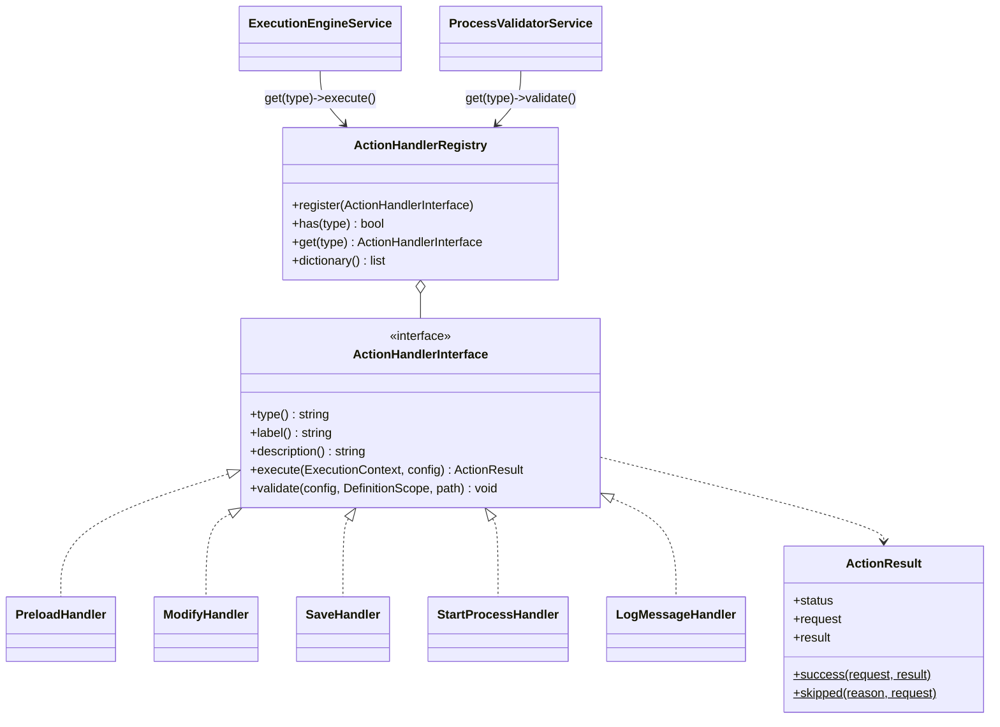

# New action type

How to add a new kind of step to process definitions, using a verified `log_message` action ("Write to log") as the example.

<!-- lang-switch -->
🇬🇧 English | [🇷🇺 Русский](../../../ru/07-developer-guide/extending/new-action-type.md)
<!-- /lang-switch -->

## 1. When you need it

Actions are the steps of a process: `preload`, `modify`, `save_object`, `start_process`. Add a new type when a process
must do something none of them can: call a custom API, send an e-mail or a webhook, write to a queue, log a business
message. If you only need a new way to *compute a value*, write a [change type](new-change-type.md) instead; for a new
way to *load an object*, a [load strategy](new-load-strategy.md).

## 2. How it works



- A step in `definition.actions[]` is a JSON object with `"type"`; all other keys are the handler's config.
- **Save time** — `ProcessValidatorService` walks the definition in execution order and calls `validate($config, $scope, $path)`.
  Report problems with `$scope->error("{$path}.field", 'message')`; they become `422 VALIDATION_ERROR` with
  `details[].field = "definition.actions[N].field"`. Check paths you read with `$scope->checkReadPath()` (the variable
  must already exist at this point), declare variables you create with `$scope->declare()` / `checkWritePath()`.
- **Run time** — `ExecutionEngineService::executeStep()` calls `execute($context, $config)`:
  - read and write process data through `ExecutionContext` (`get('object.phone')`, `set('v1.rating', 'VIP')`,
    `getVariable()`, `setVariable()`, `executionId`, `processId`, `stepIndex`);
  - return `ActionResult::success($request, $result)` or `ActionResult::skipped($reason)`. `$request` and `$result` are
    written to the audit (`execution_actions.request_data` / `result_data`) and shown in the UI;
  - throw `RecoverableException` for temporary failures — the engine restores the context snapshot and retries
    `ACTION_RETRY_MAX` times with exponential backoff; throw `NonRecoverableException`/`ConfigurationException` for
    permanent failures — the step and the execution become `failed`, the remaining steps `skipped`.
- `GET /api/dictionaries/action-types` returns `type`, `label`, `description` of every registered handler.
- Handlers are created in `Wps\Kernel\Container::actions()`, so they can receive any service (CRM adapter, logger,
  expression engine, repositories) through the constructor.

## 3. Step by step

### 3.1 The handler — `back/src/Actions/LogMessageHandler.php`

The action evaluates a `calculate`-style expression and writes the result to the service log and to the step audit:
`{ "type": "log_message", "message": "concat('Deal ', object.id, ' processed')", "level": "info" }`.

```php
<?php

declare(strict_types=1);

namespace Wps\Actions;

use Psr\Log\LoggerInterface;
use Wps\Context\ExecutionContext;
use Wps\Exceptions\ConfigurationException;
use Wps\Expression\ExpressionEngine;
use Wps\Services\Validation\DefinitionScope;

/**
 * Writes a message to the service log and to the step audit.
 * "message" is a calculate-style expression: "concat('Deal ', object.id, ' processed')".
 */
final class LogMessageHandler implements ActionHandlerInterface
{
    private const LEVELS = ['debug', 'info', 'notice', 'warning', 'error'];

    public function __construct(
        private readonly ExpressionEngine $expressions,
        private readonly LoggerInterface $logger,
    ) {
    }

    public function type(): string
    {
        return 'log_message';
    }

    public function label(): string
    {
        return 'Записать в журнал';
    }

    public function description(): string
    {
        return 'Вычисляет выражение и пишет результат в лог сервиса и в аудит шага';
    }

    public function execute(ExecutionContext $context, array $actionConfig): ActionResult
    {
        $expression = (string)($actionConfig['message'] ?? '');
        $level = (string)($actionConfig['level'] ?? 'info');
        if ($expression === '') {
            throw new ConfigurationException('log_message: message is required');
        }
        $message = ExpressionEngine::toString(
            $this->expressions->evaluate($expression, static fn (string $path) => $context->get($path)),
        );
        $this->logger->log($level, $message, [
            'execution_id' => $context->executionId,
            'process_id' => $context->processId,
            'step' => $context->stepIndex,
        ]);
        return ActionResult::success(['message' => $expression, 'level' => $level], ['logged' => $message]);
    }

    public function validate(array $actionConfig, DefinitionScope $scope, string $path): void
    {
        $message = $actionConfig['message'] ?? null;
        if (!is_string($message) || trim($message) === '') {
            $scope->error("{$path}.message", 'Message expression is required');
        } else {
            try {
                foreach ($this->expressions->paths($message) as $ref) {
                    $scope->checkReadPath($ref, "{$path}.message");
                }
            } catch (ConfigurationException $e) {
                $scope->error("{$path}.message", $e->getMessage());
            }
        }
        if (isset($actionConfig['level']) && !in_array($actionConfig['level'], self::LEVELS, true)) {
            $scope->error("{$path}.level", 'Level must be one of: ' . implode(', ', self::LEVELS));
        }
    }
}
```

### 3.2 Registration — `back/src/Kernel/Container.php`

```php
use Wps\Actions\LogMessageHandler;

public function actions(): ActionHandlerRegistry
{
    return $this->share(ActionHandlerRegistry::class, function () {
        $saver = new CrmObjectSaver($this->crm());
        $registry = new ActionHandlerRegistry();
        $registry->register(new PreloadHandler($this->crm(), $this->loadStrategies()));
        $registry->register(new ModifyHandler($this->changeTypes(), $saver));
        $registry->register(new SaveHandler($saver));
        $registry->register(new StartProcessHandler(
            $this->processes(),
            fn (): ExecutionEngineService => $this->engine(),
            $this->config()->maxChildDepth,
        ));
        $registry->register(new LogMessageHandler($this->expressions(), $this->logger()));
        return $registry;
    });
}
```

> **Warning**
> Do not call `$this->engine()` directly in a handler constructor: the engine itself depends on the action registry.
> Pass a closure, as `StartProcessHandler` does.

### 3.3 Rebuild and use

```bash
docker compose up -d --build backend
```

```json
{
  "name": "Deal log", "object_type": "Deals", "is_child": false,
  "definition": {
    "conditions": [], "preload": [],
    "actions": [ { "type": "log_message", "message": "concat('Deal ', object.id, ' ', object.status)" } ]
  }
}
```

Each executed step writes one log line. A line from the verification run (message `concat('ext ', object.id, ' ', acc.name)`):

```json
{"timestamp":"2026-10-15T08:06:27.619Z","level":"info","message":"ext e1 INN Company","context":{"execution_id":"38839d14-…","process_id":13,"step":3},"pid":14}
```

## 4. Validation and errors

| Situation | What to do | Result |
|---|---|---|
| Missing/invalid config | `$scope->error()` in `validate()` | `422`, `details[].field = definition.actions[N].<key>` |
| Reads a variable that does not exist yet | `$scope->checkReadPath($path, $field)` | `Variable "v9" is not defined at this point` |
| Creates a variable | `$scope->declare('name', 'created')` or `checkWritePath()` | later steps may use it |
| Puts a read-only list of records | `$scope->declare('name', ExecutionContext::SOURCE_LIST)`; at run time `setVariable($name, $value, $module, ExecutionContext::SOURCE_LIST)` | `modify` / `save_object` on it are rejected, `set()` throws `ConfigurationException` (as `FindRecordsHandler` does) |
| Needs a variable only while computing (the current record) | at validation — `$scope->declare($var, ExecutionContext::SOURCE_LOOP)` before checking the parameters and `$scope->undeclare($var)` after; at run time — `$context->withTemporaryVariable($var, $record, $module, fn () => …)` | the variable is removed also on an exception; `UpdateRecordsHandler` does this for `item` |
| External system temporarily down | `throw new RecoverableException('…')` | retried, status `retrying`, then `failed` |
| Permanent failure (4xx, bad data) | `throw new NonRecoverableException('…', ['response' => …])` | step `failed`, details in `result_data.details` |
| Nothing to do | `return ActionResult::skipped('reason')` | step `skipped`, execution continues |

The engine restores the context snapshot before a retry, so `execute()` may change the context before it fails.
External side effects are not rolled back — run them through the side-effect journal (see
[below](#external-calls-and-the-side-effect-journal)) or make them idempotent.

In child processes the scope is created with `inheritsVariables: true`, so `checkReadPath()` accepts unknown variables there.

### Fields that accept a secret

If an action needs credentials (a token, a password, a DSN), declare a field where the process author puts a reference
`secret://name` or `secret://name.field`, and resolve it in `execute()` with `SecretResolver`
(`Container::secretResolver()`, pass it to the handler constructor):

```php
$token = $this->secrets->resolve($actionConfig['auth']['token'], $context->secretMasker); // string|array
$hosts = $this->secrets->allowedHosts($actionConfig['auth']['token']);                      // [] = any host
$kind = $this->secrets->kind($actionConfig['auth']['token']);                               // 'bearer', 'basic_auth', …
```

- `resolve()` decrypts the value (cached in the worker memory, `SECRETS_CACHE_TTL`) and registers it and its derived forms
  in the step masker `$context->secretMasker`. The engine passes the step `request`, `result`, error text and `details`
  through this masker before writing the audit, so the value becomes `***` automatically. Do not put a secret value into
  process variables, and do not log it without the masker.
- No such secret or field — `NonRecoverableException` (`Secret "x" not found`, `Secret "x" has no field "y"`).
- When a process is saved, the validator itself checks that the secret exists and rejects references in data fields
  (`value`, `expression`, `field`, `target`, `template`, `subject`, `body`, `text`, `html`) and in conditions. So do not
  name a credential field like a data field. If the action expects particular kinds of secrets, check `kind()` in
  `execute()` and fail the step with a clear error.
- If the secret goes to an external system, check the request host against `allowedHosts()`.

### Text fields and templates

If an action field is text with substitutions (e-mail subject and body, URL, headers, request body), do not build it
yourself: use `TemplateEngine` (`Container::templates()`) and check it on save with `TemplateValidator`
(`Container::templateValidator()`). The action picks the `EscapeMode` by the purpose of the field:

```php
use Wps\Template\EscapeMode;
use Wps\Template\MissingPolicy;

// validate()
$this->templateValidator->validate($config['subject'] ?? null, $scope, "{$path}.subject", EscapeMode::Header);
$this->templateValidator->validate($config['html'] ?? null, $scope, "{$path}.html", EscapeMode::Html, allowRaw: false);
$this->templateValidator->validate($config['url'] ?? null, $scope, "{$path}.url", EscapeMode::Url);   // fixed host
$this->templateValidator->validate($config['body'] ?? null, $scope, "{$path}.body", EscapeMode::Json); // a document array

// execute()
$resolve = static fn (string $p) => $context->resolve($p);
$subject = $this->templates->render($config['subject'], $resolve, EscapeMode::Header)->value;
$to = $this->templates->render($config['to'], $resolve, EscapeMode::Text, MissingPolicy::Error)->value;
$body = $this->templates->renderStructure($config['body'], $resolve)->value; // numbers stay numbers
```

- `text` — as is; `header` — CR/LF removed (plus a warning in `RenderResult::$warnings`); `html` — `htmlspecialchars`,
  the `raw` filter is allowed only if you pass `allowRaw: true` for a trusted field; `url` — `rawurlencode` and no
  substitutions in the scheme, host and port; `json` — `renderStructure()`.
- Use `MissingPolicy::Error` for recipients and URLs: an empty address must not go out silently.
- Put `RenderResult::$missing` and `$warnings` into the step `result` so they show in the audit.

### External calls and the side-effect journal

A step runs at least once: after a worker crash it is repeated as a whole. If the action sends something to an external
system (an e-mail, a webhook, a notification), run the call through `SideEffectLedger` (`Container::sideEffects()`),
otherwise a repeat sends it a second time. The model is described in
[Reliability](../../04-operations/reliability.md#side-effects-and-repeats).

```php
use Wps\SideEffects\DeliveryPolicy;
use Wps\SideEffects\HasDeliveryPolicy;
use Wps\SideEffects\SideEffectLedger;
use Wps\SideEffects\UnknownOutcomeException;

final class PostToErpHandler implements ActionHandlerInterface, HasDeliveryPolicy
{
    public function __construct(private readonly SideEffectLedger $ledger /* , … */) {}

    public function defaultDelivery(array $config): string
    {
        // a repeated POST may create a duplicate → "at most once" by default
        return DeliveryPolicy::AT_MOST_ONCE;
    }

    public function execute(ExecutionContext $context, array $actionConfig): ActionResult
    {
        $delivery = DeliveryPolicy::resolve($actionConfig['delivery'] ?? null, $this->defaultDelivery($actionConfig));
        $request = ['url' => $url, 'body' => $body];                       // what goes out (no secrets)
        $out = $this->ledger->run($context, $this->type(), '', $delivery, $request,
            function (string $idempotencyKey) use ($url, $body): array {
                // pass the key on: Idempotency-Key header, Message-ID of an e-mail
                // error BEFORE sending (no connection, DNS)        → throw new RecoverableException(…)   — retried
                // timeout / broken connection AFTER sending (at_most_once) → throw UnknownOutcomeException::forEffect(…)
                // final error (4xx, SMTP rejection)                → throw new NonRecoverableException(…)
                return ['status' => 201, 'body' => $responseBody];          // a serializable result
            });
        return ActionResult::success($request, $out['response'] + [
            'idempotency_key' => $out['idempotency_key'],
            'replayed' => $out['replayed'],
        ]);
    }
}
```

- `run()` writes `started` before the call, `done` with the response after success (through the secret masker of the
  step), `failed` after a non-recoverable error; a recoverable error and `UnknownOutcomeException` keep `started`.
- A repeat after `done` does not call the closure and returns the stored response (`replayed: true`); a foreign
  `started` with `at_most_once` throws `UnknownOutcomeException` (`error_code: UNKNOWN_OUTCOME` in the step
  `result_data`).
- Several external calls in one step (an e-mail per recipient, two notification channels) are told apart by `$sub` — a
  stable id of the call (`'0'`, `'1'`, `'slack'`): the effect key becomes `{pc}@{iteration}#{sub}`.
- The external key `$idempotencyKey` is `{execution_id}:{effect_key}`; for the `Message-ID` of e-mails use the domain
  `AppConfig::$mailMessageIdDomain` (`WPS_MAIL_MESSAGE_ID_DOMAIN`).
- In a dry run (`$context->dryRun`) the closure is not called, the journal is not touched, `response = ['dry_run' => true]`.
- The `delivery` field is allowed only on actions that implement `HasDeliveryPolicy`: the validator checks the value
  (`Delivery must be "at_most_once" or "at_least_once"`) and rejects it on other actions
  (`Action "modify" does not support "delivery"`).

### A waiting action (parking)

An action that has to wait long (an external answer, a due time) must not sleep in the coroutine: return
`ActionResult::wait()` and the engine parks the execution — the state snapshot goes to `execution_waits`, the worker is
released, and `WaitResumeJob` resumes the execution after the due time, even after a restart
([Execution engine → Waiting](../../05-architecture/execution-engine.md#waiting-and-waking-up-waitresumejob)).
While waiting, the step has the `waiting` status.

```php
use Wps\Actions\ResumableActionInterface;

final class WaitForApprovalHandler implements ActionHandlerInterface, ResumableActionInterface
{
    public function execute(ExecutionContext $context, array $actionConfig): ActionResult
    {
        $dueAt = $this->clock->now()->modify('+1 day');
        // ActionResult::wait($dueAt, $reason, $request, $result, $info)
        return ActionResult::wait($dueAt, 'approval', ['ticket' => $id], [], ['ticket' => $id]);
    }

    public function resume(ExecutionContext $context, array $actionConfig, array $waitInfo): ActionResult
    {
        // $waitInfo — $info from wait() + due_at, parked_at
        return ActionResult::success(['ticket' => $waitInfo['ticket']], ['approved' => $this->check($waitInfo['ticket'])]);
    }
}
```

- `$reason` goes to `executions.wait_reason` and `wait.reason` of the API; `$info` — to `execution_waits.info` and to
  `resume()`. Keep it small and serializable.
- Without `ResumableActionInterface` the step simply becomes `success` after the wake-up with `request`/`result` from `wait()`.
- `resume()` may return `success`, `skipped` or throw — the usual `on_error` and retries apply.
- Short pauses (up to `WAIT_INLINE_MAX_SECONDS`) are cheaper in the coroutine (`Coroutine::sleep`), as `DelayHandler` does.
- `WAITING` is allowed only where an execution exists: in `prepare()`, during condition evaluation and in a test run
  without `handle` the step fails with `This step cannot wait here (condition evaluation or a test run)`.
- A snapshot larger than `WAIT_STATE_MAX_BYTES` is not parked: `Execution state is too large to wait (N bytes, limit M)`.

## 5. UI and translations

The process editor has panels only for the built-in types. Any other action type is handled as **passthrough**
(`front/src/stores/processes.ts → formFromProcess()`): it is shown in the "Modify object / variable" block as a read-only
row with its JSON (`ModifyPanel.vue`, tooltip `modify.passthroughHint`) and saved unchanged. So a new action can be
created through the API (`POST`/`PUT /api/processes`) or by importing JSON, and editors can still edit the rest of the
process in the UI.

For a readable caption in the process card add the type to `actionTypeLabel()` in
`front/src/views/ProcessDetailView.vue` and translate it in both locales:

```ts
// front/src/views/ProcessDetailView.vue
function actionTypeLabel(type: string): string {
  const keys: Record<string, string> = {
    modify: 'processDetail.actionType.modify',
    save_object: 'processDetail.actionType.saveObject',
    start_process: 'processDetail.actionType.startProcess',
    preload: 'processDetail.actionType.preload',
    log_message: 'processDetail.actionType.logMessage',
  }
  return keys[type] ? t(keys[type]) : type
}
```

```json
// front/src/locales/en.json → processDetail.actionType
"logMessage": "Write to log"
// front/src/locales/ru.json → processDetail.actionType
"logMessage": "Запись в журнал"
```

To make the action editable, add a row type to `ModifyRow` (`front/src/types/index.ts`), a branch in
`formFromProcess()`/`definitionFromForm()` and an editor branch in `ModifyPanel.vue` (or a new panel in
`ProcessEditView.vue`), with all texts in `locales/*.json`.

## 6. Test

This is the verified `testExtensions()` group used for all extension examples in this section (comparator
`starts_with`, change type `append`, load strategy `by_id_or_field`, function `repeat`, action `log_message`,
endpoint `/api/dictionaries/function-categories`). Call it from `run()` after `testRunOnce()`.

```php
private function testExtensions(): void
{
    echo "[extensions]\n";
    $this->test('Function categories dictionary lists date', function () {
        $res = $this->request('GET', '/api/dictionaries/function-categories', token: $this->viewerToken, expectedStatus: 200);
        $this->assertTrue(in_array('date', array_column($res['data'], 'value'), true));
    });
    $this->test('Change types and action types contain the new entries', function () {
        $changeTypes = $this->request('GET', '/api/dictionaries/change-types', token: $this->adminToken)['data'];
        $this->assertTrue(in_array('append', array_column($changeTypes, 'value'), true));
        $actionTypes = $this->request('GET', '/api/dictionaries/action-types', token: $this->adminToken)['data'];
        $this->assertTrue(in_array('log_message', array_column($actionTypes, 'value'), true));
    });
    $this->test('log_message without a message is rejected', function () {
        $res = $this->request('POST', '/api/processes', [
            'name' => 'TEST ext invalid', 'object_type' => 'TestExt', 'is_child' => false,
            'definition' => ['actions' => [['type' => 'log_message', 'level' => 'loud']]],
        ], $this->adminToken, 422);
        $fields = array_column($res['error']['details'], 'field');
        $this->assertTrue(in_array('definition.actions[0].message', $fields, true));
        $this->assertTrue(in_array('definition.actions[0].level', $fields, true));
    });

    $inn = (string)random_int(1000000000, 9999999999);
    $this->test('Seed an account with an INN in the mock CRM', function () use ($inn) {
        $raw = $this->raw('PUT', "/mock/objects/Accounts/{$this->accountId}-inn", ['name' => 'INN Company', 'inn' => $inn], base: $this->crmUrl);
        $this->assertEquals(200, $raw['status']);
    });
    $this->test('Create a process that uses all extensions', function () use ($inn) {
        $res = $this->request('POST', '/api/processes', [
            'name' => 'TEST ext all', 'object_type' => 'TestExt', 'is_child' => false,
            'definition' => [
                'conditions' => [['field' => 'object.phone', 'operator' => 'starts_with', 'value_type' => 'static', 'value' => '+7']],
                'preload' => [['var' => 'acc', 'source' => 'manual', 'module' => 'Accounts', 'strategy' => 'by_id_or_field', 'by_field' => 'inn', 'value' => $inn]],
                'actions' => [
                    ['type' => 'modify', 'target' => 'object.note', 'change_type' => 'append', 'value' => 'checked', 'separator' => ' | '],
                    ['type' => 'modify', 'target' => 'object.label', 'change_type' => 'calculate', 'value' => 'coalesce(object.nickname, object.name)'],
                    ['type' => 'log_message', 'message' => "concat('ext ', object.id, ' ', acc.name)"],
                ],
            ],
        ], $this->adminToken, 201);
        $this->createdProcesses['ext'] = $res['data']['id'];
    });
    $this->test('starts_with: a non-matching phone does not start the process', function () {
        $id = $this->createdProcesses['ext'] ?? $this->skip('ext process not created');
        $res = $this->request('POST', "/api/processes/{$id}/run", ['object' => ['id' => 'e0', 'phone' => '+1555']], $this->adminToken, 200);
        $this->assertFalse($res['data']['conditions_met']);
    });
    $this->test('All extensions work in one execution', function () {
        $id = $this->createdProcesses['ext'] ?? $this->skip('ext process not created');
        $res = $this->request('POST', "/api/processes/{$id}/run", ['object' => [
            'id' => 'e1', 'phone' => '+79990000000', 'note' => 'start', 'nickname' => '', 'name' => 'Bob',
        ]], $this->adminToken, 201);
        $execution = $this->waitForExecution($res['data']['execution_id']);
        $this->assertEquals('completed', $execution['status'], (string)($execution['error_message'] ?? ''));
        $object = $execution['context']['variables']['object'];
        $this->assertEquals('start | checked', $object['note']);
        $this->assertEquals('Bob', $object['label']);
        $this->assertEquals('INN Company', $execution['context']['variables']['acc']['name']);
        $last = $execution['actions'][count($execution['actions']) - 1];
        $this->assertEquals('log_message', $last['action_type']);
        $this->assertEquals('ext e1 INN Company', $last['result_data']['logged']);
    });
}
```

Verified result (separate stack `wpsext`, mock CRM):

```
[extensions]
  Function categories dictionary lists date ... OK
  Change types and action types contain the new entries ... OK
  log_message without a message is rejected ... OK
  Seed an account with an INN in the mock CRM ... OK
  Create a process that uses all extensions ... OK
  starts_with: a non-matching phone does not start the process ... OK
  All extensions work in one execution ... OK

Passed: 74, Failed: 0, Skipped: 0
```

## 7. Checklist

- [ ] `final` handler in `back/src/Actions/`, unique `snake_case` `type()`, `label()` and `description()`
- [ ] `validate()` reports every static problem with a field path; read paths checked, created variables declared
- [ ] `execute()` returns `ActionResult` with useful `request`/`result` for the audit; correct exception class for failures
- [ ] Registered in `Container::actions()`
- [ ] Caption in `actionTypeLabel()` + `processDetail.actionType.*` in both locales (or a full editor)
- [ ] Integration check added, suite green, `npm run build` passes
- [ ] Action described in [Actions](../../03-user-guide/actions.md) (en + ru) and `back/API.md`

<!-- footer-nav -->
---

← Previous: [Testing](../testing.md) | [Contents](../../README.md) | [New block type](new-block-type.md) Next →
<!-- /footer-nav -->
