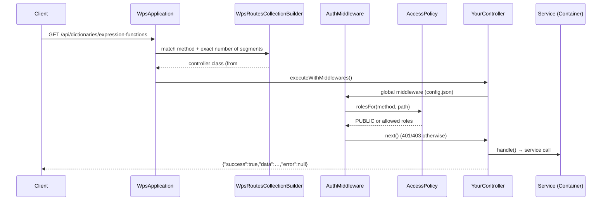

# New API endpoint

How to add a REST endpoint, using a verified `GET /api/dictionaries/expression-functions` as the example.

<!-- lang-switch -->
🇬🇧 English | [🇷🇺 Русский](../../../ru/07-developer-guide/extending/new-api-endpoint.md)
<!-- /lang-switch -->

## 1. When you need it

When the UI or an external system needs data or an operation that the API does not expose yet: a new dictionary,
a report, an admin operation. Endpoints are thin — business logic belongs to a service in `back/src/Services/`.

## 2. How it works



- **Discovery.** SwooleApp scans the namespace `Wps\Controllers` from `back/config/config.json` (sub-namespaces included)
  and registers every class with a `#[Route(uri: …, method: …)]` attribute. No list to edit.
- **Matching.** `WpsRoutesCollectionBuilder` requires the same number of URI segments as the pattern; `{id}` matches one
  non-empty segment and is available as `$this->intParam('id')` / `$this->param('id')`. A trailing slash is tolerated.
- **Access.** `Wps\Middleware\AuthMiddleware` (global) checks the JWT and asks `Wps\Auth\AccessPolicy::rolesFor()`.
  Rules are regexes checked in order; anything not listed: `GET /api/*` → all authenticated roles, other methods →
  `admin` and `editor`.
- **Response.** `BaseController::execute()` wraps `handle()`: `ApiException` → error envelope with its status/code;
  any other exception → `500 INTERNAL_ERROR` (with the message only when `APP_DEBUG=true`).

## 3. Step by step

### 3.1 The controller — `back/src/Controllers/Dictionaries/ExpressionFunctionsController.php`

```php
<?php

declare(strict_types=1);

namespace Wps\Controllers\Dictionaries;

use Sidalex\SwooleApp\Classes\Controllers\Route;
use Swoole\Http\Response;
use Wps\Controllers\BaseController;

/**
 * Names of the functions available in "calculate" expressions (for the UI help).
 */
#[Route(uri: '/api/dictionaries/expression-functions', method: 'GET')]
final class ExpressionFunctionsController extends BaseController
{
    protected function handle(): Response
    {
        $names = $this->container()->expressions()->functionNames();
        sort($names);
        return $this->ok(array_map(static fn (string $name) => ['value' => $name, 'label' => $name], $names));
    }
}
```

### 3.2 Rebuild and call

```bash
docker compose up -d --build backend
TOKEN=$(curl -s -X POST http://localhost:9501/api/auth/login -H 'Content-Type: application/json' \
  -d '{"email":"admin@wps.local","password":"admin"}' | python3 -c 'import sys,json;print(json.load(sys.stdin)["data"]["access_token"])')
curl -s http://localhost:9501/api/dictionaries/expression-functions -H "Authorization: Bearer $TOKEN"
```

Verified response (with the `coalesce` function from [Expression functions](expression-functions.md)):

```json
{"success":true,"data":[{"value":"abs","label":"abs"},{"value":"coalesce","label":"coalesce"},{"value":"concat","label":"concat"},{"value":"len","label":"len"},{"value":"lower","label":"lower"},{"value":"max","label":"max"},{"value":"min","label":"min"},{"value":"round","label":"round"},{"value":"substr","label":"substr"},{"value":"trim","label":"trim"},{"value":"upper","label":"upper"}],"error":null}
```

### 3.3 Toolbox of `BaseController`

| Method | Purpose |
|---|---|
| `$this->body()` | JSON body as an array (`400 BAD_REQUEST` if it is not an object) |
| `$this->query('key', default)`, `queryBool('key')` | query string |
| `[$page, $perPage] = $this->pagination(20, 1000)` + `$this->meta($page, $perPage, $total)` | paging; pass meta as the 3rd argument of `ok()` |
| `$this->intParam('id')`, `$this->param('name')` | URI parameters (`404 NOT_FOUND` for a non-numeric id) |
| `$this->user()` | `{id, email, role}` of the caller |
| `$this->ok($data, 201)` | success envelope with a status |
| `$this->container()` | services (`processService()`, `executions()`, `crm()`, `metrics()`, …) |

A write endpoint, for example:

```php
#[Route(uri: '/api/processes/{id}/archive', method: 'POST')]
final class ArchiveProcessController extends BaseController
{
    protected function handle(): Response
    {
        $process = $this->container()->processService()->get($this->intParam('id')); // 404 PROCESS_NOT_FOUND
        // … call a service method that does the work …
        return $this->ok(['archived' => true, 'id' => $process->id]);
    }
}
```

(`archive` is an illustration — there is no such service method in WPS.)

## 4. Validation and errors

- Throw `ApiException::validation([['field' => 'name', 'message' => '…']])` → `422 VALIDATION_ERROR`,
  `ApiException::notFound('XXX_NOT_FOUND', '…')`, `ApiException::conflict('XXX', '…', $details)`,
  `ApiException::badRequest('…')`, `ApiException::forbidden()`.
- Add a rule to `AccessPolicy::RULES` when the default (GET: everyone, writes: editors) is not right. Put specific rules
  **before** general ones — the first match wins:

```php
['POST', '#^/api/processes/[^/]+/archive$#', self::ADMIN],
```

- Public endpoints (no token) must be listed with `self::PUBLIC`, as `/api/health` and `/metrics` are.
- Document the endpoint (method, URI, role, body, response, error codes) in `back/API.md` and in
  [API endpoints](../../06-api-reference/endpoints.md) (en + ru).

## 5. UI and translations

Add a function to the matching module in `front/src/api/` (or a new module) and types to `front/src/types/index.ts`:

```ts
// front/src/api/reference.ts
import { apiGet } from './client'
import type { DictionaryItem } from '@/types'

export const referenceApi = {
  /** Functions available in "calculate" expressions */
  expressionFunctions(): Promise<DictionaryItem[]> {
    return apiGet<DictionaryItem[]>('/dictionaries/expression-functions')
  },
}
```

`apiGet` prefixes `/api`, sends the token, unwraps `data` and shows translated error messages for known error codes
(`front/src/utils/errors.ts`). Add a text for a new error code there and in both locales (`errors.*`). A page that uses
the endpoint is the example in [New UI screen](new-ui-screen.md).

## 6. Test

```php
$this->test('Expression functions dictionary lists coalesce', function () {
    $res = $this->request('GET', '/api/dictionaries/expression-functions', token: $this->viewerToken, expectedStatus: 200);
    $this->assertTrue(in_array('coalesce', array_column($res['data'], 'value'), true));
});
$this->test('Expression functions dictionary requires a token', function () {
    $this->request('GET', '/api/dictionaries/expression-functions', expectedStatus: 401);
});
```

The first check is part of the verified `testExtensions()` group ([full text](new-action-type.md#6-test)). For write
endpoints also check `viewer` → `403`.

## 7. Checklist

- [ ] `final` controller under `back/src/Controllers/<Area>/`, `#[Route]`, extends `BaseController`, logic in a service
- [ ] Access rule in `AccessPolicy` if the default is wrong
- [ ] Errors via `ApiException` with documented codes
- [ ] `back/API.md` + [API endpoints](../../06-api-reference/endpoints.md) (en + ru) updated
- [ ] Frontend API function + types (+ `errors.*` texts for new codes)
- [ ] Integration checks (success, 401, 403), suite green

<!-- footer-nav -->
---

← Previous: [Expression functions](expression-functions.md) | [Contents](../../README.md) | [New CRM adapter](new-crm-adapter.md) Next →
<!-- /footer-nav -->
