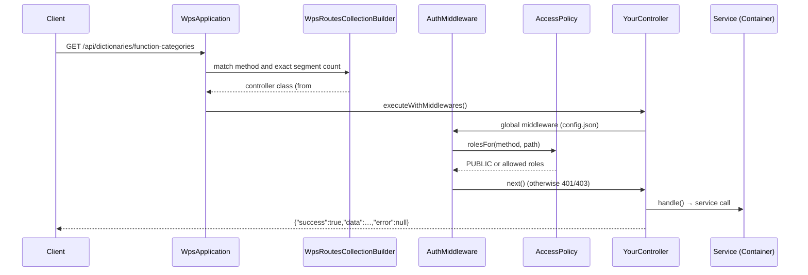

# New API endpoint

How to add a REST endpoint, using a tutorial `GET /api/dictionaries/function-categories` as the example.

<!-- lang-switch -->
🇬🇧 English | [🇷🇺 Русский](../../../ru/07-developer-guide/extending/new-api-endpoint.md)
<!-- /lang-switch -->

> `function-categories` is a tutorial endpoint that WPS does not have. The real dictionary of expression functions is
> [`GET /api/dictionaries/functions`](../../06-api-reference/endpoints.md#get-apidictionariesfunctions)
> (`FunctionsController`); the example is built on the same data.

## 1. When you need it

When the UI or an external system needs data or an operation the API does not offer yet: a new dictionary, a report,
an administrative operation. Endpoints are thin — parse the request, check the input and respond; the business logic
lives in a service in `back/src/Services/` (it can be unit-tested and reused).

Ready-made samples in the code:

| What you need | Sample |
|---|---|
| A dictionary from a registry | `Controllers/Dictionaries/ActionTypesController.php`, `OperatorsController.php`, `NotifyChannelsController.php` |
| A dictionary with extra data in `meta` | `Controllers/Dictionaries/FunctionsController.php` (`ok($functions, 200, ['operators' => …])`) |
| A static dictionary with labels | `Controllers/Dictionaries/SystemVariablesController.php` |
| A list with filters and pages | `Controllers/Processes/ListProcessesController.php` |
| An operation on a resource by `{id}` | `Controllers/Processes/CloneProcessController.php` (`201`), `RunProcessController.php` |
| A non-standard response status | `Controllers/Health/HealthController.php` (`503` when degraded) |
| Checking a body with an action validator | `Controllers/Notify/NotifyTestController.php` |

## 2. How it works



- **Discovery.** SwooleApp scans the namespace from `controllers` in `back/config/config.json`
  (`"Wps\\Controllers"`, nested ones included) and registers every class with a
  `#[Route(uri: …, method: …)]` attribute (`Sidalex\SwooleApp\Classes\Controllers\Route`). One class — one method and
  one URI; there is no list to edit, just add the file and rebuild the image.
- **Matching.** `Wps\Kernel\WpsRoutesCollectionBuilder` compares the method case-insensitively and requires the same
  number of URI segments as the pattern; `{id}` matches one **non-empty** segment and is available as
  `$this->intParam('id')` / `$this->param('id')`. A trailing slash is tolerated (`/api/processes/` = `/api/processes`).
  The query string does not take part in matching.
- **Access.** The global middleware `Wps\Middleware\AuthMiddleware` (`globalMiddlewares` in `config.json`) asks
  `Wps\Auth\AccessPolicy::rolesFor($method, $path)` (path without the trailing slash). `PUBLIC` passes without a token;
  otherwise it requires an `Authorization: Bearer <access JWT>` header (`401 UNAUTHORIZED`), checks the role from the
  token (`403 FORBIDDEN`) and puts the user into `Wps\Http\AuthContext` — that is what `$this->user()` returns.
- **Response.** `BaseController::execute()` is `final` and wraps `handle()`: `ApiException` → error envelope with its
  status, code and `details`; any other exception → a log entry and `500 INTERNAL_ERROR` (the message text only with
  `APP_DEBUG=true`). The envelope is built by `Wps\Http\JsonResponder`:

  ```json
  {"success": true,  "data": …,   "error": null, "meta": {…}}
  {"success": false, "data": null, "error": {"code": "VALIDATION_ERROR", "message": "Validation failed", "details": […]}}
  ```

  `meta` is present only when it is passed as the third argument of `ok()`; `details` — only when the exception has them.
- **Lifecycle.** A controller object is created per request (`request`, `response`, `uri_params` in the constructor),
  so controller fields may be used within the request. Services from `Container` are shared by all coroutines of the
  worker: their fields must not hold data of a particular request.

## 3. Step by step

| File | Change |
|---|---|
| `back/src/Services/FunctionCatalogService.php` | **new** — the endpoint logic |
| `back/src/Kernel/Container.php` | the service factory method |
| `back/src/Controllers/Dictionaries/FunctionCategoriesController.php` | **new** — the controller |
| `back/src/Auth/AccessPolicy.php` | an access rule, if the default does not fit |
| `back/tests/Unit/Services/FunctionCatalogServiceTest.php` | **new** — service unit test |
| `back/tests/IntegrationTest.php` | HTTP checks: success, `401`, `403` |
| `back/API.md`, `doc/{ru,en}/06-api-reference/endpoints.md` | endpoint description |
| `front/src/api/*.ts`, `front/src/types/index.ts` | client function and types (if the UI needs the endpoint) |

### 3.1 The service — `back/src/Services/FunctionCatalogService.php`

```php
<?php

declare(strict_types=1);

namespace Wps\Services;

use Wps\Expression\ExpressionEngine;

/**
 * Categories of the expression functions with the number of functions in each (UI help, reference).
 */
final class FunctionCatalogService
{
    public function __construct(private readonly ExpressionEngine $expressions)
    {
    }

    /**
     * @return list<array{value: string, label: string, count: int}>
     */
    public function categories(): array
    {
        $counts = [];
        foreach ($this->expressions->functionSpecs() as $spec) {
            $counts[$spec->category] = ($counts[$spec->category] ?? 0) + 1;
        }
        ksort($counts);
        $items = [];
        foreach ($counts as $category => $count) {
            $items[] = ['value' => $category, 'label' => $category, 'count' => $count];
        }
        return $items;
    }
}
```

The service keeps no state between calls — it is safe to share between coroutines.

### 3.2 Registering the service — `back/src/Kernel/Container.php`

```php
use Wps\Services\FunctionCatalogService;

public function functionCatalog(): FunctionCatalogService
{
    return $this->share(FunctionCatalogService::class, fn () => new FunctionCatalogService($this->expressions()));
}
```

`share($id, $factory)` creates the object on first use and then returns the same instance within the worker (each
worker has its own container — `Container::get()` rebuilds it after `fork`). Take dependencies from other container
methods (`expressions()`, `processes()`, `crm()`, `config()`, `metrics()`, `logger()` …) instead of creating them
again — otherwise you get extra connection pools.

> A very simple endpoint (a dictionary from one registry) does not need a service: `ActionTypesController` calls
> `$this->container()->actions()->dictionary()` directly.

### 3.3 The controller — `back/src/Controllers/Dictionaries/FunctionCategoriesController.php`

```php
<?php

declare(strict_types=1);

namespace Wps\Controllers\Dictionaries;

use Sidalex\SwooleApp\Classes\Controllers\Route;
use Swoole\Http\Response;
use Wps\Controllers\BaseController;

/**
 * Categories of the expression functions (GET /api/dictionaries/function-categories).
 */
#[Route(uri: '/api/dictionaries/function-categories', method: 'GET')]
final class FunctionCategoriesController extends BaseController
{
    protected function handle(): Response
    {
        return $this->ok($this->container()->functionCatalog()->categories());
    }
}
```

No access rule is needed: `GET /api/*` is open to every authenticated role (`admin`, `editor`, `viewer`) by default.

### 3.4 Rebuild and call

```bash
docker compose up -d --build backend
TOKEN=$(curl -s -X POST http://localhost:9501/api/auth/login -H 'Content-Type: application/json' \
  -d '{"email":"admin@wps.local","password":"admin"}' | python3 -c 'import sys,json;print(json.load(sys.stdin)["data"]["access_token"])')
curl -s http://localhost:9501/api/dictionaries/function-categories -H "Authorization: Bearer $TOKEN"
```

Response with the built-in function set (numbers as of writing; a function from [Expression functions](expression-functions.md),
e.g. `mask`, increases the counter of its category):

```json
{"success":true,"data":[{"value":"date","label":"date","count":32},{"value":"list","label":"list","count":18},{"value":"logic","label":"logic","count":5},{"value":"number","label":"number","count":14},{"value":"string","label":"string","count":35},{"value":"type","label":"type","count":17}],"error":null}
```

Without a token — `401 {"success":false,"data":null,"error":{"code":"UNAUTHORIZED","message":"Authentication required"}}`.

### 3.5 Toolbox of `BaseController`

| Method | What it does | Errors |
|---|---|---|
| `handle(): Response` | your code; the only abstract method | — |
| `ok(mixed $data, int $status = 200, ?array $meta = null)` | success envelope; `meta` is the third argument | — |
| `body(): array` | JSON body as an array; an empty body → `[]` | `400 BAD_REQUEST` — the body is not a JSON object (broken JSON included) |
| `query(string $key, ?string $default = null): ?string` | a query string parameter; an empty string and an array (`?a[]=1`) → `$default` | — |
| `queryBool(string $key): ?bool` | `true`/`1` → `true`, `false`/`0` → `false`, otherwise `null` | — |
| `pagination(int $defaultPerPage = 20, int $maxPerPage = 1000): array` | `[$page, $perPage]` from `page`, `per_page` (clamped) | — |
| `meta(int $page, int $perPage, int $total): array` | `{page, per_page, total}` for `ok(..., 200, $meta)` | — |
| `intParam(string $name): int` | numeric URI parameter (`{id}`) | `404 NOT_FOUND` `Invalid id` — not digits or longer than 18 characters |
| `param(string $name): string` | string URI parameter (`''` when absent) | — |
| `user(): array` | `{id, email, role}` of the caller | `401 UNAUTHORIZED` on a public route |
| `container(): Container` | services (`processService()`, `executions()`, `crm()`, `metrics()`, …) | — |

A paginated list (like `ListProcessesController`):

```php
[$page, $perPage] = $this->pagination();
[$items, $total] = $this->container()->processes()->paginate(['search' => $this->query('search')], $page, $perPage);
return $this->ok(array_map(static fn (Process $p) => $p->toArray(), $items), 200, $this->meta($page, $perPage, $total));
```

### 3.6 A write endpoint

```php
<?php

declare(strict_types=1);

namespace Wps\Controllers\Processes;

use Sidalex\SwooleApp\Classes\Controllers\Route;
use Swoole\Http\Response;
use Wps\Controllers\BaseController;
use Wps\Http\ApiException;

/**
 * Archives a process with a reason (illustration: ProcessService has no archive() method).
 */
#[Route(uri: '/api/processes/{id}/archive', method: 'POST')]
final class ArchiveProcessController extends BaseController
{
    protected function handle(): Response
    {
        $id = $this->intParam('id');                        // 404 NOT_FOUND "Invalid id" for "abc"
        $body = $this->body();                              // 400 BAD_REQUEST when the body is not a JSON object
        $reason = $body['reason'] ?? null;
        if (!is_string($reason) || trim($reason) === '' || mb_strlen($reason) > 255) {
            throw ApiException::validation([['field' => 'reason', 'message' => 'Reason is required (up to 255 characters)']]);
        }
        $process = $this->container()->processService()->get($id); // 404 PROCESS_NOT_FOUND
        if (!$process->isActive) {
            throw ApiException::conflict('PROCESS_ALREADY_ARCHIVED', "Process {$id} is already inactive");
        }
        $user = $this->user();                              // {id, email, role} from the JWT
        // $this->container()->processService()->archive($id, $reason, $user['id']);
        return $this->ok(['id' => $id, 'archived' => true, 'by' => $user['email']]);
    }
}
```

`archive` is only an illustration; WPS has no such service method. For a `POST` that creates a resource return `201`
(`$this->ok($data, 201)`, like `CloneProcessController`). Without a dedicated rule, `POST` to this path is allowed for
`admin` and `editor`; if the operation is admin-only, add a rule ([4.2](#42-access-rules-accesspolicy)).

## 4. Validation and errors

### 4.1 `ApiException`

`Wps\Http\ApiException(int $status, string $errorCode, string $message, mixed $details = null)` and its factories:

| Factory | Status | `error.code` | When |
|---|---|---|---|
| `badRequest(string $message, mixed $details = null)` | `400` | `BAD_REQUEST` | the request cannot be parsed |
| `unauthorized(string $message = 'Authentication required', string $code = 'UNAUTHORIZED')` | `401` | `UNAUTHORIZED` or your own | missing / invalid authentication |
| `forbidden(string $message = 'Insufficient permissions')` | `403` | `FORBIDDEN` | the role does not allow it |
| `notFound(string $code, string $message)` | `404` | your code (`PROCESS_NOT_FOUND`, `EXECUTION_NOT_FOUND`) | no such resource |
| `conflict(string $code, string $message, mixed $details = null)` | `409` | your code (`PROCESS_IN_USE`, `CYCLE_DETECTED`) | the state does not allow the operation |
| `validation(array $errors, string $message = 'Validation failed')` | `422` | `VALIDATION_ERROR` | field errors: `details = [{field, message}, …]` |

- Messages and codes are in English (`UPPER_SNAKE_CASE` for the code), like the rest of the API; the frontend
  translates them ([5](#5-ui-and-translations)).
- Collect **all** field errors into one `validation([...])` instead of throwing on the first one: the UI shows them as a list.
- Do not write your own parser to check a process definition — use `ProcessValidatorService` / `DefinitionScope`
  (example — `NotifyTestController`: it validates a step through the handler's `validate()` and returns `422` with
  rewritten field paths).
- Do not throw `ApiException` from services the execution engine calls (they need `RecoverableException` /
  `NonRecoverableException`); in services that only serve the API (`ProcessService`) you may.
- An uncaught exception becomes `500 INTERNAL_ERROR`, and its text goes to the log (`Request failed`); into the
  response — only with `APP_DEBUG=true`. Do not rely on this for expected errors.

### 4.2 Access rules (`AccessPolicy`)

`Wps\Auth\AccessPolicy::RULES` is a list of `[method, path regex, roles]`, checked in order; **the first match wins**.
The current rules:

```php
private const RULES = [
    ['*', '#^/api/health$#', self::PUBLIC],
    ['*', '#^/metrics$#', self::PUBLIC],
    ['POST', '#^/api/auth/(login|refresh)$#', self::PUBLIC],
    ['*', '#^/api/users(/.*)?$#', self::ADMIN],
    ['GET', '#^/api/secrets(/[^/]+)?$#', self::EDITORS],
    ['*', '#^/api/secrets(/.*)?$#', self::ADMIN],
    ['*', '#^/api/mail(/.*)?$#', self::ADMIN],
    ['GET', '#^/api/dictionaries/mail-transports$#', self::EDITORS],
    ['DELETE', '#^/api/processes/[^/]+/runs/[^/]+/[^/]+$#', self::EDITORS],
    ['DELETE', '#^/api/processes/[^/]+$#', self::ADMIN],
    ['POST', '#^/api/processes$#', self::EDITORS],
    ['PUT', '#^/api/processes/[^/]+$#', self::EDITORS],
    ['POST', '#^/api/processes/[^/]+/(clone|run)$#', self::EDITORS],
    ['POST', '#^/api/dictionaries/modules/refresh$#', self::EDITORS],
    ['GET', '#^/api/.*$#', self::ALL],
];
```

When no rule matches: `GET` → all roles (`ALL`), other methods → `EDITORS` (`admin`, `editor`).

- Put a specific rule **before** a general one (`['GET', '#^/api/.*$#', self::ALL]` catches any GET):

  ```php
  ['POST', '#^/api/processes/[^/]+/archive$#', self::ADMIN],
  ```

- An endpoint that returns sensitive data (secret names, addresses, tokens) must be closed with a rule **for GET**:
  by default `viewer` sees it (this is how `/api/secrets` and `/api/dictionaries/mail-transports` are closed).
- Public endpoints (no token) are listed with `self::PUBLIC`, like `/api/health` and `/metrics`; there `user()` throws `401`.
- `AccessPolicy` checks only the route. Record-level checks (e.g. "the last administrator cannot be deleted") belong
  in the service.

### 4.3 Documentation

Describe the endpoint (method, URI, role, parameters, body, response, error codes) in `back/API.md` and in
[API endpoints](../../06-api-reference/endpoints.md) (en + ru); a new access rule — in
[Security](../../04-operations/security.md).

## 5. UI and translations

Add a function to a suitable module in `front/src/api/` (or a new one) and the types to `front/src/types/index.ts`:

```ts
// front/src/types/index.ts
export interface FunctionCategory extends DictionaryItem {
  count: number
}
```

```ts
// front/src/api/reference.ts (new module)
import { apiGet } from './client'
import type { FunctionCategory } from '@/types'

export const referenceApi = {
  /** Categories of the expression functions */
  functionCategories(): Promise<FunctionCategory[]> {
    return apiGet<FunctionCategory[]>('/dictionaries/function-categories')
  },
}
```

- `apiGet<T>(url, params?, config?)`, `apiGetPage<T>` (returns `{items, meta}` for responses with `meta`), `apiPost`,
  `apiPostWithStatus`, `apiPut`, `apiDelete` from `api/client.ts` add the `/api` prefix, the token and
  `Accept-Language`, refresh the token on `401`, unwrap `data` and show a message on error (`ElMessage`).
  `{ silent: true }` in `config` turns the message off — when the page shows the error itself.
- A **dictionary** used by the editors is easier to add to `front/src/api/dictionaries.ts`: `cached(url)` caches the
  response for the session, `withFallback(url, FALLBACK.xxx)` substitutes defaults when the endpoint is unavailable:

  ```ts
  export const dictionariesApi = {
    // …
    functionCategories: () => withFallback('/dictionaries/function-categories', []),
  }
  ```

  Dictionary labels are translated on the client: `localizeDict(kind, items)` (`utils/format.ts`) uses the key
  `dict.<kind>.<value>` when it exists and the server `label` otherwise. Add a new dictionary kind to the `DictKind`
  type and the `dict.<kind>.*` keys to both locales.
- **Error codes.** `apiErrorTitle()` (`utils/errors.ts`) shows the translation `errors.<CODE>` when the key exists and
  the server message otherwise; `details` are shown as `field: message` lines. For a new code
  (`PROCESS_ALREADY_ARCHIVED`) add `errors.PROCESS_ALREADY_ARCHIVED` to `ru.json` and `en.json`.

A page that uses the endpoint is walked through in [New UI screen](new-ui-screen.md).

## 6. Test

### 6.1 Service unit test — `back/tests/Unit/Services/FunctionCatalogServiceTest.php`

Controllers are not unit-tested (they need a Swoole request); the logic is checked at the service level:

```php
<?php

declare(strict_types=1);

namespace Wps\Tests\Unit\Services;

use PHPUnit\Framework\TestCase;
use Wps\Expression\ExpressionEngine;
use Wps\Expression\FunctionSpec;
use Wps\Services\FunctionCatalogService;

final class FunctionCatalogServiceTest extends TestCase
{
    public function testCategoriesAreCountedAndSorted(): void
    {
        $engine = new ExpressionEngine(); // without the container: no date / type functions
        $engine->registerFunction('mask', static fn (mixed $s, mixed $keep = 4): string => (string)$s,
            new FunctionSpec('mask', 1, 2, 'string', 'mask(s[, keep])', 'Masks all but the last characters'));
        $items = (new FunctionCatalogService($engine))->categories();

        $values = array_column($items, 'value');
        $sorted = $values;
        sort($sorted);
        self::assertSame($sorted, $values, 'sorted by category');
        $counts = array_column($items, 'count', 'value');
        self::assertSame(5, $counts['logic']);
        self::assertSame(36, $counts['string'], '35 built-in + mask');
        self::assertArrayNotHasKey('date', $counts, 'date functions are registered by Container::expressions()');
    }
}
```

Run with `docker run --rm wps-backend-test --testsuite unit` ([Testing](../testing.md#backend-unit-tests)). The example
was checked against the current code (`OK (1 test, 4 assertions)`); the function counts change with the function set.

### 6.2 Integration check — `back/tests/IntegrationTest.php`

A new group method and its call in the `run()` list:

```php
private function testFunctionCategories(): void
{
    echo "[function categories]\n";
    $this->test('Function categories dictionary lists date', function () {
        $res = $this->request('GET', '/api/dictionaries/function-categories', token: $this->viewerToken, expectedStatus: 200);
        $this->assertTrue(in_array('date', array_column($res['data'], 'value'), true));
    });
    $this->test('Function categories dictionary requires a token', function () {
        $res = $this->request('GET', '/api/dictionaries/function-categories', expectedStatus: 401);
        $this->assertEquals('UNAUTHORIZED', $res['error']['code']);
    });
}
```

`request($method, $path, $body = null, $token = null, $expectedStatus = 200)` compares the status itself and returns
the decoded JSON (the error envelope included). For write endpoints also check the forbidden role
(`viewer` → `403 FORBIDDEN`, as in `testAuthMiddleware()`), `422` with fields in `error.details` and `404` for a
missing `{id}`. The first check is repeated in the template of the shared `testExtensions()` group
([New action type → Test](new-action-type.md#6-test)).

## 7. Common pitfalls

- **Request state in a service.** Services from `Container` are shared by coroutines: a field like `$this->currentUser`
  mixes up users of parallel requests. Pass request data as parameters.
- **Route clash.** The pattern `/api/processes/{id}` also matches `/api/processes/export` (same segment count). Do not
  add a fixed segment where another route with the same method has `{id}`.
- **Sensitive GET.** Without a rule of its own any `GET /api/*` is available to `viewer`.
- **Rule after the general one.** A rule placed after `['GET', '#^/api/.*$#', …]` never fires.
- **Arrays in the query string.** `query()` returns strings only; read `?ids[]=1&ids[]=2` from `$this->request->get`
  yourself.
- **Exception text in the response.** Do not catch `\Throwable` to return `$e->getMessage()` to the client — it may
  contain SQL or addresses; throw `ApiException` for expected errors.
- **Non-English API texts.** API messages are in English; dictionary labels (`label`) follow the neighbouring
  dictionaries (currently Russian), and translation is done by `dict.*` in the frontend.

## 8. Checklist

- [ ] A `final` controller in `back/src/Controllers/<Area>/`, `declare(strict_types=1)`, `#[Route]`, extends `BaseController`, logic in a service
- [ ] The service holds no request state and is registered with `share()` in `Container`
- [ ] An access rule in `AccessPolicy` if the default behaviour does not fit (placed before the general ones)
- [ ] Errors through `ApiException` with documented codes; field errors in a single `validation()`
- [ ] A service unit test and integration checks (success, `401`, `403`, `422`, `404`) added, the group is called from `run()`
- [ ] `back/API.md` and [API endpoints](../../06-api-reference/endpoints.md) updated (en + ru)
- [ ] Frontend API function and types (+ `errors.*` and `dict.*` texts in both locales)

<!-- footer-nav -->
---

← Previous: [Expression functions](expression-functions.md) | [Contents](../../README.md) | [New CRM adapter](new-crm-adapter.md) Next →
<!-- /footer-nav -->
