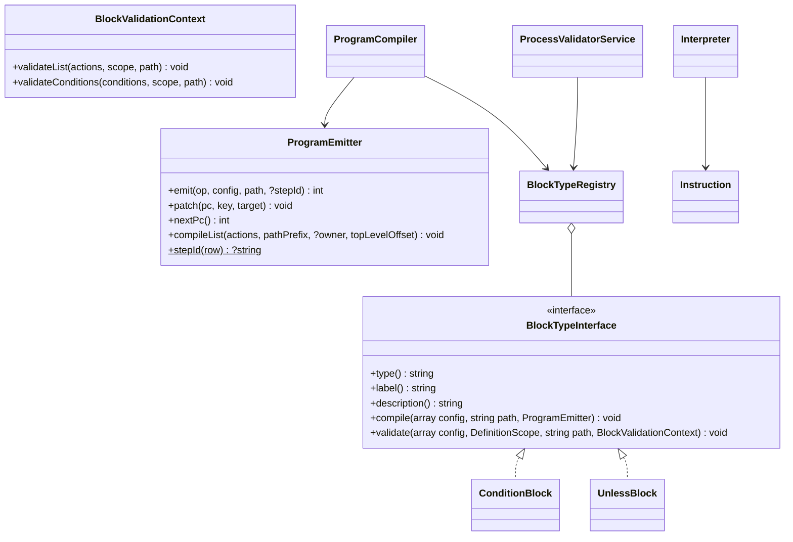

# New block type

How to add a control-flow construct with nested action lists, using the built-in `condition` block ("Condition
(if / else)") and the tutorial `unless` block ("Unless") as examples.

<!-- lang-switch -->
🇬🇧 English | [🇷🇺 Русский](../../../ru/07-developer-guide/extending/new-block-type.md)
<!-- /lang-switch -->

## 1. When you need it

An action (`ActionHandlerInterface`, see [New action type](new-action-type.md)) is a single step: it runs and hands
control to the next one. A **block** is needed when a construct controls the order of execution: it holds nested
action lists (branches, a loop body), chooses which of them to run, or ends the process. Built-in blocks
(`back/src/Program/Blocks/`):

| Block | Class | Compiled into |
|---|---|---|
| `condition` — if / else-if / else | `ConditionBlock` | `branch` + branch bodies, each with a `jump` to the end, + the `else` body |
| `stop_process` — early finish | `StopProcessBlock` | one `halt` instruction |
| `foreach` — a loop over a list | `ForeachBlock` | `loop_begin` / body / `loop_next`; run by `Wps\Program\LoopRunner` |

## 2. How it works

A process definition is a tree. Before execution `ProgramCompiler` turns it into a **flat program** — a list of
instructions with jumps; the execution cursor is the instruction number `pc` (see
[Execution engine → Program and instructions](../../05-architecture/execution-engine.md#program-and-instructions)).
A block is responsible for two things: how to **compile** itself into instructions and how to **validate** its
configuration when a process is saved. Instructions are run by the `Interpreter` — the block is not called at run
time.



The `Wps\Program\BlockTypeInterface` interface:

| Method | Purpose |
|---|---|
| `type(): string` | the value of the `type` field of an `actions` element (`"condition"`) |
| `label(): string`, `description(): string` | label and description for `GET /api/dictionaries/action-types` (a block has `"kind": "block"` there) |
| `compile(array $config, string $path, ProgramEmitter $emitter): void` | emit the block's instructions |
| `validate(array $config, DefinitionScope $scope, string $path, BlockValidationContext $context): void` | check the block on save |

- **Name clash.** A type cannot be both an action and a block: on first use `Container::blocks()` throws a
  `LogicException` (`"x" is registered both as an action and as a block`). The registry is `BlockTypeRegistry`:
  `register()`, `has(mixed)`, `get()`, `dictionary()`.
- **Compilation** goes through `ProgramEmitter`:
  - `emit(string $op, array $config, string $path, ?string $stepId = null): int` — append an instruction and return its
    `pc`; `$stepId` (from `ProgramEmitter::stepId($config)`) makes the block a `goto` target for `on_error`;
  - `nextPc(): int` — the `pc` of the next instruction (a "jump here" target);
  - `patch(int $pc, string $key, int $target): void` — set a jump target once it is known (backpatching; `$key` is a
    dot path inside `config`: `"target"`, `"branches.0.target"`);
  - `compileList(array $actions, string $pathPrefix, ?int $owner = null, int $topLevelOffset = 0): void` — compile a
    nested list; `$owner` is the `pc` of the block instruction (the engine uses it to decide which steps to mark
    `skipped` on an error and to build the audit hierarchy). Nesting depth is checked here (`PROGRAM_MAX_DEPTH`).
- **Instructions** (`Wps\Program\Instruction`):

  | `op` | `config` | What the `Interpreter` does | Audit record |
  |---|---|---|---|
  | `action` | the step config | `ActionHandlerRegistry` + retries, then `pc + 1` | yes |
  | `branch` | `{type, branches: [{conditions, target, name?}], else_target, end_target, has_else, on_error?}` | the first branch whose conditions are met → its `target`, otherwise `else_target`; `result_data.selected` = branch number / `else` / `none` | yes |
  | `jump` | `{target}` | unconditional jump | no |
  | `jump_if_false` | `{conditions, target}` | conditions not met → `target`, otherwise `pc + 1` (not used by the built-in blocks) | no |
  | `halt` | `{type, status, message?, code?}` | finishes the execution | yes |
  | `loop_begin` / `loop_next` | see `ForeachBlock` | a loop through `LoopRunner` | `loop_begin` |

  The `action_type` of an audit record is the `type` field of the instruction `config` (`Instruction::auditType()`),
  so put the block `type` there. A new `op` needs a branch in `Interpreter::step()` (and possibly in the engine) — make
  do with the existing ones.
- **Errors in a block.** A condition row with a cast error makes a `branch` instruction `failed`. If the block has
  `on_error: "continue"`, the engine continues from `end_target` (`ExecutionEngineService`), so `end_target` must point
  right after the block. Common step fields (`id`, `name`, `on_error`, `retry`) and the depth are checked by
  `ProcessValidatorService` itself; pass `on_error` into the instruction `config`, as `ConditionBlock` does.
- **Validation.** `validate()` checks the block's fields and hands nested lists and conditions back to the validator
  through `BlockValidationContext` (`validateList()` — one level deeper, `validateConditions()` — the same rules as
  trigger conditions).
- **Variable visibility.** Validate each branch in its own copy of the scope: `$fork = $scope->fork()`. After the
  branches — `$scope->mergeBranches($forks, exhaustive: …)`: a variable declared in every branch of an exhaustive
  block stays declared; one declared only in some branches becomes `conditional` — reading it is allowed, but saving
  returns a warning in `warnings`. Errors, warnings, step ids and child-process references are shared between copies.
  A body that may not run (a loop, `unless`) is one copy with `exhaustive: false`; variables visible only inside the
  block (the loop item) are declared in the copy and removed with `$fork->undeclare($name)` before `mergeBranches()` —
  this is what `ForeachBlock` does.

## 3. Example: how `condition` works

`back/src/Program/Blocks/ConditionBlock.php`, compilation:

```php
public function compile(array $config, string $path, ProgramEmitter $emitter): void
{
    $branches = array_values(is_array($config['branches'] ?? null) ? $config['branches'] : []);
    $hasElse = array_key_exists('else', $config) && is_array($config['else']);
    $branchPc = $emitter->emit(Instruction::BRANCH, [
        'type' => $this->type(),
        'branches' => array_map(static fn ($b) => ['conditions' => is_array($b['conditions'] ?? null) ? $b['conditions'] : [], 'target' => -1]
            + (isset($b['name']) && is_string($b['name']) ? ['name' => $b['name']] : []), $branches),
        'else_target' => -1,
        'end_target' => -1,
        'has_else' => $hasElse,
    ] + (isset($config['on_error']) ? ['on_error' => $config['on_error']] : []), $path, ProgramEmitter::stepId($config));

    $jumps = [];
    foreach ($branches as $i => $branch) {
        $emitter->patch($branchPc, "branches.{$i}.target", $emitter->nextPc());
        $emitter->compileList(is_array($branch['actions'] ?? null) ? $branch['actions'] : [], "{$path}.branches[{$i}].actions", $branchPc);
        $jumps[] = $emitter->emit(Instruction::JUMP, ['target' => -1], "{$path}.branches[{$i}]");
    }
    $emitter->patch($branchPc, 'else_target', $emitter->nextPc());
    if ($hasElse) {
        $emitter->compileList($config['else'], "{$path}.else", $branchPc);
    }
    $end = $emitter->nextPc();
    $emitter->patch($branchPc, 'end_target', $end);
    foreach ($jumps as $jump) {
        $emitter->patch($jump, 'target', $end);
    }
}
```

Validation (abridged; the full version also checks branch `name`s, at most 20 branches, and warns about unreachable
branches):

```php
public function validate(array $config, DefinitionScope $scope, string $path, BlockValidationContext $context): void
{
    $forks = [];
    $hasElse = isset($config['else']) && is_array($config['else']) && array_is_list($config['else']);
    foreach ($config['branches'] ?? [] as $i => $branch) {
        // conditions see the scope before the block: branches exclude each other
        $context->validateConditions($branch['conditions'] ?? [], $scope, "{$path}.branches[{$i}].conditions");
        $fork = $scope->fork();
        $context->validateList($branch['actions'] ?? [], $fork, "{$path}.branches[{$i}].actions");
        $forks[] = $fork;
    }
    if ($hasElse) {
        $fork = $scope->fork();
        $context->validateList($config['else'], $fork, "{$path}.else");
        $forks[] = $fork;
    }
    $scope->mergeBranches($forks, exhaustive: $hasElse /* || a branch without conditions */);
}
```

## 4. Step by step: the `unless` block

The tutorial "Unless" block runs its nested actions only when the conditions are **not** met:

```json
{ "type": "unless", "id": "no_phone",
  "conditions": [ { "field": "object.phone", "operator": "is_not_empty" } ],
  "actions": [ { "type": "modify", "target": "object.description", "change_type": "set_value", "value": "No phone" } ] }
```

It makes do with existing instructions: one `branch` whose single branch carries the conditions and jumps over the
body, while "else" is the body itself. This way the block gets an audit record with the condition trace for free.

| File | What to do |
|---|---|
| `back/src/Program/Blocks/UnlessBlock.php` | **new** — the block class |
| `back/src/Kernel/Container.php` | registration in `blocks()` |
| `back/tests/Unit/Program/UnlessBlockTest.php` | **new** — compilation, execution, validation |
| `back/tests/IntegrationTest.php` | an `[unless]` block |
| `front/src/views/ProcessDetailView.vue`, `front/src/locales/*.json` | (optional) a type label |
| `doc/{ru,en}/03-user-guide/actions.md`, `back/API.md` | block description |

### 4.1 Class — `back/src/Program/Blocks/UnlessBlock.php`

```php
<?php

declare(strict_types=1);

namespace Wps\Program\Blocks;

use Wps\Program\BlockTypeInterface;
use Wps\Program\BlockValidationContext;
use Wps\Program\Instruction;
use Wps\Program\ProgramEmitter;
use Wps\Services\Validation\DefinitionScope;

/**
 * "Если не": runs the actions only when the conditions are NOT met.
 *
 *   { "type": "unless", "id": "no_phone", "conditions": [...], "actions": [...] }
 *
 * Compiled into one "branch" instruction (one audit record with the condition trace): the only branch carries the
 * conditions and jumps over the body, "else" is the body.
 */
final class UnlessBlock implements BlockTypeInterface
{
    public function type(): string
    {
        return 'unless';
    }

    public function label(): string
    {
        return 'Если не';
    }

    public function description(): string
    {
        return 'Выполняет вложенные действия, только если условия НЕ выполнены';
    }

    public function compile(array $config, string $path, ProgramEmitter $emitter): void
    {
        $branchPc = $emitter->emit(Instruction::BRANCH, [
            'type' => $this->type(),
            'branches' => [['conditions' => is_array($config['conditions'] ?? null) ? $config['conditions'] : [], 'target' => -1]],
            'else_target' => -1,
            'end_target' => -1,
            'has_else' => true,
        ] + (isset($config['on_error']) ? ['on_error' => $config['on_error']] : []), $path, ProgramEmitter::stepId($config));

        // conditions not met → "else" = the body that follows the instruction
        $emitter->patch($branchPc, 'else_target', $emitter->nextPc());
        $emitter->compileList(is_array($config['actions'] ?? null) ? $config['actions'] : [], "{$path}.actions", $branchPc);
        // conditions met → jump over the body; on_error of the block also continues here
        $end = $emitter->nextPc();
        $emitter->patch($branchPc, 'branches.0.target', $end);
        $emitter->patch($branchPc, 'end_target', $end);
    }

    public function validate(array $config, DefinitionScope $scope, string $path, BlockValidationContext $context): void
    {
        $conditions = $config['conditions'] ?? null;
        if (!is_array($conditions) || $conditions === []) {
            $scope->error("{$path}.conditions", 'At least one condition is required');
        } else {
            $context->validateConditions($conditions, $scope, "{$path}.conditions");
        }
        $actions = $config['actions'] ?? null;
        if (!is_array($actions) || !array_is_list($actions)) {
            $scope->error("{$path}.actions", 'Must be an array');
            $actions = [];
        }
        // the body may not run: what it declares is "conditional" after the block
        $fork = $scope->fork();
        $context->validateList($actions, $fork, "{$path}.actions");
        $scope->mergeBranches([$fork], exhaustive: false);
    }
}
```

The program for the example above (two top-level elements: `unless` and `save_object`):

| `pc` | `op` | `path` | Jumps |
|---|---|---|---|
| 0 | `branch` (`type: unless`) | `actions[0]` | branch 0 (has a phone) → 2, `else_target` → 1, `end_target` → 2 |
| 1 | `action` (`modify`) | `actions[0].actions[0]` | `parent` = 0 |
| 2 | `action` (`save_object`) | `actions[1]` | |

### 4.2 Registration — `back/src/Kernel/Container.php`

```php
use Wps\Program\Blocks\UnlessBlock;

public function blocks(): BlockTypeRegistry
{
    return $this->share(BlockTypeRegistry::class, function () {
        $registry = new BlockTypeRegistry();
        $registry->register(new ConditionBlock());
        $registry->register(new StopProcessBlock($this->templates()));
        $registry->register(new ForeachBlock($this->expressions(), $this->config()->loopMaxItems));
        $registry->register(new UnlessBlock());                   // new block
        foreach (array_column($registry->dictionary(), 'value') as $type) {
            if ($this->actions()->has($type)) {
                throw new \LogicException("\"{$type}\" is registered both as an action and as a block");
            }
        }
        return $registry;
    });
}
```

After a rebuild (`docker compose up -d --build backend`) the block appears in `GET /api/dictionaries/action-types` with
`"kind": "block"`. `ProgramCompiler` and `ProcessValidatorService` receive the same registry — nothing else needs to be
registered.

### 4.3 What the process author sees

- The block's audit record: `action_type: "unless"`, `step_path: "actions[0]"`, `request_data` =
  `{branches: 1, has_else: true}`, `result_data` with `selected: 0` (conditions met, body skipped) or
  `selected: "else"` (body ran) and `branches[0].conditions` — the trace of the condition rows.
- Body steps get the `step_path` `actions[0].actions[N]`; when the body is skipped there are no records for it.
- If the block has `"on_error": "continue"` and a condition row fails with a cast error, execution continues after the
  block.

## 5. Rules

- Compilation is **deterministic**: the same definition → the same program (no dependency on time, randomness, hash
  iteration order). The program hash is stored in the execution (`program_hash`); if it changes after an upgrade,
  interrupted and waiting executions are not continued but finish as `failed`
  (`Program changed after an upgrade; the execution cannot be resumed safely`). Change the emission order with care.
- Put everything the execution needs into the instruction `config`: the interpreter does not see the original tree.
- Every `-1` must be replaced by `patch()`; a backward jump is acceptable only inside your own loop.
- An unknown `type` in a nested list is compiled as `action` and rejected by the validator (`Unknown action type`).
- A block has no state: one instance per worker compiles programs for every coroutine.
- No long operations in a block: waits go through actions (`ActionResult::wait()`), see
  [New action type](new-action-type.md#a-waiting-action-parking).

## 6. Test

### 6.1 Unit test — `back/tests/Unit/Program/UnlessBlockTest.php`

Modelled on `ProgramCompilerTest` (compilation), `InterpreterTest` (execution with a fake action executor) and
`ConditionBlockTest` (validation with `BlockValidationContext` stubs).

```php
<?php

declare(strict_types=1);

namespace Wps\Tests\Unit\Program;

use PHPUnit\Framework\TestCase;
use Wps\Comparators\ComparatorRegistry;
use Wps\Context\ExecutionContext;
use Wps\Persistence\Process;
use Wps\Program\BlockTypeRegistry;
use Wps\Program\BlockValidationContext;
use Wps\Program\Blocks\ConditionBlock;
use Wps\Program\Blocks\UnlessBlock;
use Wps\Program\Instruction;
use Wps\Program\Interpreter;
use Wps\Program\Program;
use Wps\Program\ProgramCompiler;
use Wps\Services\ConditionEngineService;
use Wps\Services\StepRecord;
use Wps\Services\Validation\DefinitionScope;

final class UnlessBlockTest extends TestCase
{
    private static function program(): Program
    {
        $blocks = new BlockTypeRegistry();
        $blocks->register(new ConditionBlock());
        $blocks->register(new UnlessBlock());
        return (new ProgramCompiler($blocks, 5))->compile(Process::normalizeDefinition(['actions' => [
            ['type' => 'unless', 'id' => 'no_phone', 'conditions' => [['field' => 'object.phone', 'operator' => 'is_not_empty']],
                'actions' => [['type' => 'modify', 'target' => 'object.note', 'change_type' => 'set_value', 'value' => 'no phone']]],
            ['type' => 'save_object', 'target' => 'object'],
        ]]));
    }

    public function testCompile(): void
    {
        $program = self::program();
        self::assertSame(3, $program->count());
        $branch = $program->at(0);
        self::assertSame(Instruction::BRANCH, $branch->op);
        self::assertSame('unless', $branch->config['type']);
        self::assertSame(1, $branch->config['else_target'], 'conditions not met → the body');
        self::assertSame(2, $branch->config['branches'][0]['target'], 'conditions met → after the body');
        self::assertSame(2, $branch->config['end_target']);
        self::assertSame('actions[0].actions[0]', $program->at(1)->path);
        self::assertSame(0, $program->at(1)->parent);
        self::assertSame(0, $program->pcOf('no_phone'));
    }

    /**
     * The interpreter loop as the engine runs it (like InterpreterTest), with a fake action executor.
     *
     * @return array{0: list<string>, 1: list<StepRecord>}
     */
    private static function execute(array $object): array
    {
        $executed = [];
        $interpreter = new Interpreter(
            new ConditionEngineService(ComparatorRegistry::default()),
            static function (Instruction $i, int $pc, int $seq, ExecutionContext $ctx, mixed $owner) use (&$executed): StepRecord {
                $executed[] = $i->path;
                return new StepRecord($seq, (string)$i->config['type'], 'success', 1, microtime(true), 0, pc: $pc, path: $i->path);
            },
        );
        $program = self::program();
        $context = ExecutionContext::fromEvent('e', $object + ['id' => '1'], 'Leads');
        $records = [];
        for ($pc = 0, $seq = 0; $pc < $program->count(); $pc = $outcome->nextPc) {
            $outcome = $interpreter->step($program->at($pc), $pc, $seq, $context);
            if ($outcome->record !== null) {
                $records[] = $outcome->record;
                $seq++;
            }
        }
        return [$executed, $records];
    }

    public function testRun(): void
    {
        [$executed, $records] = self::execute(['phone' => '']);
        self::assertSame(['actions[0].actions[0]', 'actions[1]'], $executed, 'no phone → the body runs');
        self::assertSame('unless', $records[0]->actionType);
        self::assertSame('else', $records[0]->result['selected']);

        [$executed, $records] = self::execute(['phone' => '+7999']);
        self::assertSame(['actions[1]'], $executed, 'a phone → the body is skipped');
        self::assertSame(0, $records[0]->result['selected']);
    }

    public function testValidate(): void
    {
        $scope = new DefinitionScope();
        $context = new BlockValidationContext(
            static function (array $list, DefinitionScope $s, string $p): void {
                foreach ($list as $i => $row) {
                    $s->checkWritePath($row['target'] ?? null, "{$p}[{$i}].target");
                }
            },
            static function (array $conditions, DefinitionScope $s, string $p): void {
                foreach ($conditions as $i => $row) {
                    $s->checkReadPath($row['field'] ?? null, "{$p}[{$i}].field");
                }
            },
        );
        $block = new UnlessBlock();
        $block->validate(['conditions' => [], 'actions' => 'x'], $scope, 'definition.actions[0]', $context);
        $block->validate(['conditions' => [['field' => 'object.phone']], 'actions' => [['target' => 'calc.flag']]], $scope, 'definition.actions[1]', $context);

        self::assertSame([
            'definition.actions[0].conditions' => 'At least one condition is required',
            'definition.actions[0].actions' => 'Must be an array',
        ], array_column($scope->errors(), 'message', 'field'));
        self::assertSame(DefinitionScope::CONDITIONAL, $scope->kind('calc'), 'the body may not run');
    }
}
```

The class and the test were run against the current code (`OK`). `run()` is a final method of `TestCase`, which is why
the helper is called `execute()`. Other models: `ForeachTest` (loops with an in-memory snapshot store),
`DefinitionScopeTest` (scopes), `StopProcessTest`. Running — [Testing](../testing.md#backend-unit-tests).

### 6.2 Integration test — `back/tests/IntegrationTest.php`

Modelled on the `[program blocks]` group (`testProgramBlocks()`); add the `$this->testUnlessBlock();` call to `run()`.

```php
private function testUnlessBlock(): void
{
    echo "[unless]\n";
    $this->test('unless runs its body only when the conditions are not met', function () {
        $types = array_column($this->request('GET', '/api/dictionaries/action-types', token: $this->viewerToken)['data'], 'kind', 'value');
        $this->assertEquals('block', $types['unless'] ?? null);
        $process = $this->request('POST', '/api/processes', ['name' => 'TEST unless', 'object_type' => 'TestUnless', 'is_child' => false, 'definition' => ['actions' => [
            ['type' => 'unless', 'id' => 'no_phone', 'conditions' => [['field' => 'object.phone', 'operator' => 'is_not_empty']],
                'actions' => [['type' => 'modify', 'target' => 'object.note', 'change_type' => 'set_value', 'value' => 'no phone']]],
        ]]], $this->adminToken, 201)['data'];
        foreach (['' => 'no phone', '+7999' => null] as $phone => $note) {
            $run = $this->request('POST', "/api/processes/{$process['id']}/run", ['object' => ['id' => 'u' . random_int(1000, 9999), 'module' => 'TestUnless', 'phone' => $phone]], $this->editorToken, 201)['data'];
            $e = $this->waitForExecution($run['execution_id']);
            $this->assertEquals('completed', $e['status']);
            $this->assertEquals('unless', $e['actions'][0]['action_type']);
            $this->assertEquals($note === null ? 0 : 'else', $e['actions'][0]['result_data']['selected']);
            $this->assertEquals($note, $e['context']['variables']['object']['note'] ?? null);
        }
        $bad = $this->request('POST', '/api/processes', ['name' => 'TEST unless bad', 'object_type' => 'TestUnless', 'is_child' => false, 'definition' => ['actions' => [
            ['type' => 'unless', 'actions' => []],
        ]]], $this->adminToken, 422);
        $d = array_column($bad['error']['details'], 'message', 'field');
        $this->assertEquals('At least one condition is required', $d['definition.actions[0].conditions'] ?? null);
        $this->request('DELETE', "/api/processes/{$process['id']}", token: $this->adminToken);
    });
}
```

## 7. Common pitfalls

| Mistake | Consequence | Do instead |
|---|---|---|
| A jump target left at `-1` | a jump to `pc = -1`, the execution breaks | `patch()` every `target`, unit-test the targets |
| `compileList()` without `$owner` | nested steps count as top level: wrong `skipped` on an error and wrong `topLevel` | pass the `pc` of the block instruction |
| No `type` in the instruction `config` | `action_type` in the audit is `branch` | `'type' => $this->type()` |
| `end_target` not right after the block | `on_error: "continue"` resumes in the wrong place | `end_target` = `nextPc()` after the whole body |
| A branch validated in the shared `$scope` | a variable from an optional branch counts as declared everywhere | `fork()` + `mergeBranches()` |
| Emission order changed in an upgrade | `program_hash` changes, interrupted and waiting executions finish as `failed` | change it only knowingly; let waiting executions finish first |
| The type equals an action type | `LogicException` on start | a unique `type()` |

## 8. Readiness checklist

- [ ] Class in `back/src/Program/Blocks/`, `final`, `declare(strict_types=1)`, implements `BlockTypeInterface`, unique `type()`
- [ ] Registered in `Container::blocks()`, no clash with action types
- [ ] Every jump target set with `patch()`, nested lists compiled with `$ownerPc`, `type` and `on_error` in the instruction `config`
- [ ] Nested lists validated through `BlockValidationContext`, branches through `fork()` / `mergeBranches()`
- [ ] Unit tests (compilation, execution, validation) and an integration block (called from `run()`) are green
- [ ] Block documented in [Actions](../../03-user-guide/actions.md) (en + ru) and in `back/API.md`

<!-- footer-nav -->
---

← Previous: [New action type](new-action-type.md) | [Contents](../../README.md) | [New comparison operator](new-comparator.md) Next →
<!-- /footer-nav -->
