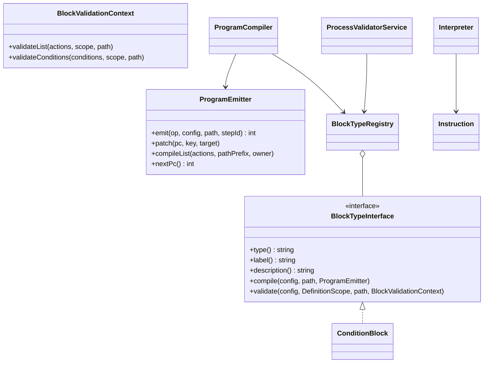

# New block type

How to add a control-flow construct with nested action lists, using the built-in `condition` block ("Condition
(if / else)") as the example.

<!-- lang-switch -->
🇬🇧 English | [🇷🇺 Русский](../../../ru/07-developer-guide/extending/new-block-type.md)
<!-- /lang-switch -->

## 1. When you need it

An action (`ActionHandlerInterface`, see [New action type](new-action-type.md)) is a single step: it runs and passes
control to the next one. A **block** is needed when a construct controls the order of execution: it contains nested
action lists (branches, a loop body), chooses which of them to run, or finishes the process. Examples: `condition`
(if / else), `stop_process` (early stop, `Wps\Program\Blocks\StopProcessBlock` — compiled into one `halt`
instruction) and `foreach` (loop over a list, `Wps\Program\Blocks\ForeachBlock` — the `loop_begin` / `loop_next`
instructions run by `Wps\Program\LoopRunner`).

## 2. How it works

A process definition is a tree. Before it runs, `ProgramCompiler` turns it into a **flat program** — a list of
instructions with jumps; the execution cursor is the instruction number `pc` (see
[Execution engine → Program and instructions](../../05-architecture/execution-engine.md#program-and-instructions)).
A block is responsible for two things: how to **compile** itself into instructions and how to **validate** its
configuration when the process is saved.



- `type()` is the value of the `type` field of an `actions` element (`"condition"`). A type cannot be both an action and
  a block: `Container::blocks()` checks for a conflict with `ActionHandlerRegistry` on first use.
- **Compilation.** `compile()` calls `ProgramEmitter`:
  - `emit($op, $config, $path, $stepId)` — add an instruction, returns its `pc`;
  - `nextPc()` — `pc` of the next instruction (a jump target "here");
  - `patch($pc, 'branches.0.target', $target)` — set a jump target once it is known (backpatching);
  - `compileList($actions, "{$path}.body", $ownerPc)` — compile a nested list; `$ownerPc` is the `pc` of the block
    instruction (the engine uses it to decide which steps get `skipped` on an error). The nesting depth is checked here
    (`PROGRAM_MAX_DEPTH`).
- **Instructions** (`Wps\Program\Instruction`): `action`, `branch`, `jump`, `jump_if_false`, `halt`, `loop_begin`,
  `loop_next`. Audit records are written for `action`, `branch`, `halt`, `loop_begin` (`Instruction::AUDITED`); the
  record's `action_type` is the `type` field of the instruction `config`, so put the block `type` there. A new `op`
  needs a branch in `Interpreter::step()` — use the existing ones when possible.
- **Validation.** `validate()` checks the block's own fields and hands nested lists and conditions back to the
  validator through `BlockValidationContext` (`validateList()` — one level deeper, `validateConditions()` — the same
  rules as launch conditions). The common step fields (`id`, `name`) and the depth are checked by
  `ProcessValidatorService` itself.
- **Variable visibility.** Validate every branch in its own copy of the scope: `$fork = $scope->fork()`. After the
  branches call `$scope->mergeBranches($forks, exhaustive: …)`: a variable declared in every branch of an exhaustive
  block stays declared; one declared only in some branches becomes `conditional` — reading it is allowed, but saving
  returns a warning in `warnings`. Errors, warnings, step ids and child process references are shared between forks.
  A loop body is one fork with `exhaustive: false` (the loop may run zero times); variables visible only inside the
  block (the loop item) are declared in the fork and removed with `$fork->undeclare($name)` before `mergeBranches()` —
  as `ForeachBlock` does.

## 3. Example: how `condition` works

`back/src/Program/Blocks/ConditionBlock.php`, compilation:

```php
public function compile(array $config, string $path, ProgramEmitter $emitter): void
{
    $branches = array_values($config['branches'] ?? []);
    $hasElse = isset($config['else']) && is_array($config['else']);
    $branchPc = $emitter->emit(Instruction::BRANCH, [
        'type' => $this->type(),
        'branches' => array_map(static fn ($b) => ['conditions' => $b['conditions'] ?? [], 'target' => -1], $branches),
        'else_target' => -1, 'end_target' => -1, 'has_else' => $hasElse,
    ], $path, ProgramEmitter::stepId($config));

    $jumps = [];
    foreach ($branches as $i => $branch) {
        $emitter->patch($branchPc, "branches.{$i}.target", $emitter->nextPc());
        $emitter->compileList($branch['actions'] ?? [], "{$path}.branches[{$i}].actions", $branchPc);
        $jumps[] = $emitter->emit(Instruction::JUMP, ['target' => -1], "{$path}.branches[{$i}]");
    }
    $emitter->patch($branchPc, 'else_target', $emitter->nextPc());
    if ($hasElse) {
        $emitter->compileList($config['else'], "{$path}.else", $branchPc);
    }
    $end = $emitter->nextPc();
    $emitter->patch($branchPc, 'end_target', $end);
    foreach ($jumps as $jump) {
        $emitter->patch($jump, 'target', $end);
    }
}
```

Validation (shortened):

```php
public function validate(array $config, DefinitionScope $scope, string $path, BlockValidationContext $context): void
{
    $forks = [];
    foreach ($config['branches'] ?? [] as $i => $branch) {
        $context->validateConditions($branch['conditions'] ?? [], $scope, "{$path}.branches[{$i}].conditions");
        $fork = $scope->fork();
        $context->validateList($branch['actions'] ?? [], $fork, "{$path}.branches[{$i}].actions");
        $forks[] = $fork;
    }
    if (isset($config['else'])) {
        $fork = $scope->fork();
        $context->validateList($config['else'], $fork, "{$path}.else");
        $forks[] = $fork;
    }
    $scope->mergeBranches($forks, exhaustive: isset($config['else']));
}
```

## 4. Registration — `back/src/Kernel/Container.php`

```php
public function blocks(): BlockTypeRegistry
{
    return $this->share(BlockTypeRegistry::class, function () {
        $registry = new BlockTypeRegistry();
        $registry->register(new ConditionBlock());
        $registry->register(new MyBlock());               // the new block
        // … conflict check against ActionHandlerRegistry
        return $registry;
    });
}
```

After a rebuild (`docker compose up -d --build backend`) the block appears in `GET /api/dictionaries/action-types` with
`"kind": "block"`.

## 5. Rules

- Compilation is **deterministic**: the same definition → the same program (no dependency on time, hash key order and
  so on). The program hash is stored in the execution (`program_hash`); if it changes after an upgrade, unfinished
  executions will not be resumed. Change the order of emitted instructions with care.
- Put everything needed at run time into the instruction `config`: the interpreter does not see the original tree.
- An unknown `type` in a nested list compiles as an `action`; the validator rejects it (`Unknown action type`).

## 6. Test

Unit tests (`back/tests/Unit/Program/`, how to run — [Testing](../testing.md#backend-unit-tests)):

- compilation: the `op`/`path` sequence, jump targets, empty and nested lists (`ProgramCompilerTest`);
- running branches with a fake action executor (`InterpreterTest`); loops — with an in-memory snapshot store
  (`ForeachTest`);
- variable scopes (`DefinitionScopeTest`).

Integration (`back/tests/IntegrationTest.php`, group `[program blocks]`): a manual run of a process with the block,
checking the audit records (`action_type`, `step_path`, `pc`, `result_data`).

## 7. Done checklist

- [ ] Class in `back/src/Program/Blocks/`, `final`, implements `BlockTypeInterface`, unique `type()`
- [ ] Registered in `Container::blocks()`, no conflict with action types
- [ ] All jump targets set through `patch()`, nested lists compiled with `$ownerPc`
- [ ] Nested lists validated through `BlockValidationContext`, branches through `fork()` / `mergeBranches()`
- [ ] Unit and integration tests are green
- [ ] The block is described in [Actions](../../03-user-guide/actions.md) (en + ru) and in `back/API.md`

<!-- footer-nav -->
---

← Previous: [New action type](new-action-type.md) | [Contents](../../README.md) | [New comparison operator](new-comparator.md) Next →
<!-- /footer-nav -->
