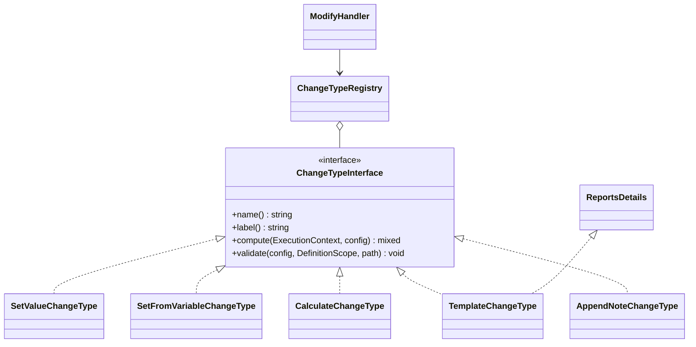

# New change type

How to add a way of computing the new value in a `modify` action, using a teaching `append_note` change type ("Append a note").

<!-- lang-switch -->
🇬🇧 English | [🇷🇺 Русский](../../../ru/07-developer-guide/extending/new-change-type.md)
<!-- /lang-switch -->

## 1. When you need it

A `modify` action writes a value into `object.<field>` or `<variable>.<field>`. The built-in change types are listed in
[Change types and expressions](../../03-user-guide/change-types-and-expressions.md) and in the
`GET /api/dictionaries/change-types` dictionary. Add a change type when the value is produced by logic that is awkward
as an expression.

> **Note**
> The built-in `append` ("Append to the end", task 5.1.5) does more: templates, `max_length`, list mode. The teaching
> example below is named `append_note` so as not to clash with it; choose your own name for your type. If only a function is missing in expressions, add an [expression function](expression-functions.md) instead.

## 2. How it works



- `ModifyHandler::execute()` takes `change_type` from the action, calls `compute($context, $actionConfig)` with the **whole
  modify action** as config (`target`, `value`, `save_to_crm` and any extra keys you define), reads the old value, writes the
  new one with `$context->set($target, $new)` and puts `old_value`/`new_value` into the audit. With `save_to_crm: true` the
  variable is saved right after.
- `ModifyHandler::validate()` checks that `change_type` is registered, calls your `validate()` **before** the target is
  declared (the value is computed before it is written), then checks `target`.
- The registry is filled in `Container::changeTypes()`; `GET /api/dictionaries/change-types` lists it.
- If the type has something to add to the step audit (e.g. `template` reports missing paths), implement the optional
  interface `ReportsDetails::computeWithDetails($context, $config): [$value, $details]` — `ModifyHandler` calls it
  instead of `compute()` and merges `$details` into `result_data`. Do not keep details in object properties: one
  instance of the type serves concurrent executions.
- A type that builds text from substitutions should not write its own parser: use `Container::templates()`
  (`TemplateEngine::render()`) and `Container::templateValidator()`, like `TemplateChangeType`.
- A type that reads CRM records gets `ExternalApiAdapterService` in the constructor and translates and checks a filter in
  the Find records format with the shared `Crm\FilterTranslator` and `Crm\FilterRulesValidator` — as
  `AggregateChangeType` does. Mind that the type is computed on every execution: cap the number of records it reads.

## 3. Step by step

### 3.1 The class — `back/src/Actions/ChangeTypes/AppendNoteChangeType.php`

```php
<?php

declare(strict_types=1);

namespace Wps\Actions\ChangeTypes;

use Wps\Comparators\ComparatorRegistry;
use Wps\Context\ExecutionContext;
use Wps\Services\Validation\DefinitionScope;

/**
 * "Дописать заметку": appends the value to the current value of the target field,
 * separated by "separator" (default: a space). An empty field simply gets the value.
 */
final class AppendNoteChangeType implements ChangeTypeInterface
{
    public function name(): string
    {
        return 'append_note';
    }

    public function label(): string
    {
        return 'Дописать заметку';
    }

    public function compute(ExecutionContext $context, array $config): mixed
    {
        $current = ComparatorRegistry::stringify($context->get((string)($config['target'] ?? '')));
        $value = ComparatorRegistry::stringify($config['value'] ?? '');
        if ($current === '') {
            return $value;
        }
        $separator = isset($config['separator']) && is_string($config['separator']) ? $config['separator'] : ' ';
        return $current . $separator . $value;
    }

    public function validate(array $config, DefinitionScope $scope, string $path): void
    {
        $value = $config['value'] ?? null;
        if (!is_scalar($value) || (string)$value === '') {
            $scope->error("{$path}.value", 'Value to append is required');
        }
        if (isset($config['separator']) && !is_string($config['separator'])) {
            $scope->error("{$path}.separator", 'Separator must be a string');
        }
    }
}
```

### 3.2 Registration — `back/src/Kernel/Container.php`

```php
use Wps\Actions\ChangeTypes\AppendNoteChangeType;

public function changeTypes(): ChangeTypeRegistry
{
    return $this->share(ChangeTypeRegistry::class, function () {
        $registry = new ChangeTypeRegistry();
        $registry->register(new SetValueChangeType());
        $registry->register(new SetFromVariableChangeType());
        $registry->register(new CalculateChangeType($this->expressions()));
        $registry->register(new AppendNoteChangeType());
        return $registry;
    });
}
```

### 3.3 Use it

```json
{ "type": "modify", "target": "object.note", "change_type": "append_note", "value": "checked", "separator": " | " }
```

With `object.note = "start"` the result is `"start | checked"` (see the test below).

## 4. Validation and errors

- Report config problems with `$scope->error("{$path}.<key>", …)`; `$path` is `definition.actions[N]`.
- If your config contains paths that are **read** (like `set_from_variable` does with `value`), check them with
  `$scope->checkReadPath($value, "{$path}.value")`, otherwise a typo is only found at run time.
- `compute()` runs inside the engine's retry loop: throw `NonRecoverableException` for bad data,
  `RecoverableException` only if you call something that can be temporarily unavailable.

## 5. UI and translations

The modify row in `ModifyPanel.vue` offers the change types from the dictionary (translated with
`dict.changeType.<name>`). For a new type:

1. Translations in both locales:

```json
// en.json → dict.changeType
"append_note": "Append a note"
// ru.json → dict.changeType
"append_note": "Дописать заметку"
```

2. Extend the TypeScript union in `front/src/types/index.ts`:

```ts
export type ChangeType = 'set_value' | 'set_from_variable' | 'calculate' | 'append_note'
```

A type that is not in the union still works at run time, but the editor code compares `change_type` with literal values
and `vue-tsc` keeps the union exhaustive for new branches.

3. The value field: `ModifyPanel.vue` shows a variable-path input for `set_from_variable`, an expression input with help for
`calculate` and a plain text input for anything else — `append_note` needs no change.

> **Warning**
> The editor keeps only `target`, `change_type`, `value` and `save_to_crm` of a modify row
> (`definitionFromForm()` in `front/src/stores/processes.ts`). Extra keys such as `separator` are **lost when the process is
> saved from the UI**. Either design the change type without extra keys, or add the key to `ModifyRow`/`ModifyAction`,
> `formFromProcess()`, `definitionFromForm()` and an input in `ModifyPanel.vue`.

## 6. Test

Following the `testExtensions()` group (full text in [New action type → Test](new-action-type.md#6-test)):

```php
$this->test('Change types contain append_note', function () {
    $changeTypes = $this->request('GET', '/api/dictionaries/change-types', token: $this->adminToken)['data'];
    $this->assertTrue(in_array('append_note', array_column($changeTypes, 'value'), true));
});
// in a process: ['type' => 'modify', 'target' => 'object.note', 'change_type' => 'append_note', 'value' => 'checked', 'separator' => ' | ']
// manual run with 'note' => 'start', then:
$this->assertEquals('start | checked', $execution['context']['variables']['object']['note']);
```

## 7. Checklist

- [ ] `final` class in `back/src/Actions/ChangeTypes/`, unique `name()`
- [ ] Registered in `Container::changeTypes()`
- [ ] `dict.changeType.<name>` in both locales, `ChangeType` union extended, extra keys handled in the editor (or none)
- [ ] Integration check added, suite green, `npm run build` passes
- [ ] Described in [Change types and expressions](../../03-user-guide/change-types-and-expressions.md) (en + ru) and `back/API.md`

<!-- footer-nav -->
---

← Previous: [New comparison operator](new-comparator.md) | [Contents](../../README.md) | [New load strategy](new-load-strategy.md) Next →
<!-- /footer-nav -->
