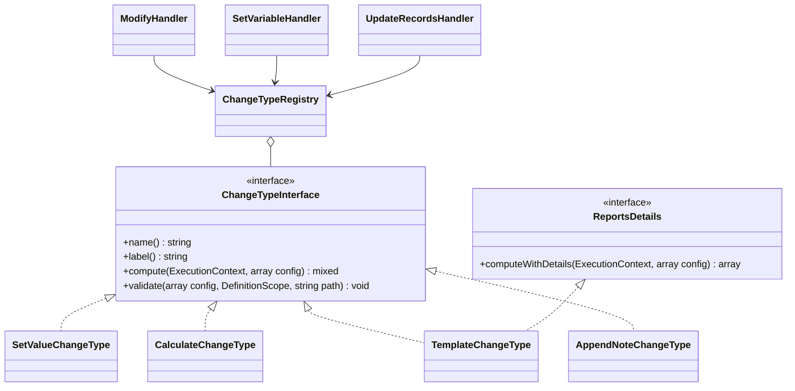

# New change type

How to add a way of computing the new value in the `modify`, `set_variable` and `update_records` actions, using the
tutorial change type `append_note` ("Append a note").

<!-- lang-switch -->
🇬🇧 English | [🇷🇺 Русский](../../../ru/07-developer-guide/extending/new-change-type.md)
<!-- /lang-switch -->

## 1. When you need it

A change type (`change_type`) decides **which value** is written to a field. The built-in types are listed in
[Change types and expressions](../../03-user-guide/change-types-and-expressions.md) and in the
`GET /api/dictionaries/change-types` dictionary: `set_value`, `set_from_variable`, `calculate`, `template`,
`date_shift`, `increment` / `decrement`, `clear`, `append` / `prepend` / `remove`, `map`, `aggregate`. Add a new one
when the value comes from logic with its own configuration that is awkward to write as an expression.

> **Note**
> The built-in `append` ("Append to the end", task 5.1.5) does more: templates, `max_length`, list mode. The tutorial
> example is named `append_note` so as not to clash with it; registering under an existing name silently
> **replaces** the built-in type. If an expression only lacks a function, add an
> [expression function](expression-functions.md). If you need a new process step rather than a new field value — an
> [action type](new-action-type.md).

## 2. How it works



The `Wps\Actions\ChangeTypes\ChangeTypeInterface` interface:

| Method | Purpose |
|---|---|
| `name(): string` | the `change_type` value in a definition; unique |
| `label(): string` | dictionary label (built-in types use Russian) |
| `compute(ExecutionContext $context, array $config): mixed` | the new field value |
| `validate(array $config, DefinitionScope $scope, string $path): void` | configuration check when a process is saved |

The `ChangeTypeRegistry`: `register()`, `has()`, `get()` (unknown name → `ConfigurationException`), `dictionary()` →
`[{value, label}]`. It is filled in `Container::changeTypes()`.

**Who calls a change type and what `$config` holds:**

| Action | `$config` | `target` in `$config` | Where the value goes |
|---|---|---|---|
| `modify` | the whole action (`target`, `value`, `save_to_crm`, your keys) | yes | `$context->set($target, $new)` — the field becomes dirty; with `save_to_crm: true` the variable is saved to the CRM right away |
| `set_variable`, `target` form | the whole action | yes | `$context->setLocal()` — a local variable, never saved to the CRM |
| `set_variable`, `var` + `fields` form | only the field description (`{change_type, value, …}`) | **no** | `$context->setLocal("{var}.{name}")` |
| `update_records` | the field rule + `target = "{item}.{field}"` | yes | the value goes into the `PUT` of every found record |

Hence the rule: if a type needs the current field value (like `append_note`, `increment`), read it through
`$config['target']` and handle its absence.

- **Validation order.** `ModifyHandler::validate()` checks that `change_type` is registered, calls your
  `validate($actionConfig, $scope, $path)` **before** declaring the target (the value is computed before it is
  written), then checks `target`, `save_to_crm` and lists. `SetVariableHandler` and `UpdateRecordsHandler` call the
  same `validate()` with the path of the field (`…fields.total`, `…fields[0]`, `…set[0]`).
- **Audit.** `modify` writes `{target, change_type, value}` to `request_data` (`value` = `$config['expression'] ??
  $config['value']`) and `{old_value, new_value}` to `result_data` (+ `save` when saved). `set_variable` writes the
  same per field.
- **`ReportsDetails`.** If a type has something to add to the audit (e.g. `template` reports missing paths), implement
  the optional `ReportsDetails::computeWithDetails($context, $config): array` interface — return `[$value, $details]`.
  `modify` and `set_variable` call it instead of `compute()` and merge `$details` into `result_data`
  (`update_records` calls `compute()` only).
- **No state.** One instance serves every coroutine of a worker: do not keep call details in properties.
- **Templates.** A type that builds text from substitutions does not write its own parser: use
  `Container::templates()` (`TemplateEngine::render()`) and `Container::templateValidator()` — like
  `TemplateChangeType` and `AppendChangeType`.
- **Reading the CRM.** A type that needs CRM records receives `ExternalApiAdapterService` in its constructor and
  translates and checks a "Find records" style filter with the shared `Crm\FilterTranslator` and
  `Crm\FilterRulesValidator` — like `AggregateChangeType`. The type runs on every execution: limit the number of
  records it reads (`AGGREGATE_MAX_RECORDS` for `aggregate`).

## 3. Step by step

| File | What to do |
|---|---|
| `back/src/Actions/ChangeTypes/AppendNoteChangeType.php` | **new** — the type class |
| `back/src/Kernel/Container.php` | registration in `changeTypes()` |
| `back/tests/Unit/Actions/AppendNoteChangeTypeTest.php` | **new** — unit test |
| `back/tests/IntegrationTest.php` | an `[append_note]` block |
| `front/src/locales/*.json`, `front/src/types/index.ts` | the `dict.changeType.append_note` label, the `ChangeType` union |
| `doc/{ru,en}/03-user-guide/change-types-and-expressions.md`, `back/API.md` | type description |

### 3.1 Class — `back/src/Actions/ChangeTypes/AppendNoteChangeType.php`

```php
<?php

declare(strict_types=1);

namespace Wps\Actions\ChangeTypes;

use Wps\Context\ExecutionContext;
use Wps\Services\Validation\DefinitionScope;
use Wps\Types\TypeCaster;

/**
 * "Дописать заметку": appends the value to the current value of the target field,
 * separated by "separator" (default: a space). An empty field simply gets the value.
 */
final class AppendNoteChangeType implements ChangeTypeInterface
{
    public function name(): string
    {
        return 'append_note';
    }

    public function label(): string
    {
        return 'Дописать заметку';
    }

    public function compute(ExecutionContext $context, array $config): mixed
    {
        // "target" is passed by modify and update_records; set_variable passes it only in the "target" form
        $target = (string)($config['target'] ?? '');
        $current = $target !== '' ? TypeCaster::stringify($context->get($target)) : '';
        $value = TypeCaster::stringify($config['value'] ?? '');
        if ($current === '') {
            return $value;
        }
        $separator = is_string($config['separator'] ?? null) ? $config['separator'] : ' ';
        return $current . $separator . $value;
    }

    public function validate(array $config, DefinitionScope $scope, string $path): void
    {
        $value = $config['value'] ?? null;
        if (!is_scalar($value) || (string)$value === '') {
            $scope->error("{$path}.value", 'Value to append is required');
        }
        if (array_key_exists('separator', $config) && !is_string($config['separator'])) {
            $scope->error("{$path}.separator", 'Separator must be a string');
        }
    }
}
```

`TypeCaster::stringify()` is the single value-to-string conversion (`null` → `''`, numbers without trailing zeros,
arrays → JSON). `ComparatorRegistry::stringify()` is a deprecated alias; do not use it in new code.

### 3.2 Registration — `back/src/Kernel/Container.php`

```php
use Wps\Actions\ChangeTypes\AppendNoteChangeType;

public function changeTypes(): ChangeTypeRegistry
{
    return $this->share(ChangeTypeRegistry::class, function () {
        $registry = new ChangeTypeRegistry();
        $registry->register(new SetValueChangeType());
        $registry->register(new SetFromVariableChangeType());
        $registry->register(new CalculateChangeType($this->expressions()));
        $registry->register(new TemplateChangeType($this->templates(), $this->templateValidator()));
        // … date_shift, increment / decrement, clear, append / prepend / remove, map, aggregate …
        $registry->register(new AppendNoteChangeType());          // new change type
        return $registry;
    });
}
```

Pass dependencies through the constructor from container services (`$this->expressions()`, `$this->templates()`,
`$this->typeCaster()`, `$this->clock()`, `$this->crm()` …). `share()` builds the registry once per worker — a restart
is needed after a change (`docker compose up -d --build backend`).

### 3.3 Usage

```json
{ "type": "modify", "target": "object.note", "change_type": "append_note", "value": "checked", "separator": " | " }
```

With `object.note = "start"` the result is `"start | checked"`, and the step audit has `result_data` =
`{"old_value": "start", "new_value": "start | checked"}`. In `update_records`:

```json
{ "type": "update_records", "list": "deals", "set": [ { "field": "description", "change_type": "append_note", "value": "closed by WPS" } ] }
```

(`deals` is a `find_records` list; for every record `target` = `item.description`; the rule format is in
[Actions](../../03-user-guide/actions.md)).

## 4. Validation and errors

- Report configuration errors with `$scope->error("{$path}.<key>", …)`; `$path` looks like `definition.actions[N]`
  (or the field path in `set_variable` / `update_records`). All save errors are collected into one
  `422 VALIDATION_ERROR` response with `details[].field`.
- Check paths that are **read** (like `value` of `set_from_variable`) with
  `$scope->checkReadPath($value, "{$path}.value")` — otherwise a typo shows up only at run time. Expressions — with
  `ExpressionEngine::paths()` + `checkReadPath()` (like `CalculateChangeType::validate()`), templates — with
  `TemplateValidator::validate()`.
- `compute()` runs inside the engine retry loop. Throw `NonRecoverableException` on bad data (the step fails, then
  `on_error` applies) and `RecoverableException` only when you call something that may be temporarily unavailable (the
  CRM). Before a retry the engine restores the context snapshot (`restoreState()`), so partial context changes do not
  accumulate.
- The value returned by `compute()` goes into the context, the audit and possibly the CRM: return a scalar, `null` or
  a serializable array.

## 5. UI and translations

The change row in `ModifyPanel.vue` offers change types from the dictionary (translated as
`dict.changeType.<name>`; without the key, the backend `label()` is shown). For a new type:

1. Translations in both locales:

```json
// en.json → dict.changeType
"append_note": "Append a note"
// ru.json → dict.changeType
"append_note": "Дописать заметку"
```

2. Extend the TypeScript union in `front/src/types/index.ts` (it currently holds only the three basic types):

```ts
export type ChangeType = 'set_value' | 'set_from_variable' | 'calculate' | 'append_note'
```

A type missing from the union still works at run time, but the editor code compares `change_type` with literals, and
`vue-tsc` keeps new branches exhaustive.

3. The value field: `ModifyPanel.vue` shows a variable-path input for `set_from_variable`, an expression field with
help for `calculate` and a plain text field for everything else — nothing to change for `append_note`.

> **Note**
> A change row whose type is not in `FORM_CHANGE_TYPES` (`front/src/utils/processForm.ts`) is shown read-only by the
> editor and saved unchanged, together with extra keys such as `separator`. To make the type editable in the form, add
> it to `FORM_CHANGE_TYPES`, the key to `ModifyRow`/`ModifyAction` and an input to `ModifyPanel.vue`; when the type of a
> row is changed, the keys of the old type are dropped (`base()` in `processForm.ts`). Actions that the table editor does
> not understand (e.g. `set_variable`) are kept as "passthrough" and left unchanged.

## 6. Test

### 6.1 Unit test — `back/tests/Unit/Actions/AppendNoteChangeTypeTest.php`

Modelled on `SimpleChangeTypesTest`: the type itself and the type through the real `ModifyHandler` (audit and dirty
fields).

```php
<?php

declare(strict_types=1);

namespace Wps\Tests\Unit\Actions;

use PHPUnit\Framework\TestCase;
use Wps\Actions\ChangeTypes\AppendNoteChangeType;
use Wps\Actions\ChangeTypes\ChangeTypeRegistry;
use Wps\Actions\ModifyHandler;
use Wps\Context\ExecutionContext;
use Wps\Services\CrmObjectSaver;
use Wps\Services\ExternalApiAdapterService;
use Wps\Services\Validation\DefinitionScope;

final class AppendNoteChangeTypeTest extends TestCase
{
    public function testCompute(): void
    {
        $type = new AppendNoteChangeType();
        $context = ExecutionContext::fromEvent('e', ['id' => '1', 'note' => 'start', 'amount' => 12.5], 'Deals');
        self::assertSame('start | checked', $type->compute($context, ['target' => 'object.note', 'value' => 'checked', 'separator' => ' | ']));
        self::assertSame('start checked', $type->compute($context, ['target' => 'object.note', 'value' => 'checked']), 'default separator');
        self::assertSame('checked', $type->compute($context, ['target' => 'object.none', 'value' => 'checked']), 'missing field');
        self::assertSame('12.5 EUR', $type->compute($context, ['target' => 'object.amount', 'value' => 'EUR']), 'numbers are stringified');
    }

    public function testThroughModify(): void
    {
        $registry = new ChangeTypeRegistry();
        $registry->register(new AppendNoteChangeType());
        // the CRM is not called without save_to_crm; ExternalApiAdapterService is final — no constructor needed here
        $saver = new CrmObjectSaver((new \ReflectionClass(ExternalApiAdapterService::class))->newInstanceWithoutConstructor());
        $modify = new ModifyHandler($registry, $saver);
        $context = ExecutionContext::fromEvent('e', ['id' => '1', 'note' => 'start'], 'Deals');

        $result = $modify->execute($context, ['type' => 'modify', 'target' => 'object.note', 'change_type' => 'append_note', 'value' => 'checked', 'separator' => ' | ']);

        self::assertSame('start | checked', $context->get('object.note'));
        self::assertSame(['target' => 'object.note', 'change_type' => 'append_note', 'value' => 'checked'], $result->request);
        self::assertSame(['old_value' => 'start', 'new_value' => 'start | checked'], $result->result);
        self::assertSame(['note'], $context->dirtyFields('object'));
    }

    public function testValidate(): void
    {
        $scope = new DefinitionScope();
        (new AppendNoteChangeType())->validate(['value' => '', 'separator' => 1], $scope, 'definition.actions[0]');
        self::assertSame([
            'definition.actions[0].value' => 'Value to append is required',
            'definition.actions[0].separator' => 'Separator must be a string',
        ], array_column($scope->errors(), 'message', 'field'));
    }
}
```

The class and the test were run against the current code (`OK`). Running unit tests —
[Testing](../testing.md#backend-unit-tests).

### 6.2 Integration test — `back/tests/IntegrationTest.php`

Modelled on `testSimpleChangeTypes()`; add the `$this->testAppendNote();` call to `run()`.

```php
private function testAppendNote(): void
{
    echo "[append_note]\n";
    $this->test('append_note: dictionary, a manual run, validation', function () {
        $changeTypes = array_column($this->request('GET', '/api/dictionaries/change-types', token: $this->viewerToken)['data'], 'label', 'value');
        $this->assertEquals('Дописать заметку', $changeTypes['append_note'] ?? null);
        $process = $this->request('POST', '/api/processes', ['name' => 'TEST append_note', 'object_type' => 'TestNote', 'is_child' => false, 'definition' => ['actions' => [
            ['type' => 'modify', 'target' => 'object.note', 'change_type' => 'append_note', 'value' => 'checked', 'separator' => ' | '],
        ]]], $this->adminToken, 201)['data'];
        $run = $this->request('POST', "/api/processes/{$process['id']}/run", ['object' => ['id' => 'n' . random_int(1000, 9999), 'module' => 'TestNote', 'note' => 'start']], $this->editorToken, 201)['data'];
        $e = $this->waitForExecution($run['execution_id']);
        $this->assertEquals('completed', $e['status']);
        $this->assertEquals('start | checked', $e['context']['variables']['object']['note']);
        $this->assertEquals('start', $e['actions'][0]['result_data']['old_value']);
        $bad = $this->request('POST', '/api/processes', ['name' => 'TEST append_note bad', 'object_type' => 'TestNote', 'is_child' => false, 'definition' => ['actions' => [
            ['type' => 'modify', 'target' => 'object.note', 'change_type' => 'append_note', 'value' => ''],
        ]]], $this->adminToken, 422);
        $d = array_column($bad['error']['details'], 'message', 'field');
        $this->assertEquals('Value to append is required', $d['definition.actions[0].value'] ?? null);
        $this->request('DELETE', "/api/processes/{$process['id']}", token: $this->adminToken);
    });
}
```

The same type is used in the shared `testExtensions()` template ([New action type → Test](new-action-type.md#6-test)).

## 7. Common pitfalls

| Mistake | Consequence | Do instead |
|---|---|---|
| The name matches a built-in type | the built-in type is silently replaced | a unique `name()`; check `GET /api/dictionaries/change-types` |
| Call details in object fields | races between coroutines | `ReportsDetails::computeWithDetails()` |
| Relying on `$config['target']` without a check | in `set_variable` with `var` + `fields` the current value is not read | handle an empty `target` |
| Paths in the configuration not checked in `validate()` | a typo shows up at run time | `checkReadPath()`, `paths()`, `TemplateValidator` |
| Order of object keys in the configuration | `processes.definition` is `jsonb`, object key order is not kept | express order with a list (like `fields` of `set_variable`, `ranges` of `map`) |
| A side effect in `compute()` (CRM write, sending) | a step retry repeats it | a change type only computes; external calls belong in an [action](new-action-type.md#external-calls-and-the-side-effect-journal) |

## 8. Readiness checklist

- [ ] `final` class in `back/src/Actions/ChangeTypes/`, `declare(strict_types=1)`, unique `name()`
- [ ] `compute()` works in all three actions (`modify`, both `set_variable` forms, `update_records`)
- [ ] `validate()` reports every problem with a field path; read paths are checked
- [ ] Registered in `Container::changeTypes()`
- [ ] `dict.changeType.<name>` in both locales, the `ChangeType` union extended, extra keys supported by the editor (or none)
- [ ] Unit test and integration block (called from `run()`), tests green, `npm run build` passes
- [ ] Documented in [Change types and expressions](../../03-user-guide/change-types-and-expressions.md) (en + ru) and in `back/API.md`

<!-- footer-nav -->
---

← Previous: [New comparison operator](new-comparator.md) | [Contents](../../README.md) | [New load strategy](new-load-strategy.md) Next →
<!-- /footer-nav -->
