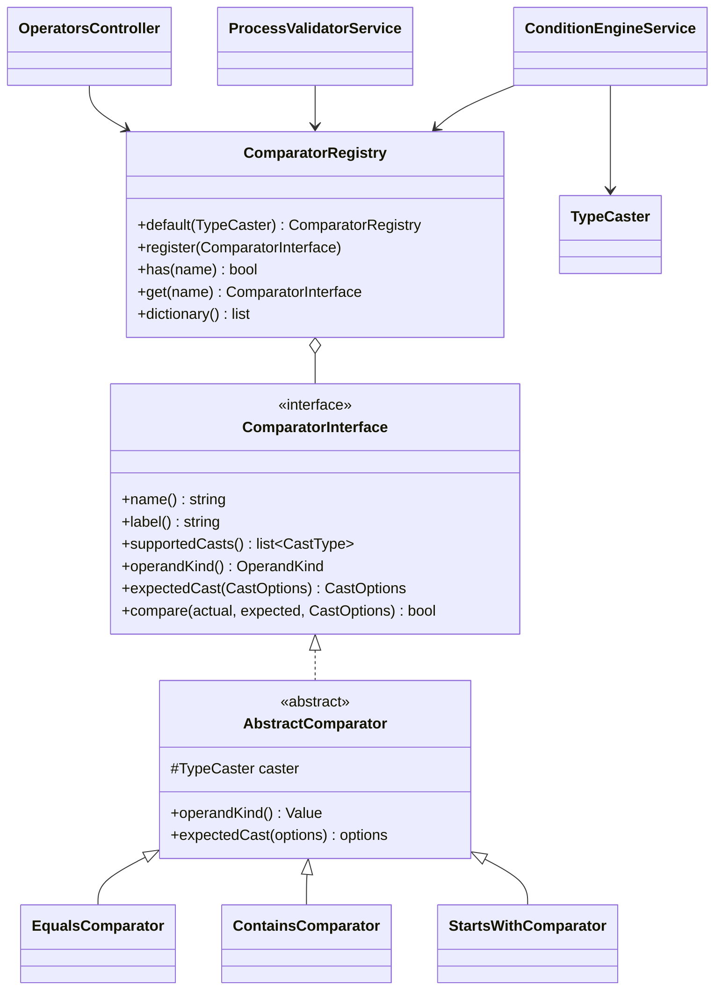

# New comparison operator

How to add an operator for process conditions, using the built-in `starts_with` ("Starts with") operator as the example.

<!-- lang-switch -->
🇬🇧 English | [🇷🇺 Русский](../../../ru/07-developer-guide/extending/new-comparator.md)
<!-- /lang-switch -->

## 1. When you need it

The built-in operators are listed in [Trigger conditions](../../03-user-guide/triggers-and-conditions.md#operators) and
in the `GET /api/dictionaries/operators` dictionary. Add a new one when a condition cannot be expressed with them, e.g. a
regular expression or a Levenshtein distance comparison.

> **Note**
> `starts_with` and `ends_with` are already shipped (task 3.5): below is how they are built. When repeating the example,
> choose your own operator name (e.g. `matches_regex`) and add it to the exact list in `testDictionaries()`.

## 2. How it works



- `name()` is the code stored in a condition row (`"operator": "starts_with"`), `label()` is the default caption.
- Before the call `ConditionEngineService` casts both sides to the type of the condition row (`cast`, `cast_options`)
  with `Wps\Types\TypeCaster`: the left side with the row's `CastOptions`, the right side with `expectedCast($options)`
  (the same options by default; `contains` with `list` casts the right side as a list element — `$options->element()`).
  Without `cast` both sides are strings (`TypeCaster::stringify()`: `null` → `''`, `true` → `'true'`, floats without
  trailing zeros, arrays → JSON), as before. See [Comparison type (cast)](../../03-user-guide/triggers-and-conditions.md#comparison-type-cast).
- A missing field, an empty value (for types other than `string` and `bool`) and a cast error are handled by the engine:
  the row becomes false and the trace gets `missing` / `empty` / `cast_error`. They never reach `compare()`, so the
  comparator receives values already cast to its type: `string`, `int`, a canonical `decimal` string,
  `DateTimeImmutable` (`date`, `datetime`), `bool`, `list<string>`.
- `supportedCasts()` lists the `CastType`s the operator works with. The validator rejects the others
  (`Operator "starts_with" does not support cast "decimal" (supported: string)`); the operators dictionary returns it
  as `casts`.
- `operandKind()` is the shape of the right-hand side (`OperandKind`: `value` — one value; `none`, `presence`, `list`,
  `range`, `change`, `change_value` — for future emptiness, list, range and change operators). In the dictionary —
  `operands`.
- The base class `AbstractComparator` holds the `TypeCaster` (`$this->caster` — for `equals()` / `compare()` of values)
  and provides `operandKind() = Value` and `expectedCast()` = the same options.
- `ComparatorRegistry::default(TypeCaster)` lists the operators; `Container::comparators()` builds it once per worker and
  passes the `TypeCaster` with the `WPS_TIMEZONE` time zone.
- The same registry is used by three consumers:
  - `ConditionEngineService` — evaluates conditions at run time;
  - `ProcessValidatorService` — rejects unknown operators on save (`Unknown comparison operator`);
  - `GET /api/dictionaries/operators` (`OperatorsController`) — the list shown in the UI.
- The UI shows the operator select from that dictionary and translates captions by value: key
  `dict.operator.<name>` in `front/src/locales/*.json`; without the key it shows the backend `label()`.

## 3. Step by step

### 3.1 The class — `back/src/Comparators/StartsWithComparator.php`

```php
<?php

declare(strict_types=1);

namespace Wps\Comparators;

use Wps\Types\CastOptions;
use Wps\Types\CastType;

/**
 * Prefix match: "object.phone" starts with "+7".
 */
final class StartsWithComparator extends AbstractComparator
{
    public function name(): string
    {
        return 'starts_with';
    }

    public function label(): string
    {
        return 'Начинается с';
    }

    public function supportedCasts(): array
    {
        return [CastType::String];
    }

    public function compare(mixed $actual, mixed $expected, CastOptions $options): bool
    {
        // both sides are already cast to strings (case_sensitive / trim applied)
        return str_starts_with((string)$actual, (string)$expected);
    }
}
```

> **Note**
> The built-in comparators return Russian captions from `label()` (the API default language). The UI never shows them
> when a `dict.operator.*` translation exists, so keep the same style.

### 3.2 Registration — `back/src/Comparators/ComparatorRegistry.php`

```php
public static function default(?TypeCaster $caster = null): self
{
    $caster ??= new TypeCaster();
    $registry = new self();
    $registry->register(new EqualsComparator($caster));
    $registry->register(new NotEqualsComparator($caster));
    $registry->register(new ContainsComparator($caster));
    $registry->register(new NotContainsComparator($caster));
    $registry->register(new StartsWithComparator($caster));
    return $registry;
}
```

The order of `register()` calls is the order in the UI select.

### 3.3 Rebuild

```bash
docker compose up -d --build backend
curl -s http://localhost:9501/api/dictionaries/operators -H "Authorization: Bearer $TOKEN"
# … {"value":"starts_with","label":"Начинается с","casts":["string"],"operands":"value"}
```

### 3.4 Use it in a process

```json
{ "field": "object.phone", "operator": "starts_with", "value_type": "static", "value": "+7" }
```

Case-insensitive — through the options of the `string` type:

```json
{ "field": "object.email", "operator": "starts_with", "value": "info@", "cast": "string", "cast_options": { "case_sensitive": false } }
```

## 4. Validation and errors

- Nothing to add: the validator accepts any registered operator and checks the `field`/`value` paths, `cast` /
  `cast_options`, compatibility with `supportedCasts()` and that a static value can be cast to the type
  (`expectedCast()`).
- `compare()` must be pure and must not throw. A run-time problem in a condition would make every event of that object
  type fail; return `false` instead.
- No need to validate number and date formats — the values are already cast. If the operator needs a special format
  (a regex, for example), validate it in `compare()` defensively (`@preg_match(...) === false` → `false`).
- Compare with `$this->caster->equals()` / `$this->caster->compare()` rather than `===` / `<`: they respect the type
  (`decimal` via `bccomp`, dates by day or moment, lists as sets).

## 5. UI and translations

Add the caption to **both** locale files (the same key set is enforced by `npm run i18n:check`):

`front/src/locales/en.json`

```json
"dict": {
  "operator": {
    "equals": "Equals",
    "not_equals": "Not equals",
    "contains": "Contains",
    "not_contains": "Does not contain",
    "starts_with": "Starts with"
  },
```

`front/src/locales/ru.json`

```json
"dict": {
  "operator": {
    …,
    "starts_with": "Начинается с"
  },
```

Optional: add the item to `FALLBACK.operators` in `front/src/api/dictionaries.ts` — that list is used only when the
dictionary endpoint is unavailable.

No component changes are needed: `ConditionsPanel.vue` renders whatever `localizeDict('operator', …)` returns, and
`ProcessDetailView.vue` shows the caption in the conditions table.

## 6. Test

In `back/tests/IntegrationTest.php`:

1. Update the exact-list check in `testDictionaries()`:

```php
$this->assertEquals(['contains', 'equals', 'not_contains', 'not_equals', 'starts_with'], $values);
```

2. Add a behaviour check (process with the new operator + manual run):

```php
$this->test('starts_with: a non-matching phone does not start the process', function () {
    $res = $this->request('POST', '/api/processes', [
        'name' => 'TEST starts_with', 'object_type' => 'TestExt', 'is_child' => false,
        'definition' => ['conditions' => [
            ['field' => 'object.phone', 'operator' => 'starts_with', 'value_type' => 'static', 'value' => '+7'],
        ]],
    ], $this->adminToken, 201);
    $id = $res['data']['id'];
    $miss = $this->request('POST', "/api/processes/{$id}/run", ['object' => ['id' => 'e0', 'phone' => '+1555']], $this->adminToken, 200);
    $this->assertFalse($miss['data']['conditions_met']);
});
```

This check is the operator part of the verified `testExtensions()` group: there the same condition is combined with the
other examples, and a matching phone (`+79990000000`) starts an execution that completes (see
[New action type → Test](new-action-type.md#6-test)). With all examples applied the full suite passed
(`Passed: 74, Failed: 0`) on a separate stack, and `npm run build` passed with the new keys.

## 7. Checklist

- [ ] Class in `back/src/Comparators/`, `final`, `strict_types`, extends `AbstractComparator`, unique `snake_case` `name()`
- [ ] `supportedCasts()` lists the allowed types, `compare()` works on cast values and has a unit test
      (`back/tests/Unit/Comparators`)
- [ ] Registered in `ComparatorRegistry::default()` with the shared `$caster`
- [ ] `dict.operator.<name>` in `en.json` and `ru.json`; `npm run build` passes
- [ ] `testDictionaries()` list updated, behaviour check added, suite green
- [ ] Operator described in [Triggers and conditions](../../03-user-guide/triggers-and-conditions.md) (en + ru) and in `back/API.md`

<!-- footer-nav -->
---

← Previous: [New block type](new-block-type.md) | [Contents](../../README.md) | [New change type](new-change-type.md) Next →
<!-- /footer-nav -->
