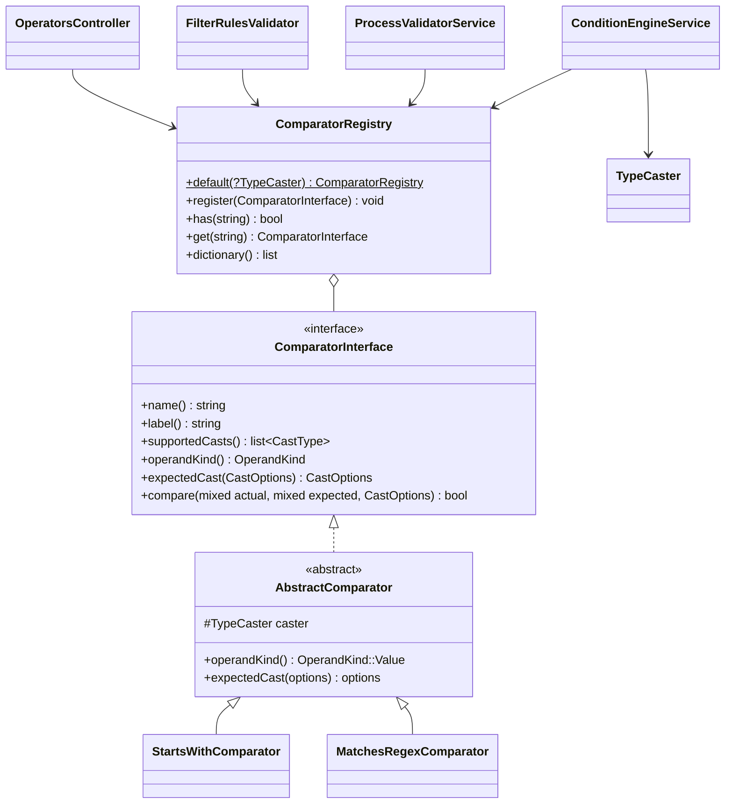

# New comparison operator

How to add an operator for process conditions, using the tutorial operator `matches_regex` ("Matches a regular
expression") as the example.

<!-- lang-switch -->
🇬🇧 English | [🇷🇺 Русский](../../../ru/07-developer-guide/extending/new-comparator.md)
<!-- /lang-switch -->

## 1. When you need it

The built-in operators are listed in [Trigger conditions](../../03-user-guide/triggers-and-conditions.md#operators) and
in the `GET /api/dictionaries/operators` dictionary: equality, order (`greater_than` …, `between`), lists (`in`,
`contains_any` …), strings (`contains`, `starts_with`, `ends_with`), emptiness and `null`, changes (`changed`,
`changed_to` …). Add a new one when a condition cannot be expressed with them, e.g. a regular-expression check or a
Levenshtein distance.

> **Note**
> `matches_regex` is a tutorial example; WPS does not ship it. A similar check can already be written without a new
> operator: a right-hand side with `value_type: "expression"` and the `regex_match()` function
> ([comparing with an expression](../../03-user-guide/triggers-and-conditions.md#comparing-with-an-expression)).
> A dedicated operator is friendlier for process editors and checks the pattern on save. Pick a name that is not in
> `ComparatorRegistry::default()`: registering the same name silently **replaces** the built-in operator.

## 2. How it works



The `Wps\Comparators\ComparatorInterface` interface (`back/src/Comparators/ComparatorInterface.php`):

| Method | Purpose |
|---|---|
| `name(): string` | the code stored in a condition row (`"operator": "matches_regex"`); unique, `snake_case` |
| `label(): string` | default label (built-in operators use Russian) |
| `supportedCasts(): array` | `list<CastType>` — which `cast` values the operator accepts; the dictionary returns it as `casts` |
| `operandKind(): OperandKind` | shape of the right-hand side, the dictionary returns it as `operands` |
| `expectedCast(CastOptions $options): CastOptions` | how the right-hand side is cast (by default the same way as the field) |
| `compare(mixed $actual, mixed $expected, CastOptions $options): bool` | the comparison of already cast values |

- **Type casting.** Before `compare()`, `ConditionEngineService` casts both sides with `Wps\Types\TypeCaster`: the
  left one with the `CastOptions` of the condition row (`cast`, `cast_options`), the right one with
  `expectedCast($options)`. Without `cast` the type is `string`: `TypeCaster::stringify()` (`null` → `''`, `true` →
  `'true'`, decimals without trailing zeros, arrays → JSON), then `trim` and case folding when `cast_options` enable
  them. The comparator receives values of its type: `string`, `int`, a canonical `decimal` string,
  `DateTimeImmutable` (`date`, `datetime`), `bool`, `list<string>`. See
  [Comparison type (cast)](../../03-user-guide/triggers-and-conditions.md#comparison-type-cast).
- **Missing values and errors are handled by the engine.** A missing field, an empty value (for every type except
  `string` and `bool`) and a cast error never reach `compare()`: the row becomes false and the condition trace shows
  `missing` / `empty` / `cast_error` (`on_cast_error: "error"` turns a cast error into an execution error).
- **`OperandKind`** (`back/src/Comparators/OperandKind.php`) — every kind is implemented in both the engine and the
  validator:

  | Value | Right-hand side | Built-in operators |
  |---|---|---|
  | `Value` (`value`) | one value (`value_type`: `static`, `from_object_field`, `expression`) | `equals`, `contains`, `greater_than` … |
  | `None` (`none`) | none; the field must exist | `is_empty`, `is_not_empty` |
  | `Presence` (`presence`) | none; evaluated for a missing field too | `is_null`, `is_not_null` |
  | `List` (`list`) | a list of values | `in`, `not_in`, `contains_any`, `contains_all`, `contains_none` |
  | `Range` (`range`) | a pair `[from, to]` | `between`, `not_between` |
  | `Change` (`change`) | none; the field changed in this save | `changed`, `not_changed` |
  | `ChangeValue` (`change_value`) | a change + a value | `changed_to`, `changed_from` |

  A new kind of right-hand side needs changes in `ConditionEngineService` and `ProcessValidatorService` — that is a
  core change, not an extension.
- **`AbstractComparator`** keeps the `TypeCaster` (`protected readonly TypeCaster $caster`) and provides
  `operandKind() = OperandKind::Value` and `expectedCast() = $options`. Almost every new operator extends it.
- **Registry.** The operator list is built by `ComparatorRegistry::default(?TypeCaster $caster = null)`;
  `Container::comparators()` builds it once per worker with a `TypeCaster` in the `WPS_TIMEZONE` time zone. There is no
  separate registration point in `Container` — you edit `default()` itself.
- **Who uses the registry:**
  - `ConditionEngineService` — process trigger conditions, branches of the `condition` block, the `find_records` filter
    in `related_to` mode (records are filtered inside WPS);
  - `ProcessValidatorService` — on save rejects an unknown operator (`Unknown comparison operator`), checks `cast`
    against `supportedCasts()` and the static value against `expectedCast()`;
  - `FilterRulesValidator` + `FilterTranslator` — filters sent to the CRM (`find_records` by module, `update_records`,
    `aggregate`, `assign` pools). Only operators from `FilterTranslator::SERVER_SIDE` are allowed there: a new operator
    gets `Operator "matches_regex" is not supported in find_records filter` until you add it there and to the CRM
    contract;
  - `GET /api/dictionaries/operators` (`OperatorsController`) — the list the UI shows.

## 3. Step by step

| File | What to do |
|---|---|
| `back/src/Comparators/MatchesRegexComparator.php` | **new** — the operator class |
| `back/src/Comparators/ComparatorRegistry.php` | registration in `default()` |
| `back/src/Services/ProcessValidatorService.php` | (optional) check of the static value on save |
| `back/tests/Unit/Comparators/MatchesRegexComparatorTest.php` | **new** — unit test |
| `back/tests/IntegrationTest.php` | a `[matches_regex]` block |
| `front/src/locales/en.json`, `ru.json` | `dict.operator.matches_regex` |
| `doc/{ru,en}/03-user-guide/triggers-and-conditions.md`, `back/API.md` | operator description |

### 3.1 Class — `back/src/Comparators/MatchesRegexComparator.php`

```php
<?php

declare(strict_types=1);

namespace Wps\Comparators;

use Wps\Exceptions\NonRecoverableException;
use Wps\Expression\SafeRegex;
use Wps\Types\CastOptions;
use Wps\Types\CastType;

/**
 * The string matches a regular expression: "object.phone" matches "^\+7\d{10}$".
 * The pattern is written without delimiters (as in regex_match()); limits and the PCRE sandbox — SafeRegex.
 */
final class MatchesRegexComparator extends AbstractComparator
{
    public function name(): string
    {
        return 'matches_regex';
    }

    public function label(): string
    {
        return 'Соответствует рег. выражению';
    }

    public function supportedCasts(): array
    {
        return [CastType::String];
    }

    /**
     * The pattern is never case-folded or trimmed: "\D" must not become "\d". Case-insensitivity is the "i" flag.
     */
    public function expectedCast(CastOptions $options): CastOptions
    {
        return new CastOptions(type: CastType::String);
    }

    public function compare(mixed $actual, mixed $expected, CastOptions $options): bool
    {
        try {
            return SafeRegex::match((string)$actual, (string)$expected, $options->caseSensitive ? '' : 'i', 'matches_regex');
        } catch (NonRecoverableException) {
            // a broken pattern or a too long value: the row is false, the condition must not throw
            return false;
        }
    }
}
```

What matters here:

- `Wps\Expression\SafeRegex` is the shared regular-expression sandbox of WPS (used by `regex_match()`,
  `regex_extract()`, `regex_replace()`): a pattern without delimiters, flags `i`/`m`/`s` only, at most 500 characters
  of pattern and 100,000 of subject, lowered `pcre.backtrack_limit` / `recursion_limit` for the duration of one call.
  Never call `preg_match()` with a user pattern directly: a Swoole worker is shared by coroutines, and catastrophic
  backtracking would block it.
- `expectedCast()` is overridden: with `cast_options.case_sensitive: false` the engine folds the case of **both**
  sides, and `\D` in the pattern would become `\d`. The pattern is cast without folding, and case-insensitivity comes
  from the `i` flag (the left side is already folded — that does no harm).
- `compare()` never throws: an error in a condition would break the processing of every event of that object type.

### 3.2 Registration — `back/src/Comparators/ComparatorRegistry.php`

```php
public static function default(?TypeCaster $caster = null): self
{
    $caster ??= new TypeCaster();
    $registry = new self();
    $registry->register(new EqualsComparator($caster));
    $registry->register(new NotEqualsComparator($caster));
    // … 21 more built-in operators, see the file …
    $registry->register(new StartsWithComparator($caster));
    $registry->register(new EndsWithComparator($caster));
    $registry->register(new MatchesRegexComparator($caster));   // new operator
    // … contains_any / contains_all / contains_none, is_empty …, changed …
    return $registry;
}
```

The order of `register()` calls is the order of the items in the UI drop-down. Always pass the shared `$caster`: it
carries the `WPS_TIMEZONE` time zone used to cast dates.

### 3.3 Checking the value on save — `ProcessValidatorService::validateCast()`

The validator itself checks `cast`, `cast_options`, compatibility with `supportedCasts()` and that a static value can
be cast with `expectedCast()`. A comparator has no "validate my value" hook; operator-specific rules live directly in
`validateCast()` (that is how `starts_with` / `ends_with` reject an empty prefix). To reject a broken pattern with
`422` instead of silently getting `false`, add a branch next to that rule:

```php
// back/src/Services/ProcessValidatorService.php, validateCast(), next to the starts_with / ends_with rule
if ($checkStaticValue && $operator === 'matches_regex'
    && ($error = SafeRegex::validate(TypeCaster::stringify($row['value'] ?? null), '', 'matches_regex')) !== null) {
    $scope->error("{$rowPath}.value", $error);   // "Invalid regular expression in matches_regex(): missing closing parenthesis"
    return;
}
```

(`use Wps\Expression\SafeRegex;` at the top of the file.) `$checkStaticValue` is true only for
`value_type: "static"`; a pattern taken from a field or an expression is checked at run time — where an error gives
`false`.

### 3.4 Rebuild and dictionary

```bash
docker compose up -d --build backend
curl -s http://localhost:9501/api/dictionaries/operators -H "Authorization: Bearer $TOKEN"
# … {"value":"matches_regex","label":"Соответствует рег. выражению","casts":["string"],"operands":"value"}
```

### 3.5 Using it in a process

```json
{ "field": "object.phone", "operator": "matches_regex", "value_type": "static", "value": "^\\+7\\d{10}$" }
```

The backslash is doubled in JSON: the condition value is `^\+7\d{10}$`. Case-insensitive:

```json
{ "field": "object.code", "operator": "matches_regex", "value": "^abc-\\d+$", "cast": "string", "cast_options": { "case_sensitive": false } }
```

A pattern from a field of another record: `"value_type": "from_object_field", "value": "acc.phone_mask_c"`.

## 4. Validation and errors

- The validator accepts any registered operator and itself checks the `field`/`value` paths, `value_type`, `cast` /
  `cast_options`, compatibility with `supportedCasts()` (`Operator "matches_regex" does not support cast "decimal"
  (supported: string)`; when `string` is not in the list the text is different — `requires cast: …`) and that a
  static value can be cast (`expectedCast()`).
- `compare()` is a pure function without I/O and without state: one instance serves every coroutine of the worker. No
  fields that change during a call.
- Do not throw from `compare()`: return `false`. Cast errors are already handled by the engine.
- Compare with `$this->caster->equals($a, $b, $options)` / `$this->caster->compare($a, $b, $options)` (returns `int`),
  not `===` / `<`: they respect the type (`decimal` via `bccomp`, dates by day or by instant, lists as sets).
- The trace of every condition row goes into the execution (`context.conditions`; for `condition` branches — into the
  `result_data` of the block record): `field`, `operator`, `actual`, `expected`, `result`, plus `missing` /
  `cast_error` when relevant. The comparator writes nothing to the trace itself.

## 5. UI and translations

Add the label to **both** locale files (`npm run i18n:check` requires identical key sets):

`front/src/locales/en.json`

```json
"dict": {
  "operator": {
    "equals": "Equals",
    "not_equals": "Not equals",
    "contains": "Contains",
    "not_contains": "Does not contain",
    "matches_regex": "Matches regex"
  },
```

`front/src/locales/ru.json`

```json
"dict": {
  "operator": {
    …,
    "matches_regex": "Соответствует рег. выражению"
  },
```

The UI translates the label by value (`dictItemLabel()` / `localizeDict('operator', …)` in
`front/src/utils/format.ts`): when there is no `dict.operator.<name>` key, the backend `label()` is shown. Optionally
add an item to `FALLBACK.operators` in `front/src/api/dictionaries.ts` — that list is used only when the dictionary
endpoint is unavailable. No component changes are needed: `ConditionsPanel.vue` renders the dictionary,
`ProcessDetailView.vue` shows the label in the conditions table.

## 6. Test

### 6.1 Unit test — `back/tests/Unit/Comparators/MatchesRegexComparatorTest.php`

Modelled on `StartsEndsWithTest`: the condition is evaluated by the real `ConditionEngineService`, so casting and a
missing field are covered too.

```php
<?php

declare(strict_types=1);

namespace Wps\Tests\Unit\Comparators;

use PHPUnit\Framework\TestCase;
use Wps\Comparators\ComparatorRegistry;
use Wps\Comparators\MatchesRegexComparator;
use Wps\Context\ExecutionContext;
use Wps\Services\ConditionEngineService;
use Wps\Types\TypeCaster;

final class MatchesRegexComparatorTest extends TestCase
{
    private static function registry(): ComparatorRegistry
    {
        $registry = ComparatorRegistry::default();
        $registry->register(new MatchesRegexComparator(new TypeCaster())); // not needed once it is in default()
        return $registry;
    }

    private static function met(array $row, array $object): bool
    {
        $engine = new ConditionEngineService(self::registry());
        return $engine->evaluate([$row], ExecutionContext::fromEvent('e', $object + ['id' => '1'], 'Leads'))->isMet();
    }

    public function testOperator(): void
    {
        $row = ['field' => 'object.phone', 'operator' => 'matches_regex', 'value' => '^\+7\d{10}$'];
        self::assertTrue(self::met($row, ['phone' => '+79991234567']));
        self::assertFalse(self::met($row, ['phone' => '+7999']));
        self::assertFalse(self::met($row, []), 'a missing field never matches');

        $code = ['field' => 'object.code', 'operator' => 'matches_regex', 'value' => '^ABC-\D+$'];
        self::assertFalse(self::met($code, ['code' => 'abc-x']), 'case-sensitive by default');
        self::assertTrue(self::met($code + ['cast_options' => ['case_sensitive' => false]], ['code' => 'abc-x']), '"\D" is not folded to "\d"');

        self::assertFalse(self::met(['field' => 'object.code', 'operator' => 'matches_regex', 'value' => '('], ['code' => '(']), 'a broken pattern is false, not an exception');
    }

    public function testDictionary(): void
    {
        $operators = array_column(self::registry()->dictionary(), null, 'value');
        self::assertSame(['value' => 'matches_regex', 'label' => 'Соответствует рег. выражению', 'casts' => ['string'], 'operands' => 'value'], $operators['matches_regex']);
    }
}
```

Run it with `docker run --rm wps-backend-test --testsuite unit` after `docker build … --target test`
([Testing](../testing.md#backend-unit-tests)). The class and the test of this section were run against the current
code (`OK`). If you added the rule from [3.3](#33-checking-the-value-on-save--processvalidatorservicevalidatecast),
cover it too — through `ProcessValidatorService` that is easiest with the integration test below.

### 6.2 Integration test — `back/tests/IntegrationTest.php`

A new method modelled on `testStartsEndsWith()`; add the `$this->testMatchesRegex();` call to the `run()` list.

```php
/**
 * matches_regex: dictionary, a manual run, validation of the pattern.
 */
private function testMatchesRegex(): void
{
    echo "[matches_regex]\n";
    $this->test('matches_regex in a manual run and on save', function () {
        $operators = array_column($this->request('GET', '/api/dictionaries/operators', token: $this->viewerToken)['data'], 'casts', 'value');
        $this->assertEquals(['string'], $operators['matches_regex'] ?? null);
        $process = $this->request('POST', '/api/processes', ['name' => 'TEST matches_regex', 'object_type' => 'TestRx', 'is_child' => false, 'definition' => [
            'conditions' => [['field' => 'object.phone', 'operator' => 'matches_regex', 'value' => '^\+7\d{10}$']],
            'actions' => [['type' => 'modify', 'target' => 'object.x', 'change_type' => 'set_value', 'value' => '1']],
        ]], $this->adminToken, 201)['data'];
        $yes = $this->request('POST', "/api/processes/{$process['id']}/run", ['object' => ['id' => 'rx1', 'module' => 'TestRx', 'phone' => '+79991234567']], $this->editorToken, 201)['data'];
        $this->assertTrue($yes['conditions_met']);
        $no = $this->request('POST', "/api/processes/{$process['id']}/run", ['object' => ['id' => 'rx2', 'module' => 'TestRx', 'phone' => '+1555']], $this->editorToken, 200)['data'];
        $this->assertFalse($no['conditions_met']);
        $bad = $this->request('POST', '/api/processes', ['name' => 'TEST matches_regex bad', 'object_type' => 'TestRx', 'is_child' => false, 'definition' => ['conditions' => [
            ['field' => 'object.phone', 'operator' => 'matches_regex', 'value' => '1', 'cast' => 'int'],
            ['field' => 'object.phone', 'operator' => 'matches_regex', 'value' => '('],          // needs the rule of 3.3
        ], 'actions' => []]], $this->adminToken, 422);
        $d = array_column($bad['error']['details'], 'message', 'field');
        $this->assertEquals('Operator "matches_regex" does not support cast "int" (supported: string)', $d['definition.conditions[0].cast'] ?? null);
        $this->assertEquals('Invalid regular expression in matches_regex(): missing closing parenthesis', $d['definition.conditions[1].value'] ?? null);
        $this->request('DELETE', "/api/processes/{$process['id']}", token: $this->adminToken);
    });
}
```

A manual run (`POST /api/processes/{id}/run`) answers `201` with `execution_id` when the conditions are met and `200`
with `conditions_met: false` when they are not. Running the integration tests against the mock —
[Testing](../testing.md). The same condition is part of the shared `testExtensions()` template
([New action type → Test](new-action-type.md#6-test)).

## 7. Common pitfalls

| Mistake | Consequence | Do instead |
|---|---|---|
| The name matches a built-in operator | the built-in operator is silently replaced for every process | a unique `name()`; check `GET /api/dictionaries/operators` |
| An exception from `compare()` | condition evaluation fails for every event of that module | return `false` |
| State in comparator fields (a cache of the last pattern, etc.) | races between the coroutines of a worker | only `readonly` dependencies; a cache must be static and bounded, like in `TemplateEngine` |
| `===` / `<` instead of `$this->caster` | `'10.0'` ≠ `'10'`, dates compared as strings | `TypeCaster::equals()` / `compare()` |
| Default `expectedCast()` for a "syntactic" right-hand side (pattern, mask) | `case_sensitive: false` / `trim` corrupt the pattern | return `new CastOptions(type: CastType::String)` |
| Expecting the operator to work in a CRM filter | `422 … is not supported in find_records filter` | process conditions, branches and `find_records` with `related_to` only; for the CRM — `FilterTranslator::SERVER_SIDE` + the contract |
| `preg_match()` with a user pattern | ReDoS blocks the worker | `SafeRegex` |

## 8. Readiness checklist

- [ ] Class in `back/src/Comparators/`, `final`, `declare(strict_types=1)`, extends `AbstractComparator`, unique `snake_case` `name()`
- [ ] `supportedCasts()` lists the accepted types; `expectedCast()` overridden when the right-hand side must not be cast like the field
- [ ] `compare()` is pure, never throws and keeps no state
- [ ] Registered in `ComparatorRegistry::default()` with the shared `$caster`
- [ ] (if needed) a static-value rule in `ProcessValidatorService::validateCast()`
- [ ] Unit test in `back/tests/Unit/Comparators/` and an integration block in `IntegrationTest.php` (called from `run()`), tests green
- [ ] `dict.operator.<name>` exists in `en.json` and `ru.json`; `npm run build` passes
- [ ] Operator documented in [Trigger conditions](../../03-user-guide/triggers-and-conditions.md) (en + ru) and in `back/API.md`

<!-- footer-nav -->
---

← Previous: [New block type](new-block-type.md) | [Contents](../../README.md) | [New change type](new-change-type.md) Next →
<!-- /footer-nav -->
