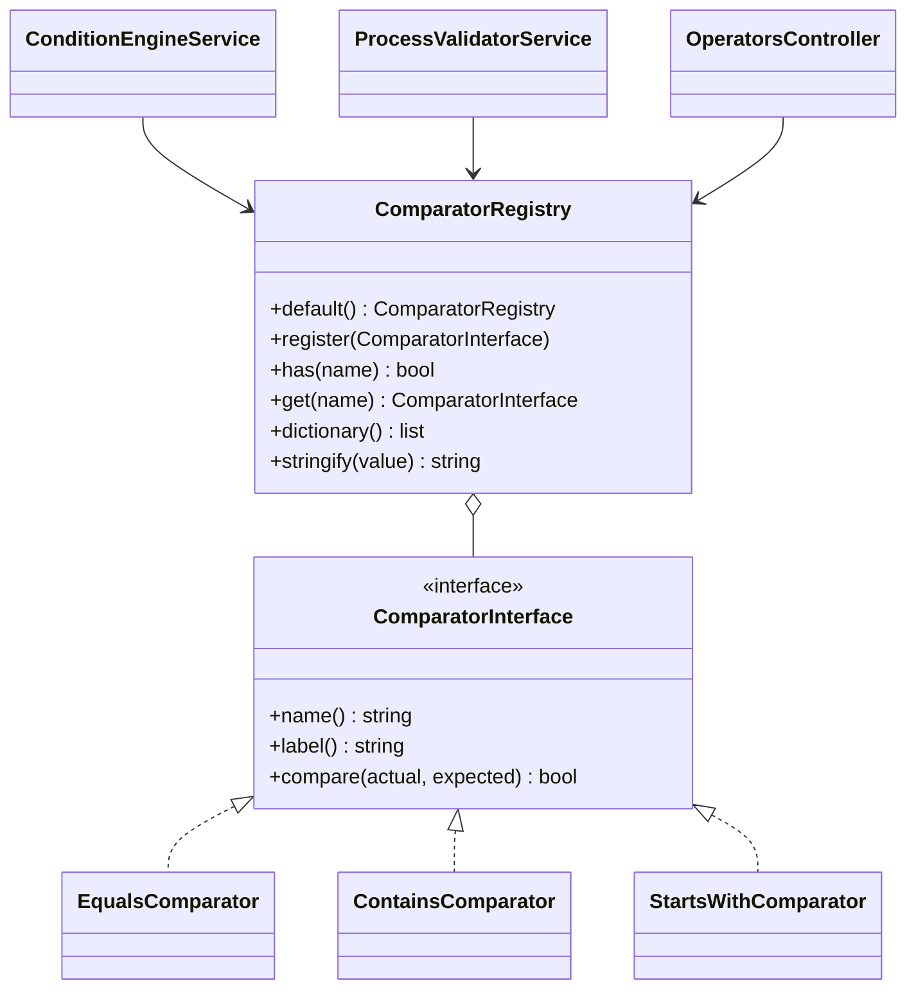

# New comparison operator

How to add an operator for process conditions, using `starts_with` ("Starts with") as a complete, verified example.

<!-- lang-switch -->
🇬🇧 English | [🇷🇺 Русский](../../../ru/07-developer-guide/extending/new-comparator.md)
<!-- /lang-switch -->

## 1. When you need it

The built-in operators are `equals`, `not_equals`, `contains`, `not_contains`. Add a new one when a condition cannot be
expressed with them — a prefix, a regular expression, a numeric comparison (`greater_than`), an "is empty" check.

## 2. How it works



- `name()` is the code stored in a condition row (`"operator": "starts_with"`), `label()` is the default caption.
- Both sides are converted to strings before the call (`ComparatorRegistry::stringify()`: `null` → `''`, `true` → `'true'`,
  floats without trailing zeros, arrays → JSON), so `compare()` always gets two strings.
- `ComparatorRegistry::default()` lists the operators; `Container::comparators()` builds it once per worker.
- The same registry is used by three consumers:
  - `ConditionEngineService` — evaluates conditions at run time;
  - `ProcessValidatorService` — rejects unknown operators on save (`Unknown comparison operator`);
  - `GET /api/dictionaries/operators` (`OperatorsController`) — the list shown in the UI.
- The UI shows the operator select from that dictionary and translates captions by value: key
  `dict.operator.<name>` in `front/src/locales/*.json`; without the key it shows the backend `label()`.

## 3. Step by step

### 3.1 The class — `back/src/Comparators/StartsWithComparator.php`

```php
<?php

declare(strict_types=1);

namespace Wps\Comparators;

/**
 * Prefix match: "object.phone" starts with "+7".
 */
final class StartsWithComparator implements ComparatorInterface
{
    public function name(): string
    {
        return 'starts_with';
    }

    public function label(): string
    {
        return 'Начинается с';
    }

    public function compare(string $actual, string $expected): bool
    {
        return str_starts_with($actual, $expected);
    }
}
```

> **Note**
> The built-in comparators return Russian captions from `label()` (the API default language). The UI never shows them
> when a `dict.operator.*` translation exists, so keep the same style.

### 3.2 Registration — `back/src/Comparators/ComparatorRegistry.php`

```php
public static function default(): self
{
    $registry = new self();
    $registry->register(new EqualsComparator());
    $registry->register(new NotEqualsComparator());
    $registry->register(new ContainsComparator());
    $registry->register(new NotContainsComparator());
    $registry->register(new StartsWithComparator());
    return $registry;
}
```

The order of `register()` calls is the order in the UI select.

### 3.3 Rebuild

```bash
docker compose up -d --build backend
curl -s http://localhost:9501/api/dictionaries/operators -H "Authorization: Bearer $TOKEN"
# … {"value":"starts_with","label":"Начинается с"}
```

### 3.4 Use it in a process

```json
{ "field": "object.phone", "operator": "starts_with", "value_type": "static", "value": "+7" }
```

## 4. Validation and errors

- Nothing to add: the validator accepts any registered operator and checks `field`/`value` paths itself.
- `compare()` must be pure and must not throw. A run-time problem in a condition would make every event of that object
  type fail; return `false` instead.
- If the operator needs a specific value format (a number, a regex), validate it in `compare()` defensively
  (`is_numeric`, `@preg_match(...) === false` → `false`).

## 5. UI and translations

Add the caption to **both** locale files (the same key set is enforced by `npm run i18n:check`):

`front/src/locales/en.json`

```json
"dict": {
  "operator": {
    "equals": "Equals",
    "not_equals": "Not equals",
    "contains": "Contains",
    "not_contains": "Does not contain",
    "starts_with": "Starts with"
  },
```

`front/src/locales/ru.json`

```json
"dict": {
  "operator": {
    …,
    "starts_with": "Начинается с"
  },
```

Optional: add the item to `FALLBACK.operators` in `front/src/api/dictionaries.ts` — that list is used only when the
dictionary endpoint is unavailable.

No component changes are needed: `ConditionsPanel.vue` renders whatever `localizeDict('operator', …)` returns, and
`ProcessDetailView.vue` shows the caption in the conditions table.

## 6. Test

In `back/tests/IntegrationTest.php`:

1. Update the exact-list check in `testDictionaries()`:

```php
$this->assertEquals(['contains', 'equals', 'not_contains', 'not_equals', 'starts_with'], $values);
```

2. Add a behaviour check (process with the new operator + manual run):

```php
$this->test('starts_with: a non-matching phone does not start the process', function () {
    $res = $this->request('POST', '/api/processes', [
        'name' => 'TEST starts_with', 'object_type' => 'TestExt', 'is_child' => false,
        'definition' => ['conditions' => [
            ['field' => 'object.phone', 'operator' => 'starts_with', 'value_type' => 'static', 'value' => '+7'],
        ]],
    ], $this->adminToken, 201);
    $id = $res['data']['id'];
    $miss = $this->request('POST', "/api/processes/{$id}/run", ['object' => ['id' => 'e0', 'phone' => '+1555']], $this->adminToken, 200);
    $this->assertFalse($miss['data']['conditions_met']);
});
```

This check is the operator part of the verified `testExtensions()` group: there the same condition is combined with the
other examples, and a matching phone (`+79990000000`) starts an execution that completes (see
[New action type → Test](new-action-type.md#6-test)). With all examples applied the full suite passed
(`Passed: 74, Failed: 0`) on a separate stack, and `npm run build` passed with the new keys.

## 7. Checklist

- [ ] Class in `back/src/Comparators/`, `final`, `strict_types`, unique `snake_case` `name()`
- [ ] Registered in `ComparatorRegistry::default()`
- [ ] `dict.operator.<name>` in `en.json` and `ru.json`; `npm run build` passes
- [ ] `testDictionaries()` list updated, behaviour check added, suite green
- [ ] Operator described in [Triggers and conditions](../../03-user-guide/triggers-and-conditions.md) (en + ru) and in `back/API.md`

<!-- footer-nav -->
---

← Previous: [New action type](new-action-type.md) | [Contents](../../README.md) | [New change type](new-change-type.md) Next →
<!-- /footer-nav -->
