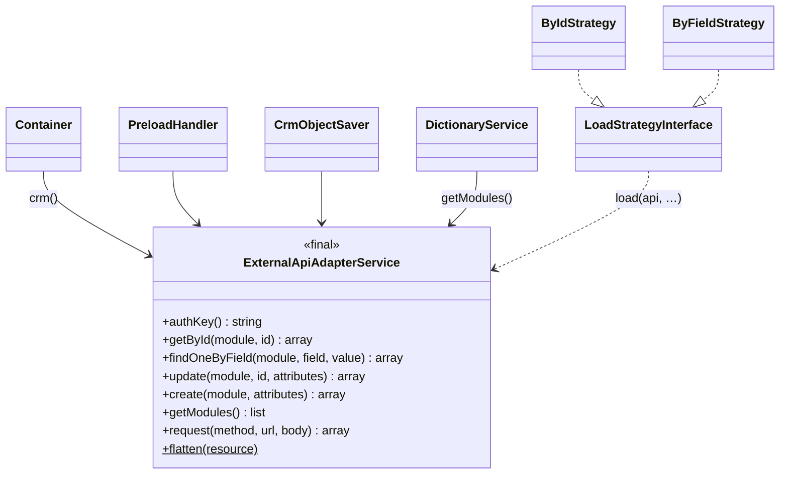

# New CRM adapter

How to connect WPS to a CRM other than the mock or SuiteCRM 7/8, using a verified bridge service as the example.

<!-- lang-switch -->
🇬🇧 English | [🇷🇺 Русский](../../../ru/07-developer-guide/extending/new-crm-adapter.md)
<!-- /lang-switch -->

## 1. When you need it

WPS talks to exactly one CRM, configured by `CRM_API_BASE_URL`. The mock and the SuiteCRM plugin both speak the same small
REST contract. Follow this page when the CRM you need has a different API (other URLs, other authentication, plain JSON
instead of JSON:API) or does not publish events to the Redis Stream yet.

## 2. How it works



- There is **one** CRM client: `Wps\Services\ExternalApiAdapterService`, created in `Wps\Kernel\Container::crm()`.
  It is a `final` class **without an interface**, and its concrete type is used in `PreloadHandler`, `CrmObjectSaver`
  (`modify` with `save_to_crm`, `save_object`), `DictionaryService` (modules dictionary) and in the signature of
  `LoadStrategyInterface::load()`. There is no registry of CRM adapters to plug a second implementation into.
- The adapter speaks the contract described in [CRM integration](../../04-operations/crm-integration.md#crm-api-contract-wps--crm):
  `GET/PUT {base}/{module}/{id}`, `GET {base}/{module}?filter[field]=value&size=1`, `POST {base}/{module}`,
  `GET {base}/modules`, header `X-Auth-Key = CRM_API_STATIC_KEY . gmdate("Y.m.d H")`, JSON:API resources
  `{type, id, attributes}`. `AppConfig::crmUrl()` appends `/api/v8` unless the base already ends with `/api/v<N>`.
- Events go the other way and do not use the adapter at all: the CRM writes messages to the Redis Stream `crm_events`
  ([event format](../../04-operations/crm-integration.md#event-format-crm--wps)).

So "a new CRM adapter" means one of two things:

| Way | What you write | WPS code changes | Use it when |
|---|---|---|---|
| **A. Bridge (recommended)** | A small HTTP service that serves the WPS contract and calls your CRM | none, only `.env` | The CRM has any REST API you can call |
| **B. Plugin inside the CRM** | Endpoints in the CRM itself, like `.tehnical/suiteCRM7/plugin` (`WpsApi`, rewrite `/api/v9/…`) | none | You can install code in the CRM |
| C. Change the adapter | Edit `ExternalApiAdapterService` (and the type hints that use it) | yes, core class | The contract itself must change for all CRMs |

This page shows way A with a complete, verified example. Way B is the SuiteCRM plugin: read
`.tehnical/suiteCRM7/README.md`. Way C is a change of the core, not an extension — see [Validation and errors](#4-validation-and-errors)
for the rules any adapter must follow.

## 3. Step by step

The example target CRM has a simple REST API:

| Target CRM request | Response |
|---|---|
| `GET {TARGET_URL}/{module}/{id}` | `200 {"success": true, "data": {flat object with id}}`, `404` if absent |
| `PUT {TARGET_URL}/{module}/{id}` with the full flat object | `200 {"success": true, "data": {…}}` (create or replace) |
| `Authorization: Bearer <token>` | |

It has no search. (For the verification the target was the mock helper `/mock/objects/{module}/{id}`, which has
exactly this shape.)

### 3.1 The bridge — `crm-bridge/bridge.php`

Plain PHP 8.3, no extensions or Composer packages, runs on the built-in web server.

```php
<?php

declare(strict_types=1);

/**
 * WPS CRM bridge: serves the WPS CRM API contract and translates it to another CRM's REST API.
 *   php -S 0.0.0.0:8080 bridge.php
 *
 * WPS side (ExternalApiAdapterService):           target CRM side (example API):
 *   GET  /api/vN/modules                           — (static list from BRIDGE_MODULES)
 *   GET  /api/vN/{module}/{id}                     GET {TARGET_URL}/{module}/{id}
 *   GET  /api/vN/{module}?filter[f]=v&size=1       — (not supported by the target → 422)
 *   PUT  /api/vN/{module}/{id}                     GET + PUT {TARGET_URL}/{module}/{id} (full object)
 *   POST /api/vN/{module}                          PUT {TARGET_URL}/{module}/{new id}
 * Target responses: {"success": true, "data": {flat object}}; missing record → HTTP 404.
 */

function env(string $key, string $default = ''): string
{
    $value = getenv($key);
    return ($value === false || $value === '') ? $default : $value;
}

/**
 * @param array<mixed> $payload
 */
function respond(int $status, array $payload): never
{
    http_response_code($status);
    header('Content-Type: application/json');
    echo json_encode($payload, JSON_UNESCAPED_UNICODE | JSON_UNESCAPED_SLASHES);
    exit;
}

function error(int $status, string $title): never
{
    respond($status, ['errors' => [['status' => (string)$status, 'title' => $title]]]);
}

/**
 * @param array<string, mixed> $object flat object with "id"
 * @return array<string, mixed> JSON:API resource expected by WPS
 */
function resource(string $module, array $object): array
{
    $id = (string)($object['id'] ?? '');
    unset($object['id']);
    return ['type' => $module, 'id' => $id, 'attributes' => (object)$object];
}

/**
 * Calls the target CRM. Transport errors and 5xx become 502, which WPS treats as recoverable (retry).
 *
 * @param array<string, mixed>|null $body
 * @return array{status: int, data: array<string, mixed>|null}
 */
function target(string $method, string $path, ?array $body = null): array
{
    $headers = ['Accept: application/json', 'Content-Type: application/json'];
    if (env('TARGET_TOKEN') !== '') {
        $headers[] = 'Authorization: Bearer ' . env('TARGET_TOKEN');
    }
    $context = stream_context_create(['http' => [
        'method' => $method,
        'header' => implode("\r\n", $headers),
        'content' => $body === null ? '' : json_encode($body, JSON_UNESCAPED_UNICODE),
        'timeout' => (float)env('TARGET_TIMEOUT', '5'),
        'ignore_errors' => true,
    ]]);
    $raw = @file_get_contents(rtrim(env('TARGET_URL'), '/') . $path, false, $context);
    if ($raw === false || !isset($http_response_header[0])) {
        error(502, 'Target CRM is unavailable');
    }
    preg_match('#^HTTP/\S+\s+(\d{3})#', $http_response_header[0], $m);
    $status = (int)($m[1] ?? 0);
    if ($status >= 500 || $status === 0) {
        error(502, "Target CRM returned HTTP {$status}");
    }
    $decoded = json_decode($raw, true);
    $data = is_array($decoded) ? ($decoded['data'] ?? null) : null;
    return ['status' => $status, 'data' => is_array($data) ? $data : null];
}

function authorized(): bool
{
    $key = env('WPS_API_STATIC_KEY');
    $given = $_SERVER['HTTP_X_AUTH_KEY'] ?? '';
    // the key changes every hour; accept the previous hour too (clock skew)
    return $key !== '' && (hash_equals($key . gmdate('Y.m.d H'), $given)
        || hash_equals($key . gmdate('Y.m.d H', time() - 3600), $given));
}

$method = $_SERVER['REQUEST_METHOD'] ?? 'GET';
$path = (string)parse_url($_SERVER['REQUEST_URI'] ?? '/', PHP_URL_PATH);
if (!preg_match('#^/api/v\d+/([A-Za-z][A-Za-z0-9_]*)(?:/([^/]+))?/?$#', $path, $m)) {
    error(404, 'Route not found');
}
if (!authorized()) {
    error(401, 'Invalid X-Auth-Key');
}
$module = $m[1];
$id = isset($m[2]) ? rawurldecode($m[2]) : null;
$input = json_decode((string)file_get_contents('php://input'), true);
$attributes = (array)($input['data']['attributes'] ?? []);

if ($module === 'modules' && $id === null && $method === 'GET') {
    $names = array_filter(array_map('trim', explode(',', env('BRIDGE_MODULES', 'Accounts,Contacts,Deals'))));
    respond(200, ['data' => array_map(static fn (string $n) => ['value' => $n, 'label' => $n], array_values($names))]);
}

$item = '/' . rawurlencode($module) . ($id !== null ? '/' . rawurlencode($id) : '');
switch (true) {
    case $method === 'GET' && $id !== null:
        $res = target('GET', $item);
        if ($res['status'] === 404 || $res['data'] === null) {
            error(404, "{$module} {$id} not found");
        }
        respond(200, ['data' => resource($module, $res['data'])]);

    case $method === 'GET':
        error(422, 'Search by field is not supported by the target CRM');

    case $method === 'PUT' && $id !== null:
        $current = target('GET', $item);
        if ($current['status'] === 404 || $current['data'] === null) {
            error(404, "{$module} {$id} not found");
        }
        $object = ['id' => $id] + $attributes + $current['data'];
        $saved = target('PUT', $item, $object);
        respond(200, ['data' => resource($module, $saved['data'] ?? $object)]);

    case $method === 'POST' && $id === null:
        $newId = bin2hex(random_bytes(8));
        $object = ['id' => $newId] + $attributes;
        $saved = target('PUT', $item . '/' . $newId, $object);
        respond(201, ['data' => resource($module, $saved['data'] ?? $object)]);

    default:
        error(405, 'Method not allowed');
}
```

What the bridge does for each WPS call:

| WPS call (`ExternalApiAdapterService`) | Bridge → target CRM | Answer to WPS |
|---|---|---|
| `getModules()` → `GET /api/v1/modules` | — (`BRIDGE_MODULES`) | `{"data": [{"value", "label"}]}` |
| `getById()` → `GET /api/v1/{module}/{id}` | `GET /{module}/{id}` | `200` resource or `404` |
| `findOneByField()` → `GET /api/v1/{module}?filter…` | — | `422` (not supported) |
| `update()` → `PUT /api/v1/{module}/{id}` | `GET` + `PUT` merged object | `200` resource or `404` |
| `create()` → `POST /api/v1/{module}` | `PUT /{module}/{new id}` | `201` resource with the new `id` |

### 3.2 Run it next to WPS — `docker-compose.override.yml`

Docker Compose reads `docker-compose.override.yml` automatically, so `docker-compose.yml` stays unchanged:

```yaml
services:
  crm-bridge:
    image: php:8.3-cli
    command: ["php", "-S", "0.0.0.0:8080", "/srv/bridge/bridge.php"]
    volumes:
      - ./crm-bridge:/srv/bridge:ro
    environment:
      WPS_API_STATIC_KEY: bridgeKey                # must equal CRM_API_STATIC_KEY of the backend
      TARGET_URL: https://crm.example.com/rest     # your CRM
      TARGET_TOKEN: change-me                      # your CRM token
      BRIDGE_MODULES: Accounts,Contacts,Deals      # object types offered in the UI
```

### 3.3 Point the backend to the bridge — `./.env`

```bash
CRM_API_BASE_URL=http://crm-bridge:8080/api/v1
CRM_API_STATIC_KEY=bridgeKey
MOCK_SERVICE_URL=             # empty: the modules dictionary comes from the bridge
```

`/api/v1` at the end stops `AppConfig::crmUrl()` from adding `/api/v8`; any `/api/v<N>` works. Then:

```bash
docker compose up -d --build backend crm-bridge
curl -s -X POST http://localhost:9501/api/dictionaries/modules/refresh -H "Authorization: Bearer $TOKEN"
```

### 3.4 Publish events

The bridge covers WPS → CRM only. The CRM must also send "record saved" events to `crm_events`, from a webhook handler,
a CRM hook or a polling job — any code that can run `XADD`:

```bash
redis-cli -h <redis-stream host> -p 6379 XADD crm_events MAXLEN '~' 100000 '*' \
  data '{"id":"d-1","module":"Deals","status":"Active","account_id":"194","event_id":"deal-d-1-1"}'
```

`module` (or `object_type`) and `id` are required; see [CRM integration](../../04-operations/crm-integration.md#publishing-events-from-any-system).

## 4. Validation and errors

WPS decides what to do from the **HTTP status** the CRM API (here: the bridge) returns, in `ExternalApiAdapterService::request()`:

| Bridge answer | WPS treats it as | Step result |
|---|---|---|
| `200`/`201` with JSON | success | `success`; `{id, attributes}` is flattened |
| `404` on `GET` | not found | preload variable = `null` |
| connection error, timeout (`CRM_API_TIMEOUT`), `5xx` | `CrmApiException`, recoverable | retried `ACTION_RETRY_MAX` times, then `failed` |
| other `4xx` (incl. `404` on `PUT`), invalid JSON | `CrmApiException`, non-recoverable | `failed` at once, remaining steps `skipped` |

Rules for a bridge or plugin:

- Return `5xx` (the example uses `502`) only for **temporary** problems of the target CRM, so WPS retries them.
- Return `4xx` for anything a retry cannot fix: unsupported operation, invalid data, rejected record.
- Return `404` on `GET` when the record does not exist — never an empty `200`.
- `PUT` must accept partial `attributes` (WPS sends only the changed fields unless `save_object.mode` is `full`).
- `POST` must answer with the new `id` in `data.id`; WPS writes it back into the variable (`created_id` in the step result).
- Check `X-Auth-Key` for the current **and** the previous hour, like the mock and the SuiteCRM plugin.

Verified on a separate stack (bridge + mock as the target CRM):

```text
Execution steps (process "Bridge: active deal → VIP account + contact"):
0 preload      success  {"found": true, "object": {"id": "194", "name": "ИП Иванов", "rating": "", …}}
1 modify       success  {"save": {"saved": true, "status": "success", "response": {"id": "194", "rating": "VIP", …}}}
2 modify       success  {"new_value": "Deal 29311", "old_value": null}
3 save_object  success  {"saved": true, "response": {"id": "bf535877c6d21f1c", "last_name": "Deal 29311"}, "created_id": "bf535877c6d21f1c"}

Target CRM down:        failed, retry_count 3, "CRM GET http://crm-bridge:8080/api/v1/Accounts/194 returned HTTP 502"
Preload by other field: failed, retry_count 0, "CRM GET http://crm-bridge:8080/api/v1/Accounts?filter%5Bname%5D=X&size=1 returned HTTP 422"
```

> **Warning**
> A process that saves the record it was started by produces a new event for the same record. Use
> [run once per record](../../03-user-guide/manual-run-and-reset.md) (`run_once`) or a guard condition to stop loops.

## 5. UI and translations

Nothing to change in the frontend. The "Object type" and "Module" selectors are filled from
`GET /api/dictionaries/modules`, which now comes from the bridge (`BRIDGE_MODULES`); labels are shown as the CRM/bridge
returns them (they are not translated by `locales/*.json`). The list is cached in Redis `dict:modules` for
`DICT_CACHE_TTL` (300 s) — use the refresh button next to "Object type" or
`POST /api/dictionaries/modules/refresh` after changing it.

## 6. Test

`back/tests/IntegrationTest.php` seeds and reads objects through the mock helpers `/mock/objects/...`, so it is run
against the **mock**, not against a real CRM or a bridge (see [Testing](../testing.md)). Check a bridge with a smoke test
from inside the backend container (it uses the same network and key as WPS):

```bash
KEY="bridgeKey$(date -u +'%Y.%m.%d %H')"
docker compose exec backend sh -c "
  curl -s -H 'X-Auth-Key: $KEY' http://crm-bridge:8080/api/v1/modules; echo
  curl -s -H 'X-Auth-Key: $KEY' http://crm-bridge:8080/api/v1/Accounts/<existing id>; echo
  curl -s -o /dev/null -w '%{http_code}\n' -H 'X-Auth-Key: $KEY' http://crm-bridge:8080/api/v1/Accounts/does-not-exist
  curl -s -o /dev/null -w '%{http_code}\n' -H 'X-Auth-Key: wrong' http://crm-bridge:8080/api/v1/Accounts/1"
```

Expected: the modules list, `{"data":{"type":"Accounts","id":…,"attributes":{…}}}`, `404`, `401`.

Then run one process end to end: create it with the JSON below (`POST /api/processes`), publish a `Deals` event with
`status = Active` and an existing `account_id` ([3.4](#34-publish-events)), and open the execution in the UI —
all four steps must be `success`, and the account in the CRM must have `rating = VIP`.

```json
{
  "name": "Bridge: active deal → VIP account + contact", "object_type": "Deals", "is_child": false, "is_active": true,
  "definition": {
    "conditions": [ { "field": "object.status", "operator": "equals", "value_type": "static", "value": "Active" } ],
    "preload": [ { "var": "acc", "source": "object_field", "module": "Accounts", "by_field": "id", "value": "object.account_id" } ],
    "actions": [
      { "type": "modify", "target": "acc.rating", "change_type": "set_value", "value": "VIP", "save_to_crm": true },
      { "type": "modify", "target": "contact.last_name", "change_type": "calculate", "value": "concat('Deal ', object.id)", "save_to_crm": false },
      { "type": "save_object", "target": "contact", "module": "Contacts" }
    ]
  }
}
```

## 7. Checklist

- [ ] Every operation your processes use is served: `GET` by id, search by field (if preload uses other fields), `PUT`, `POST`, `modules`
- [ ] JSON:API resources `{type, id, attributes}` in `data`; `404` on a missing record; new `id` returned on `POST`
- [ ] `5xx` only for temporary failures, `4xx` for permanent ones
- [ ] `X-Auth-Key` checked for the current and the previous hour; the same key in `CRM_API_STATIC_KEY`
- [ ] `CRM_API_BASE_URL` ends with `/api/v<N>`, `MOCK_SERVICE_URL` empty, modules cache refreshed
- [ ] The CRM publishes events to `crm_events` with `module` and `id`; loops prevented with `run_once` or conditions
- [ ] Smoke test and one end-to-end execution pass
- [ ] The CRM described in [CRM integration](../../04-operations/crm-integration.md) (en + ru) if it becomes a supported option

<!-- footer-nav -->
---

← Previous: [New API endpoint](new-api-endpoint.md) | [Contents](../../README.md) | [New UI screen](new-ui-screen.md) Next →
<!-- /footer-nav -->
