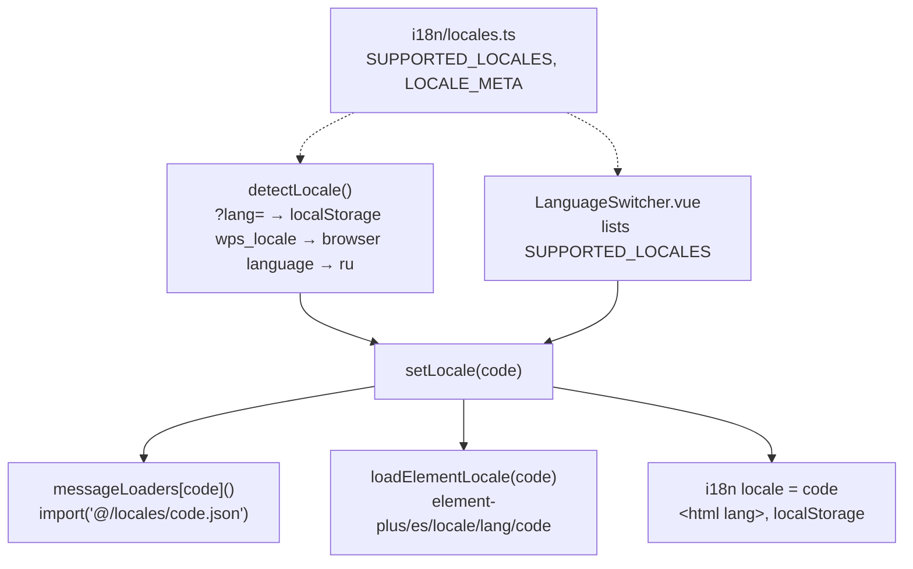

# New UI language

How to add a language to the web UI, using a verified German (`de`) locale as the example.

<!-- lang-switch -->
🇬🇧 English | [🇷🇺 Русский](../../../ru/07-developer-guide/extending/new-language.md)
<!-- /lang-switch -->

## 1. When you need it

The UI ships in Russian (`ru`, the default and fallback) and English (`en`). Add a language when users need the
interface in another one. Only the **frontend** is translated: the backend has no language setting (see
[UI and translations](#5-ui-and-translations) for what stays untranslated).

## 2. How it works



| File | Role |
|---|---|
| `front/src/locales/<code>.json` | All UI texts. `ru.json` is the reference: the key schema (`src/i18n/types.d.ts`) and the fallback |
| `front/src/i18n/locales.ts` | Registry: `SUPPORTED_LOCALES`, `DEFAULT_LOCALE`, `LOCALE_META` (name of the language in that language) |
| `front/src/i18n/index.ts` | `createI18n()` (plural rules, date formats), `messageLoaders`, `detectLocale()`, `setLocale()` |
| `front/src/i18n/element-plus.ts` | Element Plus texts (date picker, pagination, empty table) per language |
| `front/src/components/LanguageSwitcher.vue` | The switcher in the header and on the login page — no change needed |

- `ru` is bundled into the main chunk; every other language is a separate chunk loaded by `setLocale()` before it is shown.
- `matchLocale()` maps a browser language like `de-AT` to `de` once `de` is in `SUPPORTED_LOCALES`.
- `AppLocale` is derived from `SUPPORTED_LOCALES`, and `LOCALE_META`, `messageLoaders` and the Element Plus `loaders`
  are typed `Record<AppLocale, …>` — after you add the code, `vue-tsc` fails until all three have an entry.
- The current language is sent to the backend as `Accept-Language` (`api/client.ts`), but the backend does not use it yet.

## 3. Step by step

### 3.1 Translations — `front/src/locales/de.json`

Copy `en.json` (or `ru.json`) and translate **every** value; keep keys, nesting and placeholders (`{name}`, `{n}`) as they are.

```bash
cp front/src/locales/en.json front/src/locales/de.json
```

A fragment of the translated file:

```json
{
  "language": {
    "label": "Sprache"
  },
  "nav": {
    "processes": "Prozesse",
    "processCreate": "Prozess anlegen",
    "users": "Benutzer"
  }
}
```

Message syntax rules ([Coding conventions](../coding-conventions.md#frontend-vue--typescript)): `@ { } | $` are special
characters, a literal `@` is written `{'@'}`. Dictionary values from the API are translated in the `dict.*` section
(`dict.operator.equals`, `dict.changeType.calculate`, …) — translate them too.

### 3.2 Registry — `front/src/i18n/locales.ts`

```ts
export const SUPPORTED_LOCALES = ['ru', 'en', 'de'] as const
export type AppLocale = (typeof SUPPORTED_LOCALES)[number]

export const DEFAULT_LOCALE: AppLocale = 'ru'

/** Название языка — всегда на самом языке, не переводится */
export const LOCALE_META: Record<AppLocale, { label: string; bcp47: string }> = {
  ru: { label: 'Русский', bcp47: 'ru-RU' },
  en: { label: 'English', bcp47: 'en-US' },
  de: { label: 'Deutsch', bcp47: 'de-DE' },
}
```

The order of `SUPPORTED_LOCALES` is the order in the switcher. `src/i18n/locales.ts` is the only `.ts` file where
non-Latin text is allowed by `i18n:check` (for names like «Русский»).

### 3.3 Loader, date format and plural rule — `front/src/i18n/index.ts`

```ts
export const i18n = createI18n<[MessageSchema], AppLocale, false>({
  legacy: false,
  globalInjection: true,
  locale: DEFAULT_LOCALE,
  fallbackLocale: DEFAULT_LOCALE,
  messages: { ru } as Record<AppLocale, MessageSchema>,
  pluralRules: { ru: ruPluralRule },
  datetimeFormats: { ru: dateTime, en: dateTime, de: dateTime },
  missingWarn: import.meta.env.DEV,
  fallbackWarn: import.meta.env.DEV,
})
```

```ts
const messageLoaders: Record<AppLocale, () => Promise<{ default: MessageSchema }>> = {
  ru: async () => ({ default: ru }),
  en: () => import('@/locales/en.json'),
  de: () => import('@/locales/de.json'),
}
```

- `datetimeFormats` is used by `formatDate()` (`utils/format.ts → d(date, 'long')`); TypeScript does not remind you
  about it, so add the language by hand.
- `pluralRules`: German, like English, uses the default vue-i18n rule ("one | other"). A language with more plural
  forms (Polish, Ukrainian, Czech…) needs its own function, like `ruPluralRule`.

### 3.4 Element Plus locale — `front/src/i18n/element-plus.ts`

```ts
const loaders: Record<AppLocale, () => Promise<Language>> = {
  ru: async () => ru,
  en: () => import('element-plus/es/locale/lang/en').then((m) => m.default),
  de: () => import('element-plus/es/locale/lang/de').then((m) => m.default),
}
```

The file name is the Element Plus locale code (`node_modules/element-plus/es/locale/lang/`), e.g. `zh-cn`, `pt-br`.

## 4. Validation and errors

`npm run i18n:check` (also the first step of `npm run build` and of the frontend Docker image) compares every
`src/locales/*.json` with `ru.json`. Verified messages:

```
✗ de.json: нет ключа system.latency        ← key missing in de.json
✗ de.json: пустой перевод nav.users        ← empty value
```

An extra key reports `лишний ключ …`. TypeScript errors (`vue-tsc`) appear when the code is added to
`SUPPORTED_LOCALES` but `LOCALE_META`, `messageLoaders` or the Element Plus `loaders` lack an entry.

The check does not find untranslated text: a value copied from English passes. Review the file before release.

## 5. UI and translations

- Nothing to change in components: the switcher, `?lang=de`, the browser language and the remembered choice work
  automatically. `<html lang>` and the page title (`route.*` keys) follow the language.
- **Not translated by the UI files:**
  - backend dictionary captions — the UI shows its own `dict.*` texts, but API clients always get the backend
    `label()` (Russian);
  - server validation messages (`422 details[].message`) — English, shown as is;
  - module names from the CRM / mock (`GET /api/dictionaries/modules`);
  - data: process names, CRM values.
- If the documentation should cover the language, add `doc/<code>/` with the same files as `doc/en/` and the screenshots
  `doc/images/screenshots/<code>/` (see `doc/_meta/screenshots_manifest.md`).

## 6. Test

```bash
cd front
npm run i18n:check
npm run build
```

Check result with `de` added (key and module counts, chunk names and sizes are as of the check, on a stand with the [new screen](new-ui-screen.md) example applied; without it `ru.json` currently has 394 keys):

```
✓ i18n: 408 ключей, языки: de, en, ru
✓ 1745 modules transformed.
dist/assets/de-B83BTEP7.js                        3.94 kB │ gzip:   1.67 kB    ← Element Plus locale
dist/assets/de-B7LZGrcV.js                       25.54 kB │ gzip:   5.85 kB    ← de.json
✓ built in 9.30s
```

Manual check: open `http://localhost:3080/processes?lang=de` — the side menu shows the German texts ("Prozesse",
"Prozess anlegen", "Benutzer") and `document.documentElement.lang` is `de` (both verified on a separate stack). The
switcher in the header shows "Deutsch"; after a reload without `?lang` German stays, because `setLocale()` saves the
choice in `localStorage['wps_locale']`.

## 7. Common pitfalls

- **Changed placeholders.** `i18n:check` verifies only that keys exist and values are not empty: `{name}` translated as
  `{Name}` or dropped does not fail the build, but the substitution disappears or shows up as text in the UI. Compare
  the placeholders with `ru.json` by hand (e.g. by searching for `{`).
- **Number of plural forms.** Translate strings with `|` (`"none | 1 item | {n} items"`) into the forms of your
  language; without a rule of its own in `pluralRules` vue-i18n uses the "one | other" rule, and extra forms are
  picked wrongly.
- **Special characters.** Literal `@`, `{`, `}`, `|`, `$` in a text break message parsing — escape them as `{'@'}`.
- **A new key only in `ru`/`en`.** Once the language is added, every new key must also go into `<code>.json` —
  otherwise `i18n:check` (and the frontend image build) fails with `нет ключа …` ("missing key").
- **`datetimeFormats` and `pluralRules`.** TypeScript does not require an entry for the new language in these
  objects: without `datetimeFormats` dates (`formatDate()`) are not formatted; for the plural rule see above.
- **Expecting translations from the backend.** The `Accept-Language` header is sent, but the backend does not read
  it: dictionary labels, `422` messages and CRM module names arrive unchanged ([5](#5-ui-and-translations)).

## 8. Checklist

- [ ] `src/locales/<code>.json` with all keys of `ru.json`, every value translated, placeholders unchanged
- [ ] Code in `SUPPORTED_LOCALES`, name in `LOCALE_META`
- [ ] `messageLoaders`, `datetimeFormats` and (if needed) `pluralRules` in `src/i18n/index.ts`
- [ ] Element Plus locale in `src/i18n/element-plus.ts`
- [ ] `npm run build` passes; switcher, `?lang=<code>` and dates checked in the browser
- [ ] `front/README.md` (section «Локализация») and [Login and UI](../../03-user-guide/login-and-ui.md) mention the new language

<!-- footer-nav -->
---

← Previous: [New UI screen](new-ui-screen.md) | [Contents](../../README.md) | [Contributing](../contributing.md) Next →
<!-- /footer-nav -->
