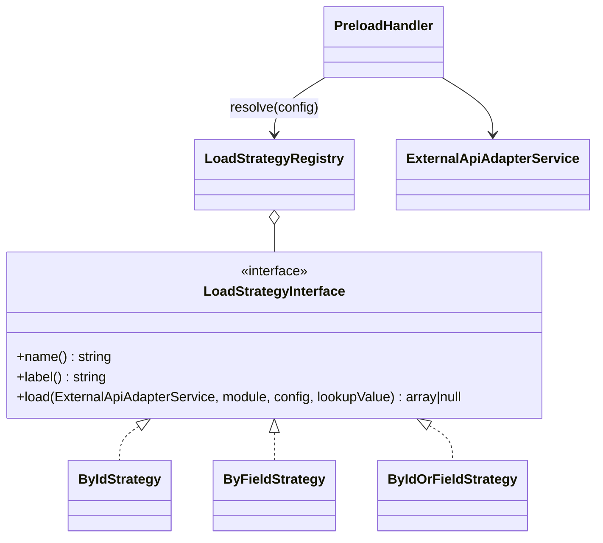

# New load strategy

How to add a way of loading a CRM object into a preload variable, using a verified `by_id_or_field` strategy as the example.

<!-- lang-switch -->
🇬🇧 English | [🇷🇺 Русский](../../../ru/07-developer-guide/extending/new-load-strategy.md)
<!-- /lang-switch -->

## 1. When you need it

A preload row (`definition.preload[]` or a `preload` step in `actions[]`) loads one CRM object into a variable. Two strategies
exist: `by_id` (`GET /{module}/{id}`) and `by_field` (`GET /{module}?filter[field]=value&size=1`, first match). Add a
strategy for other lookups — "by id, otherwise by field", "newest record", "by several fields", a search in another system.

## 2. How it works



- `PreloadHandler::execute()` computes the **lookup value** from `source` (`object_field` → a field of the event object,
  `variable_field` → a field of an earlier variable, `manual` → the typed value) and converts it to a string. An empty
  lookup value sets the variable to `null` without calling the strategy.
- `LoadStrategyRegistry::resolve($config)` picks the strategy: the explicit `"strategy"` key of the row wins; without it
  `by_field: "id"` (or empty) → `by_id`, any other field → `by_field`. So a new strategy is used **only** when the row
  names it explicitly.
- `load()` returns the flattened object (`id` + attributes) or `null` (not found → the variable is `null`, the step is
  still `success` with `found: false`).
- `PreloadHandler::validate()` rejects an unknown `strategy` (`Unknown load strategy`).
- The registry is created in `LoadStrategyRegistry::default()` and shared by `Container::loadStrategies()`.

## 3. Step by step

### 3.1 The class — `back/src/LoadStrategies/ByIdOrFieldStrategy.php`

```php
<?php

declare(strict_types=1);

namespace Wps\LoadStrategies;

use Wps\Exceptions\ConfigurationException;
use Wps\Services\ExternalApiAdapterService;

/**
 * Tries GET /{module}/{id} first; when nothing is found, searches by "by_field".
 * Selected explicitly with "strategy": "by_id_or_field" in the preload row.
 */
final class ByIdOrFieldStrategy implements LoadStrategyInterface
{
    public function name(): string
    {
        return 'by_id_or_field';
    }

    public function label(): string
    {
        return 'По ID, затем по полю';
    }

    public function load(ExternalApiAdapterService $api, string $module, array $config, string $lookupValue): ?array
    {
        $field = trim((string)($config['by_field'] ?? ''));
        if ($field === '' || $field === 'id') {
            throw new ConfigurationException('Preload: by_field (other than "id") is required for strategy by_id_or_field');
        }
        return $api->getById($module, $lookupValue) ?? $api->findOneByField($module, $field, $lookupValue);
    }
}
```

### 3.2 Registration — `back/src/LoadStrategies/LoadStrategyRegistry.php`

```php
public static function default(): self
{
    $registry = new self();
    $registry->register(new ByIdStrategy());
    $registry->register(new ByFieldStrategy());
    $registry->register(new ByIdOrFieldStrategy());
    return $registry;
}
```

### 3.3 Use it

```json
{ "var": "acc", "source": "manual", "module": "Accounts", "strategy": "by_id_or_field", "by_field": "inn", "value": "7701234567" }
```

`GET /Accounts/7701234567` returns 404 in the mock, so the strategy falls back to `GET /Accounts?filter[inn]=7701234567&size=1`
and `acc` gets the account (verified).

## 4. Validation and errors

- Errors of the CRM adapter are already classified: transport errors and HTTP 5xx → `CrmApiException` (recoverable, retried),
  other 4xx → non-recoverable, GET 404 → `null`. Do not catch them in the strategy.
- Missing or wrong config → `ConfigurationException` (non-recoverable, the step fails with your message).
- Keep `load()` side-effect free: the engine may call it again on retry or after recovery.
- `PreloadHandler::validate()` checks `var`, `source`, `module`, `by_field`, `value` and the strategy name. For extra
  strategy-specific keys there is no hook in the strategy interface — check them in `load()` and throw `ConfigurationException`.

## 5. UI and translations

The preload editor (`PreloadPanel.vue`) has no strategy selector, and **the editor does not keep the `strategy` key**:
`definitionFromForm()` in `front/src/stores/processes.ts` writes only `var`, `source`, `module`, `by_field`, `value`.
So today:

- create rows with a custom strategy through the API or JSON import, and do not re-save such a process from the editor; or
- extend the UI: add `strategy?: string` to `PreloadAction` (`front/src/types/index.ts`), copy it in `formFromProcess()` and
  `definitionFromForm()`, add a select in `PreloadPanel.vue` with captions in `locales/*.json`
  (for example `preload.strategy.by_id_or_field`). There is no dictionary endpoint for strategies yet — add one by the
  [new endpoint guide](new-api-endpoint.md) if the UI should list them.

The process card (`ProcessDetailView.vue`) shows the preload rows by module and `by_field`, which is enough for reading.

## 6. Test

From the verified `testExtensions()` group ([full text](new-action-type.md#6-test)):

```php
$inn = (string)random_int(1000000000, 9999999999);
$this->test('Seed an account with an INN in the mock CRM', function () use ($inn) {
    $raw = $this->raw('PUT', "/mock/objects/Accounts/{$this->accountId}-inn", ['name' => 'INN Company', 'inn' => $inn], base: $this->crmUrl);
    $this->assertEquals(200, $raw['status']);
});
// process: 'preload' => [['var' => 'acc', 'source' => 'manual', 'module' => 'Accounts',
//                         'strategy' => 'by_id_or_field', 'by_field' => 'inn', 'value' => $inn]]
// after the run:
$this->assertEquals('INN Company', $execution['context']['variables']['acc']['name']);
```

## 7. Checklist

- [ ] `final` class in `back/src/LoadStrategies/`, unique `name()`
- [ ] Registered in `LoadStrategyRegistry::default()`
- [ ] Rows use `"strategy": "<name>"` explicitly; UI decision made (API-only or editor support)
- [ ] Integration check added, suite green
- [ ] Described in [Actions](../../03-user-guide/actions.md) (preload part, en + ru) and `back/API.md`

<!-- footer-nav -->
---

← Previous: [New change type](new-change-type.md) | [Contents](../../README.md) | [Expression functions](expression-functions.md) Next →
<!-- /footer-nav -->
