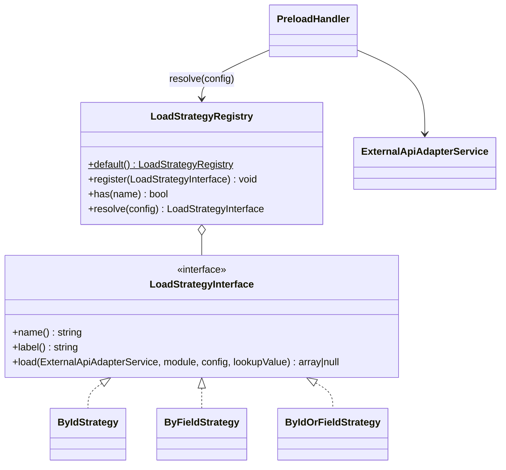

# New load strategy

How to add a way of loading a CRM object into a preload variable — on a teaching example of the `by_id_or_field`
strategy ("by ID, then by field").

<!-- lang-switch -->
🇬🇧 English | [🇷🇺 Русский](../../../ru/07-developer-guide/extending/new-load-strategy.md)
<!-- /lang-switch -->

## 1. When you need it

A preload row (`definition.preload[]` or a `preload` step in `actions[]`, see
[Actions → Preload](../../03-user-guide/actions.md#preload)) loads **one** CRM object into a variable. There are two
strategies: `by_id` (`GET /{module}/{id}`) and `by_field` (`GET /{module}?filter[field]=value&size=1`, first match).
A new strategy is needed for other kinds of lookup: "by id, and if not found, by a field", "the newest record",
"by several fields", a lookup in another system.

If you need a **list** of records, that is the `find_records` action, not a strategy. If the data does not come from
the CRM (an external API with a response), use the `http_request` action.

## 2. How it works



Exact signatures (`back/src/LoadStrategies/`):

```php
namespace Wps\LoadStrategies;

interface LoadStrategyInterface
{
    public function name(): string;
    public function label(): string;
    /**
     * @param array<string, mixed> $config the preload row (module, by_field, ...)
     * @return array<string, mixed>|null null when nothing was found
     */
    public function load(ExternalApiAdapterService $api, string $module, array $config, string $lookupValue): ?array;
}

final class LoadStrategyRegistry
{
    public static function default(): self;                        // by_id, by_field
    public function register(LoadStrategyInterface $strategy): void;
    public function has(string $name): bool;
    public function resolve(array $config): LoadStrategyInterface;  // ConfigurationException for an unknown name
}
```

- `PreloadHandler::execute()` computes the **lookup value** from `source` (`object_field` — a field of the event
  object, `variable_field` — a field of a previously loaded variable, `manual` — a typed value) and converts it to a
  string (`ComparatorRegistry::stringify()`, the same as `TypeCaster::stringify()`). If the lookup value is empty, the
  variable becomes `null` and the strategy is not called (`found: false`, `reason: Lookup value is empty`).
- `LoadStrategyRegistry::resolve($config)` picks the strategy: an explicit `"strategy"` key in the row wins; without it
  `by_field: "id"` (or empty / missing) → `by_id`, any other field → `by_field`. So a new strategy is used **only**
  when the row names it explicitly.
- `load()` returns a "flat" object (`id` + attributes, as `ExternalApiAdapterService::flatten()` produces it) or `null`
  (not found → the variable is `null`, the step is still `success` with `found: false`).
- The step audit is written by `PreloadHandler`: `request_data = {var, module, strategy, by_field, source, value, lookup_value}`,
  `result_data = {found, object}`.
- On save `PreloadHandler::validate()` rejects an unknown `strategy` (`Unknown load strategy`) and checks `var`,
  `source`, `module`, `by_field`, `value`; it declares the variable with kind `preload`.
- Preload is not only a step: when start conditions reference variables, the engine runs the `definition.preload[]`
  rows **before** evaluating the conditions (lazy preload, `ExecutionEngineService::prepare()`) with the same handler —
  the strategy is called there too.
- The registry is created in `LoadStrategyRegistry::default()` and served by `Container::loadStrategies()` (one
  instance per worker, shared by all coroutines).

## 3. Step by step

| File | Change |
|---|---|
| `back/src/LoadStrategies/ByIdOrFieldStrategy.php` | **new** — the strategy class |
| `back/src/LoadStrategies/LoadStrategyRegistry.php` | registration in `default()` |
| `back/tests/Unit/LoadStrategies/ByIdOrFieldStrategyTest.php` | **new** — unit test |
| `back/tests/IntegrationTest.php` | integration group + call in `run()` |
| `front/…` (optional) | support for the `strategy` key in the preload editor ([5](#5-ui-and-translations)) |
| `doc/{ru,en}/03-user-guide/actions.md`, `back/API.md` | description of the strategy |

### 3.1 The class — `back/src/LoadStrategies/ByIdOrFieldStrategy.php`

```php
<?php

declare(strict_types=1);

namespace Wps\LoadStrategies;

use Wps\Exceptions\ConfigurationException;
use Wps\Services\ExternalApiAdapterService;

/**
 * Tries GET /{module}/{id} first; when nothing is found, searches by "by_field".
 * Selected explicitly with "strategy": "by_id_or_field" in the preload row.
 */
final class ByIdOrFieldStrategy implements LoadStrategyInterface
{
    public function name(): string
    {
        return 'by_id_or_field';
    }

    public function label(): string
    {
        return 'По ID, затем по полю';
    }

    public function load(ExternalApiAdapterService $api, string $module, array $config, string $lookupValue): ?array
    {
        $field = trim((string)($config['by_field'] ?? ''));
        if ($field === '' || $field === 'id') {
            throw new ConfigurationException('Preload: by_field (other than "id") is required for strategy by_id_or_field');
        }
        return $api->getById($module, $lookupValue) ?? $api->findOneByField($module, $field, $lookupValue);
    }
}
```

Adapter methods available to strategies (`ExternalApiAdapterService`): `getById($module, $id): ?array` (404 → `null`),
`findOneByField($module, $field, $value): ?array`, `findMany($module, CrmFilter $filter, array $sort = [], ?array $fields = null, int $limit = 100): array{items, has_more, requests}`
and `findPage(...)`. Sorting, filter operators other than equality and the cursor need CRM contract 2.0 — without the
capability the adapter throws `CRM_CAPABILITY_MISSING`. For example, "the newest record by a field":

```php
$found = $api->findMany($module, CrmFilter::eq($field, $lookupValue), [['field' => 'date_entered', 'desc' => true]], null, 1);
return $found['items'][0] ?? null;
```

### 3.2 Registration — `back/src/LoadStrategies/LoadStrategyRegistry.php`

Strategies are registered not in `Container` but in the registry factory (called by `Container::loadStrategies()`):

```php
public static function default(): self
{
    $registry = new self();
    $registry->register(new ByIdStrategy());
    $registry->register(new ByFieldStrategy());
    $registry->register(new ByIdOrFieldStrategy());
    return $registry;
}
```

If a strategy needs a service (Redis, configuration), pass it through the strategy constructor and register it in
`Container::loadStrategies()` after `LoadStrategyRegistry::default()`:

```php
public function loadStrategies(): LoadStrategyRegistry
{
    return $this->share(LoadStrategyRegistry::class, function (): LoadStrategyRegistry {
        $registry = LoadStrategyRegistry::default();
        $registry->register(new MyCachedStrategy($this->redisData()));   // example of a strategy with a dependency
        return $registry;
    });
}
```

### 3.3 Use it

```json
{ "var": "acc", "source": "manual", "module": "Accounts", "strategy": "by_id_or_field", "by_field": "inn", "value": "7701234567" }
```

In the mock `GET /Accounts/7701234567` returns 404, so the strategy falls back to
`GET /Accounts?filter[inn]=7701234567&size=1` and `acc` receives the account. Step audit:

```json
{ "request_data": { "var": "acc", "module": "Accounts", "strategy": "by_id_or_field", "by_field": "inn", "source": "manual", "value": "7701234567", "lookup_value": "7701234567" },
  "result_data": { "found": true, "object": { "id": "…", "name": "INN Company", "inn": "7701234567" } } }
```

## 4. Validation and errors

- CRM adapter errors are already classified: transport errors, timeouts, HTTP 5xx and 408/425/429 → `CrmApiException`
  (recoverable, retried per `ACTION_RETRY_MAX` / `retry`), other 4xx → non-recoverable, GET 404 → `null`. Do not catch
  them in the strategy.
- Missing or invalid configuration → `ConfigurationException` (non-recoverable, the step fails with your message).
- `load()` must have no side effects: on a recoverable error the engine restores the context snapshot and runs the step
  again, and after a worker crash as well.
- `PreloadHandler::validate()` checks `var`, `source`, `module`, `by_field`, `value` and the strategy name. For a
  strategy's own keys the interface has **no save-time validation hook** — check them in `load()` and throw
  `ConfigurationException`, or add a check to `PreloadHandler::validate()` (a core change).
- Do not keep call results in strategy properties: the instance is shared by all coroutines of the worker.

## 5. UI and translations

The preload editor (`PreloadPanel.vue`) has no strategy selector, but the `strategy` key **is kept**: a row stores its
original object (`_raw`), and `definitionFromForm()` in `front/src/utils/processForm.ts` merges the form fields into it
(`strategy` survives a source change too). So:

- create rows with a custom strategy through the API or a JSON import — the editor will not break them; or
- extend the UI: add `strategy?: string` to `PreloadAction` (`front/src/types/index.ts`), fill it in
  `formFromProcess()` and write it in `buildPreload()`, add a select to `PreloadPanel.vue` with labels in `locales/*.json`
  (e.g. `preload.strategy.by_id_or_field`). There is no strategies dictionary endpoint — add one following the
  [new endpoint guide](new-api-endpoint.md) if the UI should show the list
  (`GET /api/dictionaries/preload-sources` lists value sources, not strategies).

The process card (`ProcessDetailView.vue`) shows preload rows by module and `by_field` — enough for reading.

## 6. Test

### 6.1 Unit test — `back/tests/Unit/LoadStrategies/ByIdOrFieldStrategyTest.php`

`ExternalApiAdapterService` is a `final` class without an interface and cannot be replaced by a fake. The unit test
checks what does not reach the network: strategy selection by the registry, the configuration error and row
validation. The CRM requests themselves are checked by integration tests on the mock (existing tests work the same
way: the adapter is created with `newInstanceWithoutConstructor()`).

```php
<?php

declare(strict_types=1);

namespace Wps\Tests\Unit\LoadStrategies;

use PHPUnit\Framework\TestCase;
use Wps\Actions\PreloadHandler;
use Wps\Exceptions\ConfigurationException;
use Wps\LoadStrategies\ByIdOrFieldStrategy;
use Wps\LoadStrategies\LoadStrategyRegistry;
use Wps\Services\ExternalApiAdapterService;
use Wps\Services\Validation\DefinitionScope;

final class ByIdOrFieldStrategyTest extends TestCase
{
    private static function registry(): LoadStrategyRegistry
    {
        $registry = LoadStrategyRegistry::default();
        $registry->register(new ByIdOrFieldStrategy());
        return $registry;
    }

    /** final adapter without a CRM: only for paths that never reach the network */
    private static function api(): ExternalApiAdapterService
    {
        return (new \ReflectionClass(ExternalApiAdapterService::class))->newInstanceWithoutConstructor();
    }

    public function testResolve(): void
    {
        $registry = self::registry();
        self::assertSame('by_id_or_field', $registry->resolve(['strategy' => 'by_id_or_field', 'by_field' => 'inn'])->name());
        self::assertSame('by_id', $registry->resolve(['by_field' => 'id'])->name(), 'without "strategy" the old rule applies');
        self::assertSame('by_field', $registry->resolve(['by_field' => 'inn'])->name());
    }

    public function testConfigurationError(): void
    {
        $this->expectException(ConfigurationException::class);
        $this->expectExceptionMessage('Preload: by_field (other than "id") is required for strategy by_id_or_field');
        (new ByIdOrFieldStrategy())->load(self::api(), 'Accounts', ['by_field' => 'id'], '7701234567');
    }

    public function testValidation(): void
    {
        $handler = new PreloadHandler(self::api(), self::registry());
        $scope = new DefinitionScope();
        $handler->validate(['var' => 'acc', 'source' => 'manual', 'module' => 'Accounts', 'strategy' => 'by_id_or_field', 'by_field' => 'inn', 'value' => '1'], $scope, 'a');
        $handler->validate(['var' => 'acc2', 'source' => 'manual', 'module' => 'Accounts', 'strategy' => 'newest', 'value' => '1'], $scope, 'b');
        self::assertSame(['b.strategy: Unknown load strategy'], array_map(static fn (array $e) => $e['field'] . ': ' . $e['message'], $scope->errors()));
        self::assertSame('preload', $scope->kind('acc'));
    }
}
```

How to run — [Testing](../testing.md#backend-unit-tests).

### 6.2 Integration test — `back/tests/IntegrationTest.php`

The record with an INN is created through the mock helper API (`PUT /mock/objects/{module}/{id}`); the id and the INN
are unique per run because the mock keeps data of previous runs. The same checks are part of the template of the
shared `testExtensions()` group ([New action type → Test](new-action-type.md#6-test)).

```php
/**
 * preload strategy by_id_or_field: by id first, then by another field.
 */
private function testLoadStrategy(): void
{
    echo "[load strategy]\n";
    $inn = (string)random_int(1000000000, 9999999999);
    $accountId = "{$this->accountId}-inn-{$inn}";
    $this->test('by_id_or_field: found by id and by the other field; an unknown strategy is rejected', function () use ($inn, $accountId) {
        $raw = $this->raw('PUT', "/mock/objects/Accounts/{$accountId}", ['name' => 'INN Company', 'inn' => $inn], base: $this->crmUrl);
        $this->assertEquals(200, $raw['status']);
        $process = $this->request('POST', '/api/processes', ['name' => 'TEST load strategy', 'object_type' => 'TestExt', 'is_child' => false, 'definition' => [
            'preload' => [['var' => 'acc', 'source' => 'object_field', 'module' => 'Accounts', 'strategy' => 'by_id_or_field', 'by_field' => 'inn', 'value' => 'object.account_ref']],
        ]], $this->adminToken, 201)['data'];
        foreach ([$inn, $accountId] as $ref) {   // by the other field, then by id
            $run = $this->request('POST', "/api/processes/{$process['id']}/run", ['object' => ['id' => 'ls-' . random_int(1000, 9999), 'account_ref' => $ref]], $this->adminToken, 201)['data'];
            $e = $this->waitForExecution($run['execution_id']);
            $this->assertEquals('completed', $e['status'], (string)($e['error_message'] ?? ''));
            $this->assertEquals('INN Company', $e['context']['variables']['acc']['name'] ?? null);
            $this->assertEquals('by_id_or_field', $e['actions'][0]['request_data']['strategy']);
        }
        $bad = $this->request('POST', '/api/processes', ['name' => 'TEST load strategy bad', 'object_type' => 'TestExt', 'is_child' => false, 'definition' => [
            'preload' => [['var' => 'acc', 'source' => 'manual', 'module' => 'Accounts', 'strategy' => 'newest', 'value' => 'x']],
        ]], $this->adminToken, 422);
        $d = array_column($bad['error']['details'], 'message', 'field');
        $this->assertEquals('Unknown load strategy', $d['definition.preload[0].strategy'] ?? null);
        $this->request('DELETE', "/api/processes/{$process['id']}", token: $this->adminToken);
    });
}
```

Add the call `$this->testLoadStrategy();` to `run()` (for example after `$this->testRunOnce();`).

### 6.3 Documentation

- [Actions → Preload](../../03-user-guide/actions.md#preload) (en + ru): the `strategy` key, when the strategy applies,
  what it needs from the CRM.
- `back/API.md`: allowed `strategy` values in a preload row.

## 7. Common pitfalls

| Mistake | Consequence | Do instead |
|---|---|---|
| Expecting the strategy to be picked by `by_field` | `by_field` / `by_id` is used | name `"strategy"` explicitly |
| Catching `CrmApiException` in `load()` | a temporary CRM failure is not retried or turns into "not found" | let adapter exceptions through |
| Writing to the CRM or another side effect in `load()` | step retries and lazy preload repeat the effect | read only |
| Returning the CRM answer as is (`{type, id, attributes}`) | fields are not reachable as `acc.name` | a flat object (adapter methods already `flatten()`) |
| Saving the process from the editor | the `strategy` key is lost | support the key in the frontend or edit through the API |
| Lookup without a limit (`findMany` with a large `limit`) | extra CRM load on every event | `limit` = 1, sorting on the CRM side |

## 8. Checklist

- [ ] `final` class in `back/src/LoadStrategies/`, `declare(strict_types=1)`, unique `name()`
- [ ] Registered in `LoadStrategyRegistry::default()` (or in `Container::loadStrategies()` when it has dependencies)
- [ ] `load()` only reads and returns a flat object or `null`; configuration errors — `ConfigurationException`
- [ ] Rows name `"strategy": "<name>"` explicitly; the UI decision is made (API only or editor support)
- [ ] Unit test and integration group added, tests green
- [ ] Described in [Actions](../../03-user-guide/actions.md#preload) (en + ru) and in `back/API.md`

<!-- footer-nav -->
---

← Previous: [New change type](new-change-type.md) | [Contents](../../README.md) | [Expression functions](expression-functions.md) Next →
<!-- /footer-nav -->
