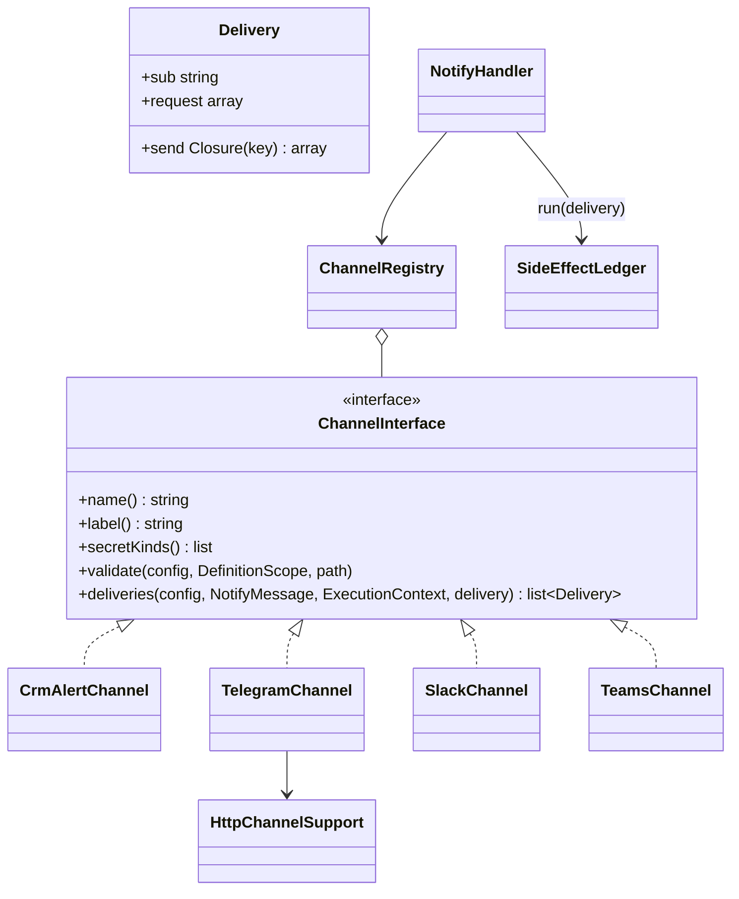

# New notification channel

How to add a channel to the `notify` action ("Notification") — on a teaching example of a Discord webhook.

<!-- lang-switch -->
🇬🇧 English | [🇷🇺 Русский](../../../ru/07-developer-guide/extending/new-notify-channel.md)
<!-- /lang-switch -->

## 1. When you need it

The [Notification](../../03-user-guide/actions.md#notification) action sends out of the box to the CRM bell
(`crm_alert`), Telegram, Slack and Microsoft Teams. Another messenger, a corporate chat or an alerting service (Discord,
Mattermost, Rocket.Chat, an SMS gateway) is connected as a **channel**: a class that turns the common message into one
or more deliveries. Repeating without duplicates, the step outcome by `fail_on`, secret masking and the audit come from
`NotifyHandler` for free.

## 2. How it works



- `NotifyHandler` builds a `NotifyMessage` once — title, text and link. `NotifyMessage::text($mode)` renders the
  templates with the needed escaping (`EscapeMode::Text`, `Html`, `Url` …) and caches the result; `plain()` is plain text
  for previews.
- `deliveries()` is called for every channel of `channels`. The channel returns a list of `Delivery`: `sub` — a delivery
  key unique within the channel (`discord:{hash}`, `crm_alert:{user}`), `request` — what the audit shows (**no
  secrets**), `send` — a closure that makes the external call and returns what is stored in the journal. An empty list —
  the channel is `skipped` ("No recipients").
- `NotifyHandler` runs every delivery through the side-effect journal (`SideEffectLedger::run()`) with the key
  `{channel number}:{sub}`: on a repeated step the delivered ones come from the journal and `send` is not called.
- An exception from `send` is a channel error. A recoverable one (`ErrorClassifier` → `transient`) repeats the step after
  all channels; the others make the channel `failed` and the outcome follows `fail_on`.
- `HttpChannelSupport` is what HTTP channels share: `secret()` (the value of the `connection` secret, registered in the
  masker), `post()` (a JSON request through `OutboundHttpClient` — SSRF protection and `HTTP_*`), `check()`
  (408/425/429/503 — recoverable with `Retry-After`; 500/502/504 and a break after sending — repeated only with
  `at_least_once`, otherwise `UNKNOWN_OUTCOME`; other codes — an error), `validateConnection()` (a `secret://` reference
  and the secret kind).

## 3. Step by step

### Step 1. The channel class — `back/src/Notify/Channels/DiscordChannel.php`

```php
<?php

declare(strict_types=1);

namespace Wps\Notify\Channels;

use Wps\Context\ExecutionContext;
use Wps\Notify\ChannelInterface;
use Wps\Notify\Delivery;
use Wps\Notify\HttpChannelSupport;
use Wps\Notify\NotifyMessage;
use Wps\Notify\RecordLinks;
use Wps\Services\Validation\DefinitionScope;

/**
 * Discord webhook (secret of kind webhook_url): {"content": "**title**\ntext\nlink"}, at most 2000 characters.
 */
final class DiscordChannel implements ChannelInterface
{
    public function __construct(
        private readonly HttpChannelSupport $http,
        private readonly RecordLinks $links,
    ) {
    }

    public function name(): string
    {
        return 'discord';
    }

    public function label(): string
    {
        return 'Discord';
    }

    public function secretKinds(): array
    {
        return ['webhook_url', 'generic'];
    }

    public function deliveries(array $config, NotifyMessage $message, ExecutionContext $context, string $delivery): array
    {
        $text = $message->text();
        $content = ($text['title'] !== '' ? "**{$text['title']}**\n" : '') . $text['message'];
        if ($message->link !== null && $this->links->isAbsolute($link = $this->links->absolute($message->link))) {
            $content .= "\n{$link}";
        }
        $content = mb_substr($content, 0, 2000);
        $connection = (string)$config['connection'];
        return [new Delivery('discord:' . sha1($connection), ['connection' => $connection],
            function (string $key) use ($connection, $content, $context, $delivery): array {
                $url = $this->http->secret($connection, $context->secretMasker);
                $response = $this->http->post($url, ['content' => $content], 'discord', $delivery, $key, $context->secretMasker);
                $this->http->check($response, 'discord', $delivery, $key);
                return ['status' => $response->status];
            })];
    }

    public function validate(array $config, DefinitionScope $scope, string $path): void
    {
        $this->http->validateConnection($config['connection'] ?? null, $this->secretKinds(), $scope, "{$path}.connection");
    }
}
```

### Step 2. Registration — `back/src/Kernel/Container.php`

```php
public function notifyChannels(): ChannelRegistry
{
    return $this->share(ChannelRegistry::class, function (): ChannelRegistry {
        $http = new HttpChannelSupport($this->outboundHttp(), $this->secretResolver(), $this->config()->httpRetryAfterMax);
        $registry = new ChannelRegistry();
        // … crm_alert, telegram, slack, teams
        $registry->register(new DiscordChannel($http, $this->recordLinks()));   // the new channel
        return $registry;
    });
}
```

After a rebuild (`docker compose up -d --build backend`) the channel appears in
`GET /api/dictionaries/notify-channels` and can be used in a definition:

```json
{ "type": "notify", "message": "Deal {{ object.name }} won", "link": { "record": "object" },
  "channels": [ { "channel": "discord", "connection": "secret://discord_sales" } ] }
```

A check without a process — `POST /api/notify/test` with `{"channel": {"channel": "discord", "connection": "secret://discord_sales"}}`.

## 4. Rules

- **Secrets.** Tokens and webhook URLs only through `connection` (`secret://…`) and `HttpChannelSupport::secret()`: the
  value is registered in the step masker and removed from the audit, errors and logs. Do not put a secret into the
  delivery `request`. If a secret goes into the URL, `post()` masks the whole URL.
- **Escaping.** Take the text with `NotifyMessage::text()` in the mode that suits the service format
  (`EscapeMode::Html` for HTML, your own `escape()` for markup like mrkdwn — as `SlackChannel::escape()`): substitutions
  from the CRM must not break the message markup.
- **The delivery key** `sub` must be stable between step repeats (a recipient id, a hash of `connection`), otherwise the
  journal does not recognize what was delivered and the message goes twice.
- **Unknown outcome.** Messenger webhooks usually have no idempotency keys; keep the answer classification of
  `HttpChannelSupport::check()`: with `at_most_once` (the `notify` default) a doubtful answer is not repeated.
- **A channel without HTTP** (a CRM record, a queue) implements `send` itself, as `CrmAlertChannel`; `secretKinds()`
  then returns `[]`.

## 5. Test

Unit tests (`back/tests/Unit/Notify/`, how to run — [Testing](../testing.md#backend-unit-tests)): the request body and
escaping, the link, the `validate()` rules — following `NotifyTest`. An integration test: an endpoint in the mock CRM
(`mock/mock_server.php`, following `/mock/slack/{id}`), a `webhook_url` secret pointing to it and a process with
`notify` — check that the message arrived and that a repeated step does not send it again (`replayed: true`). The mock
host must be allowed by `HTTP_ALLOW_PRIVATE_CIDRS` (already so on the stand).

## 6. Readiness checklist

- [ ] The class implements `ChannelInterface` and is registered in `Container::notifyChannels()`
- [ ] Secrets only through `connection` and `HttpChannelSupport::secret()`; none in the delivery `request`
- [ ] The text is escaped for the service format; the length is capped by the service limit
- [ ] `sub` is stable between repeats; answers are classified by `HttpChannelSupport::check()`
- [ ] `validate()` checks all channel fields (errors with the `…channels[i].…` path)
- [ ] Unit and integration tests; the channel is described in [Actions → Notification](../../03-user-guide/actions.md#notification)

<!-- footer-nav -->
---

← Previous: [New CRM adapter](new-crm-adapter.md) | [Contents](../../README.md) | [New UI screen](new-ui-screen.md) Next →
<!-- /footer-nav -->
