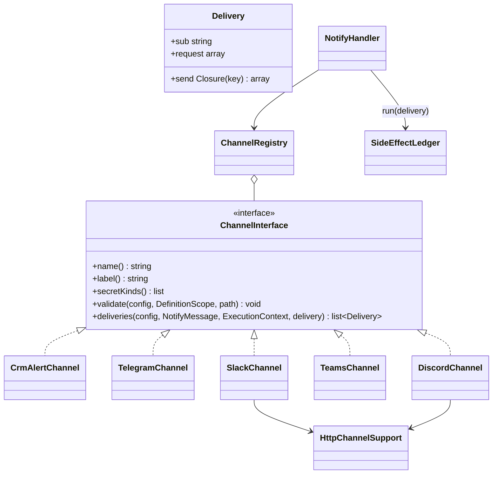

# New notification channel

How to add a channel to the `notify` action ("Notification") — on a teaching example of a Discord webhook.

<!-- lang-switch -->
🇬🇧 English | [🇷🇺 Русский](../../../ru/07-developer-guide/extending/new-notify-channel.md)
<!-- /lang-switch -->

## 1. When you need it

Out of the box the [Notification](../../03-user-guide/actions.md#notification) action sends to the CRM bell
(`crm_alert`), Telegram, Slack and Microsoft Teams. Another messenger, corporate chat or alerting service
(Discord, Mattermost, Rocket.Chat, an SMS gateway) is connected as a **channel**: a class that turns the common message
into one or more deliveries. Repeats without duplicates, the step outcome by `fail_on`, secret masking and the audit
come for free from `NotifyHandler`.

If you need not a short notification but an arbitrary HTTP call whose response is used by later steps, that is the
[`http_request`](../../03-user-guide/actions.md) action, not a channel. For an entirely different step write a
[new action type](new-action-type.md).

## 2. How it works



Exact signatures (`back/src/Notify/`):

```php
namespace Wps\Notify;

interface ChannelInterface
{
    public function name(): string;                    // "channel" in the definition: "discord"
    public function label(): string;                   // label in the dictionary
    /** @return list<string> secret kinds accepted in "connection"; [] — the channel has no connection */
    public function secretKinds(): array;
    /** @param array<string, mixed> $config an element of "channels" */
    public function validate(array $config, DefinitionScope $scope, string $path): void;
    /** @return list<Delivery> an empty list — the channel is "skipped" ("No recipients") */
    public function deliveries(array $config, NotifyMessage $message, ExecutionContext $context, string $delivery): array;
}

final class Delivery
{
    public function __construct(
        public readonly string $sub,       // delivery key, unique within the channel and stable between retries
        public readonly array $request,    // what the audit shows (no secrets)
        public readonly \Closure $send,    // fn (string $idempotencyKey): array — the external call, its result is journaled
    ) {}
}

final class ChannelRegistry
{
    public function register(ChannelInterface $channel): void;
    public function has(mixed $name): bool;
    public function get(string $name): ChannelInterface;    // \InvalidArgumentException for an unknown one
    /** @return list<array{value: string, label: string, secret_kinds: list<string>}> */
    public function dictionary(): array;
}
```

- `NotifyHandler` builds a `NotifyMessage` once — title, text and link (`$message->link`, `linkModule`, `linkId`).
  `NotifyMessage::text(EscapeMode $mode = EscapeMode::Text): array{title, message}` renders the templates with the
  required escaping (`Text`, `Html`, `Url` …), cuts the text to `NotifyMessage::MAX_LENGTH` (4000) and caches the
  result per mode; `plain()` is plain "title + message" text for previews and fallback fields.
- `deliveries()` is called for every element `channels[i]`. The channel returns a list of `Delivery`.
- `NotifyHandler` runs every delivery through the side effect journal:
  `SideEffectLedger::run($context, 'notify', "{$i}:{$d->sub}", $delivery, $d->request + ['text' => …], $d->send)`.
  The effect key in the journal is `{pc}@{iteration}#{i}:{sub}` (`@{iteration}` only inside a loop). On a repeated step
  what was already delivered comes back from the journal (`replayed: true`) and `send` is not called. The `send`
  closure receives the external idempotency key `{execution_id}:{effect_key}` — pass it to the service if it supports
  idempotency keys.
- An exception from `send` (or from `deliveries()`) is an error of the **channel**; the other channels are still sent.
  If the error is recoverable (`ErrorClassifier` → `transient`: 408/425/429/503, network), `NotifyHandler` rethrows it
  after all channels — the step is repeated according to its `retry` policy. Otherwise the channel gets `failed` and the
  step outcome is decided by `fail_on` (`any` — the step fails on any error, `all` — only when nothing was delivered).
- The step's `delivery` (`at_most_once`, the default for `notify`, or `at_least_once`) is passed to `deliveries()` — use it
  in `HttpChannelSupport::post()` / `check()`.
- `HttpChannelSupport` is shared by HTTP channels (`new HttpChannelSupport(OutboundHttpClient $http, ?SecretResolver $secrets, int $retryAfterMax = 300)`):

  | Method | What it does |
  |---|---|
  | `secret(string $reference, ?SecretMasker $masker): string` | the value of the `connection` secret (for a composite secret — the field `value` / `url` / `token`), registered in the step masker |
  | `post(string $url, array $body, string $service, string $delivery, string $effect, ?SecretMasker $masker): OutboundResponse` | JSON `POST` through `OutboundHttpClient` (SSRF protection `EgressGuard`, 15 s timeout); the whole URL is registered in the masker; a broken connection **after** sending with `at_most_once` → `UnknownOutcomeException` |
  | `check(OutboundResponse $response, string $service, string $delivery, string $effect, ?string $error = null, ?int $retryAfter = null): void` | 2xx — ok; 408/425/429/503 — recoverable error with `Retry-After` (at most `HTTP_RETRY_AFTER_MAX`); 500/502/504 — repeated only with `at_least_once`, otherwise `UNKNOWN_OUTCOME`; other codes — non-recoverable error |
  | `validateConnection(mixed $connection, array $kinds, DefinitionScope $scope, string $field): void` | a `secret://name` reference is required; the secret kind must be one of `$kinds` |

- The channel registry is built in `Container::notifyChannels()` and passed to `NotifyHandler` (`Container::actions()`).
  Dictionary — `GET /api/dictionaries/notify-channels` (`NotifyChannelsController`), checking a channel without a
  process — `POST /api/notify/test`.

## 3. Step by step

| File | Change |
|---|---|
| `back/src/Notify/Channels/DiscordChannel.php` | **new** — the channel class |
| `back/src/Kernel/Container.php` | registration in `notifyChannels()` |
| `back/tests/Unit/Notify/DiscordChannelTest.php` | **new** — unit test |
| `back/tests/IntegrationTest.php` | group `testDiscordChannel()` + call in `run()`; channel list in `testNotify()` |
| `mock/mock_server.php` | optional — an own endpoint `/mock/discord/{id}` (the example below uses `/mock/slack/{id}`) |
| `doc/{ru,en}/03-user-guide/actions.md`, `back/API.md` | description of the channel and its fields |

### Step 1. The channel class — `back/src/Notify/Channels/DiscordChannel.php`

A Discord message is JSON `{"content": "…"}` of up to 2000 characters with markdown. The body is built in a static
`body()` method so that a unit test can check it without the network (as `TeamsChannel::body()` does).

```php
<?php

declare(strict_types=1);

namespace Wps\Notify\Channels;

use Wps\Context\ExecutionContext;
use Wps\Notify\ChannelInterface;
use Wps\Notify\Delivery;
use Wps\Notify\HttpChannelSupport;
use Wps\Notify\NotifyMessage;
use Wps\Notify\RecordLinks;
use Wps\Services\Validation\DefinitionScope;

/**
 * Discord webhook (secret of kind webhook_url): {"content": "**title**\ntext\nlink"}, at most 2000 characters.
 * Mentions are disabled (allowed_mentions), so "@everyone" from CRM data does not ping the channel.
 */
final class DiscordChannel implements ChannelInterface
{
    public const MAX_LENGTH = 2000;

    public function __construct(
        private readonly HttpChannelSupport $http,
        private readonly RecordLinks $links,
    ) {
    }

    public function name(): string
    {
        return 'discord';
    }

    public function label(): string
    {
        return 'Discord';
    }

    public function secretKinds(): array
    {
        return ['webhook_url', 'generic'];
    }

    /**
     * Discord markdown: * _ ~ ` | > and \ are escaped, so CRM data cannot change the formatting.
     */
    public static function escape(string $text): string
    {
        return (string)preg_replace('/([\\\\*_~`|>])/', '\\\\$1', $text);
    }

    /**
     * @param array{title: string, message: string} $text
     * @return array<string, mixed>
     */
    public static function body(array $text, ?string $link): array
    {
        $content = ($text['title'] !== '' ? '**' . self::escape($text['title']) . "**\n" : '') . self::escape($text['message']);
        if ($link !== null) {
            $content .= "\n{$link}";
        }
        return ['content' => mb_substr($content, 0, self::MAX_LENGTH), 'allowed_mentions' => ['parse' => []]];
    }

    public function deliveries(array $config, NotifyMessage $message, ExecutionContext $context, string $delivery): array
    {
        $link = $message->link !== null ? $this->links->absolute($message->link) : null;
        $body = self::body($message->text(), $link !== null && $this->links->isAbsolute($link) ? $link : null);
        $connection = (string)$config['connection'];
        return [new Delivery('discord:' . sha1($connection), ['connection' => $connection],
            function (string $key) use ($connection, $body, $context, $delivery): array {
                $url = $this->http->secret($connection, $context->secretMasker);
                $response = $this->http->post($url, $body, 'discord', $delivery, $key, $context->secretMasker);
                $this->http->check($response, 'discord', $delivery, $key);
                return ['status' => $response->status];
            })];
    }

    public function validate(array $config, DefinitionScope $scope, string $path): void
    {
        $this->http->validateConnection($config['connection'] ?? null, $this->secretKinds(), $scope, "{$path}.connection");
    }
}
```

What matters here:

- `sub` = `discord:` + `sha1(connection)` — stable between step retries and distinguishes two Discord channels in one step.
- The delivery `request` holds only the `secret://…` reference, not the webhook URL.
- The secret is resolved **inside** `send`: on a replay from the journal (`replayed`) it is not even decrypted.
- Record link: `RecordLinks::absolute()` prepends `CRM_UI_BASE_URL` to a relative link; without a base URL the link
  stays relative and the channel leaves it out (like Slack and Telegram).
- The channel does **not** keep per-call state in properties: one instance per worker serves all coroutines.

### Step 2. Registration — `back/src/Kernel/Container.php`

```php
use Wps\Notify\Channels\DiscordChannel;

/**
 * Channels of the notify action (md/tasks_list/4.8-notify.md).
 */
public function notifyChannels(): ChannelRegistry
{
    return $this->share(ChannelRegistry::class, function (): ChannelRegistry {
        $http = new HttpChannelSupport($this->outboundHttp(), $this->secretResolver(), $this->config()->httpRetryAfterMax);
        $registry = new ChannelRegistry();
        $registry->register(new CrmAlertChannel($this->crm(), $this->templates(), $this->recordLinks()));
        $registry->register(new TelegramChannel($http, $this->templates(), $this->recordLinks(), $this->config()->telegramApiBase));
        $registry->register(new SlackChannel($http, $this->recordLinks()));
        $registry->register(new TeamsChannel($http, $this->recordLinks()));
        $registry->register(new DiscordChannel($http, $this->recordLinks()));   // the new channel
        return $registry;
    });
}
```

The order of `register()` is the order in the dictionary. If the channel needs a setting (an API base URL, like
`TELEGRAM_API_BASE`), add a field to `AppConfig` (with bounds) and `back/.env.example` and pass the value to the
constructor.

### Step 3. Rebuild and use it

```bash
docker compose up -d --build backend
```

The channel appears in `GET /api/dictionaries/notify-channels`
(`{"value":"discord","label":"Discord","secret_kinds":["webhook_url","generic"]}`). Create a secret of kind
`webhook_url` (`POST /api/secrets`, see [Secrets](../../03-user-guide/secrets.md)) and use it in a definition:

```json
{ "type": "notify", "title": "Deal won", "message": "{{ object.name }} — {{ object.amount }}",
  "link": { "record": "object" },
  "channels": [ { "channel": "discord", "connection": "secret://discord_sales" } ] }
```

Checking without a process — `POST /api/notify/test` with `{"channel": {"channel": "discord", "connection": "secret://discord_sales"}}`:
the answer is `{"sent": true, "result": {…}}` or `{"sent": false, "error": "…"}` (validation errors — `422` with `channel.*` fields).

### Step 4. Step audit

The channel writes nothing to the audit itself — `NotifyHandler` does:

| Field | Content |
|---|---|
| `request_data.channels[]` | elements of `channels` (only the keys `channel`, `connection`, `chat_id`, `users`, `format`) |
| `request_data.title`, `message_preview`, `link`, `delivery` | the common message |
| `result_data.channels[i]` | `{channel, status: success\|skipped\|failed, deliveries: [request + send result + replayed], error, error_code}` |
| `result_data.warnings` | e.g. `Message was cut to 4000 characters` |

All of it goes through the step masker, so the values registered by `secret()` and `post()` become `***`.

### Step 5. Process editor

The frontend has no `notify` editor: a notification step is shown in the changes block as a read-only row
(passthrough, `formFromProcess()` in `front/src/utils/processForm.ts`) and saved unchanged. So a new channel needs no
frontend changes — processes using it are created through the API or a JSON import.

## 4. Rules

- **Secrets.** Tokens and webhook URLs only through `connection` (`secret://…`) and `HttpChannelSupport::secret()`:
  the value is registered in the step masker and removed from the audit, errors and logs. Never put a secret into the
  delivery `request`. If a secret ends up in the URL, `post()` masks the whole URL. The process validator checks that
  the secret exists; `validateConnection()` checks its kind.
- **Escaping.** Take the text through `NotifyMessage::text()` with the mode that fits the service format
  (`EscapeMode::Html` for HTML, like Telegram; your own `escape()` for markup like mrkdwn — `SlackChannel::escape()`, or
  markdown — `DiscordChannel::escape()`): substitutions from the CRM must not break the message markup. Disable mentions
  if the service supports them.
- **The delivery key** `sub` must be stable between step retries (recipient id, hash of `connection`); otherwise the
  journal does not recognise what was delivered and the message goes out twice. Never use time, random numbers or the
  message text in `sub`.
- **Unknown outcome.** Messenger webhooks usually have no idempotency keys; leave the classification of answers to
  `HttpChannelSupport::check()`: with `at_most_once` (the default for `notify`) a doubtful answer is not repeated
  (`error_code: UNKNOWN_OUTCOME`). If the service API accepts an idempotency key, pass it `$key` from `send`.
- **A service error in the body with HTTP 200** (like Telegram's `{"ok": false}`) goes to
  `check($response, …, error: $description, retryAfter: $retryAfter)`.
- **A channel without HTTP** (a CRM record, a queue) implements `send` itself, like `CrmAlertChannel` (several
  deliveries — one per user, `sub = crm_alert:{user}`); `secretKinds()` then returns `[]`.
- **Calls only in `send`.** `deliveries()` runs on every attempt of the step, also when the delivery is already in the
  journal: render and check there, but do not send.

## 5. Test

### 5.1 Unit test — `back/tests/Unit/Notify/DiscordChannelTest.php`

Modelled on `NotifyTest`: body and escaping, delivery `sub`/`request`, `validate()` rules. The HTTP client is `final`
and is not called here — an instance without a constructor is enough; `HttpChannelSupport` without a `SecretResolver`
checks only the shape of the `secret://` reference.

```php
<?php

declare(strict_types=1);

namespace Wps\Tests\Unit\Notify;

use PHPUnit\Framework\TestCase;
use Wps\Context\ExecutionContext;
use Wps\Expression\ExpressionEngine;
use Wps\Http\Outbound\OutboundHttpClient;
use Wps\Notify\Channels\DiscordChannel;
use Wps\Notify\HttpChannelSupport;
use Wps\Notify\NotifyMessage;
use Wps\Notify\RecordLinks;
use Wps\Services\Validation\DefinitionScope;
use Wps\Template\TemplateEngine;

final class DiscordChannelTest extends TestCase
{
    private static function channel(): DiscordChannel
    {
        // the HTTP client is final and is not called here: deliveries() only prepares the closure
        $client = (new \ReflectionClass(OutboundHttpClient::class))->newInstanceWithoutConstructor();
        return new DiscordChannel(new HttpChannelSupport($client, null), new RecordLinks('suitecrm8', '', 'http://crm.local/'));
    }

    private static function message(string $message, string $title = '', ?string $link = null): NotifyMessage
    {
        $context = ExecutionContext::fromEvent('e', ['id' => 'L1', 'last_name' => 'Иванов *VIP* @everyone'], 'Leads');
        return new NotifyMessage(new TemplateEngine(new ExpressionEngine()), $title, $message,
            static fn (string $p) => $context->resolve($p), $link, 'Leads', 'L1');
    }

    public function testBody(): void
    {
        $body = DiscordChannel::body(self::message('Лид {{ object.last_name }}', 'Новый')->text(), 'http://crm.local/#/leads/record/L1');
        self::assertSame("**Новый**\nЛид Иванов \\*VIP\\* @everyone\nhttp://crm.local/#/leads/record/L1", $body['content']);
        self::assertSame(['parse' => []], $body['allowed_mentions'], 'mentions from CRM data do not ping');
        self::assertSame(DiscordChannel::MAX_LENGTH, mb_strlen(DiscordChannel::body(['title' => '', 'message' => str_repeat('я', 3000)], null)['content']));
    }

    public function testDeliveries(): void
    {
        $context = ExecutionContext::fromEvent('e', ['id' => 'L1'], 'Leads');
        $deliveries = self::channel()->deliveries(['connection' => 'secret://discord_sales'], self::message('Hi', '', '#/leads/record/L1'), $context, 'at_most_once');
        self::assertCount(1, $deliveries);
        self::assertSame('discord:' . sha1('secret://discord_sales'), $deliveries[0]->sub, 'stable between retries');
        self::assertSame(['connection' => 'secret://discord_sales'], $deliveries[0]->request, 'no secret value in the audit');
    }

    public function testValidation(): void
    {
        $scope = new DefinitionScope();
        self::channel()->validate([], $scope, 'a.channels[0]');
        self::channel()->validate(['connection' => 'https://discord.com/api/webhooks/1/x'], $scope, 'a.channels[1]');
        self::channel()->validate(['connection' => 'secret://discord_sales'], $scope, 'a.channels[2]');
        self::assertSame([
            'a.channels[0].connection: Connection secret is required (secret://name)',
            'a.channels[1].connection: Connection secret is required (secret://name)',
        ], array_map(static fn (array $e) => $e['field'] . ': ' . $e['message'], $scope->errors()));
    }
}
```

How to run — [Testing](../testing.md#backend-unit-tests). The behaviour of `NotifyHandler` with a channel (`fail_on`,
recoverable errors, `skipped`) is already covered by `NotifyTest` with the fake channel `FakeChannel` — take it as a
model if your channel has its own error logic.

### 5.2 Integration test — `back/tests/IntegrationTest.php`

The mock has no Discord endpoint, but `/mock/slack/{id}` (`mock/mock_server.php`, `outboundTestEndpoint()`) stores any
JSON body, and an id with the prefix `fail429` answers `429` once — enough to check delivery, masking and a repeat
without a duplicate. Received messages — `GET /mock/notify`, clearing — `DELETE /mock/notify`. The `mock` host must be
allowed by `HTTP_ALLOW_PRIVATE_CIDRS` (the stand's `docker-compose.yml` already does that).

```php
/**
 * notify → discord: delivery, masking of the webhook URL, a 429 repeats the step without a duplicate.
 */
private function testDiscordChannel(): void
{
    echo "[notify discord]\n";
    $run = substr(bin2hex(random_bytes(4)), 0, 8);
    $mock = fn (string $method, string $path) => json_decode((string)file_get_contents("{$this->crmUrl}/mock/{$path}", false,
        stream_context_create(['http' => ['method' => $method]])), true)['data'] ?? [];
    $this->test('discord: delivered once, webhook URL masked, 429 repeats without a duplicate', function () use ($run, $mock) {
        // the mock has no Discord endpoint: /mock/slack/{id} stores any JSON body (prefix fail429 answers 429 once)
        foreach (['test_discord' => "d-{$run}", 'test_discord_busy' => "fail429-d-{$run}"] as $name => $id) {
            $this->raw('DELETE', "/api/secrets/{$name}", null, $this->adminToken);
            $this->request('POST', '/api/secrets', ['name' => $name, 'kind' => 'webhook_url', 'value' => "http://mock:9502/mock/slack/{$id}"], $this->adminToken, 201);
        }
        $mock('DELETE', 'notify');
        $process = $this->request('POST', '/api/processes', ['name' => 'TEST discord', 'object_type' => 'TestNotify', 'is_child' => false, 'definition' => ['actions' => [
            ['type' => 'notify', 'title' => 'Новый лид', 'message' => 'Лид {{ object.last_name }}', 'retry' => ['max_attempts' => 3, 'base_delay' => '1s'], 'channels' => [
                ['channel' => 'discord', 'connection' => 'secret://test_discord'],
                ['channel' => 'discord', 'connection' => 'secret://test_discord_busy'],
            ]],
        ]]], $this->adminToken, 201)['data'];
        $r = $this->request('POST', "/api/processes/{$process['id']}/run", ['object' => ['id' => "d-{$run}", 'module' => 'TestNotify', 'last_name' => 'Иванов *VIP*']], $this->editorToken, 201)['data'];
        $e = $this->waitForExecution($r['execution_id'], 20);
        $this->assertEquals('completed', $e['status'], json_encode($e['actions'], JSON_UNESCAPED_UNICODE));
        $this->assertEquals(2, $e['actions'][0]['attempts']);
        $this->assertEquals(true, $e['actions'][0]['result_data']['channels'][0]['deliveries'][0]['replayed'], 'the first message came from the journal');
        $got = array_column($mock('GET', 'notify'), null, 'id');
        $this->assertEquals("**Новый лид**\nЛид Иванов \\*VIP\\*", $got["d-{$run}"]['body']['content'] ?? null);
        $this->assertEquals(["d-{$run}" => 1, "fail429-d-{$run}" => 1], array_count_values(array_column($mock('GET', 'notify'), 'id')), 'no duplicates');
        $this->assertFalse(str_contains(json_encode($e, JSON_UNESCAPED_SLASHES), "mock/slack/d-{$run}"), 'the webhook URL is not in the audit');

        $bad = $this->request('POST', '/api/processes', ['name' => 'TEST discord bad', 'object_type' => 'TestNotify', 'is_child' => false, 'definition' => ['actions' => [
            ['type' => 'notify', 'message' => 'x', 'channels' => [['channel' => 'discord']]],
        ]]], $this->adminToken, 422);
        $d = array_column($bad['error']['details'], 'message', 'field');
        $this->assertEquals('Connection secret is required (secret://name)', $d['definition.actions[0].channels[0].connection'] ?? null);
        foreach ($this->request('GET', '/api/processes?search=TEST%20discord&per_page=100', token: $this->adminToken)['data'] as $p) {
            $this->request('DELETE', "/api/processes/{$p['id']}", token: $this->adminToken);
        }
    });
}
```

Add the call `$this->testDiscordChannel();` to `run()` after `$this->testNotify();`. `testNotify()` itself has an exact
check of the dictionary — add the new channel there:

```php
$this->assertEquals(['crm_alert', 'telegram', 'slack', 'teams', 'discord'], array_column($this->request('GET', '/api/dictionaries/notify-channels', token: $this->viewerToken)['data'], 'value'));
```

Running the integration tests against the mock — [Testing](../testing.md#backend-integration-tests).

### 5.3 Documentation

- [Actions → Notification](../../03-user-guide/actions.md#notification) (en + ru): the channel, its fields, the secret
  kind, limits of the service (length, markup).
- `back/API.md`: the `channel` value and a `POST /api/notify/test` example.

## 6. Common pitfalls

| Mistake | Consequence | Do instead |
|---|---|---|
| `sub` depends on the text, time or a random value | a repeated step sends the message again | recipient id or `sha1(connection)` |
| External call in `deliveries()` instead of `send` | sent on every attempt, bypassing the journal | only preparation in `deliveries()` |
| Webhook URL or token in the delivery `request` / in an exception text without the masker | the secret in the audit and logs | `secret()` + `post()` with `$context->secretMasker` |
| Own handling of HTTP codes instead of `check()` | a 500 with `at_most_once` is repeated and duplicates the message | `HttpChannelSupport::check()` |
| Per-call state in channel properties | data of one coroutine leaks into another | only local variables and closures |
| The list in `testNotify()` not updated | the integration test fails on the dictionary | add the channel name |
| CRM substitutions without escaping | `*`, `<`, `@everyone` break the markup or ping everyone | `escape()` for the service format |

## 7. Readiness checklist

- [ ] `final` class in `back/src/Notify/Channels/` implements `ChannelInterface`, unique `name()`; registered in `Container::notifyChannels()`
- [ ] Secrets only through `connection` and `HttpChannelSupport::secret()`; none in the delivery `request`
- [ ] Text escaped for the service format; length limited to the service limit
- [ ] `sub` is stable between retries; answers are classified by `HttpChannelSupport::check()`; calls only in `send`
- [ ] `validate()` checks every field of the channel (errors with path `…channels[i].…`)
- [ ] Unit test, integration group and the channel list in `testNotify()`; tests green
- [ ] The channel is described in [Actions → Notification](../../03-user-guide/actions.md#notification) (en + ru) and in `back/API.md`

<!-- footer-nav -->
---

← Previous: [New CRM adapter](new-crm-adapter.md) | [Contents](../../README.md) | [New UI screen](new-ui-screen.md) Next →
<!-- /footer-nav -->
