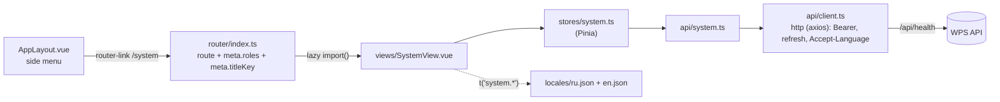

# New UI screen

How to add a page to the web UI — view, route, menu item, store, API module and translations — using a verified
"System status" screen as the example.

<!-- lang-switch -->
🇬🇧 English | [🇷🇺 Русский](../../../ru/07-developer-guide/extending/new-ui-screen.md)
<!-- /lang-switch -->

## 1. When you need it

Add a screen when users need to see or change something that has no page yet: a new API resource, an admin tool, a
report. To show a new field or option inside an existing page, edit that view or component instead.

## 2. How it works



- **Routes** live in `front/src/router/index.ts`. Every route except `/login` is shown inside `AppLayout` (`App.vue`
  wraps non-public routes). `meta` fields:
  - `roles` — allowed roles (`'admin' | 'editor' | 'viewer'`); the global `beforeEach` guard sends other users to `/processes`;
  - `titleKey` — a `route.*` translation key; the browser tab title becomes `"<title> — WPS"` and follows the language;
  - `public` — no login required (only `/login`).
- **Access is enforced by the backend.** `meta.roles` only hides the page; the API endpoint must be protected in
  `Wps\Auth\AccessPolicy::RULES` ([Security](../../04-operations/security.md)).
- **API calls** go through `src/api/client.ts`: `apiGet`, `apiGetPage`, `apiPost`, `apiPut`, `apiDelete` add the token,
  refresh it on `401`, unwrap the `{success, data, error}` envelope and show an error message (`silent: true` turns it off).
  One file per resource in `src/api/` (`processesApi`, `usersApi`, …); response types in `src/types/index.ts`.
- **State** is kept in the view (`ref`s, as in `UsersView.vue`) or, when several components share it, in a Pinia setup
  store in `src/stores/` (`auth.ts`, `processes.ts`).
- **Texts** are always keys in `src/locales/ru.json` **and** `en.json`; `npm run i18n:check` (part of `npm run build`)
  rejects missing keys and Cyrillic in `.vue`/`.ts` ([Coding conventions](../coding-conventions.md)).

## 3. Step by step

The example page shows the result of `GET /api/health`: overall status, each dependency check and the stream counters.
The endpoint already exists, so no backend change is needed. Files to create or change:

| File | Change |
|---|---|
| `front/src/types/index.ts` | response types |
| `front/src/api/system.ts` | **new** — API module |
| `front/src/stores/system.ts` | **new** — Pinia store |
| `front/src/views/SystemView.vue` | **new** — the page |
| `front/src/router/index.ts` | route `/system` |
| `front/src/components/AppLayout.vue` | menu item |
| `front/src/locales/en.json`, `ru.json` | `nav.system`, `route.system`, section `system` |

### 3.1 Types — append to `front/src/types/index.ts`

```ts
// ===== Состояние системы =====

export interface HealthCheck {
  status: 'ok' | 'error'
  latency_ms?: number
  error?: string
}

export interface StreamInfo {
  stream: string
  group: string
  length: number
  lag: number | null
  pending: number
  consumers: number
}

export interface SystemHealth {
  status: 'ok' | 'degraded'
  checks: Record<'postgres' | 'redis_data' | 'redis_stream', HealthCheck>
  stream: StreamInfo | null
  time: string
}
```

### 3.2 API module — `front/src/api/system.ts`

```ts
import { http } from './client'
import type { ApiEnvelope, SystemHealth } from '@/types'

export const systemApi = {
  /** GET /api/health отвечает 503, если одна из проверок упала, — это тоже валидный ответ */
  async health(): Promise<SystemHealth> {
    const response = await http.get<ApiEnvelope<SystemHealth>>('/health', {
      validateStatus: (status) => status === 200 || status === 503,
    })
    return response.data.data
  },
}
```

> **Note**
> Most endpoints need only `apiGet<T>('/resource')`. `/api/health` is special: when a dependency is down it answers
> `503` with a normal `data` body, so the example uses the raw `http` instance and accepts that status.

### 3.3 Store — `front/src/stores/system.ts`

```ts
import { defineStore } from 'pinia'
import { ref } from 'vue'
import { systemApi } from '@/api/system'
import type { SystemHealth } from '@/types'

export const useSystemStore = defineStore('system', () => {
  const health = ref<SystemHealth | null>(null)
  const loading = ref(false)

  async function load(): Promise<void> {
    loading.value = true
    try {
      health.value = await systemApi.health()
    } catch {
      /* сообщение уже показано клиентом API */
    } finally {
      loading.value = false
    }
  }

  return { health, loading, load }
})
```

### 3.4 View — `front/src/views/SystemView.vue`

```vue
<script setup lang="ts">
import { computed, onMounted } from 'vue'
import { useI18n } from 'vue-i18n'
import { Refresh } from '@element-plus/icons-vue'
import { useSystemStore } from '@/stores/system'
import { formatDate } from '@/utils/format'

const { t } = useI18n()
const system = useSystemStore()

const checks = computed(() =>
  Object.entries(system.health?.checks ?? {}).map(([name, check]) => ({ name, ...check })),
)

onMounted(system.load)
</script>

<template>
  <div>
    <div class="page-header">
      <h1>{{ t('system.title') }}</h1>
      <div class="actions">
        <el-button :icon="Refresh" :loading="system.loading" @click="system.load">{{ t('common.refresh') }}</el-button>
      </div>
    </div>

    <el-card v-loading="system.loading" shadow="never">
      <template v-if="system.health">
        <el-descriptions :column="2" border>
          <el-descriptions-item :label="t('system.status')">
            <el-tag :type="system.health.status === 'ok' ? 'success' : 'danger'">
              {{ t(`system.overall.${system.health.status}`) }}
            </el-tag>
          </el-descriptions-item>
          <el-descriptions-item :label="t('system.checkedAt')">{{ formatDate(system.health.time) }}</el-descriptions-item>
          <template v-if="system.health.stream">
            <el-descriptions-item :label="t('system.stream')">{{ system.health.stream.stream }}</el-descriptions-item>
            <el-descriptions-item :label="t('system.length')">{{ system.health.stream.length }}</el-descriptions-item>
            <el-descriptions-item :label="t('system.pending')">{{ system.health.stream.pending }}</el-descriptions-item>
            <el-descriptions-item :label="t('system.consumers')">{{ system.health.stream.consumers }}</el-descriptions-item>
          </template>
        </el-descriptions>

        <el-table :data="checks" stripe class="checks">
          <el-table-column prop="name" :label="t('system.component')" min-width="160" />
          <el-table-column :label="t('system.status')" width="140">
            <template #default="{ row }">
              <el-tag :type="row.status === 'ok' ? 'success' : 'danger'">{{ t(`system.check.${row.status}`) }}</el-tag>
            </template>
          </el-table-column>
          <el-table-column :label="t('system.latency')" width="140">
            <template #default="{ row }">{{ row.latency_ms ?? '—' }}</template>
          </el-table-column>
          <el-table-column prop="error" :label="t('system.error')" min-width="240" />
        </el-table>
      </template>
      <el-empty v-else-if="!system.loading" :description="t('system.unavailable')" />
    </el-card>
  </div>
</template>

<style scoped>
.checks {
  margin-top: 16px;
}
</style>
```

`page-header` and its `actions` block are global styles (`src/styles/main.css`) used by every page.
`formatDate()` from `utils/format.ts` formats the date for the current language.

### 3.5 Route — `front/src/router/index.ts`

Add the route before the catch-all `/:pathMatch(.*)*`:

```ts
  {
    path: '/system',
    name: 'system',
    component: () => import('@/views/SystemView.vue'),
    meta: { roles: ['admin'], titleKey: 'route.system' },
  },
```

`import()` makes the page a separate chunk that is loaded on first visit.

### 3.6 Menu item — `front/src/components/AppLayout.vue`

```ts
const activeMenu = computed(() => {
  if (route.path.startsWith('/processes/create')) return '/processes/create'
  if (route.path.startsWith('/users')) return '/users'
  if (route.path.startsWith('/system')) return '/system'
  return '/processes'
})
```

```vue
          <el-menu-item v-if="auth.isAdmin" index="/system">
            <el-icon><Monitor /></el-icon>
            <span>{{ t('nav.system') }}</span>
          </el-menu-item>
```

All Element Plus icons are registered globally in `main.ts`, so `<Monitor />` needs no import. Use the same role check
as `meta.roles` (`auth.isAdmin`, `auth.canEdit`, or none for all roles).

## 4. Validation and errors

- API errors are shown by `api/client.ts` automatically (`ElMessage`, with `details` for `422`). Catch the rejected
  promise only to stop the spinner, as the store does; pass `{ silent: true }` when the page shows the error itself.
- `401` triggers a token refresh and a retry; if the refresh fails, the user is sent to `/login?redirect=…`.
- Form validation messages go into `computed` `FormRules` with `t()` (see `UsersView.vue`), so they follow a language switch.
- A new API error code gets a translated text by adding `errors.<CODE>` to both locales: `apiErrorTitle()` in
  `utils/errors.ts` uses that key when it exists and the server message otherwise.
- A user without the role in `meta.roles` who opens the URL directly is redirected to `/processes`.

## 5. UI and translations

Add the same keys to both files. `nav.*` is the menu label, `route.*` the browser tab title.

`front/src/locales/en.json`

```json
  "route": {
    …,
    "users": "Users",
    "system": "System status"
  },
  "nav": {
    …,
    "users": "Users",
    "system": "System status"
  },
  "system": {
    "title": "System status",
    "status": "Status",
    "checkedAt": "Checked at",
    "stream": "Stream",
    "length": "Messages in stream",
    "pending": "Pending",
    "consumers": "Consumers",
    "component": "Component",
    "latency": "Latency, ms",
    "error": "Error",
    "unavailable": "The service did not respond",
    "overall": { "ok": "OK", "degraded": "Degraded" },
    "check": { "ok": "OK", "error": "Error" }
  }
```

`front/src/locales/ru.json`

```json
  "route": {
    …,
    "users": "Пользователи",
    "system": "Состояние системы"
  },
  "nav": {
    …,
    "users": "Пользователи",
    "system": "Состояние системы"
  },
  "system": {
    "title": "Состояние системы",
    "status": "Статус",
    "checkedAt": "Время проверки",
    "stream": "Стрим",
    "length": "Сообщений в стриме",
    "pending": "В обработке",
    "consumers": "Обработчики",
    "component": "Компонент",
    "latency": "Задержка, мс",
    "error": "Ошибка",
    "unavailable": "Сервис не ответил",
    "overall": { "ok": "Работает", "degraded": "Деградация" },
    "check": { "ok": "Работает", "error": "Ошибка" }
  }
```

Dynamic keys such as ``t(`system.overall.${status}`)`` are not seen by the key check — make sure every possible value
has a key. If the page is part of the documented UI, add screenshots for both languages to
`doc/_meta/screenshots_manifest.md`.

## 6. Test

The project has no frontend unit tests; the checks are the build and a manual run.

```bash
cd front
npm ci
npm run build        # i18n:check + vue-tsc --noEmit + vite build
```

Check result with the example applied (key and module counts and chunk sizes are as of the check; `ru.json` currently has 394 keys, the example adds 14):

```
✓ i18n: 408 ключей, языки: en, ru
✓ 1743 modules transformed.
dist/assets/SystemView-BEnnSfuu.js                2.81 kB │ gzip:   1.15 kB
✓ built in 8.16s
```

A Cyrillic string left in the view fails the build:

```
✗ src/views/SystemView.vue:21: кириллица вне комментария: <h1>{{ t('system.title') }} Статус</h1>
```

Manual check (steps 1–4 were verified on a separate stack, see [Development environment](../dev-environment.md#a-second-isolated-stack)):

1. `docker compose up -d --build frontend` (or `npm run dev` with the backend on `localhost:9501`).
2. Sign in as `admin@wps.local` / `admin` — the menu has "System status"; open it.
3. All three checks are "OK", the tab title is "System status — WPS"; with `?lang=ru` — «Состояние системы».
4. Stop a dependency (`docker compose stop redis-data`) and press "Refresh": status "Degraded", the `redis_data` row
   shows "Error". Start it again (`docker compose start redis-data`).
5. Sign in as a viewer: no menu item, `/system` redirects to `/processes`.

## 7. Common pitfalls

- **Cyrillic or literal text in a template.** Every UI string goes through `t('…')`; `i18n:check` fails the build on
  Cyrillic in `.vue`/`.ts` (except comments and `src/i18n/locales.ts`).
- **A key in one locale only.** `i18n:check` compares every file with `ru.json`: a missing key, an empty value or an
  extra key fails the build.
- **Dynamic keys.** The check does not see ``t(`system.check.${status}`)``; for a new value coming from the API (e.g. a
  third check status) the key will be missing and the key itself appears on screen. For backend values use a
  fallback, like `labelOr()` in `utils/format.ts` (the translation when the key exists, the raw value otherwise).
- **A double error message.** The API client has already shown an `ElMessage`; do not show the same error again in
  `catch` (or pass `{ silent: true }` and show your own).
- **Protection in the UI only.** `meta.roles` and `v-if` in the menu only hide the page; without a rule in
  `AccessPolicy` the data is available through the API to any role allowed by default (`GET` — everyone).
- **A route after the catch-all.** A route added after `/:pathMatch(.*)*` never opens — the redirect to `/processes`
  takes it.
- **`activeMenu` not updated.** The menu item is not highlighted on the new page and its nested paths.
- **Shared state in a module-level `ref`.** A `ref()` at module level (outside `setup` and outside a store) survives a
  logout; keep the state in the view or in a Pinia store and clear it on logout if it depends on the user.

## 8. Checklist

- [ ] Types in `src/types/index.ts`, calls in `src/api/<resource>.ts` through `api/client.ts`
- [ ] View in `src/views/`, `<script setup lang="ts">`, global `page-header` layout
- [ ] Route with `meta.roles` and `meta.titleKey`, added before the catch-all route
- [ ] Menu item in `AppLayout.vue` with the same role check, `activeMenu` updated
- [ ] Endpoint protected in `AccessPolicy::RULES` (backend)
- [ ] All texts in `en.json` and `ru.json`; `npm run build` passes
- [ ] Screen described in the [user guide](../../03-user-guide/login-and-ui.md) (en + ru), screenshots in the manifest

<!-- footer-nav -->
---

← Previous: [New notification channel](new-notify-channel.md) | [Contents](../../README.md) | [New UI language](new-language.md) Next →
<!-- /footer-nav -->
