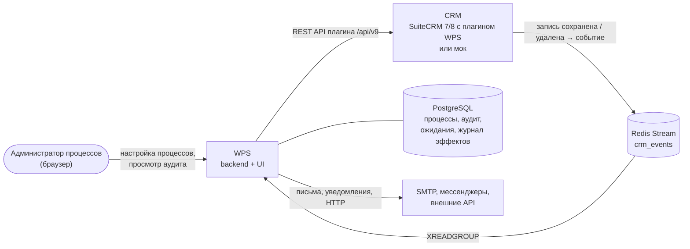

# Обзор

Что такое Workflow Processing Service (WPS), какие задачи он решает и с чего начать чтение.

<!-- lang-switch -->
[🇬🇧 English](../../en/01-overview/index.md) | 🇷🇺 Русский
<!-- /lang-switch -->

## Что такое WPS

**Workflow Processing Service (WPS)** — open-source сервис автоматизации бизнес-процессов поверх CRM
(SuiteCRM 7, SuiteCRM 8 или встроенный мок CRM). По возможностям он ориентирован на AOW Workflow SuiteCRM и
бизнес-процессы Битрикс24, но работает отдельно от CRM: не нагружает её веб-сервер, переживает её перезапуски и хранит
подробный аудит каждого шага.

Когда CRM сохраняет или удаляет запись, например сделку или лид, плагин WPS в CRM публикует **событие** в Redis Stream
`crm_events` (контракт 2.0: тип события `create` / `update` / `delete`, старые значения изменённых полей, список
изменённых полей, пользователь). WPS читает событие и делает следующее:

1. Подбирает активные **процессы верхнего уровня**, настроенные на этот тип объекта (модуль CRM) и этот тип события
   (`trigger_on`), в порядке `priority`.
2. Проверяет **условия** каждого процесса: сравнения с приведением типов, пустоту, списки, диапазоны, относительные даты,
   изменения полей, выражения в правой части, группы «И» / «ИЛИ».
3. Выполняет **предзагрузку**: загружает связанные объекты из CRM в переменные (`v1`, `account`, …) — лениво, только если
   условия по `object.*` уже выполнены.
4. Выполняет **действия** процесса — от простых (изменить поле, сохранить в CRM) до блоков с ветвлениями, циклами,
   паузами, письмами, HTTP-запросами и уведомлениями.
5. Записывает каждое **выполнение** и каждый **шаг** в аудит: запрос, результат, ошибки, повторы, контекст. Аудит
   смотрят в веб-интерфейсе или через API.

Процессы настраиваются без программирования: простые — в визуальном редакторе, сложные — JSON-определением через API.
Чтобы добавить или изменить процесс, деплой не нужен.

## Какие задачи решает

| Проблема | Как её решает WPS |
|---|---|
| Бизнес-правила зашиты в logic hooks CRM, и каждую правку делает разработчик | Правила — это данные: процесс хранится как JSON `definition`, редактируется в UI или через API и версионируется (`version` + 1 при каждом сохранении) |
| «При сохранении X обнови связанный Y» требует своего кода | Предзагрузка достаёт связанную запись, `modify` меняет её, `save_object` / `save_to_crm` записывает обратно |
| Нужно обработать все задачи сделки, а не одну | `find_records` находит список записей, `foreach` обходит его, `update_records` меняет все записи одним шагом, `aggregate` считает сумму или количество |
| Нужно известить человека или внешнюю систему | `send_email` (SMTP), `notify` (колокольчик CRM, Telegram, Slack, Teams), `http_request` (любой REST API или вебхук) |
| «Через 3 дня после…», «за 30 дней до…» | Пауза `delay`: выполнение «засыпает» в PostgreSQL и просыпается в срок, не занимая воркер |
| Непонятно, почему изменилось поле | Каждое выполнение хранит исходное событие, трассировку условий, запрос и результат каждого шага и итоговый контекст |
| CRM или внешний сервис временно недоступны | Восстановимые ошибки (таймауты, HTTP 5xx, 429) повторяются по профилю `retry`; `on_error` решает, остановиться, продолжить или перейти к другому шагу |
| Письмо или запрос нельзя отправить дважды | Журнал побочных эффектов: шаг, повторённый после сбоя, не отправляет письмо или запрос второй раз |
| Одну запись нельзя обрабатывать дважды | Идемпотентность событий и флаг **однократного запуска для записи** (`run_once`) |
| Пароли и токены внешних систем нельзя хранить в процессах | Секреты: значение зашифровано в WPS, процесс ссылается на него `secret://имя` |
| Длинная цепочка зависимых процессов | `start_process` запускает ведомые процессы, они получают событие и все переменные |

## Основные возможности

### Запуск и условия

- **Тип события** (`trigger_on`): процесс реагирует на создание, изменение и/или удаление записи.
- **Операторы сравнения** (25): равенство, порядок (`greater_than` …), диапазоны (`between`, `not_between`), списки
  (`in`, `not_in`), подстроки (`contains`, `starts_with`, `ends_with`), мультисписки (`contains_any`, `contains_all`,
  `contains_none`), пустота и наличие данных (`is_empty`, `is_null` …), изменения поля (`changed`, `changed_to`,
  `changed_from`, `not_changed`).
- **Приведение типов** (`cast`: `string`, `int`, `decimal`, `bool`, `date`, `datetime`, `list`) с параметрами (регистр,
  пробелы, формат даты, разделитель списка) и строгим режимом `on_cast_error`.
- **Правая часть** — значение, другое поле или **выражение** (`v1.credit_limit * 0.8`, `config.min_amount`);
  **относительные даты** (`today+30d`, `now-24h`, `start_of_quarter`).
- **Группы «И» / «ИЛИ»** любой вложенности; **значения до изменения** (`object_before`).

### Действия

| Группа | Действия |
|---|---|
| Данные CRM | `preload` (загрузить запись), `modify` (изменить поле), `save_object` (сохранить), `find_records` (найти список записей), `update_records` (изменить все записи списка), `link_records` / `unlink_records` (связать / отвязать) |
| Переменные | `set_variable` (записать в переменную процесса, накопители) |
| Логика | `condition` (если / иначе, несколько веток), `foreach` (цикл по списку), `stop_process` (завершить досрочно), `delay` (пауза до срока или даты) |
| Люди и внешние системы | `send_email`, `notify`, `http_request`, `assign` (назначить ответственного: по кругу, наименее загруженному, руководителю…) |
| Процессы | `start_process` (запустить ведомый процесс) |

**Типы изменения** поля: значение, значение другой переменной, **расчёт** по выражению, **шаблон** с подстановками,
**сдвиг даты**, увеличение / уменьшение, очистка, дописывание в список и удаление из него, **таблица соответствия**,
**агрегат** по записям CRM (`count`, `sum`, `avg`, `min`, `max`).

### Выражения и шаблоны

- Точная десятичная арифметика, сравнения, логика, условные функции (`if`, `ifs`, `switch`, `coalesce`).
- Функции строк (`replace`, `split`, `pad_left`, `translit`, `slug`, регулярные выражения `regex_match` /
  `regex_extract` / `regex_replace`), чисел (`round`, `percent`, `to_number`, `number_format`), дат (`add_days`,
  `date_diff`, `format_date`, часовые пояса), **списков** (`to_list`, `unique`, `sort`, `pluck`, `where`, `sum`), проверок
  типов (`is_number`, `is_date`, `to_bool`) и **JSON** (`json_get` с JSONPath, `json_decode`, `json_encode`).
- **Системные переменные** `sys.*` (id выполнения, процесс и версия, источник запуска, тип события, изменённые поля,
  пользователь, текущее время, последняя ошибка) и **константы процесса** `config.*`.

### Выполнение, надёжность, аудит

- Ошибки шагов: `on_error` (`stop`, `continue`, `goto`) и профиль повторов `retry` у каждого шага.
- Ожидающие выполнения (`waiting`) хранятся в PostgreSQL и переживают перезапуск; удаление процесса с ожидающими
  выполнениями отменяет их (`cancelled`).
- Журнал побочных эффектов и политика доставки `delivery` (`at_most_once` / `at_least_once`) для писем, запросов и
  уведомлений.
- Обработка стрима «как минимум один раз», идемпотентность, восстановление прерванных выполнений, стрим
  недоставленных сообщений `crm_events:dlq`.
- **Аудит**: журнал выполнений процесса, страница выполнения с шагами, `request_data` / `result_data`, трассой условий
  и живым контекстом.
- **Ручной запуск** с тестовым объектом, при желании без проверки условий (`force`).

### Администрирование

- Роли `admin`, `editor`, `viewer` (JWT); управление пользователями в интерфейсе.
- Секреты внешних систем (`/api/secrets`), проверка почты (`/api/mail/test`) и каналов уведомлений (`/api/notify/test`).
- Наблюдаемость: `/api/health` и метрики Prometheus на `/metrics`.
- Двуязычный интерфейс: русский и английский, переключение без перезагрузки страницы.
- Расширяемость: новые действия, блоки, операторы, типы изменений, функции выражений и каналы уведомлений
  добавляются PHP-классами и регистрируются в одном месте.

## Что настраивается в редакторе, а что через API

Визуальный редактор процесса покрывает «табличную» часть определения. Всё остальное задаётся JSON-определением через
API (`POST` / `PUT /api/processes`) — интерфейс такие части показывает и при сохранении старается не трогать, но
редактировать их в форме нельзя.

| Часть процесса | В редакторе | Только через API |
|---|---|---|
| Название, тип объекта, тип процесса, приоритет, однократный запуск | ✓ | |
| Тип события `trigger_on` | | ✓ (на карточке не показывается) |
| Константы `definition.constants` | | ✓ (на карточке не показываются) |
| Условия: строки «И» с одним значением — **Равен**, **Не равен**, **Включает**, **Не включает**, **Начинается с**, **Заканчивается на**, **Изменилось на**, **Изменилось с** — и без значения — **Пусто**, **Не пусто**, **Данные отсутствуют**, **Данные есть**, **Изменилось**, **Не изменилось** | ✓ | |
| Условия с `cast` (**Больше**, **Меньше** …), списками, диапазонами, с выражением, группы «ИЛИ» | | ✓ |
| Предзагрузка (блок 2) | ✓ | `strategy`, предзагрузка внутри действий |
| Строки **Изменение** (`modify`) с одним значением: **Равен значению**, **Равен переменной**, **Расчёт**, **Шаблон**, **Увеличить на** / **Уменьшить на**, **Очистить** | ✓ | **Сдвиг даты**, списки (`append` / `remove` с параметрами), **По таблице соответствия**, **Агрегат по записям**; поля `id`, `on_error`, `retry` |
| **Сохранить в CRM** (`save_object`), **Запустить следующий процесс** (`start_process`) | ✓ | `mode: full`, `on_error`, `retry` |
| `send_email`, `http_request`, `notify`, `assign`, `set_variable`, `find_records`, `update_records`, `link_records`, `unlink_records`, `foreach`, `condition`, `stop_process`, `delay` | показываются серой строкой «только чтение» | ✓ |

> **Примечание**
> Процесс, собранный через API, можно открыть в редакторе и сохранить: форма правит определение поверх исходного JSON.
> Константы `config.*`, дополнительные поля строк (`cast`, `on_cast_error`, `id`, `on_error`, `retry`, `mode`,
> `strategy` …) и порядок действий сохраняются. Строки, которые форма не умеет показать, — условия со списками,
> диапазонами, выражениями или вложенными группами, изменения **Сдвиг даты**, списки, **По таблице соответствия**,
> **Агрегат по записям**, запуск нескольких процессов одним шагом и все действия из последней строки таблицы —
> показываются только для чтения и сохраняются без изменений. Подробнее — [Частые вопросы](../08-faq.md#можно-ли-открыть-в-редакторе-процесс-созданный-через-api).

## Как это устроено

CRM публикует события. WPS их читает и через REST API плагина читает и записывает записи CRM (поиск с фильтрами,
связи, количество). В PostgreSQL хранятся процессы, аудит, ожидающие выполнения и журнал побочных эффектов. Второй
экземпляр Redis (на схеме не показан) держит кэши, состояние идущих выполнений, блокировки и очереди назначения.
Полная картина — в разделе [Обзор архитектуры](../05-architecture/overview.md).

## Технологии

| Часть | Технологии |
|---|---|
| Backend (`back/`) | PHP 8.3, Swoole 6 (корутины), фреймворк SwooleApp (`sidalex/swoole-app`), symfony/mailer |
| Frontend (`front/`) | Vue 3, TypeScript, Vite 5, Element Plus, Pinia, Vue Router, Axios, vue-i18n |
| Хранилища | PostgreSQL 15, Redis 7 (два экземпляра: шина событий и данные) |
| CRM | SuiteCRM 7 / 8 с плагином WPS (`.tehnical/`) или мок (`mock/`) |
| Почта для разработки | Mailpit (перехватывает письма процессов, `http://localhost:8025`) |
| Поставка | Docker Compose |

## Что читать дальше

| Задача | Раздел |
|---|---|
| Запустить WPS локально за 10 минут | [Быстрый старт](../02-getting-started/quick-start.md) |
| Собрать первый процесс | [Первый процесс](../02-getting-started/first-process.md) |
| Разобраться в интерфейсе и всех настройках | [Руководство пользователя](../03-user-guide/login-and-ui.md) |
| Взять готовый сценарий | [Рецепты](../03-user-guide/recipes.md) |
| Понять, почему процесс не сработал | [Выполнения и аудит](../03-user-guide/executions-and-audit.md), [Частые вопросы](../08-faq.md) |
| Развернуть и настроить | [Развёртывание](../04-operations/deployment.md), [Конфигурация](../04-operations/configuration.md) |
| Понять внутреннее устройство | [Обзор архитектуры](../05-architecture/overview.md) |
| Работать через API | [Справочник API](../06-api-reference/index.md) |
| Добавить новое действие или оператор | [Руководство разработчика](../07-developer-guide/dev-environment.md) |
| Найти термин | [Глоссарий](glossary.md) |

<!-- footer-nav -->
---

[Оглавление](../README.md) | [Глоссарий](glossary.md) Далее →
<!-- /footer-nav -->
