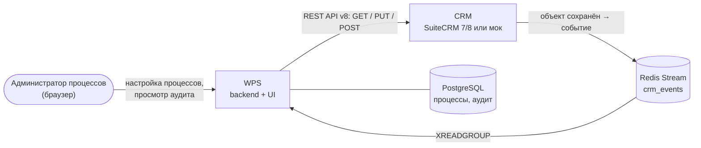

# Обзор

Что такое Workflow Processing Service (WPS), какие задачи он решает и с чего начать чтение.

<!-- lang-switch -->
[🇬🇧 English](../../en/01-overview/index.md) | 🇷🇺 Русский
<!-- /lang-switch -->

## Что такое WPS

**Workflow Processing Service (WPS)** — open-source сервис автоматизации бизнес-процессов поверх CRM
(SuiteCRM 7, SuiteCRM 8 или встроенный мок CRM).

Когда CRM сохраняет объект, например сделку или лид, она публикует событие в Redis Stream `crm_events`.
WPS читает событие и делает следующее:

1. Подбирает активные **процессы верхнего уровня**, настроенные на этот тип объекта (модуль CRM), в порядке `priority`.
2. Проверяет **условия** каждого процесса. Все строки объединяются по «И».
3. Выполняет **предзагрузку**: загружает связанные объекты из CRM в переменные (`v1`, `v2`, …).
4. Выполняет **действия** процесса строго по порядку: меняет поля, сохраняет объекты в CRM, асинхронно запускает
   **ведомые процессы**.
5. Записывает каждое **выполнение** и каждый **шаг** в аудит. Аудит можно смотреть в веб-интерфейсе.

Процессы настраиваются в веб-интерфейсе без программирования. Чтобы добавить или изменить процесс, деплой не нужен.

## Какие задачи решает

| Проблема | Как её решает WPS |
|---|---|
| Бизнес-правила зашиты в logic hooks CRM, и каждую правку делает разработчик | Правила — это данные: процесс хранится как JSON `definition`, редактируется в UI и версионируется (`version` + 1 при каждом сохранении) |
| «При сохранении X обнови связанный Y» требует своего кода | Предзагрузка достаёт связанную запись, `modify` меняет её, `save_object` / `save_to_crm` записывает обратно |
| Непонятно, почему изменилось поле | Каждое выполнение хранит исходное событие, трассировку условий, запрос и результат каждого шага и итоговый контекст |
| CRM временно недоступна | Восстановимые ошибки (таймауты, HTTP 5xx) повторяются с экспоненциальной задержкой, прерванные выполнения продолжаются |
| Одну запись нельзя обрабатывать дважды | Идемпотентность событий и необязательный флаг **однократного запуска для записи** (`run_once`) |
| Длинная цепочка зависимых процессов | `start_process` запускает ведомые процессы, они получают событие и все переменные |

## Основные возможности

- **Визуальный редактор процессов**: условия запуска, предзагрузка, изменения, сохранение в CRM, запуск следующего
  процесса. Боковая панель переменных показывает, какие переменные доступны на каждом шаге.
- **Условия**: операторы `equals`, `not_equals`, `contains`, `not_contains`. Сравнивать можно со значением или с другим
  полем. В условиях можно использовать предзагруженные переменные (ленивая предзагрузка).
- **Типы изменений**: `set_value`, `set_from_variable`, `calculate`. В `calculate` пишутся выражения с `+ - * / %`
  и функциями `concat`, `upper`, `lower`, `trim`, `len`, `substr`, `round`, `abs`, `min`, `max`.
- **Ведомые процессы** запускаются асинхронно. При сохранении процесса проверяется, нет ли цикла запусков.
- **Ручной запуск** с тестовым объектом, при желании без проверки условий (`force`).
- **Аудит**: журнал выполнений процесса, пошаговые детали, живой контекст во время выполнения.
- **Надёжность**: обработка стрима «как минимум один раз», повторы, восстановление прерванных выполнений, стрим
  недоставленных сообщений `crm_events:dlq`.
- **Роли**: `admin`, `editor`, `viewer` (аутентификация по JWT).
- **Наблюдаемость**: `/api/health` и метрики Prometheus на `/metrics`.
- **Расширяемость**: новые типы действий, операторы сравнения, типы изменений, стратегии загрузки и функции выражений
  добавляются PHP-классами и регистрируются в одном месте.
- **Двуязычный интерфейс**: русский и английский, переключение без перезагрузки страницы.

## Как это устроено

CRM публикует события. WPS их читает и через REST API CRM читает и записывает записи. В PostgreSQL хранятся
конфигурация процессов и аудит. Второй экземпляр Redis (на схеме не показан) держит кэши и состояние идущих выполнений.
Полная картина — в разделе [Обзор архитектуры](../05-architecture/overview.md).

## Технологии

| Часть | Технологии |
|---|---|
| Backend (`back/`) | PHP 8.3, Swoole 6 (корутины), фреймворк SwooleApp (`sidalex/swoole-app`) |
| Frontend (`front/`) | Vue 3, TypeScript, Vite 5, Element Plus, Pinia, Vue Router, Axios, vue-i18n |
| Хранилища | PostgreSQL 15, Redis 7 (два экземпляра: шина событий и данные) |
| CRM | SuiteCRM 7 / 8 с плагином WPS (`.tehnical/`) или мок (`mock/`) |
| Поставка | Docker Compose |

## Что читать дальше

| Задача | Раздел |
|---|---|
| Запустить WPS локально за 10 минут | [Быстрый старт](../02-getting-started/quick-start.md) |
| Собрать первый процесс | [Первый процесс](../02-getting-started/first-process.md) |
| Разобраться в интерфейсе и всех настройках | [Руководство пользователя](../03-user-guide/login-and-ui.md) |
| Взять готовый сценарий | [Рецепты](../03-user-guide/recipes.md) |
| Развернуть и настроить | [Развёртывание](../04-operations/deployment.md), [Конфигурация](../04-operations/configuration.md) |
| Понять внутреннее устройство | [Обзор архитектуры](../05-architecture/overview.md) |
| Работать через API | [Справочник API](../06-api-reference/index.md) |
| Добавить новое действие или оператор | [Руководство разработчика](../07-developer-guide/dev-environment.md) |
| Найти термин | [Глоссарий](glossary.md) |

<!-- footer-nav -->
---

[Оглавление](../README.md) | [Глоссарий](glossary.md) Далее →
<!-- /footer-nav -->
