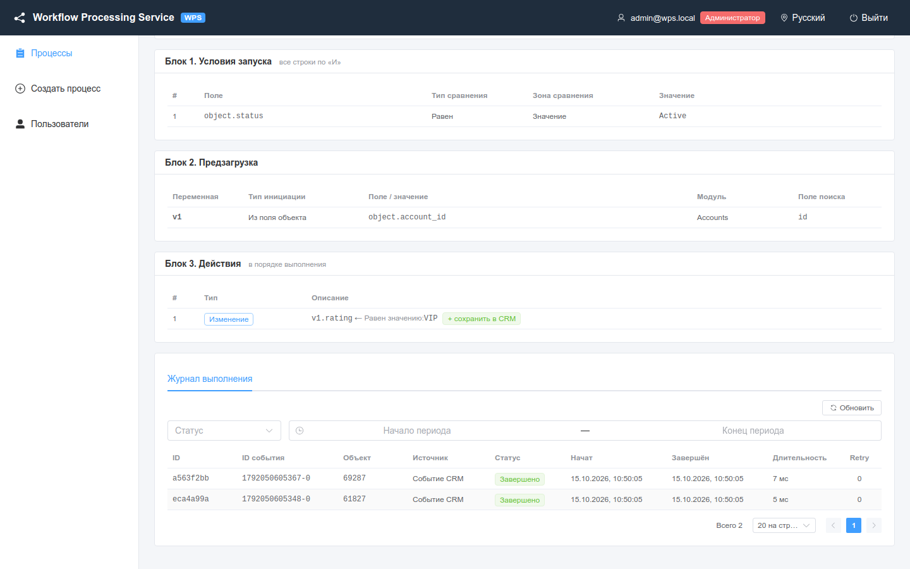
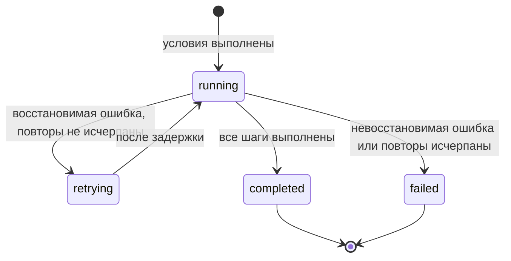
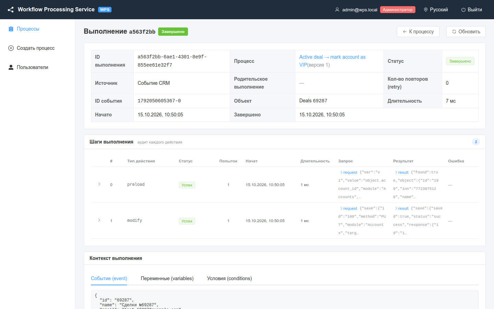
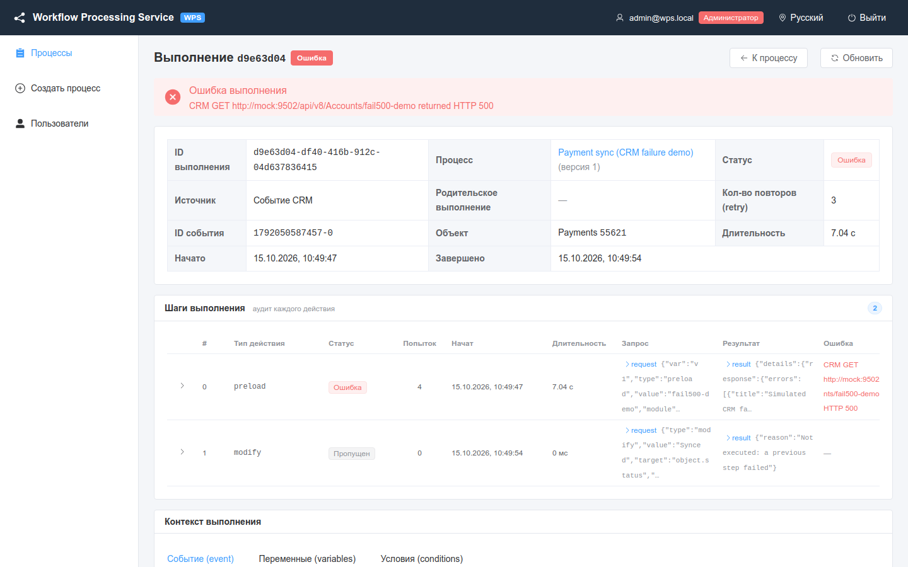

# Выполнения и аудит

Где посмотреть каждый запуск процесса, как читать страницу выполнения и как найти причину ошибки.

<!-- lang-switch -->
[🇬🇧 English](../../en/03-user-guide/executions-and-audit.md) | 🇷🇺 Русский
<!-- /lang-switch -->

## Что записывается

При каждом запуске процесса WPS создаёт **выполнение** (запуск для одного события) и пишет в аудит каждый **шаг**
(одну строку предзагрузки или одно действие):

- выполнение: процесс и его версия, источник запуска, id события, объект, статус, число повторов, ошибка, время, а также
  итоговый контекст (событие, переменные, результаты условий);
- каждый шаг: тип действия, статус, число попыток, время начала, длительность, `request_data` (что шаг сделал или
  отправил) и `result_data` (что он получил или изменил), текст ошибки.

> **Примечание**
> Событие, для которого условия процесса **не выполнены**, выполнения не создаёт и в журнал не попадает. То же
> относится к запуску, заблокированному **однократным запуском для записи**. Чтобы понять, почему процесс не
> запустился, используйте [ручной запуск](manual-run-and-reset.md): он показывает результат каждого условия.

## Журнал выполнения процесса

Откройте карточку процесса и прокрутите её до вкладки **Журнал выполнения**.



*Журнал процесса #1: два завершённых запуска по событиям CRM.*

| Колонка | Значение |
|---|---|
| **ID** | Короткий id выполнения; нажмите на строку, чтобы открыть выполнение |
| **ID события** | id сообщения Redis Stream (`1792050605348-0`) или `manual-<uuid>` для ручного запуска |
| **Объект** | id записи CRM из события |
| **Источник** | **Событие CRM** (`stream`), **Ручной запуск** (`manual`), **Дочерний** (`child`) |
| **Статус** | **Выполняется**, **Повтор**, **Завершено**, **Ошибка** |
| **Начат** / **Завершён** / **Длительность** | Время выполнения |
| **Retry** | Сколько раз повторялись шаги этого выполнения |

Фильтры:

- **Статус** — показать выполнения только с выбранным статусом;
- **Начало периода** — **Конец периода** — период по времени начала выполнения;
- **Обновить** — перезагрузить список.

Список отсортирован от новых к старым и разбит на страницы. Те же данные доступны через API:

```bash
curl -s "http://localhost:9501/api/processes/1/executions?status=failed&date_from=2026-10-15T00:00:00Z&page=1&per_page=20" \
  -H "Authorization: Bearer $TOKEN"
```

## Статусы выполнения



| Статус | В интерфейсе | Значение |
|---|---|---|
| `running` | **Выполняется** | Шаги выполняются |
| `retrying` | **Повтор** | Шаг завершился временной ошибкой (таймаут CRM, 5xx от CRM, сеть); WPS ждёт и повторяет его |
| `completed` | **Завершено** | Все шаги выполнены |
| `failed` | **Ошибка** | Шаг завершился ошибкой, остальные шаги не выполнялись |

Статусы шагов:

| Статус | В интерфейсе | Значение |
|---|---|---|
| `success` | **Успех** | Шаг выполнен |
| `failed` | **Ошибка** | Шаг завершился ошибкой, см. колонку **Ошибка** |
| `skipped` | **Пропущен** | Шаг не выполнялся: предыдущий шаг упал, сохранять было нечего или переменная для сохранения пуста |

## Страница выполнения

Нажмите на строку журнала (или на ссылку в **Дочерних выполнениях**), чтобы открыть `/executions/<id>`.



*Завершённое выполнение процесса #1: `preload` загрузил контрагента, `modify` выставил рейтинг и сохранил его в CRM.*

Страница состоит из четырёх частей.

1. **Заголовок** — короткий id, статус, кнопки **К процессу** и **Обновить**. Пока выполнение в статусе
   **Выполняется** или **Повтор**, страница обновляется сама каждые 2 секунды и показывает `live · обновлено <время>`.
2. **Свойства** — **ID выполнения**, **Процесс** (с версией на момент запуска), **Статус**, **Источник**,
   **Родительское выполнение** (для ведомого процесса), **Кол-во повторов (retry)**, **ID события**, **Объект**,
   **Длительность**, **Начато**, **Завершено**. Красный баннер **Ошибка выполнения** показывает текст ошибки.
3. **Шаги выполнения** — по строке на шаг: **#**, **Тип действия**, **Статус**, **Попыток**, **Начат**,
   **Длительность**, **Запрос**, **Результат**, **Ошибка**. Раскройте строку, чтобы увидеть полный JSON
   **Запрос (request_data)** и **Результат (result_data)**.
4. **Контекст выполнения** — три вкладки:
   - **Событие (event)** — объект в том виде, в каком он пришёл из CRM;
   - **Переменные (variables)** — `object` и все переменные после последнего шага (для идущего выполнения — живой
     контекст из Redis с пометкой **живой контекст из Redis**);
   - **Условия (conditions)** — каждое условие с фактическим и ожидаемым значением и результатом.

У родительского процесса таблица **Дочерние выполнения** перечисляет запущенные им ведомые процессы (см.
[Ведомые процессы](subprocesses.md)).

### Что записывают шаги

| Действие | `request_data` | `result_data` |
|---|---|---|
| `preload` | `var`, `module`, `strategy` (`by_id`/`by_field`), `by_field`, `source`, `value`, `lookup_value` | `found`, `object` (загруженная запись или `null`) |
| `modify` | `target`, `change_type`, `value` (значение или выражение) | `old_value`, `new_value`; при `save_to_crm` ещё `save` |
| `save_object` | `method` (`PUT`/`POST`), `module`, `id`, отправленные `attributes` | `saved`, `response`, `created_id` для новой записи |
| `start_process` | `process_ids` | `children`: `started` / `skipped` для каждого ведомого процесса |
| шаг с ошибкой | конфигурация шага | `error_class`, `recoverable`, `details` (например, ответ CRM) |

## Разбор ошибки выполнения



*Процесс #5 загружает запись, на которую мок CRM отвечает HTTP 500: три повтора, затем выполнение завершается ошибкой.*

1. Откройте выполнение со статусом **Ошибка**. В баннере **Ошибка выполнения** — текст, например
   `CRM GET http://mock:9502/api/v8/Accounts/fail500-demo returned HTTP 500`.
2. В **Шагах выполнения** найдите строку со статусом **Ошибка**. Шаги после неё **Пропущены** с причиной
   `Not executed: a previous step failed`.
3. Посмотрите на **Попыток**:
   - больше 1 (по умолчанию 4 = первая попытка + 3 повтора `ACTION_RETRY_MAX`) — ошибка временная
     (`recoverable: true`): CRM недоступна, таймаут или 5xx. Проверьте CRM, её адрес и ключ
     ([Интеграция с CRM](../04-operations/crm-integration.md));
   - 1 — ошибка постоянная (`recoverable: false`): 4xx от CRM, неверный модуль, ошибка настройки. Исправьте процесс.
4. Раскройте строку: в `result_data.details.response` — ответ CRM, в `request_data` — точная конфигурация шага.
5. Откройте **Контекст выполнения** → **Переменные**: проверьте, какие переменные равны `null` (предзагрузка ничего не
   нашла) и какие значения были у полей.
6. Исправьте процесс или данные и проверьте результат [ручным запуском](manual-run-and-reset.md).

Типичные ошибки:

| Ошибка | Причина | Что делать |
|---|---|---|
| `CRM GET … returned HTTP 500`, `connection failed`, `request timeout` | CRM недоступна или отвечает медленно | Проверить CRM, `CRM_API_BASE_URL`, `CRM_API_TIMEOUT` |
| `CRM … returned HTTP 401` | Неверный `CRM_API_STATIC_KEY` | Исправить ключ в конфигурации бэкенда |
| `Cannot save "v1": CRM module is unknown (set "module" in the save action)` | Сохраняется переменная, созданная через `modify`, без модуля | Заполнить **Модуль (для новых переменных, необязательно)** в строке «Сохранить в CRM» |
| `Variable "v1" is empty (object was not loaded) — nothing to save` (шаг **Пропущен**) | Предзагрузка ничего не нашла | Добавить условие на переменную (например, `v1.id` **Не равен** пустому значению) |
| `Child process 42 not found`, `… is not a child process` | Ведомый процесс удалён или сменил тип | Исправить строку **Запустить следующий процесс** |
| `Execution context expired or lost; it could not be resumed` | Воркер упал, а состояние в Redis истекло | Запустить процесс заново вручную |

> **Примечание**
> При каждом сохранении процесса его версия увеличивается. Выполнение хранит версию, с которой оно запускалось
> (**(версия N)** рядом с названием процесса), поэтому аудит остаётся согласованным после правок процесса.

См. также: [Надёжность](../04-operations/reliability.md), [Мониторинг](../04-operations/monitoring.md),
[Решение проблем](../04-operations/troubleshooting.md), [Эндпоинты API](../06-api-reference/endpoints.md).

<!-- footer-nav -->
---

← Назад: [Ведомые процессы](subprocesses.md) | [Оглавление](../README.md) | [Ручной запуск и сброс однократного запуска](manual-run-and-reset.md) Далее →
<!-- /footer-nav -->
