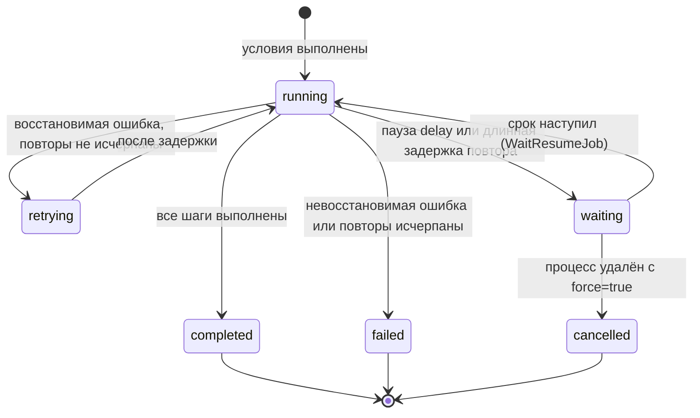

# Выполнения и аудит

Где посмотреть каждый запуск процесса, как читать страницу выполнения и как найти причину ошибки.

<!-- lang-switch -->
[🇬🇧 English](../../en/03-user-guide/executions-and-audit.md) | 🇷🇺 Русский
<!-- /lang-switch -->

## Что записывается

При каждом запуске процесса WPS создаёт **выполнение** (запуск для одного события) и пишет в аудит каждый **шаг**
(одну строку предзагрузки или одно действие):

- выполнение: процесс и его версия, источник запуска, id события, объект, статус, число повторов, ошибка, время, а также
  итоговый контекст (событие, переменные, результаты условий);
- каждый шаг: тип действия, статус, число попыток, время начала, длительность, `request_data` (что шаг сделал или
  отправил) и `result_data` (что он получил или изменил), текст ошибки, а также положение шага в программе:
  - `step_index` — порядковый номер записи в аудите выполнения;
  - `pc` — номер инструкции программы (для линейного процесса совпадает со `step_index`);
  - `step_path` — место шага в определении: `preload[0]`, `actions[2]`, `actions[1].branches[0].actions[0]`,
    `actions[1].else[0]`;
  - `iteration` — номер итерации цикла [`foreach`](actions.md#цикл-для-каждого-элемента) с нуля, во вложенных циклах —
    индексы от внешнего к внутреннему (`"2/0"`); пусто вне циклов;
  - `step_id` — пользовательский `id` шага, если он задан (см. [Действия](actions.md#вложенные-блоки-и-поля-шага));
  - `error_code` — код ошибки упавшего шага (`HTTP_503`, `TIMEOUT`, `CONFIG`, `UNKNOWN_OUTCOME` …);
  - `handled` — как обработана ошибка: `continue`, `goto` (по `on_error`), `item_continue` (цикл с
    `on_item_error: continue` перешёл к следующему элементу) или пусто (ошибка остановила выполнение), см.
    [Действия → Ошибки шага](actions.md#ошибки-шага-on_error-и-повторы);
- у выполнения также `handled_errors` — число ошибок шагов, обработанных `on_error` или `on_item_error: continue`.

> **Примечание**
> Событие, для которого условия процесса **не выполнены**, выполнения не создаёт и в журнал не попадает. То же
> относится к запуску, заблокированному **однократным запуском для записи**. Чтобы понять, почему процесс не
> запустился, используйте [ручной запуск](manual-run-and-reset.md): он показывает результат каждого условия.

## Журнал выполнения процесса

Откройте карточку процесса и прокрутите её до вкладки **Журнал выполнения**.


*Журнал процесса #1: два завершённых запуска по событиям CRM.*

| Колонка | Значение |
|---|---|
| **ID** | Короткий id выполнения; нажмите на строку, чтобы открыть выполнение |
| **ID события** | id сообщения Redis Stream (`1792050605348-0`) или `manual-<uuid>` для ручного запуска |
| **Объект** | id записи CRM из события |
| **Источник** | **Событие CRM** (`stream`), **Ручной запуск** (`manual`), **Дочерний** (`child`) |
| **Статус** | **Выполняется**, **Повтор**, **Ожидает**, **Завершено**, **Ошибка**, **Отменено** |
| **Начат** / **Завершён** / **Длительность** | Время выполнения |
| **Retry** | Сколько раз повторялись шаги этого выполнения |

Фильтры:

- **Статус** — показать выполнения только с выбранным статусом;
- **Начало периода** — **Конец периода** — период по времени начала выполнения;
- **Обновить** — перезагрузить список.

Список отсортирован от новых к старым и разбит на страницы. Те же данные доступны через API:

```bash
curl -s "http://localhost:9501/api/processes/1/executions?status=failed&date_from=2026-10-15T00:00:00Z&page=1&per_page=20" \
  -H "Authorization: Bearer $TOKEN"
```

## Статусы выполнения



| Статус | В интерфейсе | Значение |
|---|---|---|
| `running` | **Выполняется** | Шаги выполняются |
| `retrying` | **Повтор** | Шаг завершился временной ошибкой (таймаут CRM, 5xx от CRM, сеть); WPS ждёт и повторяет его |
| `waiting` | **Ожидает** | Выполнение приостановлено до срока `waiting_until` (пауза `delay` или длинная задержка повтора); воркер свободен, состояние хранится в PostgreSQL |
| `completed` | **Завершено** | Все шаги выполнены; ошибки шагов, обработанные `on_error` (`continue` / `goto`) или циклом с `on_item_error: continue`, видны в `handled_errors` |
| `failed` | **Ошибка** | Шаг завершился ошибкой (с `on_error: stop`, по умолчанию), остальные шаги не выполнялись |
| `cancelled` | **Отменено** | Ожидающее выполнение отменено: процесс удалён с `?force=true` (`error_message` «Process deleted») |

Статусы шагов:

| Статус | В интерфейсе | Значение |
|---|---|---|
| `success` | **Успех** | Шаг выполнен |
| `failed` | **Ошибка** | Шаг завершился ошибкой, см. колонку **Ошибка** |
| `skipped` | **Пропущен** | Шаг не выполнялся: предыдущий шаг упал, сохранять было нечего или переменная для сохранения пуста |
| `waiting` | **Ожидает** | Шаг приостановил выполнение (`result_data.wait = {due_at, reason}`); после пробуждения та же запись получает итоговый статус |

### Ожидающие выполнения

У выполнения в статусе `waiting` есть поля `waiting_until` (срок, UTC) и `wait_reason` (`delay` — пауза, `retry` —
длинная задержка повтора). `GET /api/executions/{id}` для такого выполнения отдаёт ещё объект `wait`
(`due_at`, `reason`, `attempts` — попытки пробуждения, `info`), а контекст берёт из сохранённого снимка ожидания:

```json
{ "id": "…", "status": "waiting", "waiting_until": "2026-10-19T09:00:00+00:00", "wait_reason": "delay",
  "current_step": 1,
  "wait": { "due_at": "2026-10-19T09:00:00+00:00", "reason": "delay", "attempts": 0,
            "info": { "pc": 1, "seq": 1, "mode": "after_wait", "parked_at": "2026-10-16T09:00:00+00:00" } },
  "actions": [ { "step_index": 0, "action_type": "modify", "status": "success" },
               { "step_index": 1, "action_type": "delay", "status": "waiting", "result_data": { "wait": { "due_at": "…", "reason": "delay" } } } ] }
```

После пробуждения запись шага паузы получает статус `success` с `waited: true`, `waited_seconds` и `lateness_ms`
(насколько позже срока выполнение продолжилось), дальше идут следующие шаги. Шаг повтора (`retry`) после пробуждения
выполняется заново и перезаписывает ту же запись аудита.

Найти все ожидающие выполнения (по всем процессам):

```bash
curl -s "http://localhost:9501/api/executions?status=waiting&due_before=2026-10-20T00:00:00Z&page=1&per_page=50" \
  -H "Authorization: Bearer $TOKEN"
```

В журнале процесса фильтр **Статус** тоже принимает `waiting` и `cancelled`. Удаление процесса с ожидающими
выполнениями отклоняется (`409 PROCESS_HAS_WAITING_EXECUTIONS`), с `?force=true` (admin) они отменяются.

## Страница выполнения

Нажмите на строку журнала (или на ссылку в **Дочерних выполнениях**), чтобы открыть `/executions/<id>`.


*Завершённое выполнение процесса #1: `preload` загрузил контрагента, `modify` выставил рейтинг и сохранил его в CRM.*

Страница состоит из четырёх частей.

1. **Заголовок** — короткий id, статус, кнопки **К процессу** и **Обновить**. Пока выполнение в статусе
   **Выполняется** или **Повтор**, страница обновляется сама каждые 2 секунды и показывает `live · обновлено <время>`.
2. **Свойства** — **ID выполнения**, **Процесс** (с версией на момент запуска), **Статус**, **Источник**,
   **Родительское выполнение** (для ведомого процесса), **Кол-во повторов (retry)**, **ID события**, **Объект**,
   **Длительность**, **Начато**, **Завершено**. Красный баннер **Ошибка выполнения** показывает текст ошибки.
3. **Шаги выполнения** — по строке на шаг: **#**, **Тип действия**, **Статус**, **Попыток**, **Начат**,
   **Длительность**, **Запрос**, **Результат**, **Ошибка**. Раскройте строку, чтобы увидеть полный JSON
   **Запрос (request_data)** и **Результат (result_data)**.
4. **Контекст выполнения** — три вкладки:
   - **Событие (event)** — объект в том виде, в каком он пришёл из CRM;
   - **Переменные (variables)** — `object` и все переменные после последнего шага (для идущего выполнения — живой
     контекст из Redis с пометкой **живой контекст из Redis**);
   - **Условия (conditions)** — каждое условие с фактическим и ожидаемым значением и результатом.

У родительского процесса таблица **Дочерние выполнения** перечисляет запущенные им ведомые процессы (см.
[Ведомые процессы](subprocesses.md)).

### Что записывают шаги

| Действие | `request_data` | `result_data` |
|---|---|---|
| `preload` | `var`, `module`, `strategy` (`by_id`/`by_field`), `by_field`, `source`, `value`, `lookup_value` | `found`, `object` (загруженная запись или `null`) |
| `modify` | `target`, `change_type`, `value` (значение или выражение) | `old_value`, `new_value`; при `save_to_crm` ещё `save`; у `aggregate` — `function`, `module` / `link`, `records_scanned`, `pages`, `truncated`, `total`, `skipped_reason` (см. [Агрегат по записям](change-types-and-expressions.md#агрегат-по-записям)) |
| `save_object` | `method` (`PUT`/`POST`), `module`, `id`, отправленные `attributes` | `saved`, `response`, `created_id` для новой записи |
| `start_process` | `process_ids` | `children`: `started` / `skipped` для каждого ведомого процесса |
| `condition` (блок) | `branches` (число веток), `has_else` | `selected` — индекс выбранной ветки, `"else"` или `"none"` (ни одна ветка не подошла и `else` нет); `branches` — для каждой проверенной ветки `branch`, `name`, `result` и трасса условий `conditions` (см. [ниже](#запись-блока-condition)) |
| `stop_process` (блок) | `status`, `code`, `message` (шаблон сообщения) | `stopped: true`, `status`, `code`, `message` после подстановок; `message_error`, если шаблон не удалось вычислить (см. [ниже](#остановленное-выполнение)) |
| `assign` | `target`, `field`, `strategy`, `only_active`, `queue_key`, `save` | `chosen_user_id`, `previous_user_id`, `unchanged`, `reason`, `pool_size`, `pool`, `pool_source`, `inactive`, `excluded`, `counts`, `manager_of`, `fallback`, `reused_decision`, `save` (см. [Назначить ответственного](actions.md#назначить-ответственного)) |
| `notify` | `title`, `message_preview`, `link`, `channels` (без секретов), `delivery` | `channels`: по каналу `status` (`success` / `failed` / `skipped`), `deliveries` (`user`/`record`, `chat_id`/`message_id`, `status`, `replayed`), `error`, `error_code`; `warnings` (см. [Уведомление](actions.md#уведомление)) |
| `update_records` | `list`, `module`, `count`, `set`, `only_changed`, `max` | `updated`, `unchanged`, `skipped_no_id`, `errors`, `items` (до 200: `{id, status, fields, error}`); если записи упали — шаг `failed` («N of M records failed»), та же сводка в `details` (см. [Изменить записи списка](actions.md#изменить-записи-списка)) |
| `foreach` (блок) | `source`, `as`, `max_items`, `on_overflow`, `on_item_error`, `has_where` | в начале — `count`, `truncated`, `source_missing`; по окончании цикла запись перезаписывается итогами: `processed`, `skipped_by_where`, `failed_items`, `failed_indexes`, `unsaved_items`, `where_traces`, при ошибке `failed_at_index` (см. [ниже](#запись-цикла-foreach)) |
| `delay` | `mode` и поля срока, `due_at` (UTC), `due_at_local` | в корутине — `waited: true`, `waited_seconds`, `inline: true`; после парковки — `waited: true`, `lateness_ms`, `waited_seconds`; момент прошёл — `waited: false`, `past_due: true` (см. [Пауза](actions.md#пауза-delay)) |
| шаг с ошибкой | конфигурация шага | `error_class`, `recoverable`, `error_code`, `error` — классифицированная ошибка (`code`, `message`, `transient`, `http_status`, `retry_after`), `details` (например, ответ CRM); при `on_error: {goto}` — `goto` (id цели) |
| внешнее действие (`send_email`, `http_request`, `notify`) | что отправлено (секреты замаскированы) | ответ внешней системы, `idempotency_key` — внешний ключ идемпотентности; `replayed: true`, если шаг повторно выполнился после сбоя и ответ взят из журнала побочных эффектов без повторного вызова |

Шаги невыбранных веток в аудит не попадают. Если шаг упал (и `on_error` — `stop`), `skipped` получают следующие шаги
его списка (например, ветки) и следующие шаги всех объемлющих списков вплоть до верхнего уровня. При `on_error:
continue` упавший шаг остаётся `failed` с `handled: "continue"`, а выполнение идёт дальше; при `goto` шаги между
ошибкой и целью не выполняются и в аудит не пишутся.

### Запись блока condition

Блок `condition` пишет одну запись `condition` на каждое выполнение; шаги выбранной ветки идут следом обычными
записями (`step_path` вида `actions[0].branches[1].actions[0]`), шаги невыбранных веток не пишутся.

```json
{ "step_index": 0, "pc": 0, "step_path": "actions[0]", "step_id": "deal_size", "action_type": "condition", "status": "success",
  "request_data": { "branches": 3, "has_else": false },
  "result_data": { "selected": 1,
    "branches": [
      { "branch": 0, "name": "Больше 1 млн", "result": false,
        "conditions": [ { "field": "object.amount", "operator": "greater_than", "actual": "5000", "expected": "1000000", "result": false } ] },
      { "branch": 1, "name": "Больше 100 тыс. или VIP", "result": true, "conditions": [ … ] } ] } }
```

- `selected` — номер выбранной ветки, `"else"` или `"none"` (ни одна ветка не подошла, `else` нет).
- `branches` — только **проверенные** ветки по порядку: ветки после выбранной не вычисляются и в трассе отсутствуют.
  `name` — подпись ветки, если задана; `conditions` — та же трасса, что у условий запуска (`actual`, `expected`,
  `*_cast`, `missing`, `cast_error`).
- Ошибка в условии ветки (`on_cast_error: "error"`) — запись `condition` со статусом `failed` и трассой упавшей строки.

### Запись цикла foreach

Цикл [`foreach`](actions.md#цикл-для-каждого-элемента) пишет **одну** запись `foreach` (её `step_index` — перед шагами
тела) и обычные записи шагов тела с номером итерации. Когда цикл заканчивается, запись `foreach` перезаписывается
итогами, а `duration_ms` становится длительностью всего цикла:

```json
[ { "step_index": 2, "pc": 2, "step_path": "actions[2]", "step_id": "each_deal", "action_type": "foreach", "status": "success",
    "request_data": { "source": "deals.items", "as": "deal", "max_items": 500, "on_overflow": "fail", "on_item_error": "stop", "has_where": true },
    "result_data": { "count": 3, "processed": 2, "skipped_by_where": 1, "failed_items": 0, "failed_indexes": [],
                     "unsaved_items": 0, "truncated": false, "source_missing": false,
                     "where_traces": [ { "index": 2, "conditions": [ … ] } ] } },
  { "step_index": 3, "step_path": "actions[2].actions[0]", "iteration": "0", "action_type": "modify", "status": "success" },
  { "step_index": 4, "step_path": "actions[2].actions[1]", "iteration": "0", "action_type": "save_object", "status": "success" },
  { "step_index": 6, "step_path": "actions[2].actions[0]", "iteration": "1", "action_type": "modify", "status": "success" } ]
```

- Элементы, отсеянные `where`, записей не дают: только счётчик `skipped_by_where` и трасса первых 20 в `where_traces`.
- `unsaved_items` — итерации, после которых у переменной элемента остались несохранённые изменения (нет `save_object`).
- `on_item_error: continue`: упавший шаг — `failed` с `handled: "item_continue"`, остаток итерации не пишется, итог
  цикла — `failed_items` и `failed_indexes` (до 50), выполнение `completed`.
- `on_item_error: stop`: запись `foreach` — `failed` с `failed_at_index`, шаги после цикла — `skipped`.
- Цикл, прерванный `stop_process`, получает в итогах `stopped: true`; оставленный переходом `goto` — статус `failed` и
  `left_by: "goto"`.

### Остановленное выполнение

Шаг [`stop_process`](actions.md#завершить-процесс) пишет одну запись `stop_process` со статусом `success`, после неё
оставшиеся шаги получают `skipped` с причиной `Not executed: the process was stopped by stop_process`:

```json
[ { "step_index": 0, "action_type": "condition", "status": "success", "result_data": { "selected": 0, "branches": [ … ] } },
  { "step_index": 1, "step_path": "actions[0].branches[0].actions[0]", "action_type": "stop_process", "status": "success",
    "request_data": { "status": "failed", "code": "NO_CONTACTS", "message": "У лида {{ object.last_name }} нет email" },
    "result_data": { "stopped": true, "status": "failed", "code": "NO_CONTACTS", "message": "У лида Иванов нет email" } },
  { "step_index": 2, "step_path": "actions[1]", "action_type": "modify", "status": "skipped",
    "result_data": { "reason": "Not executed: the process was stopped by stop_process" } } ]
```

- `status: failed` — статус выполнения `failed`, `error_message = "[NO_CONTACTS] У лида Иванов нет email"`;
  `status: completed` — выполнение `completed`, `error_message` пуст.
- В снимке выполнения (`context`) — `stop: { status, code, message }`: так видно, что процесс завершён досрочно,
  даже если статус `completed`.

## Разбор ошибки выполнения


*Процесс #5 загружает запись, на которую мок CRM отвечает HTTP 500: три повтора, затем выполнение завершается ошибкой.*

1. Откройте выполнение со статусом **Ошибка**. В баннере **Ошибка выполнения** — текст, например
   `CRM GET http://mock:9502/api/v8/Accounts/fail500-demo returned HTTP 500`.
2. В **Шагах выполнения** найдите строку со статусом **Ошибка**. Шаги после неё **Пропущены** с причиной
   `Not executed: a previous step failed`.
3. Посмотрите на **Попыток**:
   - больше 1 (по умолчанию 4 = первая попытка + 3 повтора `ACTION_RETRY_MAX`) — ошибка временная
     (`recoverable: true`): CRM недоступна, таймаут или 5xx. Проверьте CRM, её адрес и ключ
     ([Интеграция с CRM](../04-operations/crm-integration.md));
   - 1 — ошибка постоянная (`recoverable: false`): 4xx от CRM, неверный модуль, ошибка настройки. Исправьте процесс.
4. Раскройте строку: в `result_data.details.response` — ответ CRM, в `request_data` — точная конфигурация шага.
5. Откройте **Контекст выполнения** → **Переменные**: проверьте, какие переменные равны `null` (предзагрузка ничего не
   нашла) и какие значения были у полей.
6. Исправьте процесс или данные и проверьте результат [ручным запуском](manual-run-and-reset.md).

Типичные ошибки:

| Ошибка | Причина | Что делать |
|---|---|---|
| `CRM GET … returned HTTP 500`, `connection failed`, `request timeout` | CRM недоступна или отвечает медленно | Проверить CRM, `CRM_API_BASE_URL`, `CRM_API_TIMEOUT` |
| `CRM … returned HTTP 401` | Неверный `CRM_API_STATIC_KEY` | Исправить ключ в конфигурации бэкенда |
| `Cannot save "v1": CRM module is unknown (set "module" in the save action)` | Сохраняется переменная, созданная через `modify`, без модуля | Заполнить **Модуль (для новых переменных, необязательно)** в строке «Сохранить в CRM» |
| `Variable "v1" is empty (object was not loaded) — nothing to save` (шаг **Пропущен**) | Предзагрузка ничего не нашла | Добавить условие на переменную (например, `v1.id` **Не равен** пустому значению) |
| `Child process 42 not found`, `… is not a child process` | Ведомый процесс удалён или сменил тип | Исправить строку **Запустить следующий процесс** |
| `Execution context expired or lost; it could not be resumed` | Воркер упал, а состояние в Redis истекло | Запустить процесс заново вручную |
| `Outcome of the previous attempt is unknown …` (`error_code: UNKNOWN_OUTCOME`) | Воркер упал после отправки письма или запроса (`delivery: at_most_once`), шаг не повторён, чтобы не отправить дважды | Сверить с внешней системой; журнал вызовов — `GET /api/executions/{id}/side-effects`; подробно — [Надёжность](../04-operations/reliability.md#побочные-эффекты-и-повторы) |

> **Примечание**
> При каждом сохранении процесса его версия увеличивается. Выполнение хранит версию, с которой оно запускалось
> (**(версия N)** рядом с названием процесса), поэтому аудит остаётся согласованным после правок процесса.

См. также: [Надёжность](../04-operations/reliability.md), [Мониторинг](../04-operations/monitoring.md),
[Решение проблем](../04-operations/troubleshooting.md), [Эндпоинты API](../06-api-reference/endpoints.md).

<!-- footer-nav -->
---

← Назад: [Секреты](secrets.md) | [Оглавление](../README.md) | [Ручной запуск и сброс однократного запуска](manual-run-and-reset.md) Далее →
<!-- /footer-nav -->
