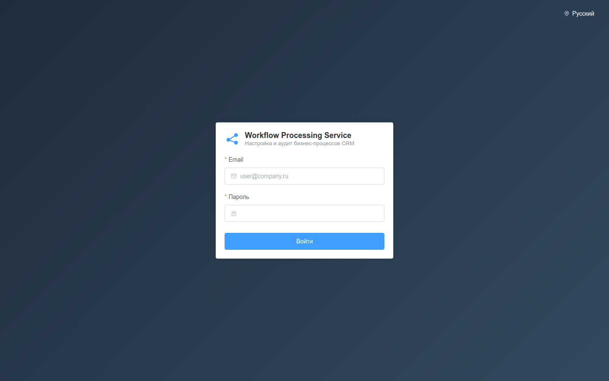
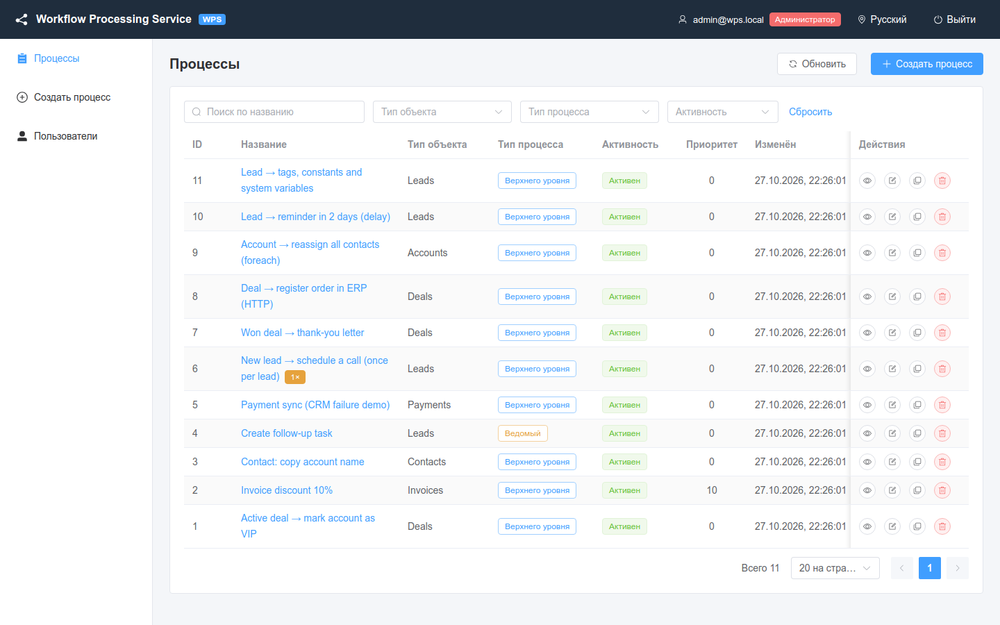
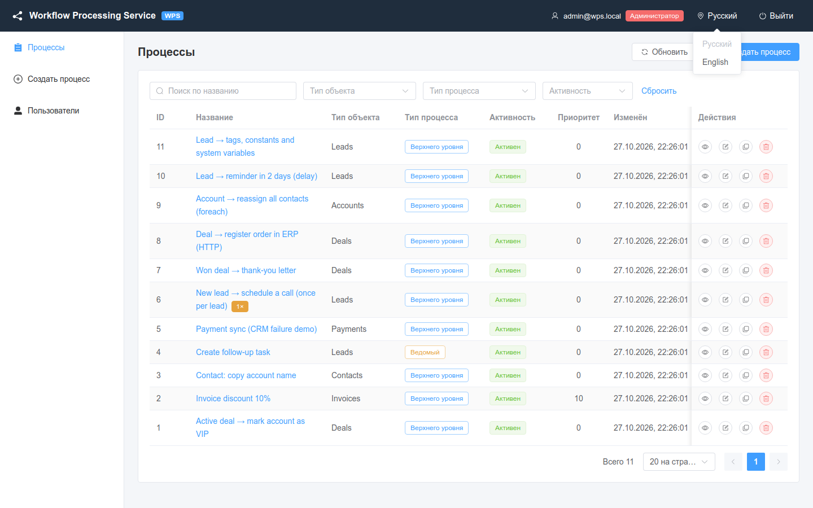
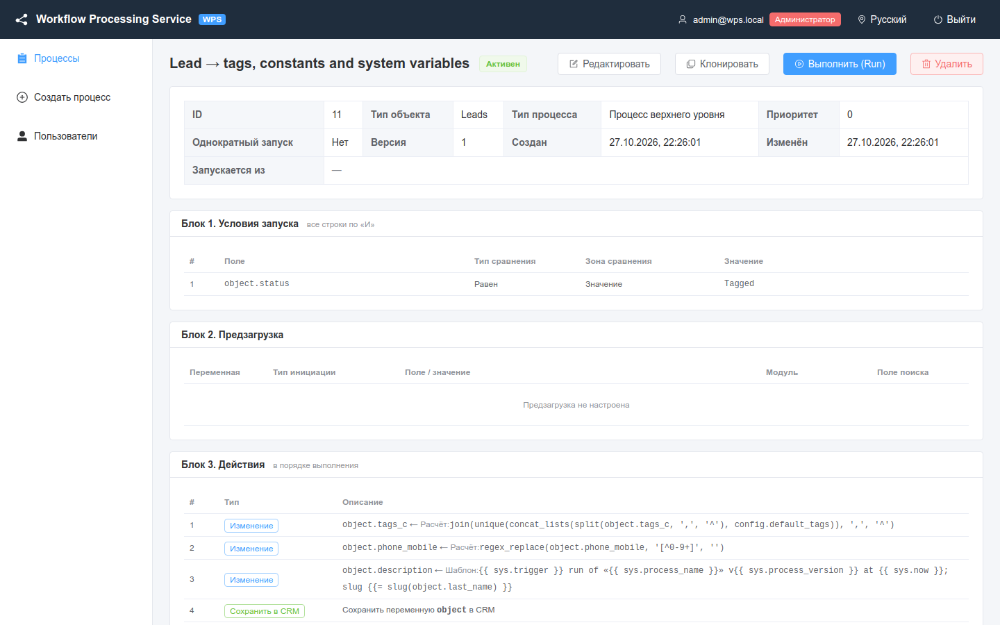

# Вход и интерфейс

Как войти в веб-интерфейс WPS, ориентироваться в нём и переключать язык интерфейса.

<!-- lang-switch -->
[🇬🇧 English](../../en/03-user-guide/login-and-ui.md) | 🇷🇺 Русский
<!-- /lang-switch -->

## Вход

1. Откройте интерфейс в браузере. При стандартном запуске через `docker compose` адрес — `http://localhost:3000`; порт задаёт `WPS_UI_PORT` в `./.env` (в `.env` этого репозитория указан `3080`).
2. Введите **Email** и **Пароль**. Сразу после установки есть один администратор: `admin@wps.local` / `admin`.
3. Нажмите **Войти**.

*Страница входа. Переключатель языка — в правом верхнем углу.*

> **Внимание**
> Смените пароль `admin@wps.local` после первого входа (**Пользователи** → редактирование пользователя). См. [Пользователи и роли](users-and-roles.md).

Сообщения формы входа:

| Сообщение | Причина |
|---|---|
| Введите email / Некорректный email | Поле email пустое или содержит не адрес |
| Введите пароль | Поле пароля пустое |
| Неверный email или пароль | Сервер ответил `401 INVALID_CREDENTIALS` |
| Сервер недоступен. Проверьте подключение. | Бэкенд (`/api`) недоступен |

После входа открывается список процессов. Если до входа вы открыли ссылку на конкретную страницу, после входа откроется она.

### Сессия

- Интерфейс хранит в браузере access- и refresh-токены (`localStorage`, ключи `wps_access_token` и `wps_refresh_token`).
- Access-токен по умолчанию живёт 15 минут (`JWT_ACCESS_TTL`), refresh-токен — 7 дней (`JWT_REFRESH_TTL`). Когда access-токен истекает, интерфейс незаметно обновляет его.
- Если истёк и refresh-токен, появится сообщение **Сессия истекла, войдите снова**, и откроется страница входа.
- Кнопка **Выйти** (справа вверху) спрашивает подтверждение (**Выйти из системы?**) и удаляет токены из браузера.

## Устройство окна

*Главное окно: шапка, левое меню и рабочая область (здесь — список процессов).*

| Область | Что в ней |
|---|---|
| Шапка | Логотип **Workflow Processing Service** (ссылка на список процессов), ваш email, роль (**Администратор**, **Редактор**, **Наблюдатель**), переключатель языка, **Выйти** |
| Левое меню | **Процессы**, **Создать процесс**, **Пользователи** — в зависимости от роли, см. ниже |
| Рабочая область | Текущая страница: список процессов, карточка процесса, редактор, страница выполнения, пользователи |

### Пункты меню по ролям

| Пункт меню | `admin` | `editor` | `viewer` |
|---|---|---|---|
| **Процессы** | ✓ | ✓ | ✓ |
| **Создать процесс** | ✓ | ✓ | — |
| **Пользователи** | ✓ | — | — |

Те же правила защищают сами страницы: если наблюдатель откроет `/processes/create`, а редактор — `/users` напрямую, интерфейс вернёт его к списку процессов. Кнопки тоже зависят от роли: **Редактировать**, **Клонировать** и **Выполнить (Run)** видны редакторам и администраторам, **Удалить** — только администраторам. Полная матрица прав — в разделе [Пользователи и роли](users-and-roles.md).

### Страницы

| Адрес | Страница | Кому доступна |
|---|---|---|
| `/login` | Вход | всем |
| `/processes` | Список процессов | всем ролям |
| `/processes/create` | Новый процесс | admin, editor |
| `/processes/{id}` | Карточка процесса, журнал выполнения, однократные запуски | всем ролям |
| `/processes/{id}/edit` | Редактирование процесса | admin, editor |
| `/executions/{id}` | Страница выполнения (шаги, контекст) | всем ролям |
| `/users` | Пользователи | admin |

Заголовок вкладки браузера меняется вместе со страницей, например `Процессы — WPS`.

## Язык интерфейса

Интерфейс доступен на русском и английском. Названия процессов, модулей CRM и другие данные показываются так, как они сохранены, и не переводятся.

*Меню языка в шапке: **Русский** / **English**.*

Чтобы сменить язык:

1. Нажмите на текущий язык в шапке (или в правом верхнем углу страницы входа).
2. Выберите **Русский** или **English**. Страница переключится сразу, без перезагрузки; несохранённые данные формы не теряются.

Как выбирается язык при открытии интерфейса (по приоритету):

1. Параметр адреса `lang`: `?lang=ru` или `?lang=en`. Удобно для ссылок и закладок, например `http://localhost:3000/processes?lang=en`.
2. Язык, выбранный в прошлый раз (хранится в браузере, `localStorage['wps_locale']`).
3. Язык браузера.
4. Русский (по умолчанию).

Выбранный язык запоминается в этом браузере и передаётся бэкенду в заголовке `Accept-Language`.

> **Примечание**
> Названия модулей в списках приходят из CRM. Встроенный мок отдаёт русские названия модулей (например, `Сделки` для `Deals`) при любом языке интерфейса.

## Что есть в интерфейсе, а что только в API

| Задача | Интерфейс | API |
|---|---|---|
| Список, карточка, создание, редактирование, клонирование, удаление процессов | ✓ | `/api/processes` |
| Журнал выполнений процесса, страница выполнения, контекст | ✓ | `/api/processes/{id}/executions`, `/api/executions/{id}` |
| Выполнения **всех** процессов, поиск ожидающих | — | `GET /api/executions?status=waiting` |
| Журнал побочных эффектов (что отправлено) | — | `GET /api/executions/{id}/side-effects` |
| Ручной запуск, сброс однократного запуска | ✓ | `/api/processes/{id}/run`, `/api/processes/{id}/runs` |
| Пользователи | ✓ (admin) | `/api/users` |
| Секреты внешних систем | — | `/api/secrets`, см. [Секреты](secrets.md) |
| Проверка почты и каналов уведомлений | — | `POST /api/mail/test`, `POST /api/notify/test` |
| Состояние сервиса и метрики | — | `/api/health`, `/metrics`, см. [Мониторинг](../04-operations/monitoring.md) |
| Справочники (операторы, функции, `sys.*`, единицы дат…) | частично — в выпадающих списках | `/api/dictionaries/*` |

## Редактор и действия, заданные через API

Редактор процесса умеет строить четыре вида строк: **условия** (блок 1), **предзагрузку**, **изменения** с
**сохранением в CRM** и **запуск следующего процесса** (блок 2). Остальные действия — письма, HTTP-запросы,
уведомления, назначение, поиск записей, циклы, ветвления, паузы, `set_variable`, `stop_process` — задаются
JSON-определением через API (см. [Обзор](../01-overview/index.md#что-настраивается-в-редакторе-а-что-через-api)).

Как такие действия выглядят в интерфейсе:

- **Карточка процесса**, **Блок 3. Действия**: строка с тегом типа (`send_email`, `foreach`, `http_request` …) и
  JSON-описанием шага в колонке **Описание** — без перевода и форматирования. Вложенные шаги блоков (`branches`,
  тело цикла) видны внутри этого JSON.
- **Редактор**, раздел **Изменить объект / переменную**: серая строка с тегом типа и JSON-сводкой, значок ⓘ —
  **Это действие не редактируется в табличном редакторе и будет сохранено без изменений**. Строку можно переместить
  стрелками или удалить, но не изменить.
- Условия в расширенной форме (группы, «ИЛИ») показываются JSON-блоком с предупреждением; кнопка
  **Заменить на табличные условия (И)** превращает их в обычные строки (простую группу «И») или очищает.
- `trigger_on` и константы `config.*` на карточке не показываются — смотрите их в ответе `GET /api/processes/{id}`.

*Карточка процесса, собранного через API: расчёты, шаблон с `sys.*` и константа `config.*`.*

> **Примечание**
> Процесс, собранный через API, можно сохранять из редактора: константы, поля строк, которых нет в форме (`cast`,
> `on_error`, `retry` …), и порядок действий сохраняются. То, что форма не умеет показать (условия со списками и
> выражениями, сложные типы изменений, нередактируемые действия), выводится только для чтения и сохраняется без
> изменений. См. [Частые вопросы](../08-faq.md#можно-ли-открыть-в-редакторе-процесс-созданный-через-api).

В английском интерфейсе подписи операторов и типов изменений, кроме базовых (**Equals**, **Contains**, **Set to value**,
**Calculate** …), приходят с сервера по-русски (например, **Больше**, **Шаблон**): сервер отдаёт справочники на
русском, а интерфейс переводит только базовые значения.

## Если не получается войти

| Симптом | Что делать |
|---|---|
| **Сервер недоступен. Проверьте подключение.** | Backend не отвечает: `curl http://localhost:9501/api/health`, `docker compose ps backend` |
| **Неверный email или пароль** | Проверьте раскладку и регистр email; пароль администратора по умолчанию мог быть изменён — его может сменить другой администратор на странице **Пользователи** |
| Страница входа снова и снова после входа | Браузер не сохраняет `localStorage` (приватный режим с запретом хранилища) или разные адреса интерфейса (`localhost` и `127.0.0.1` — разные хранилища) |
| **Сессия истекла, войдите снова** посреди работы | Истёк refresh-токен (`JWT_REFRESH_TTL`, 7 дней) или сменился `JWT_SECRET` на сервере. Несохранённые изменения формы теряются — сохраняйте чаще |
| **Недостаточно прав для выполнения операции** | У вашей роли нет этой операции; если роль недавно повысили — выйдите и войдите снова |
| Пустая белая страница | Откройте консоль браузера (F12): обычно это старая версия фронтенда в кэше — обновите страницу с `Ctrl+F5` |

## Что дальше

- [Процессы](processes.md) — список, карточка и редактор.
- [Условия запуска](triggers-and-conditions.md) — когда процесс запускается.

<!-- footer-nav -->
---

← Назад: [Первый процесс](../02-getting-started/first-process.md) | [Оглавление](../README.md) | [Процессы](processes.md) Далее →
<!-- /footer-nav -->
