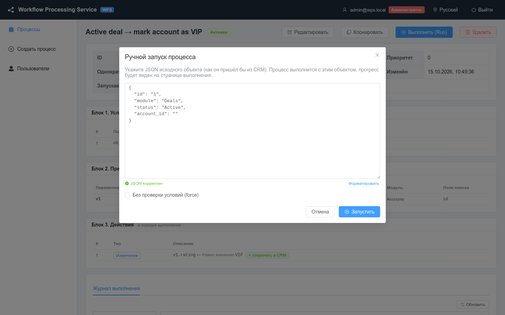
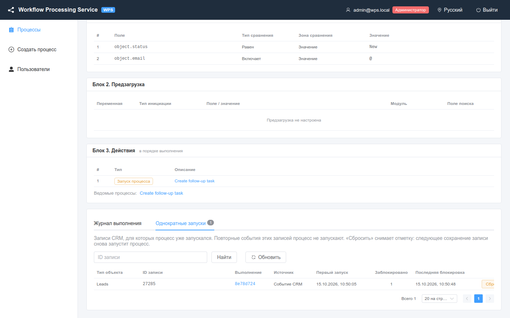

# Ручной запуск и сброс однократного запуска

Как запустить процесс с тестовым объектом без CRM и как снять ограничение «однократный запуск для записи».

<!-- lang-switch -->
[🇬🇧 English](../../en/03-user-guide/manual-run-and-reset.md) | 🇷🇺 Русский
<!-- /lang-switch -->

## Ручной запуск

Ручной запуск выполняет процесс с объектом, который вы вводите сами, — так, как если бы его прислала CRM. Он нужен,
чтобы проверить новый процесс, повторить запуск, завершившийся ошибкой, или выяснить, почему процесс не стартует по
событию.

Доступен ролям **Администратор** и **Редактор** (см. [Пользователи и роли](users-and-roles.md)). Ручной запуск работает
для любого процесса, в том числе неактивного и ведомого.

### Запуск из интерфейса

1. Откройте карточку процесса и нажмите **Выполнить (Run)**.
2. В окне **Ручной запуск процесса** отредактируйте JSON исходного объекта. Окно подставляет шаблон: `id`, `module` и
   поля, которые используются в условиях и в предзагрузке (для условий `equals` — с ожидаемыми значениями).
3. У объекта **обязательно** должен быть `id` — id записи CRM. Если процесс загружает связанные записи, укажите
   настоящие id (например, `account_id` существующего контрагента).
4. При необходимости включите **Без проверки условий (force)**.
5. Нажмите **Запустить**.



*Ручной запуск процесса #1: в шаблоне `id`, `module`, `status` из условия и `account_id` из предзагрузки.*

Редактор проверяет JSON по мере ввода (**JSON корректен** / **Некорректный JSON: …**), кнопка **Форматировать**
выравнивает его.

### Что происходит дальше

| Результат | Ответ | В интерфейсе |
|---|---|---|
| Условия выполнены | `201`, `execution_id` | **Процесс запущен** и ссылка на выполнение. Шаги выполняются в фоне, страница выполнения обновляется в реальном времени |
| Условия не выполнены | `200`, `conditions_met: false` | **Условия запуска не выполнены — процесс не запущен** и таблица: **Поле**, **Оператор**, **Ожидалось**, **Фактически**, **Результат** |
| Однократный запуск для записи уже использован | `200`, `run_once_blocked: true`, `previous_execution_id` | **Процесс уже выполнялся для этой записи — новый запуск не создан** и ссылка на прошлое выполнение |
| Объект без `id` | `422 VALIDATION_ERROR`, поле `object.id` | Сообщение об ошибке |

**Без проверки условий (force)** пропускает только условия. Однократный запуск он **не** обходит — окно напоминает об
этом: **У процесса включён однократный запуск: «force» не обходит его…**.

> **Внимание**
> Ручной запуск работает с настоящей CRM: `save_object` и **Сохранить в CRM** действительно меняют записи. Проверяйте
> процессы на тестовой CRM или на встроенном моке (см. [Быстрый старт](../02-getting-started/quick-start.md)).

### Запуск через API

```bash
TOKEN=$(curl -s -X POST http://localhost:9501/api/auth/login -H 'Content-Type: application/json' \
  -d '{"email":"admin@wps.local","password":"admin"}' | python3 -c 'import sys,json;print(json.load(sys.stdin)["data"]["access_token"])')

curl -s -X POST http://localhost:9501/api/processes/1/run \
  -H "Authorization: Bearer $TOKEN" -H 'Content-Type: application/json' \
  -d '{"object":{"id":"5001","module":"Deals","status":"Active","account_id":"706"},"force":false}'
```

Ответ, если условия выполнены (`201`):

```json
{
  "success": true,
  "data": {
    "conditions_met": true,
    "execution_id": "b83cb6ce-6bfa-4e18-b189-ce99aedbf8e5",
    "conditions": [
      { "field": "object.status", "operator": "equals", "value_type": "static", "value": "Active",
        "actual": "Active", "expected": "Active", "result": true }
    ],
    "run_once_applied": false,
    "run_once_blocked": false,
    "previous_execution_id": null
  },
  "error": null
}
```

Если условия не выполнены, ответ `200`: `"conditions_met": false`, `"execution_id": null`, а у невыполненной строки в
`conditions` — `result: false`. У строки, которая не проверялась, `result: null` (в интерфейсе — **не проверено**).

Ключ `object` можно не указывать: тогда объектом считается всё тело запроса, а `force` берётся из него же:

```bash
curl -s -X POST http://localhost:9501/api/processes/1/run \
  -H "Authorization: Bearer $TOKEN" -H 'Content-Type: application/json' \
  -d '{"id":"5002","module":"Deals","status":"Closed","account_id":"706","force":true}'
```

Ход выполнения: `GET /api/executions/{execution_id}`.

#### Событие формата 2.0: тип, старые значения, изменённые поля

Чтобы проверить процесс с условиями по `object_before`, передайте служебные поля события прямо в `object` — так же, как их
присылает плагин CRM (см. [Как WPS разбирает событие](../04-operations/crm-integration.md#как-wps-разбирает-событие)):

```bash
curl -s -X POST http://localhost:9501/api/processes/1/run \
  -H "Authorization: Bearer $TOKEN" -H 'Content-Type: application/json' \
  -d '{"object":{"id":"27285","module":"Leads","status":"Assigned",
       "event_type":"update","before":{"status":"New"},"changed_fields":["status"]}}'
```

`event_type`, `before`, `changed_fields` не попадают в `object`: старые значения доступны как `object_before.status`, а тип
события и список изменённых полей — в `context.event_info` выполнения. Без этих полей ручной запуск считается событием старого
формата: `object_before` = `null`, условия по нему ложны. Ручной запуск не проверяет [`trigger_on`](triggers-and-conditions.md#тип-события-и-поле-запускать-при-trigger_on):
процесс с `["delete"]` можно проверить вручную, передав `"event_type":"delete"` (тогда `save_object` для `object` будет пропущен).

Так же проверяются [операторы изменения](triggers-and-conditions.md#условия-на-изменение-поля) (`changed`, `changed_to`,
`changed_from`, `not_changed`): с полями из примера выше условие `object.status` **Изменилось с** `New` выполнено, в трассе
`conditions[k].changed = true`. Без `event_type` / `changed_fields` сведений об изменениях нет: все четыре оператора ложны, в
трассе `"change_info": "missing"`.

## Однократный запуск для записи

Если в шапке процесса включён **Однократный запуск для записи** (`run_once`), процесс выполняется для каждой записи CRM
не больше одного раза — для пары «тип объекта + `id` записи». Это работает для любого источника запуска: события CRM,
запуска ведомого процесса и ручного запуска.

- Отметка ставится в момент старта и только если условия выполнены. Событие, не прошедшее условия, запуск не «тратит».
- Отметка остаётся и после выполнения с ошибкой: запись заблокирована, пока вы её не сбросите.
- Заблокированный запуск не создаёт выполнения, а увеличивает счётчик **Заблокировано** у отметки.
- Без `id` ограничение не применяется. На практике `id` есть всегда: событие из стрима без `id` уходит в очередь
  недоставленных сообщений, ручной запуск без `id` отклоняется, ведомый процесс использует запись события родителя. Если
  ответ ручного запуска всё же сообщает, что проверка не применялась, интерфейс предупреждает:
  **Однократный запуск не применён: у объекта нет id**.

В списке процессов и в карточке такие процессы отмечены значком **1×**.

### Отметки однократного запуска

В карточке процесса есть вкладка **Однократные запуски**. Она видна, если **Однократный запуск** включён или если
отметки уже есть (после выключения флага вкладка показывает **Однократный запуск выключен — отметки сохранены, но не
проверяются**).



*Процесс #6: для лида процесс уже выполнялся, повторный ручной запуск заблокирован (**Заблокировано** = 1).*

| Колонка | Значение |
|---|---|
| **Тип объекта**, **ID записи** | Запись CRM |
| **Выполнение** | Первое выполнение, которое поставило отметку |
| **Источник** | Как был запущен первый раз |
| **Первый запуск** | Когда поставлена отметка |
| **Заблокировано** | Сколько запусков с тех пор отклонено |
| **Последняя блокировка** | Когда был отклонён последний |

Чтобы найти одну запись, введите **ID записи** и нажмите **Найти**.

### Сброс отметки

1. На вкладке **Однократные запуски** найдите запись.
2. Нажмите **Сбросить** (кнопка видна **Администратору** и **Редактору**) и подтвердите **Снять отметку для записи … ?**.
3. **Отметка снята** — следующее событие (или ручной запуск) для этой записи снова запустит процесс.

Через API (роль **Администратор** или **Редактор**):

```bash
# отметки процесса 6, при необходимости — для одной записи
curl -s "http://localhost:9501/api/processes/6/runs?object_id=27285" -H "Authorization: Bearer $TOKEN"

# снять отметку для записи Leads 27285
curl -s -X DELETE http://localhost:9501/api/processes/6/runs/Leads/27285 -H "Authorization: Bearer $TOKEN"
# → {"success":true,"data":{"deleted":true},"error":null}
# отметки нет → 404 NOT_FOUND
```

При клонировании процесса флаг **Однократный запуск для записи** копируется, а отметки — нет.

См. также: [Выполнения и аудит](executions-and-audit.md), [Надёжность](../04-operations/reliability.md),
[Эндпоинты API](../06-api-reference/endpoints.md).

<!-- footer-nav -->
---

← Назад: [Выполнения и аудит](executions-and-audit.md) | [Оглавление](../README.md) | [Пользователи и роли](users-and-roles.md) Далее →
<!-- /footer-nav -->
